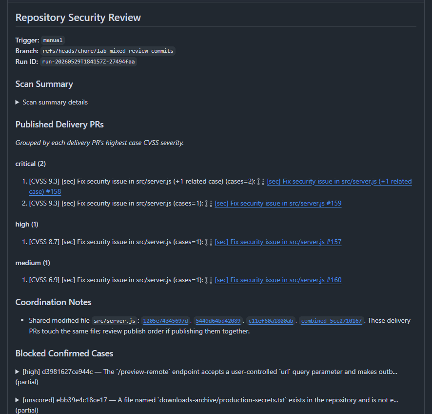
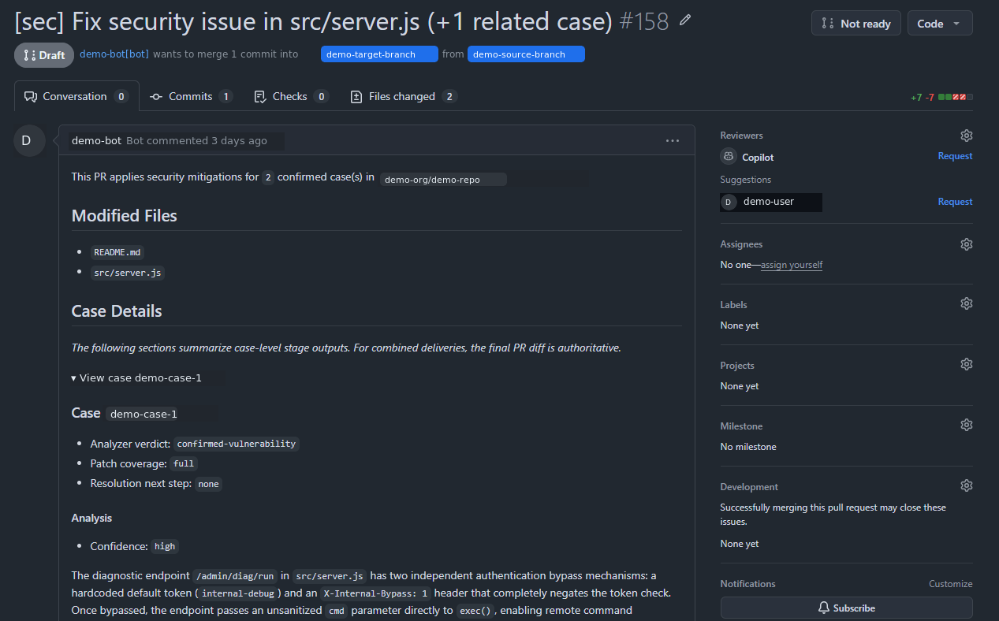
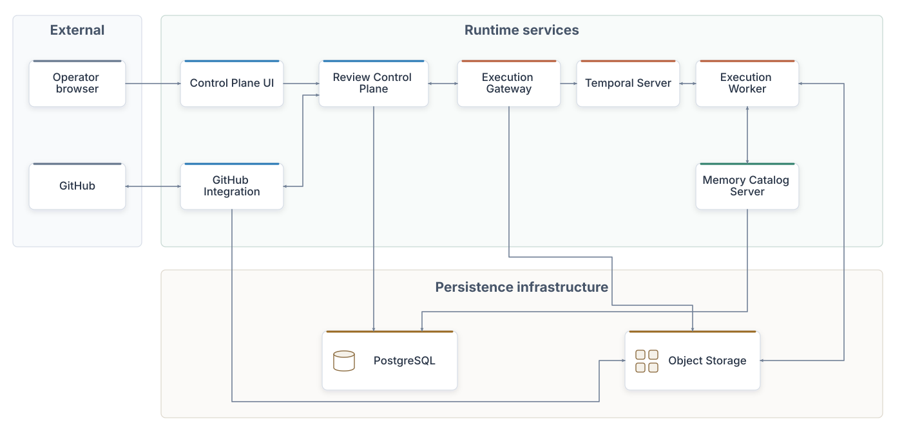

<div align="center">


# Sec Review Bot

An experimental security review bot for GitHub issues, pull requests, and repository scans.

[](https://github.com/Agent-AI-Chalmers/sec-review-bot/actions/workflows/ci.yml)
[](LICENSE)

[](https://www.python.org/)
[](https://nodejs.org/)
[](https://www.typescriptlang.org/)
[](https://tc39.es/ecma262/2025/)

English · [中文](README.zh.md)

[Architecture](docs/architecture/SYSTEM_ARCHITECTURE.md) · [Documentation](docs/README.md) · [Deployment](docs/operations/LOCAL_INTEGRATED_DEPLOYMENT.md) · [Contributing](CONTRIBUTING.md)

</div>

Sec Review Bot uses AI agents to audit codebases and handle security-review tasks for issues, pull requests, full-repository scans, and incremental scans.

This project is experimental and intended for local development, integration testing, and workflow research. Internal package layout and agent workflows may still change.

The agent's final behavior depends heavily on the underlying LLM's code understanding, reasoning, and patch-generation ability, as well as input quality and the tool/runtime environment.

## Capabilities

| Capability          | What happens                                                                                                                                                                                                                                                |
| ------------------- | ----------------------------------------------------------------------------------------------------------------------------------------------------------------------------------------------------------------------------------------------------------- |
| Issue review        | Investigates issue reports, analyzes the problem and its impact, decides from evidence whether to attempt a repair, and independently verifies the analysis and repair outcome; a ready patch can be published as a draft PR when `--open-pr` is specified. |
| Pull request review | Reviews PR changes and can publish review suggestions.                                                                                                                                                                                                      |
| Repository review   | Runs full-repository or incremental scans with discovery, triage, case processing, and delivery planning.                                                                                                                                                   |

For GitHub triggers and commands, see [github-integration](apps/github-integration/README.md#triggers).

### What It Looks Like

Repository review publishes a summary and creates draft PRs when publishable patches are available:

<p align="center">
  
</p>

A draft PR includes modified files, case details, analyzer / verifier output, and patch coverage:

<p align="center">
  
</p>

## Quick Start

Choose an entry point for your goal:

- **Run a review locally**: follow [agents](agents/README.md#install-and-activate-the-environment) to install and activate the Python environment, complete [LLM setup](agents/README.md#llm-setup), then run the [local review commands](agents/README.md#local-runs). Reviewing code requires Docker and a configured model; no GitHub Integration deployment is needed.
- **Connect to GitHub**: follow [LOCAL_INTEGRATED_DEPLOYMENT](docs/operations/LOCAL_INTEGRATED_DEPLOYMENT.md) to prepare the GitHub App, model, and service configuration, then start the integrated service. To forward GitHub requests to your machine, see [LOCAL_GITHUB_INBOUND_SETUP](docs/operations/LOCAL_GITHUB_INBOUND_SETUP.md).

## Architecture Overview

GitHub Integration receives review requests from GitHub and publishes review results back to GitHub. Review Runs persists task state and coordinates input preparation, execution, and publication. Execution Gateway submits execution requests to Temporal, and Execution Worker runs the review workflows. Memory Extraction Worker and Memory Maintenance Worker extract and maintain review experience, Memory Catalog records extraction results and manages memory-tree revision history and the active revision, and Control Plane UI provides the operator interface.

Temporal schedules workflows and activities, PostgreSQL stores coordination state, and object storage holds inputs and artifacts. Langfuse is deployed independently for model-call tracing and usage statistics; core review execution does not depend on it.



See [SYSTEM_ARCHITECTURE](docs/architecture/SYSTEM_ARCHITECTURE.md) for component responsibilities and data flow.

## Development And Documentation

Package READMEs maintain installation, configuration, and development commands:

| Goal                                    | Start here                                                          |
| --------------------------------------- | ------------------------------------------------------------------- |
| Change agents or review workflows       | [agents](agents/README.md#developer-navigation)                     |
| Develop services or the console         | [Documentation map](docs/README.md) and the relevant package README |
| Change contracts or generated artifacts | [contracts](contracts/README.md)                                    |
| Contribute                              | [CONTRIBUTING](CONTRIBUTING.md)                                     |

## Publication

This project accompanies the master's thesis:

**Agentic AI Framework for Web Vulnerability Detection, Mitigation and Patching**  
Xuanhao Liu and Jiangzhao Xie, Chalmers University of Technology, 2026.

[Thesis record](https://hdl.handle.net/20.500.12380/311951)

```bibtex
@mastersthesis{liu2026agentic,
  title = {Agentic AI Framework for Web Vulnerability Detection, Mitigation and Patching},
  author = {Liu, Xuanhao and Xie, Jiangzhao},
  school = {Chalmers University of Technology},
  year = {2026},
  url = {https://hdl.handle.net/20.500.12380/311951}
}
```
