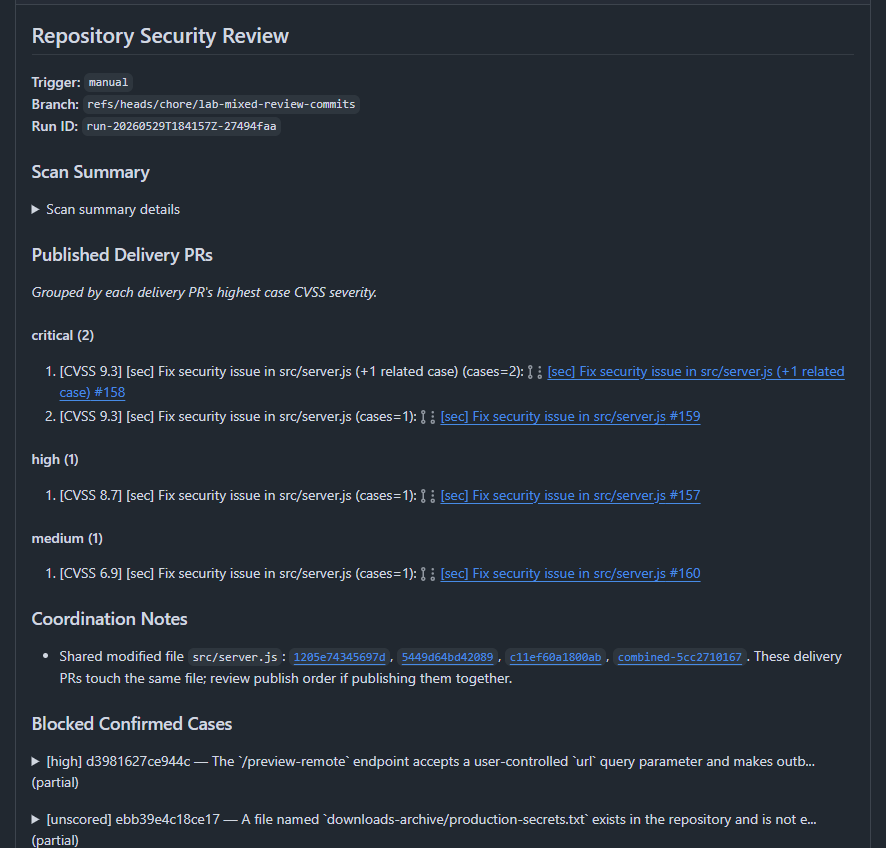
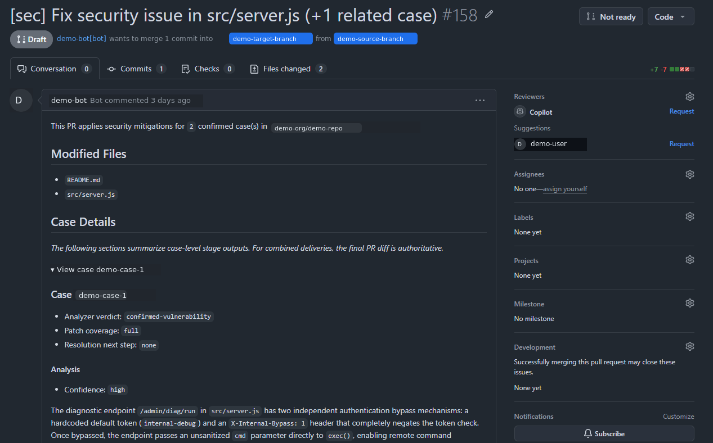
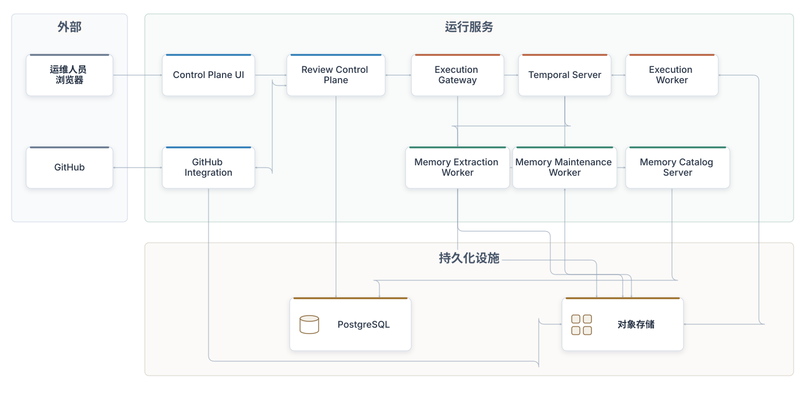

<div align="center">


# Sec Review Bot

一个面向 GitHub issues、pull requests 和仓库级扫描的实验性安全审查 bot。

[](https://github.com/Agent-AI-Chalmers/sec-review-bot/actions/workflows/ci.yml)
[](LICENSE)

[](https://www.python.org/)
[](https://nodejs.org/)
[](https://www.typescriptlang.org/)
[](https://tc39.es/ecma262/2025/)

[English](README.md) · 中文

[架构](docs/architecture/SYSTEM_ARCHITECTURE.zh.md) · [文档](docs/README.zh.md) · [部署](docs/operations/LOCAL_INTEGRATED_DEPLOYMENT.zh.md) · [贡献指南](CONTRIBUTING.zh.md)

</div>

Sec Review Bot 支持使用 AI Agent 执行代码库安全审计，覆盖 issue、pull request、全仓扫描和增量扫描等安全审查任务。

本项目仍处于实验阶段，主要用于本地开发、集成测试和 workflow 研究。内部 package layout 和 agent workflow 仍可能调整。

Agent 的最终表现很大程度取决于底层 LLM 的代码理解、推理和补丁生成能力，也取决于输入质量和工具 / 运行时环境。

## 能力

| 能力                | 行为                                                                                                                                              |
| ------------------- | ------------------------------------------------------------------------------------------------------------------------------------------------- |
| Issue review        | 核查 Issue 报告、分析问题及其影响，再根据证据决定是否尝试修复，并独立验证分析结论和修复结果；有可交付补丁且指定 `--open-pr` 时，可创建 draft PR。 |
| Pull request review | 审查 PR 变更，并可发布 review suggestions。                                                                                                       |
| Repository review   | 对仓库执行全仓或增量扫描，并进行问题发现、筛选、逐项处理和交付规划。                                                                              |

GitHub 触发条件和命令见 [github-integration](apps/github-integration/README.zh.md#触发)。

### 运行结果示例

仓库审查会发布摘要，并在有符合发布条件的补丁时创建 draft PR：

<p align="center">
  
</p>

Draft PR 会包含修改文件、case 详情、analyzer / verifier 输出和补丁覆盖情况：

<p align="center">
  
</p>

## 快速开始

按你的目标选择入口：

- **在本地运行一次审查**：按 [agents](agents/README.zh.md#安装激活环境) 安装并激活 Python 环境，完成 [LLM 配置](agents/README.zh.md#llm-配置)，再运行[本地审查命令](agents/README.zh.md#本地运行)。审查代码需要 Docker 和可用的模型配置，无需部署 GitHub 集成。
- **接入 GitHub**：按 [LOCAL_INTEGRATED_DEPLOYMENT](docs/operations/LOCAL_INTEGRATED_DEPLOYMENT.zh.md) 准备 GitHub App、模型和服务配置，再启动集成服务。需要将 GitHub 请求转发到本机时，参阅 [LOCAL_GITHUB_INBOUND_SETUP](docs/operations/LOCAL_GITHUB_INBOUND_SETUP.zh.md)。

## 架构概览

GitHub Integration 接收来自 GitHub 的审查请求，并将审查结果发布回 GitHub；Review Runs 保存任务状态并协调输入准备、执行和发布；Execution Gateway 将执行请求提交给 Temporal，由 Execution Worker 运行审查工作流。Memory Extraction Worker 和 Memory Maintenance Worker 负责提取与维护审查经验，Memory Catalog 记录经验提取结果，管理记忆树的修订历史和当前生效版本，Control Plane UI 提供运维界面。

Temporal 调度 workflow/activity，PostgreSQL 保存协调状态，对象存储保存输入和产物。Langfuse 独立部署，用于模型调用追踪和用量统计，核心审查执行不依赖它。



组件职责与数据流见 [SYSTEM_ARCHITECTURE](docs/architecture/SYSTEM_ARCHITECTURE.zh.md)。

## 开发与文档

安装、配置和开发命令由各包的 README 维护：

| 目标                    | 入口                                           |
| ----------------------- | ---------------------------------------------- |
| 修改 Agent 或审查工作流 | [agents](agents/README.zh.md#开发者导航)       |
| 开发服务或控制台        | [文档地图](docs/README.zh.md)及对应包的 README |
| 修改契约或生成产物      | [contracts](contracts/README.zh.md)            |
| 提交贡献                | [CONTRIBUTING](CONTRIBUTING.zh.md)             |

## 论文

本项目是以下硕士论文的配套代码仓库：

**Agentic AI Framework for Web Vulnerability Detection, Mitigation and Patching**  
Liu Xuanhao 和 Xie Jiangzhao，Chalmers University of Technology，2026。

[论文记录](https://hdl.handle.net/20.500.12380/311951)

```bibtex
@mastersthesis{liu2026agentic,
  title = {Agentic AI Framework for Web Vulnerability Detection, Mitigation and Patching},
  author = {Liu, Xuanhao and Xie, Jiangzhao},
  school = {Chalmers University of Technology},
  year = {2026},
  url = {https://hdl.handle.net/20.500.12380/311951}
}
```
