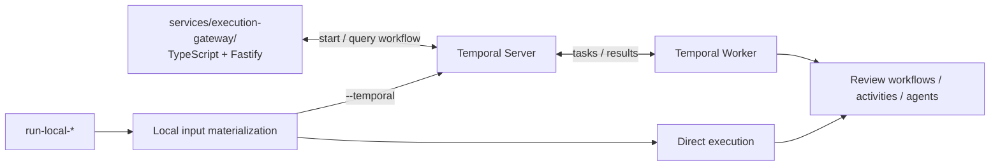

# `sec-review-agents`

Language: English | [中文](README.zh.md)

`agents/` contains security-review agents, review workflows, and code for extracting and maintaining review experience. It supports local runs and task execution through Temporal.

## Capabilities

- **Execution Worker** runs `issue-review`, `pull-request-review`, and `repository-review`. Repository reviews include discovery, triage, per-case analysis, CVSS scoring, mitigation, verification, and delivery. Cases without a delivery remain visible in case results.
- **Memory Extraction Worker** extracts reusable review experience from execution trajectories.
- **Memory Maintenance Worker** reviews extracted experience and updates shared memory.

## Install And Activate The Environment

From `agents/`:

```bash
uv sync --group dev
source .venv/bin/activate
```

This directory carries its own `.python-version`; `pyproject.toml` requires Python 3.14 or newer.

> *Python 3.14 is the default development, CI, package, and container runtime baseline for this package.*

## LLM Setup

Copy the configuration files from the repository root, then edit the TOML model endpoints, credential references, and agent bindings. The sample lists the available fields and binding names; every agent used by the task needs an available model binding.

```bash
cp agents/.env.sample agents/.env
cp agents/config/model-providers.sample.toml agents/config/model-providers.toml
```

Local review commands read `agents/.env` and `agents/config/model-providers.toml` by default. Set `MODEL_PROVIDERS_CONFIG_TOML` to use a model configuration file at another location.

The local `run-local-*` CLIs and `sec-review-agents-check-llm-deployments` load `agents/.env`, but never overwrite environment variables already set in the process.

Local commands load `agents/.env`; Worker startup commands do not. Set environment variables through the shell, a process manager, or CI when starting Workers.

`[agent_deployment_bindings]` explicitly binds agents to deployments. Every agent that can run must be declared; undeclared agents fail fast and do not inherit a default model.

Each `[[deployments]]` entry must explicitly declare `max_input_tokens`. The Execution Worker does not infer context-window size from LangChain model profiles or provider names; this deployment contract is the source of truth for context-limit behavior.

## Local Runs

Local runs are for development and debugging. They are not the production integration path.

The supported local execution paths are:

- Direct local run: the default and fastest path for ordinary development.
- Local `--temporal` run: for exercising workflow / activity orchestration.
- Manually started service and worker: for testing the HTTP service, Temporal, and Worker together without starting the full Compose stack.

| Execution path | Diagnostic publication | Memory processing |
| --- | --- | --- |
| Direct `run-local-*`, standard workflow | Local diagnostic bundle | Disabled |
| Local `--temporal`, standard workflow | Local diagnostic bundle | Controlled by `AGENT_MEMORY_PROCESSING_ENABLED` |
| Manually started service and workers | Diagnostic bundle in S3-compatible storage | Controlled by `AGENT_MEMORY_PROCESSING_ENABLED` in the Execution Worker environment |

### `run-local-*` Commands

After installing dependencies, these commands are available:

- `sec-review-agents-run-local-issue`: local issue run entrypoint. See [Ablation Experiments](#ablation-experiments) for alternative strategies.
- `sec-review-agents-run-local-pr`: local PR run entrypoint.
- `sec-review-agents-run-local-repository`: local repository scan run entrypoint. Use `--scan-mode full|incremental` to choose full or incremental scan, and repeat `--paths-ignore PATTERN` to ignore paths or globs.

Local commands require `--output-dir` to select the parent directory for a new `local-run-*` directory.

Examples:

```bash
cd /path/to/sec-review-bot

# 1) issue
# Choose the review objective; test_changes defaults to allow.
sec-review-agents-run-local-issue \
  --repo /abs/path/to/repo \
  --issue-md /abs/path/to/issue.md \
  --target-branch main \
  --output-dir /abs/path/to/local-runs \
  --review-objective repair

# 2) pr
# Pull-request objective is fixed to audit; --test-changes is optional.
sec-review-agents-run-local-pr \
  --output-dir /abs/path/to/local-runs \
  --repo /abs/path/to/repo \
  --pr-md /abs/path/to/pr.md \
  --base-sha <base-commit-sha> \
  --head-sha <head-commit-sha> \
  --test-changes deny

# 3) full repo scan
# Repository objective is fixed to audit; test_changes defaults to allow.
sec-review-agents-run-local-repository \
  --output-dir /abs/path/to/local-runs \
  --repo /abs/path/to/repo \
  --target-branch main \
  --paths-ignore docs \
  --paths-ignore '**/*.generated.py'

# 4) incremental repo scan
sec-review-agents-run-local-repository \
  --output-dir /abs/path/to/local-runs \
  --repo /abs/path/to/repo \
  --target-branch main \
  --scan-mode incremental \
  --base-sha <base-commit-sha> \
  --head-sha <head-commit-sha> # optional head
```

### Use Temporal with `run-local-*`

Use `--temporal` only when you specifically want to exercise internal Temporal workflow / activity orchestration.

With `--temporal`, the same local command still prepares input on the developer machine, but the workflow stages run through Temporal workflow / activity scheduling. This is useful when debugging workflow orchestration, retries, activity boundaries, or Temporal-visible state.

Start Temporal Server and Execution Worker as described in [Run the Workers Manually](#run-the-workers-manually), then add `--temporal` to a `run-local-*` command.

### Run the Workers Manually

Review execution requires Temporal Server and Execution Worker. When memory processing is enabled, configure the dependencies described in [Memory](#memory) and start the Memory Extraction and Memory Maintenance workers as well.

Prepare `agents/.env` and `agents/config/model-providers.toml` as described in [LLM Setup](#llm-setup). In each worker terminal, load the environment before running the worker command:

```bash
cd agents
set -a
source .env
set +a
```

Start Temporal and the workers in separate terminals:

Terminal 1, Temporal Server:

```bash
temporal server start-dev --ip 127.0.0.1 --port 7233
```

Terminal 2, Execution Worker:

```bash
TEMPORAL_ADDRESS=127.0.0.1:7233 \
TEMPORAL_EXECUTION_TASK_QUEUE=sec-review-execution \
sec-review-execution-worker
```

Terminal 3, Memory Extraction Worker:

```bash
TEMPORAL_ADDRESS=127.0.0.1:7233 \
TEMPORAL_MEMORY_EXTRACTION_MAX_CONCURRENT_ACTIVITIES=4 \
sec-review-memory-extraction-worker
```

Terminal 4, Memory Maintenance Worker:

```bash
TEMPORAL_ADDRESS=127.0.0.1:7233 \
TEMPORAL_MEMORY_MAINTENANCE_MAX_CONCURRENT_ACTIVITIES=1 \
sec-review-memory-maintenance-worker
```

Memory Maintenance Worker must run as a single process with activity concurrency fixed at `1`; do not start multiple instances.

Docker Compose review-runs startup and host worker operation are documented in the [local integrated deployment guide](../docs/operations/LOCAL_INTEGRATED_DEPLOYMENT.md).

## Agent Runtime Configuration

### Skills

Agents can declare the skills they need. The worker prepares and mounts the declared skills when it starts an agent. See [Agent Skills](../docs/agent/SKILLS.md) for details.

### Memory

This package implements the memory extractor, maintainer, and their workers. Review agents read maintained memory through an invocation-scoped filesystem view. See [Agent Memory System](../docs/agent/MEMORY_SYSTEM.md) for the overall design and [local Memory development](../docs/operations/LOCAL_MEMORY_DEVELOPMENT.md) for infrastructure setup and operation.

| Variable | Purpose |
| --- | --- |
| `AGENT_MEMORY_CATALOG_URL` | Memory Catalog base URL. Without it, review agents have no memory view and memory processing cannot run. |
| `AGENT_MEMORY_CATALOG_TOKEN` | Worker bearer token for Memory Catalog extraction and automatic maintenance. Required when `AGENT_MEMORY_CATALOG_URL` is set. |
| `AGENT_MEMORY_CONSUMPTION_ENABLED` | Whether review agents load the active memory tree.  |
| `AGENT_MEMORY_PROCESSING_ENABLED` | Whether extraction and maintenance activities run.  |

### Structured Output

<!-- doc-default: AGENT_MISSING_STRUCTURED_RESPONSE_MAX_RETRIES; source=agents/src/sec_review_agents/runtime/structured_response_middleware.py -->
Agents that require structured output must return `structured_response`. If a model returns only prose, or unparseable tool arguments leave no valid tool call to proceed with, middleware appends a correction message and retries inside the same agent invocation. `AGENT_MISSING_STRUCTURED_RESPONSE_MAX_RETRIES` controls the retry limit, default `2`. This is separate from provider/API request retries; schema validation errors in parsed arguments remain under LangChain structured-output handling.

## Sandbox Runtime

Agent stages that review code run in a sandbox that can execute commands, because without one they cannot run tests, read history, or reproduce a finding. Which sandbox that is, is deployment configuration:

- `AGENT_SANDBOX_BACKEND` unset or set to `docker`: require the Docker sandbox

There is no value that selects the local filesystem backend. It has no shell, so handing it to a stage that reviews code would quietly remove that stage's ability to run anything. Stages that do not need one select it themselves, so this is not a deployment setting.

When using Docker sandbox, set `AGENT_DOCKER_IMAGE` to choose the default workspace container image.

### Workspace Tools

The optional workspace tools image installs [Joern](https://joern.io/), [CodeGraph](https://github.com/colbymchenry/codegraph), [Playwright](https://playwright.dev/), and [Chromium](https://www.chromium.org/) in the Docker sandbox. Build the image and select it for a local run:

```bash
docker build -f agents/docker/workspace-tools.Dockerfile -t sec-review-bot-workspace:tools agents
export AGENT_DOCKER_IMAGE=sec-review-bot-workspace:tools
export AGENT_JOERN_ENABLED=true
export AGENT_PLAYWRIGHT_ENABLED=true
```

Agents use Joern and Playwright through bash and their CLIs when the corresponding deployment switch and agent declaration enable them. The selected image must contain the commands; enabling a switch does not install a tool.

The existing CodeGraph and Playwright MCP integrations remain available but are disabled by default. Enable them explicitly when needed:

```bash
export AGENT_MCP_ENABLED=true
```

See [Agent External Tools](../docs/agent/EXTERNAL_TOOLS.md) for the tool and interface choices.

## Developer Navigation

### Layout

The Python package is easiest to read by responsibility:

1. Agent implementations.
   - `agents/`: prompts, runtime setup, tools, and output schemas for each agent.

2. Stage pipeline: shared execution, stage artifacts, and public result contracts.
   - `scan_stages/`: repository discovery / triage stage execution; turns repository scan signals into cases.
   - `review_stages/`: analysis / mitigation / verification / CVSS stage execution, stage result payloads, review record projection, and verifier feedback logic.
   - `delivery_stages/`: repository delivery planning, delivery execution, patch synthesis execution, and delivery result generation.

3. Workflows: combines stages into product paths.
   - `workflows/`: `issue/`, `pull_request/`, and `repository/` are the public workflows; `repository_case/` is the per-case review used inside repository workflow.

4. Local and operator commands.
   - `cli/`: commands for development and operations that perform one requested task and exit, plus their local-only support code.

5. Production entrypoints.
   - `entrypoints/`: the Temporal execution worker plus its execution contract, run protocol, and workflow input preparation boundaries.

6. Artifact persistence and run diagnostics.
   - `artifacts/`: immutable artifact references, local and S3 transport, materialization, and safe archive extraction. References bind a `file://` or `s3://` location to its media type, size, and digest; consumers own transport configuration and materialize verified references before use.
   - `run_diagnostics/`: the per-run diagnostic bundle format, build and materialize logic, and its Temporal publication activity.

7. Runtime support: infrastructure needed to run agents.
   - `runtime/`, `filesystem/`, `workspace/`, `llm/`, `resources/`, `observability/`: agent runtime, filesystem sandbox, workspace artifacts, model config, prompt / skill resources, and diagnostics.

### Execution Architecture



The external TypeScript Gateway receives HTTP run requests and uses the Temporal client to start and query workflows. Temporal Server persists workflow state and dispatches review work to Execution Worker through its task queue.

- Direct local execution bypasses the HTTP service and Temporal while reusing activity functions.
- `run-local-* --temporal` bypasses the HTTP service but uses Temporal Server and Execution Worker.

### Development Checks

Run from `agents/`:

```bash
uv run ruff check .
uv run black --check .
uv run mypy .
uv run pyright .
uv run python -m pytest
```

For local cleanup, ruff can apply safe mechanical fixes:

```bash
uv run ruff check . --fix
```

### Ablation Experiments

Local issue reviews use the multi-stage workflow by default. For ablation experiments, add `--strategy two-stage` to run the two-stage variant, or `--strategy single-agent` to run single-agent.

The ablation paths publish local diagnostic bundles and disable memory processing, both in direct runs and with `--temporal`.

```bash
cd /path/to/sec-review-bot

# two-stage ablation
# --test-changes deny forbids test changes in the final mitigation patch.
sec-review-agents-run-local-issue \
  --output-dir /abs/path/to/local-runs \
  --repo /abs/path/to/repo \
  --issue-md /abs/path/to/issue.md \
  --target-branch main \
  --strategy two-stage \
  --review-objective audit \
  --test-changes deny

# single-agent
sec-review-agents-run-local-issue \
  --output-dir /abs/path/to/local-runs \
  --repo /abs/path/to/repo \
  --issue-md /abs/path/to/issue.md \
  --target-branch main \
  --strategy single-agent \
  --review-objective repair
```
