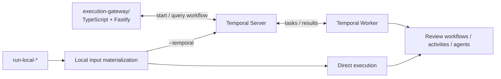

# `sec-review-agents`

Language: English | [中文](README.zh.md)

`agents/` is the Python side of the project. It implements the Execution Worker, Memory Extraction Worker, and Memory Maintenance Worker as separate Temporal runtimes, together with workflow execution, filesystem and workspace runtime, delivery result generation, and observability.

## Setup

From `agents/`:

```bash
uv sync --group dev
source .venv/bin/activate
```

This directory carries its own `.python-version`; `pyproject.toml` requires Python 3.14 or newer.

> *Python 3.14 is the default development, CI, package, and container runtime baseline for this package.*

Development checks:

```bash
uv run ruff check .
uv run black --check .
uv run mypy .
uv run pyright .
uv run python -m pytest
```

For local cleanup, ruff can apply safe mechanical fixes:

```bash
uv run ruff check . --fix
```

## LLM Setup

LLM configuration is deployment-based.

This layer is responsible for:

- reading chat / embedding deployment config through [`llm/config.py`](./src/sec_review_agents/llm/config.py)
- selecting deployments per agent through [`llm/factory.py`](./src/sec_review_agents/llm/factory.py)
- constructing native LangChain chat models by provider prefix:
  - `openai/...` -> `ChatOpenAI`
  - `anthropic/...` -> `ChatAnthropic`
  - `google/...` -> `ChatGoogleGenerativeAI`

When running from this repository, local commands read `agents/.env` and `agents/config/model-providers.toml` by default.

The local `run-local-*` CLIs and `sec-review-agents-check-llm-deployments` load `agents/.env`, but never overwrite environment variables already set in the process.

`sec-review-execution-worker`, `sec-review-memory-extraction-worker`, and `sec-review-memory-maintenance-worker` do not load `.env` themselves. Pass their environment through the shell, process supervisor, or CI. Execution Gateway is a separate TypeScript service under [`execution-gateway/`](../execution-gateway/README.md).

There is no `.env` path override. `MODEL_PROVIDERS_CONFIG_TOML` has the highest priority for model config; set it only when using another TOML location or when the run layout does not preserve the project-relative path.

`[agent_deployment_bindings]` explicitly binds agents to deployments. Every agent that can run must be declared; undeclared agents fail fast and do not inherit a default model.

Each `[[deployments]]` entry must explicitly declare `max_input_tokens`. The Execution Worker does not infer context-window size from LangChain model profiles or provider names; this deployment contract is the source of truth for context-limit behavior.

## Capabilities

The Execution Worker supports:

- `issue-review` workflow
- issue analyzer / mitigator / verifier
- `pull-request-review` workflow
- PR analyzer / mitigator / verifier
- `repository-review` workflow
  - discovery / triage / analyzer / cvss-v4-scoring / mitigator / verifier / delivery
  - delivery organizes repository cases into publishable delivery results; non-delivered cases are still shown through case results
- local evaluation / ablation paths:
  - `issue-review` with `--strategy two-stage`
  - `issue-review` with `--strategy single-agent` (local baseline)

Resources live inside the package:

- [`./src/sec_review_agents/resources/`](./src/sec_review_agents/resources/)
- The worker reads prompts from there, prepares the skills declared for an agent, and mounts them for that agent.

## Layout

The Python package is easiest to read by responsibility:

1. Agent implementations.
   - `agents/`: prompts, runtime setup, tools, and output schemas for each agent.

2. Stage pipeline: shared execution, stage artifacts, and public result contracts.
   - `scan_stages/`: repository discovery / triage stage execution; turns repository scan signals into cases.
   - `review_stages/`: analysis / mitigation / verification / CVSS stage execution, stage result payloads, review record projection, and verifier feedback logic.
   - `delivery_stages/`: repository delivery planning, delivery execution, patch synthesis execution, and delivery result generation.

3. Workflows: combines stages into product paths.
   - `workflows/`: `issue/`, `pull_request/`, and `repository/` are the public workflows; `repository_case/` is the per-case review used inside repository workflow.

4. Local and operator commands.
   - `cli/`: commands for development and operations that perform one requested task and exit, plus their local-only support code.

5. Production entrypoints.
   - `entrypoints/`: the Temporal execution worker plus its execution contract, run protocol, and workflow input preparation boundaries.

6. Artifact persistence and run diagnostics.
   - `artifacts/`: immutable artifact references, local and S3 transport, materialization, and safe archive extraction. References bind a `file://` or `s3://` location to its media type, size, and digest; consumers own transport configuration and materialize verified references before use.
   - `run_diagnostics/`: the per-run diagnostic bundle format, build and materialize logic, and its Temporal publication activity.

7. Runtime support: infrastructure needed to run agents.
   - `runtime/`, `filesystem/`, `workspace/`, `llm/`, `resources/`, `observability/`: agent runtime, filesystem sandbox, workspace artifacts, model config, prompt / skill resources, and diagnostics.

## Execution Architecture



The external TypeScript Gateway receives HTTP run requests and uses the Temporal client to start and query workflows; it does not execute agents. Temporal Server persists workflow state and dispatches review work, memory extraction, and memory maintenance to their separate workers and task queues. Direct local execution bypasses both the HTTP service and Temporal while reusing activity functions; `run-local-* --temporal` bypasses the HTTP service but uses Temporal Server and Execution Worker.

## Local Runs

Local runs are for development and debugging. They are not the production integration path.

The supported local execution paths are:

- Direct local run: the default and fastest path for ordinary development.
- Local `--temporal` run: for exercising workflow / activity orchestration.
- Manually started service and worker: for exercising the complete service path without the full Compose stack.

| Execution path | Diagnostic publication | Memory processing |
| --- | --- | --- |
| Direct `run-local-*`, standard workflow | Local diagnostic bundle | Disabled |
| Direct `run-local-*`, `single-agent` or `two-stage` ablation | Local diagnostic bundle | Disabled |
| Local `--temporal`, standard workflow | Local diagnostic bundle | Controlled by `AGENT_MEMORY_PROCESSING_ENABLED` |
| Local `--temporal`, `single-agent` or `two-stage` ablation | Local diagnostic bundle | Disabled |
| Manually started service and workers | Diagnostic bundle in S3-compatible storage | Production workflow behavior |

### `run-local-*` Commands

The `run-local-*` commands prepare workspace snapshots, history, and incremental windows through `cli/local_materialization/`, then reuse the production workflow input preparation boundary to derive artifact directories. They use direct local execution by default, without the HTTP service or Temporal.

After installing dependencies, these commands are available:

- `sec-review-agents-run-local-issue`: local issue run entrypoint. Use `--strategy default|two-stage|single-agent` to choose the default multi-stage path, two-stage ablation, or single-agent baseline.
- `sec-review-agents-run-local-pr`: local PR run entrypoint.
- `sec-review-agents-run-local-repository`: local repository scan run entrypoint. Use `--scan-mode full|incremental` to choose full or incremental scan, and repeat `--paths-ignore PATTERN` to ignore paths or globs.

Local runs use a temporary directory by default for the workflow result, workspace snapshot, history, and other artifacts. At the end of the command, the CLI prints `WORKFLOW_RESULT=...`, which you can use to locate the result; you can also use `--output-dir` to override the output directory.

Examples:

```bash
cd /path/to/monorepo
cp agents/.env.sample agents/.env
cp agents/config/model-providers.sample.toml agents/config/model-providers.toml

# 1) issue
# Choose the review objective; test_changes defaults to allow.
sec-review-agents-run-local-issue \
  --repo /abs/path/to/repo \
  --issue-md /abs/path/to/issue.md \
  --target-branch main \
  --output-dir /abs/path/to/local-run \
  --review-objective repair

# 1b) issue two-stage ablation
# --test-changes deny forbids test changes in the final mitigation patch.
sec-review-agents-run-local-issue \
  --repo /abs/path/to/repo \
  --issue-md /abs/path/to/issue.md \
  --target-branch main \
  --strategy two-stage \
  --review-objective audit \
  --test-changes deny

# 1c) issue single-agent baseline
sec-review-agents-run-local-issue \
  --repo /abs/path/to/repo \
  --issue-md /abs/path/to/issue.md \
  --target-branch main \
  --strategy single-agent \
  --review-objective repair

# 2) pr
# Pull-request objective is fixed to audit; --test-changes is optional.
sec-review-agents-run-local-pr \
  --repo /abs/path/to/repo \
  --pr-md /abs/path/to/pr.md \
  --base-sha <base-commit-sha> \
  --head-sha <head-commit-sha> \
  --test-changes deny

# 3) full repo scan
# Repository objective is fixed to audit; test_changes defaults to allow.
sec-review-agents-run-local-repository \
  --repo /abs/path/to/repo \
  --target-branch main \
  --paths-ignore docs \
  --paths-ignore '**/*.generated.py'

# 4) incremental repo scan
sec-review-agents-run-local-repository \
  --repo /abs/path/to/repo \
  --target-branch main \
  --scan-mode incremental \
  --base-sha <base-commit-sha> \
  --head-sha <head-commit-sha> # optional head
```

### Use Temporal with `run-local-*`

Use `--temporal` only when you specifically want to exercise internal Temporal workflow / activity orchestration.

With `--temporal`, the same local command still prepares input on the developer machine, but the workflow stages run through Temporal workflow / activity scheduling. This is useful when debugging workflow orchestration, retries, activity boundaries, or Temporal-visible state. It still bypasses the HTTP Execution Gateway, so it is not the same as the full service path.

Local Temporal execution keeps the run diagnostic bundle on the local filesystem and passes a verified `file://` reference between the Execution Worker and Memory Extraction Worker. Those workers must therefore share that artifact filesystem and see it at the same absolute path.

Before running a `--temporal` local command, start a local Temporal dev server:

```bash
temporal server start-dev --ip 127.0.0.1 --port 7233
```

Then start the Execution Worker as a host process in another terminal:

```bash
cd agents
cp .env.sample .env
cp config/model-providers.sample.toml config/model-providers.toml
# Fill .env and config/model-providers.toml.

set -a
. .env
set +a

TEMPORAL_ADDRESS=127.0.0.1:7233 \
TEMPORAL_NAMESPACE=default \
TEMPORAL_EXECUTION_TASK_QUEUE=sec-review-execution \
sec-review-execution-worker
```

### Run the Workers Manually

Start Temporal and the worker processes in separate terminals.

Minimal local startup shape:

Terminal 1, Temporal Server:

```bash
temporal server start-dev
```

Terminal 2, Execution Worker:

```bash
TEMPORAL_ADDRESS=127.0.0.1:7233 \
TEMPORAL_EXECUTION_TASK_QUEUE=sec-review-execution \
sec-review-execution-worker
```

Terminal 3, Memory Extraction Worker:

```bash
TEMPORAL_ADDRESS=127.0.0.1:7233 \
TEMPORAL_MEMORY_EXTRACTION_MAX_CONCURRENT_ACTIVITIES=4 \
sec-review-memory-extraction-worker
```

Terminal 4, Memory Maintenance Worker:

```bash
TEMPORAL_ADDRESS=127.0.0.1:7233 \
TEMPORAL_MEMORY_MAINTENANCE_MAX_CONCURRENT_ACTIVITIES=1 \
sec-review-memory-maintenance-worker
```

Execution Worker handles review workflows, sandboxed activities, and run diagnostic publication. Memory Extraction Worker reads published diagnostics and produces observations; additional processes can poll the same extraction task queue. Memory Maintenance Worker serially updates the shared memory tree and owns maintenance schedule repair; it rejects any activity concurrency other than `1` and must run as a single process. Each worker has its own task queue and concurrency limit.

Docker Compose review-runs startup and host worker operation are documented in the [local integrated deployment guide](../docs/operations/LOCAL_INTEGRATED_DEPLOYMENT.md).

## Agent Runtime Configuration

### Skills

Agents can declare the skills they need. The worker prepares and mounts the declared skills when it starts an agent. See [Agent Skills](../docs/agent/SKILLS.md) for details.

### Memory

Memory requires Temporal, a Memory Catalog backed by PostgreSQL, and S3-compatible object storage.

For local Memory development, Compose runs the infrastructure and the workers run as host processes.

> [!WARNING]
> The checked-in development credentials are fixed loopback-only values. They are not secrets and must not be used on a shared machine or any deployment reachable from another host.

From the **repository root**, create the ignored local env file and start the infrastructure:

```bash
cp compose.memory.env.sample compose.memory.env
# Compose runs RustFS and Temporal with the current host UID/GID. Creating
# their bind-mount roots first keeps those directories writable.
install -d .agent-rustfs-state .agent-temporal-state
docker compose \
  --env-file compose.memory.env \
  --profile memory \
  up -d --build --wait \
  rustfs postgres temporal memory-catalog-server
docker compose \
  --env-file compose.memory.env \
  --profile memory \
  run --rm rustfs-init
curl --fail http://127.0.0.1:8092/healthz
```

Configure `agents/.env` and `agents/config/model-providers.toml` for model access, then start the Execution, Memory Extraction, and Memory Maintenance workers together:

```bash
cd agents
uv run sec-review-agents-memory dev-workers \
  --env-file ../compose.memory.env
```

The launcher maps the separate object-storage identities to their workers, keeps Memory Maintenance Worker activity concurrency at `1`, and stops the worker group when one worker exits or the launcher receives `SIGINT`/`SIGTERM`. It does not start or stop Compose services.

| Variable | Purpose |
| --- | --- |
| `AGENT_MEMORY_CATALOG_URL` | Memory Catalog base URL. Without it, review agents have no memory view and memory processing cannot run. |
| `AGENT_MEMORY_CATALOG_TOKEN` | Worker bearer token for Memory Catalog extraction and automatic maintenance. Required when `AGENT_MEMORY_CATALOG_URL` is set. |
| `AGENT_MEMORY_CONSUMPTION_ENABLED` | Whether review agents load the active memory tree. Defaults to `true`. |
| `AGENT_MEMORY_PROCESSING_ENABLED` | Whether extraction and maintenance activities run. Defaults to `true`. |

Each review invocation materializes the active memory tree in a temporary directory and removes it afterward. See [Agent Memory System](../docs/agent/MEMORY_SYSTEM.md) for the architecture and lifecycle.

- `sec-review-agents-memory maintain` asks Temporal Server to start one memory maintenance workflow.
- `sec-review-agents-memory schedules maintenance ensure` creates or updates the periodic maintenance schedule in Temporal Server.

### Structured Output

Agents that require structured output check whether the final state contains `structured_response`. If the model only returns plain text and does not produce a structured result, agent middleware appends a correction message inside the LangChain agent loop and retries. Retry count is controlled by `AGENT_MISSING_STRUCTURED_RESPONSE_MAX_RETRIES`, default `2`. This fallback is separate from provider/API request retry and does not handle schema-parameter validation errors; those remain under LangChain structured-output retry behavior.

## Sandbox Runtime

Agent stages that review code run in a sandbox that can execute commands, because without one they cannot run tests, read history, or reproduce a finding. Which sandbox that is, is deployment configuration:

- `AGENT_SANDBOX_BACKEND` unset or set to `docker`: require the Docker sandbox
- `AGENT_SANDBOX_BACKEND=bwrap`: opt into bubblewrap (Linux/WSL2 only)

There is no value that selects the local filesystem backend. It has no shell, so handing it to a stage that reviews code would quietly remove that stage's ability to run anything. Stages that do not need one select it themselves, so this is not a deployment setting.

Benchmark and local debug runs can set `runtime.workspace_image` to choose the image for the isolated container that hosts the target repository.

### Workspace Tools

The optional workspace tools image installs Joern, CodeGraph, Playwright, and Chromium in the Docker sandbox. Build the image and select it for a local run:

```bash
docker build -f agents/docker/workspace-tools.Dockerfile -t sec-review-bot-workspace:tools agents
export AGENT_DOCKER_IMAGE=sec-review-bot-workspace:tools
export AGENT_JOERN_ENABLED=true
export AGENT_PLAYWRIGHT_ENABLED=true
```

Joern and Playwright are intended for use through bash and their CLIs. The existing CodeGraph and Playwright MCP integrations remain available but are disabled by default. Enable them explicitly when needed:

```bash
export AGENT_MCP_ENABLED=true
```

See [Agent External Tools](../docs/agent/EXTERNAL_TOOLS.md) for the tool and interface choices.
