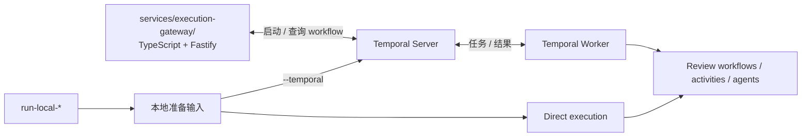

# `sec-review-agents`

语言：[English](README.md) | 中文

本文为 [README.md](README.md) 的中文译文；如有差异，以英文版为准。

`agents/` 包含安全审查 Agent、审查工作流，以及审查经验的提取和维护代码，支持本地运行和通过 Temporal 执行任务。

## 能力

- **Execution Worker** 执行 `issue-review`、`pull-request-review` 和 `repository-review`。仓库审查包括 Discovery、Triage、逐项分析、CVSS 评分、修复、验证和交付；没有交付结果的 case 仍会展示在 case 结果中。
- **Memory Extraction Worker** 从执行轨迹中提取可复用的审查经验。
- **Memory Maintenance Worker** 审阅提取出的经验，并更新共享记忆。

## 安装、激活环境

在 `agents/` 目录运行：

```bash
uv sync --group dev
source .venv/bin/activate
```

本目录自带 `.python-version`；`pyproject.toml` 要求 Python 3.14 或更新版本。

> *Python 3.14 是本包开发、CI、打包和容器运行使用的基线版本。*

## LLM 配置

先在仓库根目录复制配置文件，再编辑 TOML 中的模型地址、凭据引用和 Agent 绑定。可用字段和绑定名称见示例文件；运行任务涉及的每个 Agent 都需要绑定可用模型。

```bash
cp agents/.env.sample agents/.env
cp agents/config/model-providers.sample.toml agents/config/model-providers.toml
```

本地审查命令默认读取 `agents/.env` 和 `agents/config/model-providers.toml`。如需使用其他位置的模型配置文件，可设置 `MODEL_PROVIDERS_CONFIG_TOML`。

本地 `run-local-*` CLI 和 `sec-review-agents-check-llm-deployments` 会加载 `agents/.env`，但不会覆盖进程里已有的环境变量。

本地命令会加载 `agents/.env`，Worker 入口和 activities 不会加载 dotenv 文件。启动 Worker 时，需要通过 shell、进程管理器或 CI 设置环境变量。本地开发启动脚本会先加载配置，再创建 Worker 子进程；Worker 继承加载后的环境。

`[agent_deployment_bindings]` 用来把具体 Agent 显式绑定到某个模型部署。所有运行到的 Agent 都必须显式声明；未声明的 Agent 会 fail fast，不会继承默认模型。

每个 `[[deployments]]` 都必须显式声明 `max_input_tokens`。Execution Worker 不会从 LangChain 模型能力描述或模型服务商名字推断上下文窗口；这个模型部署 contract 才是上下文上限行为的事实来源。

## 本地运行

本地运行用于开发和调试，不是生产集成路径。

本地支持以下执行路径：

- 直接本地执行：日常开发使用，省去 HTTP 和 Temporal 调度。
- Local `--temporal` 任务：用于验证 workflow / activity 编排。
- 手动启动 Service 和 Worker：联调 HTTP 服务、Temporal 和 Worker，无需启动完整 Compose 栈。

| 执行路径 | 诊断包发布 | 记忆处理 |
| --- | --- | --- |
| Direct `run-local-*`，标准工作流 | 本地诊断包 | 禁用 |
| 本地 `--temporal`，标准工作流 | 本地诊断包 | 由 `AGENT_MEMORY_PROCESSING_ENABLED` 控制 |
| 手动启动 Service 和 Worker | S3 兼容存储中的诊断包 | 由 Execution Worker 环境中的 `AGENT_MEMORY_PROCESSING_ENABLED` 控制 |

### `run-local-*` 命令

安装依赖后，可以使用以下命令：

- `sec-review-agents-run-local-issue`：本地 issue 任务入口；其他策略见[消融实验](#消融实验)
- `sec-review-agents-run-local-pr`：本地 PR 任务入口
- `sec-review-agents-run-local-repository`：本地 repo 扫描任务入口；可用 `--scan-mode full|incremental` 选择全量或增量扫描，并可重复传入 `--paths-ignore PATTERN`，忽略指定路径或 glob

本地命令必须通过 `--output-dir` 指定保存位置；程序在该父目录下创建新的 `local-run-*` 目录。

示例：

```bash
cd /path/to/sec-review-bot

# 1) issue
# 选择 review objective；test_changes 默认为 allow。
sec-review-agents-run-local-issue \
  --repo /abs/path/to/repo \
  --issue-md /abs/path/to/issue.md \
  --target-branch main \
  --output-dir /abs/path/to/local-runs \
  --review-objective repair

# 2) pr
# PR 的 objective 固定为 audit；--test-changes 可选。
sec-review-agents-run-local-pr \
  --output-dir /abs/path/to/local-runs \
  --repo /abs/path/to/repo \
  --pr-md /abs/path/to/pr.md \
  --base-sha <base-commit-sha> \
  --head-sha <head-commit-sha> \
  --test-changes deny

# 3) repo 全量扫描
# Repository 的 objective 固定为 audit；test_changes 默认为 allow。
sec-review-agents-run-local-repository \
  --output-dir /abs/path/to/local-runs \
  --repo /abs/path/to/repo \
  --target-branch main \
  --paths-ignore docs \
  --paths-ignore '**/*.generated.py'

# 4) repo 增量扫描
sec-review-agents-run-local-repository \
  --output-dir /abs/path/to/local-runs \
  --repo /abs/path/to/repo \
  --target-branch main \
  --scan-mode incremental \
  --base-sha <base-commit-sha> \
  --head-sha <head-commit-sha> # 可选 head
```

### 通过 `run-local-*` 使用 Temporal

只有需要调试内部 Temporal workflow / activity 编排时，才使用 `--temporal`。

显式传 `--temporal` 时，同一个本地命令仍然在开发机上准备输入，但后续工作流阶段会通过 Temporal workflow / activity 调度执行。这个模式适合调试工作流编排、retry、activity 边界或 Temporal 中可见的状态。

按[手动启动 Workers](#手动启动-workers)中的步骤启动 Temporal Server 和 Execution Worker，再为 `run-local-*` 命令添加 `--temporal`。

### 手动启动 Workers

运行 review 需要 Temporal Server 和 Execution Worker。启用记忆处理时，先按 [Memory](#memory) 小节配置依赖，再启动 Memory Extraction 和 Memory Maintenance Worker。

先按[模型配置](#llm-配置)准备 `agents/.env` 和 `agents/config/model-providers.toml`。在每个 Worker 终端中，先加载环境变量，再执行对应的启动命令：

```bash
cd agents
set -a
source .env
set +a
```

在不同终端中分别启动 Temporal 和 Worker：

终端 1，Temporal Server：

```bash
temporal server start-dev --ip 127.0.0.1 --port 7233
```

终端 2，Execution Worker：

```bash
TEMPORAL_ADDRESS=127.0.0.1:7233 \
TEMPORAL_EXECUTION_TASK_QUEUE=sec-review-execution \
sec-review-execution-worker
```

终端 3，Memory Extraction Worker：

```bash
TEMPORAL_ADDRESS=127.0.0.1:7233 \
TEMPORAL_MEMORY_EXTRACTION_MAX_CONCURRENT_ACTIVITIES=4 \
sec-review-memory-extraction-worker
```

终端 4，Memory Maintenance Worker：

```bash
TEMPORAL_ADDRESS=127.0.0.1:7233 \
TEMPORAL_MEMORY_MAINTENANCE_MAX_CONCURRENT_ACTIVITIES=1 \
sec-review-memory-maintenance-worker
```

Memory Maintenance Worker 必须保持单进程，activity 并发数固定为 `1`；不要同时启动多个实例。

Docker Compose 控制平面和宿主机 Worker 的运行方式见[本地集成部署](../docs/operations/LOCAL_INTEGRATED_DEPLOYMENT.zh.md)。

## Agent 运行时配置

### Skills

Agent 可以声明自己需要的 skills。Worker 启动 Agent 时会自动准备并挂载声明的 skills。更多设计细节见 [SKILLS](../docs/agent/SKILLS.zh.md)。

### Memory

本包实现经验提取、记忆维护及对应 Worker。主链路的 Analyzer、Mitigator 和 Verifier 通过每次调用专用的文件系统视图读取维护后的记忆。整体设计见 [MEMORY_SYSTEM](../docs/agent/MEMORY_SYSTEM.zh.md)，基础设施搭建与运维见[LOCAL_MEMORY_DEVELOPMENT](../docs/operations/LOCAL_MEMORY_DEVELOPMENT.zh.md)。

| 变量 | 用途 |
| --- | --- |
| `AGENT_MEMORY_CATALOG_URL` | Memory Catalog 的基础 URL。未配置时，主链路 Agent 不加载记忆，记忆处理也无法运行。 |
| `AGENT_MEMORY_CATALOG_TOKEN` | Memory Catalog 经验提取和自动记忆维护使用的 Worker bearer token。配置 `AGENT_MEMORY_CATALOG_URL` 时必须同时配置。 |
| `AGENT_MEMORY_CONSUMPTION_ENABLED` | 是否让主链路 Agent 加载当前生效的记忆文件树。 |
| `AGENT_MEMORY_PROCESSING_ENABLED` | 是否启用经验提取和记忆维护。 |

### 结构化输出

<!-- doc-default: AGENT_MISSING_STRUCTURED_RESPONSE_MAX_RETRIES; source=agents/src/sec_review_agents/runtime/structured_response_middleware.py -->
需要结构化输出的 Agent 必须返回 `structured_response`。模型只返回普通文本，或工具参数无法解析且没有有效工具调用可以继续时，中间件会在同一次 Agent 执行中追加纠正消息并重试。`AGENT_MISSING_STRUCTURED_RESPONSE_MAX_RETRIES` 控制重试上限，默认 `2`。这与服务商 API 请求重试不同；已解析参数的 schema 校验错误仍由 LangChain 的结构化输出机制处理。

## 沙箱运行环境

审查代码的 Agent 阶段必须运行在能够执行命令的 sandbox 里，否则它无法运行测试、读取历史或复现发现。具体用哪个 sandbox 属于部署配置：

- `AGENT_SANDBOX_BACKEND` 不设置或设置为 `docker`：要求使用 Docker sandbox

没有任何取值可以选择本地 filesystem backend。它没有 shell，把它交给审查代码的阶段，等于悄悄让那一步无法执行任何命令。不需要 shell 的阶段会自行选择它，因此这不是部署配置。

使用 Docker sandbox 时，可通过 `AGENT_DOCKER_IMAGE` 设置默认的工作区容器镜像。

### 沙箱内工具

可选的沙箱工具镜像在 Docker sandbox 中安装了 [Joern](https://joern.io/)、[CodeGraph](https://github.com/colbymchenry/codegraph)、[Playwright](https://playwright.dev/) 和 [Chromium](https://www.chromium.org/)。构建镜像，并在本地运行时选用它：

```bash
docker build -f agents/docker/workspace-tools.Dockerfile -t sec-review-bot-workspace:tools agents
export AGENT_DOCKER_IMAGE=sec-review-bot-workspace:tools
export AGENT_JOERN_ENABLED=true
export AGENT_PLAYWRIGHT_ENABLED=true
```

部署开关与 Agent 的工具声明同时启用某项工具时，Agent 会通过 bash 调用 Joern 或 Playwright 的 CLI。所选镜像必须已安装对应命令；开启开关不会安装工具。

现有 CodeGraph 和 Playwright MCP 集成仍然可用，但默认关闭；需要时显式开启：

```bash
export AGENT_MCP_ENABLED=true
```

工具及接入方式的选择见 [Agent 外部工具](../docs/agent/EXTERNAL_TOOLS.zh.md)。

## 开发者导航

### 目录

Python 包按职责读最清楚：

1. Agent 实现。
   - `agents/`：各类 Agent 的提示词、运行配置、工具和输出结构。

2. 阶段执行、产物和公开结果契约。
   - `scan_stages/`：执行仓库初筛和候选整理，将扫描线索整理为 case。
   - `review_stages/`：执行分析、修复、验证和 CVSS 评分阶段，定义阶段结果、生成审查记录，并处理 Verifier 反馈。
   - `delivery_stages/`：执行仓库交付规划、交付和补丁合成，生成交付结果。

3. 工作流：组合各阶段。
   - `workflows/`：`issue/`、`pull_request/`、`repository/` 是对外工作流；`repository_case/` 用于仓库工作流内部的单 case 审查。

4. 本地与运维命令。
   - `cli/`：用于开发和运维、完成一次指定任务后退出的命令，以及只服务于本地命令的支持代码。

5. 生产入口。
   - `entrypoints/`：Temporal Worker 入口，以及执行契约、执行协议和工作流输入准备。

6. 产物持久化与运行诊断。
   - `artifacts/`：不可变产物引用、本地与 S3 传输、物化和安全归档解包。产物引用将 `file://` 或 `s3://` 位置与媒体类型、大小和摘要绑定；使用方持有传输配置，并在使用前校验和物化引用。
   - `run_diagnostics/`：每次运行的诊断包的格式、构建与物化逻辑，以及对应的 Temporal 发布 activity。

7. Agent 运行所需基础设施。
   - `runtime/`、`filesystem/`、`workspace/`、`llm/`、`resources/`、`observability/`：Agent 运行时、文件系统沙箱、工作区产物、模型配置、提示词 / skill 资源和诊断支持。

### 执行架构



Execution Gateway 接收 HTTP 执行请求，并通过 Temporal client 启动和查询 Temporal workflow。Temporal Server 持久化 workflow 状态，并通过 task queue 将审查任务分发给 Execution Worker。

- Direct 本地执行不经过 HTTP 服务和 Temporal 调度，但复用 Temporal activity 函数。
- `run-local-* --temporal` 绕过 HTTP service，但会经过 Temporal Server 和 Execution Worker。

### 开发检查

在 `agents/` 目录运行：

```bash
uv run ruff check .
uv run black --check .
uv run mypy .
uv run pyright .
uv run python -m pytest
```

本地清理时，可以让 ruff 应用安全的机械修复：

```bash
uv run ruff check . --fix
```

### 消融实验

本地 Issue 审查默认使用多阶段工作流。做消融实验时，添加 `--strategy two-stage` 运行双阶段版本，或添加 `--strategy single-agent` 运行 single-agent。

消融实验路径生成本地诊断包，且禁用记忆处理；直接运行和添加 `--temporal` 时均如此。

```bash
cd /path/to/sec-review-bot

# two-stage 消融实验
# --test-changes deny 表示最终 mitigation patch 不得包含测试改动。
sec-review-agents-run-local-issue \
  --output-dir /abs/path/to/local-runs \
  --repo /abs/path/to/repo \
  --issue-md /abs/path/to/issue.md \
  --target-branch main \
  --strategy two-stage \
  --review-objective audit \
  --test-changes deny

# single-agent
sec-review-agents-run-local-issue \
  --output-dir /abs/path/to/local-runs \
  --repo /abs/path/to/repo \
  --issue-md /abs/path/to/issue.md \
  --target-branch main \
  --strategy single-agent \
  --review-objective repair
```
