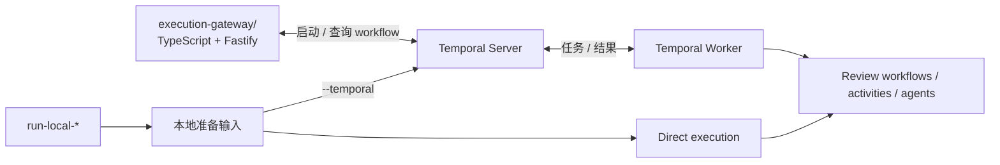

# `sec-review-agents`

语言：[English](README.md) | 中文

本文是 [README.md](README.md) 的中文译文。英文版是权威版本；如果两者不一致，以英文版为准。

`agents/` 是项目里的 Python 侧。它把 Execution Worker、Memory Extraction Worker 和 Memory Maintenance Worker 实现为三个独立的 Temporal runtime，并提供 workflow 执行、filesystem / workspace runtime、delivery 产物生成和 observability。

## 安装

在 `agents/` 目录运行：

```bash
uv sync --group dev
source .venv/bin/activate
```

本目录自带 `.python-version`；`pyproject.toml` 要求 Python 3.14 或更新版本。

> *Python 3.14 是当前 package 的默认开发、CI、package 和容器 runtime 基线。*

开发检查：

```bash
uv run ruff check .
uv run black --check .
uv run mypy .
uv run pyright .
uv run python -m pytest
```

本地清理时，可以让 ruff 应用安全的机械修复：

```bash
uv run ruff check . --fix
```

## LLM 配置

LLM 配置按 deployment 选择 provider。

这一层负责：

- 由 [`llm/config.py`](./src/sec_review_agents/llm/config.py) 读取 chat / embedding deployment 配置
- 由 [`llm/factory.py`](./src/sec_review_agents/llm/factory.py) 按 agent 选择 deployment
- 再按 provider 前缀构造原生 LangChain chat model
  - `openai/...` -> `ChatOpenAI`
  - `anthropic/...` -> `ChatAnthropic`
  - `google/...` -> `ChatGoogleGenerativeAI`

在本仓库里运行本地命令时，默认读取 `agents/.env` 和 `agents/config/model-providers.toml`。

本地 `run-local-*` CLI 和 `sec-review-agents-check-llm-deployments` 会加载 `agents/.env`，但不会覆盖进程里已有的环境变量。

`sec-review-execution-worker`、`sec-review-memory-extraction-worker` 和 `sec-review-memory-maintenance-worker` 不会自己加载 `.env`，需要由 shell、process supervisor 或 CI 注入环境变量。Execution Gateway 是 [`execution-gateway/`](../execution-gateway/README.zh.md) 下独立的 TypeScript 服务。

没有 `.env` 文件路径 override。`MODEL_PROVIDERS_CONFIG_TOML` 是模型配置路径的最高优先级入口；只有想把 TOML 放到其他位置，或运行方式不保留当前项目相对目录结构时，才需要显式设置它。

`[agent_deployment_bindings]` 用来把具体 agent 显式绑定到某个 deployment。所有运行到的 agent 都必须显式声明；未声明的 agent 会 fail fast，不会继承默认模型。

每个 `[[deployments]]` 都必须显式声明 `max_input_tokens`。Execution Worker 不会从 LangChain model profile 或 provider 名字推断上下文窗口；这个 deployment contract 才是上下文上限行为的事实来源。

## 能力

Execution Worker 支持：

- `issue-review` workflow
- issue analyzer / mitigator / verifier
- `pull-request-review` workflow
- PR analyzer / mitigator / verifier
- `repository-review` workflow
  - discovery / triage / analyzer / cvss-v4-scoring / mitigator / verifier / delivery
  - delivery 会把 repository cases 组织成可发布的交付结果；未交付 case 仍通过 case result 展示
- 本地评测 / ablation 路径：
  - `issue-review` 配 `--strategy two-stage`
  - `issue-review` 配 `--strategy single-agent`（local baseline）

resources 位于 package 内部：

- [`./src/sec_review_agents/resources/`](./src/sec_review_agents/resources/)
- worker 从这里读取 prompts，并把 agent 声明允许的 skills 准备好、挂给对应 agent 使用

## 目录

Python package 按职责读最清楚：

1. Agent implementations。
   - `agents/`：各类 agent 的提示词、运行配置、工具和输出结构。

2. Stage pipeline：共享执行、stage 产物和公开结果契约。
   - `scan_stages/`：repository discovery / triage stage execution，把仓库扫描信号整理成 cases。
   - `review_stages/`：analysis / mitigation / verification / CVSS stage execution、stage result payloads、review record projection 和 verifier feedback 逻辑。
   - `delivery_stages/`：repository delivery planning、delivery execution、patch synthesis execution 和 delivery result 生成。

3. Workflows：把 stage 组合成产品路径。
   - `workflows/`：`issue/`、`pull_request/`、`repository/` 是三个 public workflow；`repository_case/` 是 repository workflow 内部的单 case review。

4. 本地与运维命令。
   - `cli/`：用于开发和运维、完成一次指定任务后退出的命令，以及只服务于本地命令的支持代码。

5. 生产 entrypoints。
   - `entrypoints/`：Temporal execution worker，以及它的 execution contract、run protocol 和 workflow input preparation 边界。

6. Artifact 持久化与 run diagnostics。
   - `artifacts/`：不可变 artifact reference、本地与 S3 传输、物化和安全 archive 解包。Reference 将 `file://` 或 `s3://` 位置与 media type、大小和 digest 绑定；consumer 持有传输配置，并在使用前校验和物化 reference。
   - `run_diagnostics/`：per-run diagnostic bundle 的格式、构建与物化逻辑，以及对应的 Temporal publication activity。

7. Runtime support：agent 运行所需基础设施。
   - `runtime/`、`filesystem/`、`workspace/`、`llm/`、`resources/`、`observability/`：agent runtime、filesystem sandbox、workspace 产物、模型配置、prompt / skill 资源和诊断支持。

## 执行架构



外部 TypeScript Gateway 接收 HTTP run 请求，并通过 Temporal client 启动和查询 workflow；它不执行 agent。Temporal Server 持久化 workflow 状态，并通过独立的 worker 和 task queue 分发 review、memory extraction 与 memory maintenance 工作。Direct local execution 绕过 HTTP service 和 Temporal，但会复用 activity functions；`run-local-* --temporal` 绕过 HTTP service，但会经过 Temporal Server 和 Execution Worker。

## 本地运行

本地运行用于开发和调试，不是生产集成路径。

本地有三种执行路径：

- Direct local run：日常开发默认使用，也是最快的路径。
- Local `--temporal` run：用于验证 workflow / activity 编排。
- 手动启动 Service 和 Worker：用于在不启动完整 Compose 栈时验证完整 service path。

| 执行路径 | Diagnostic publication | Memory processing |
| --- | --- | --- |
| Direct `run-local-*`，标准 workflow | 本地 diagnostic bundle | 禁用 |
| Direct `run-local-*`，`single-agent` 或 `two-stage` ablation | 本地 diagnostic bundle | 禁用 |
| 本地 `--temporal`，标准 workflow | 本地 diagnostic bundle | 由 `AGENT_MEMORY_PROCESSING_ENABLED` 控制 |
| 本地 `--temporal`，`single-agent` 或 `two-stage` ablation | 本地 diagnostic bundle | 禁用 |
| 手动启动 Service 和 Worker | 对象存储中的 diagnostic bundle | 使用生产 workflow 行为 |

### `run-local-*` 命令

`run-local-*` 命令通过 `cli/local_materialization/` 准备 workspace snapshot、history 和 incremental window，再复用生产 workflow input preparation 边界派生 artifacts 目录。默认使用 direct local execution，不需要 HTTP service 或 Temporal。

安装依赖后，可以使用以下命令：

- `sec-review-agents-run-local-issue`：本地 issue run 入口；可用 `--strategy default|two-stage|single-agent` 选择默认 multi-stage 路径、two-stage ablation 或 single-agent baseline
- `sec-review-agents-run-local-pr`：本地 PR run 入口
- `sec-review-agents-run-local-repository`：本地 repo 扫描 run 入口；可用 `--scan-mode full|incremental` 选择全量或增量扫描，并可重复传入 `--paths-ignore PATTERN`，忽略指定路径或 glob

本地运行默认使用临时目录保存 workflow result、workspace snapshot、history 和其他 artifacts。命令结束时会打印 `WORKFLOW_RESULT=...`，可根据该路径查看结果；也可以通过 `--output-dir` 指定固定的输出目录。

示例：

```bash
cd /path/to/monorepo
cp agents/.env.sample agents/.env
cp agents/config/model-providers.sample.toml agents/config/model-providers.toml

# 1) issue
# 选择 review objective；test_changes 默认为 allow。
sec-review-agents-run-local-issue \
  --repo /abs/path/to/repo \
  --issue-md /abs/path/to/issue.md \
  --target-branch main \
  --output-dir /abs/path/to/local-run \
  --review-objective repair

# 1b) issue two-stage ablation
# --test-changes deny 表示最终 mitigation patch 不得包含测试改动。
sec-review-agents-run-local-issue \
  --repo /abs/path/to/repo \
  --issue-md /abs/path/to/issue.md \
  --target-branch main \
  --strategy two-stage \
  --review-objective audit \
  --test-changes deny

# 1c) issue single-agent baseline
sec-review-agents-run-local-issue \
  --repo /abs/path/to/repo \
  --issue-md /abs/path/to/issue.md \
  --target-branch main \
  --strategy single-agent \
  --review-objective repair

# 2) pr
# PR 的 objective 固定为 audit；--test-changes 可选。
sec-review-agents-run-local-pr \
  --repo /abs/path/to/repo \
  --pr-md /abs/path/to/pr.md \
  --base-sha <base-commit-sha> \
  --head-sha <head-commit-sha> \
  --test-changes deny

# 3) repo 全量扫描
# Repository 的 objective 固定为 audit；test_changes 默认为 allow。
sec-review-agents-run-local-repository \
  --repo /abs/path/to/repo \
  --target-branch main \
  --paths-ignore docs \
  --paths-ignore '**/*.generated.py'

# 4) repo 增量扫描
sec-review-agents-run-local-repository \
  --repo /abs/path/to/repo \
  --target-branch main \
  --scan-mode incremental \
  --base-sha <base-commit-sha> \
  --head-sha <head-commit-sha> # 可选 head
```

### 通过 `run-local-*` 使用 Temporal

只有需要调试内部 Temporal workflow / activity 编排时，才使用 `--temporal`。

显式传 `--temporal` 时，同一个本地命令仍然在开发机上准备输入，但后续 workflow stages 会通过 Temporal workflow / activity 调度执行。这个模式适合调试 workflow 编排、retry、activity 边界或 Temporal 中可见的状态。它仍然绕过 HTTP Execution Gateway，因此不等同于完整 service path。

本地 Temporal 执行会把 run diagnostic bundle 保存在本地文件系统中，并通过经过校验的 `file://` 引用在 Execution Worker 与 Memory Extraction Worker 之间传递。因此，这两个 worker 必须共享该 artifact 文件系统，并以相同的绝对路径访问它。

运行 `--temporal` local command 前，先启动本地 Temporal dev server：

```bash
temporal server start-dev --ip 127.0.0.1 --port 7233
```

然后另开一个 terminal，把 Execution Worker 作为宿主机进程启动：

```bash
cd agents
cp .env.sample .env
cp config/model-providers.sample.toml config/model-providers.toml
# 填好 .env 和 config/model-providers.toml

set -a
. .env
set +a

TEMPORAL_ADDRESS=127.0.0.1:7233 \
TEMPORAL_NAMESPACE=default \
TEMPORAL_EXECUTION_TASK_QUEUE=sec-review-execution \
sec-review-execution-worker
```

### 手动启动 Workers

分别启动 Temporal 和各个 worker 进程。

最小本地启动形状：

终端 1，Temporal Server：

```bash
temporal server start-dev
```

终端 2，Execution Worker：

```bash
TEMPORAL_ADDRESS=127.0.0.1:7233 \
TEMPORAL_EXECUTION_TASK_QUEUE=sec-review-execution \
sec-review-execution-worker
```

终端 3，Memory Extraction Worker：

```bash
TEMPORAL_ADDRESS=127.0.0.1:7233 \
TEMPORAL_MEMORY_EXTRACTION_MAX_CONCURRENT_ACTIVITIES=4 \
sec-review-memory-extraction-worker
```

终端 4，Memory Maintenance Worker：

```bash
TEMPORAL_ADDRESS=127.0.0.1:7233 \
TEMPORAL_MEMORY_MAINTENANCE_MAX_CONCURRENT_ACTIVITIES=1 \
sec-review-memory-maintenance-worker
```

Execution Worker 负责 review workflow、sandbox activity 和 run diagnostic 发布；Memory Extraction Worker 读取已发布的诊断包并产出 observations，可以增加轮询同一 extraction task queue 的进程；Memory Maintenance Worker 串行更新共享 memory tree，并负责维护 maintenance schedule，它拒绝 `1` 以外的 activity concurrency，且必须保持单进程。三个 worker 分别使用独立的 task queue 和并发限制。

Docker Compose 控制平面和宿主机 worker 的运行方式见[本地集成部署](../docs/operations/LOCAL_INTEGRATED_DEPLOYMENT.zh.md)。

## Agent 运行时配置

### Skills

Agent 可以声明自己需要的 skills。worker 启动 agent 时会自动准备并挂载声明的 skills。更多设计细节见 [Agent Skills](../docs/agent/SKILLS.zh.md)。

### Memory

Memory 依赖 Temporal、使用 PostgreSQL 的 Memory Catalog，以及 S3 兼容对象存储。

本地 Memory 开发由 Compose 运行基础设施，各个 worker 则作为宿主机进程运行。

> [!WARNING]
> 仓库提供的是只供 loopback 开发使用的固定凭据。它们不是 secret，不得用于共享机器或可被其他主机访问的部署。

在 **仓库根目录** 中创建被忽略的本地 env 文件，并启动基础设施：

```bash
cp compose.memory.env.sample compose.memory.env
# Compose 使用当前宿主机 UID/GID 运行 RustFS 和 Temporal；预先创建
# bind-mount 根目录，确保容器可以写入。
install -d .agent-rustfs-state .agent-temporal-state
docker compose \
  --env-file compose.memory.env \
  --profile memory \
  up -d --build --wait \
  rustfs postgres temporal memory-catalog-server
docker compose \
  --env-file compose.memory.env \
  --profile memory \
  run --rm rustfs-init
curl --fail http://127.0.0.1:8092/healthz
```

填好 `agents/.env` 和 `agents/config/model-providers.toml` 中的模型配置，然后一起启动 Execution、Memory Extraction 和 Memory Maintenance workers：

```bash
cd agents
uv run sec-review-agents-memory dev-workers \
  --env-file ../compose.memory.env
```

launcher 会将不同的对象存储身份传给对应 worker，将 Memory Maintenance Worker 的 activity concurrency 保持为 `1`，并在任一 worker 退出或收到 `SIGINT`/`SIGTERM` 时停止整个 worker 组。它不负责启动或停止 Compose services。

| 变量 | 用途 |
| --- | --- |
| `AGENT_MEMORY_CATALOG_URL` | Memory Catalog 的基础 URL。未配置时，review agent 不加载 memory，memory processing 也无法运行。 |
| `AGENT_MEMORY_CATALOG_TOKEN` | Memory Catalog 的 bearer token。配置 `AGENT_MEMORY_CATALOG_URL` 时必须同时配置。 |
| `AGENT_MEMORY_CONSUMPTION_ENABLED` | 是否让 review agent 加载 active memory tree。默认为 `true`。 |
| `AGENT_MEMORY_PROCESSING_ENABLED` | 是否运行 extraction 和 maintenance activities。默认为 `true`。 |

每次 review invocation 都会在临时目录中物化 active memory tree，并在结束后删除。架构和生命周期见 [Agent Memory System](../docs/agent/MEMORY_SYSTEM.zh.md)。

- `sec-review-agents-memory maintain`：请求 Temporal Server 启动一次 memory maintenance workflow。
- `sec-review-agents-memory schedules maintenance ensure`：在 Temporal Server 中创建或更新周期性 maintenance schedule。

### 结构化输出

需要结构化输出的 agent 会检查最终 state 是否包含 `structured_response`。如果模型只返回普通文本、没有产出结构化结果，agent middleware 会在 LangChain agent loop 内追加一条纠偏消息并重试；重试次数由 `AGENT_MISSING_STRUCTURED_RESPONSE_MAX_RETRIES` 控制，默认 `2`。这层兜底独立于 provider/API 请求重试，不处理 schema 参数校验错误；参数校验错误仍交给 LangChain structured output 自身的 retry 机制。

## Sandbox 运行环境

审查代码的 agent stage 必须运行在能够执行命令的 sandbox 里，否则它无法运行测试、读取历史或复现发现。具体用哪个 sandbox 属于部署配置：

- `AGENT_SANDBOX_BACKEND` 不设置或设置为 `docker`：要求使用 Docker sandbox
- `AGENT_SANDBOX_BACKEND=bwrap`：显式启用 bubblewrap（仅 Linux/WSL2）

没有任何取值可以选择本地 filesystem backend。它没有 shell，把它交给审查代码的 stage，等于悄悄让那一步无法执行任何命令。不需要 shell 的 stage 会自行选择它，因此这不是部署配置。

benchmark 和本地调试可以设置 `runtime.workspace_image`，指定承载目标代码库的隔离容器镜像。

### Workspace 工具

可选的 workspace tools 镜像在 Docker sandbox 中安装了 Joern、CodeGraph、Playwright 和 Chromium。构建镜像，并在本地运行时选用它：

```bash
docker build -f agents/docker/workspace-tools.Dockerfile -t sec-review-bot-workspace:tools agents
export AGENT_DOCKER_IMAGE=sec-review-bot-workspace:tools
export AGENT_JOERN_ENABLED=true
export AGENT_PLAYWRIGHT_ENABLED=true
```

Joern 和 Playwright 计划通过 bash 和各自的 CLI 使用。现有 CodeGraph 和 Playwright MCP 集成仍然可用，但默认关闭；需要时显式开启：

```bash
export AGENT_MCP_ENABLED=true
```

工具及接入方式的选择见 [Agent 外部工具](../docs/agent/EXTERNAL_TOOLS.zh.md)。
