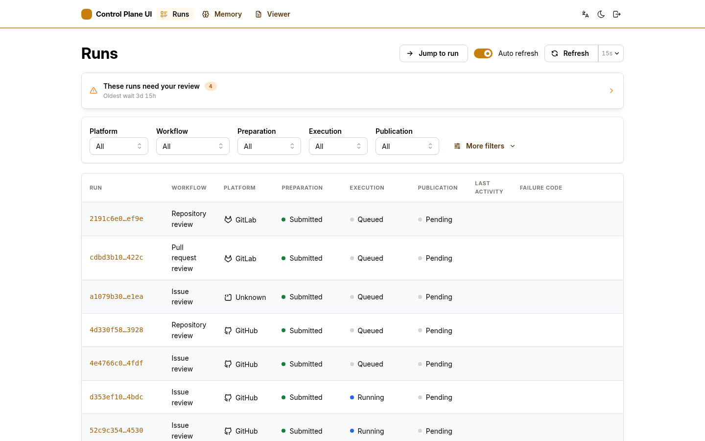
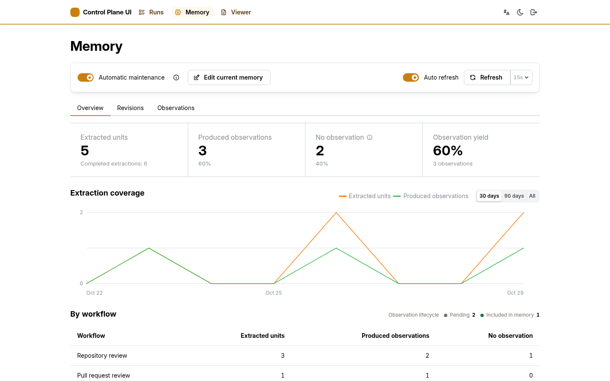
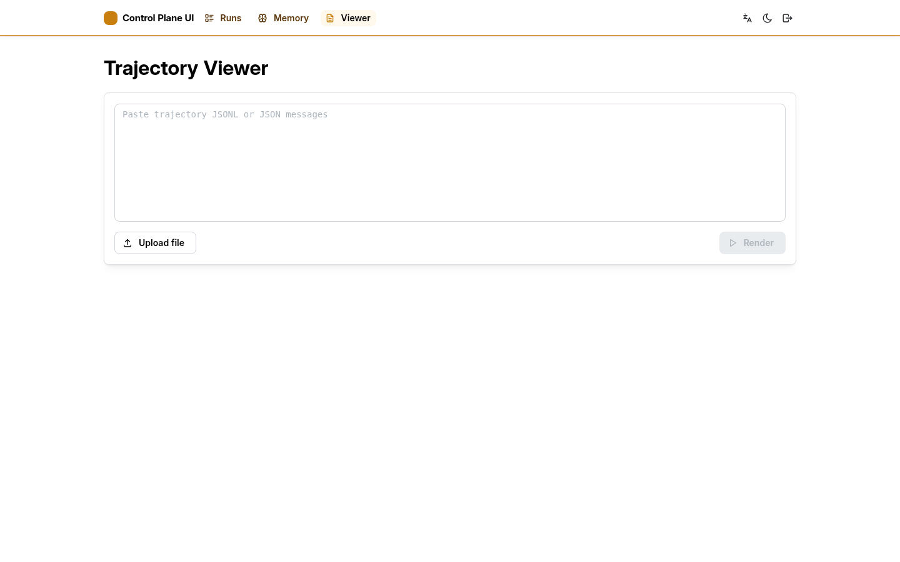

# Control Plane UI

Language: English | [中文](README.zh.md)

Internal web console for inspecting and operating review runs, execution diagnostics and artifacts, agent memory, and trajectories. Server-backed data goes only through this application's same-origin BFF, which holds upstream credentials and proxies explicit route allowlists; the standalone trajectory Viewer processes uploaded or pasted input entirely in the browser.

## Interface preview

> The following fixture screenshots are also committed Playwright visual baselines.

### Runs



### Memory



### Viewer



## Local development

From `apps/control-plane-ui`, install dependencies and start the fixture-backed preview:

```bash
pnpm install
pnpm run dev:fixtures
```

Open the URL printed by Vite, normally `http://localhost:5173`. This mode supplies representative run and memory states without requiring Review Runs, Memory Catalog, PostgreSQL, or RustFS. Memory pause, resume, edit, and restore controls are stateful fixtures. Memory tree and trajectory actions return small fixture attachments so their browser download behavior can be exercised without stored objects.

The fixture server also exposes stable full-page error states for visual inspection:

- `/memory/revisions/404/tree` shows a memory-tree preview failure while preserving the artifact download.
- `/memory/revisions/404/trajectory` shows a trajectory load failure.
- `/runs/fixture-artifact-load-error/files` shows a run-files load failure.

The Viewer page is entirely local to the browser. It accepts the project's event-based JSONL trajectory contract and direct LangGraph message-array JSON, from either a file or pasted content, without uploading the input to the BFF. Direct message arrays that omit tool-result IDs are linked only when one assistant message's calls are followed by an unambiguous, complete result sequence.

## Source layout

The package is organized by runtime first, then by browser feature ownership:

```text
browser/
  app/                application shell, session UI, preferences, and theme
  features/
    runs/             run list, detail, status, and Review Runs projections
    memory/           memory inspection and Memory Catalog projections
    workspace/        file browsing and editing used by runs and memory
    trajectory/       trajectory model and renderer
    viewer/           local trajectory viewer page
  shared/             browser-only infrastructure and small utilities
  styles/             ordered stylesheet sections
  main.tsx            browser entry point
server/               Node BFF
shared/               values imported by both browser and server
scripts/              development-time package tooling
test/                 browser and server tests
```

Feature domains must not import one another. Reusable browser capabilities live under `browser/features/` or `browser/shared/`, while package-level `shared/` is reserved for code that genuinely crosses the browser/server runtime boundary.

The fixtures serve a few dozen runs at Review Runs' default page size and implement its cursor contract, so paging, the status filters, the detail timeline, and settled model-usage snapshots are all exercised without a backend. Every generated run is checked against the states the store can actually produce, so an unreachable combination fails the module import instead of appearing as plausible-looking demo data.

To develop against a running Review Runs, build and start the BFF in one terminal:

```bash
pnpm run build
REVIEW_RUNS_READ_TOKEN=local-read-token \
CONTROL_PLANE_UI_ACCESS_TOKEN=local-ui-token \
pnpm run server
```

Then start Vite in another terminal:

```bash
pnpm run dev
```

Vite proxies `/api` requests to the BFF at `http://127.0.0.1:8091`. The BFF connects to Review Runs at `http://127.0.0.1:8090` by default; set `REVIEW_RUNS_URL` when it runs elsewhere. Artifact downloads additionally require the S3 settings documented in [Local Integrated Deployment](../../docs/operations/LOCAL_INTEGRATED_DEPLOYMENT.md). AWS can use its default endpoint with `SEC_REVIEW_ARTIFACT_S3_ADDRESSING_STYLE=auto`; the local RustFS deployment supplies its endpoint and uses `path`.

The complete Compose deployment is available at `http://127.0.0.1:8091` by default.

## Local checks

```bash
pnpm run lint
pnpm run format:check
pnpm run typecheck
pnpm run colors:check
pnpm run icons:check
pnpm run styles:report
pnpm test
pnpm run test:e2e
pnpm run build
```

Additional UI consistency checks:

- `pnpm run colors:check`: checks that custom colors exist in both themes, required text/background pairs remain readable, and the brand palette stays ordered from light to dark. Very similar neighboring shades are reported but do not fail CI.
- `pnpm run icons:check`: requires browser icons to come from Tabler and use the shared `ICON_SIZE` scale.
- `pnpm run styles:report`: lists spacing, border-radius, and font-size values written directly in maintained CSS. This is an informational report and does not fail CI.

`pnpm test` runs the Node tests and Vitest React component tests. Component tests use React Testing Library with jsdom for local rendering and interaction behavior. `pnpm run test:e2e` runs desktop and mobile Chrome projects through Playwright Test. Each local worker starts an isolated fixture server on a random port, so stateful flows cannot leak between workers; set `CONTROL_PLANE_UI_E2E_PORT` to use a fixed local port when debugging. Set `CONTROL_PLANE_UI_BASE_URL` to test an already-running external deployment and `CONTROL_PLANE_UI_ACCESS_TOKEN` when that deployment requires sign-in. External-deployment tests are read-only and use one worker to avoid multiplying load and observations against shared data; the single-worker setting is a stability policy, not the write-safety boundary. Browser-only layout, scrolling, minimap, download, and request-race behavior remains in reusable browser flows invoked by Playwright tests, while component behavior is covered by Vitest rather than duplicated in E2E.

The local-fixture browser suite also checks WCAG A/AA violations with axe, including rendered text contrast, and verifies keyboard focus plus disabled/loading control states. Visual tests cover desktop and mobile viewports, light and dark themes, and a stable error state. They compare current screenshots with the baseline images committed to the repository and allow at most 0.1% of pixels to differ. The 0.1% tolerance is a project choice, not a Playwright standard. For an intentional UI change, inspect the new images first; only after confirming the change should you run `pnpm run test:e2e:update-visuals` and commit the updated baselines.

The production server requires `REVIEW_RUNS_READ_TOKEN` and `CONTROL_PLANE_UI_ACCESS_TOKEN`, and they answer different questions. The access token decides who may open the console: the browser exchanges it for an HTTP-only session cookie, and the token itself never reaches browser code or Vite variables. The read token is what the backend then uses to call Review Runs query routes on the signed-in user's behalf; it never leaves the server either. Keeping them separate means a console account and a read key can be issued, rotated, and revoked independently — a read-only consumer such as a dashboard holds only the read token and has no console access.

<!-- doc-default: CONTROL_PLANE_UI_HOST; source=apps/control-plane-ui/server/index.ts -->

The production server binds to `127.0.0.1` by default. Set `CONTROL_PLANE_UI_HOST` only when a container network or reverse proxy must reach it. Browser sessions use independent random identifiers with a 12-hour server-side lifetime instead of deriving the cookie from the access token.

When an HTTPS reverse proxy terminates TLS, set `CONTROL_PLANE_UI_SECURE_COOKIES=true` so session and sign-out cookies carry the `Secure` attribute. Keep the plain HTTP listener unreachable from untrusted networks; the access token is submitted only to `/api/session`, but TLS remains the transport protection for that request.

The BFF also proxies terminal artifact downloads from private RustFS storage. It receives a dedicated `s3:GetObject` credential restricted to `sec-review/runs/*/artifacts/*`; the browser supplies only a run ID and never receives storage credentials or an object URI. Before responding to the browser, the BFF writes the object to a temporary file and verifies its size and SHA-256 digest against Review Runs metadata. Downloads are attachment-only, subject to a storage idle timeout, and protected by the same HTTP-only session.

The server-side memory tree reader and builder implement the versioned [memory-tree profile](../../contracts/tar-zstd-artifact/profiles/memory-tree/README.md). They remain outside the browser bundle; the BFF is responsible for validation, digest calculation, and canonical object keys.

Set `MEMORY_CATALOG_URL` and `MEMORY_CATALOG_OPERATOR_TOKEN` to enable memory management. The BFF strips storage URIs from Catalog JSON, fetches artifacts itself, and verifies their size and SHA-256 digest before returning content or downloads.

The authenticated control plane can pause or resume maintenance, edit the active memory tree, and restore an existing revision. The BFF derives actor identity server-side and uses expected-active-revision and control-generation compare-and-swap. Its S3 identity can create immutable objects only under `memory/trees/*`; run artifacts and memory trajectories remain read-only. A failed edit or restore does not resume maintenance automatically.
