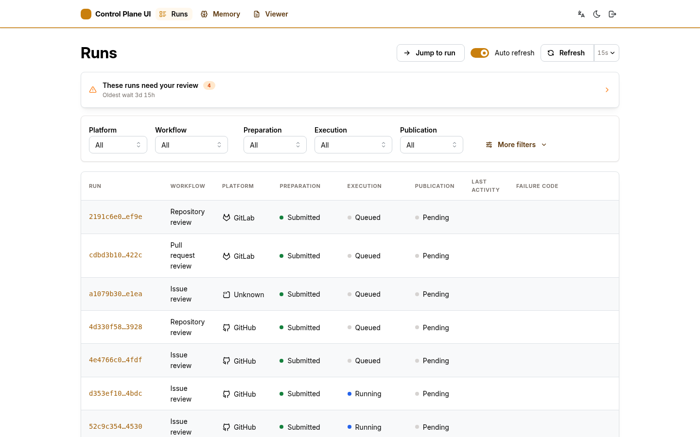
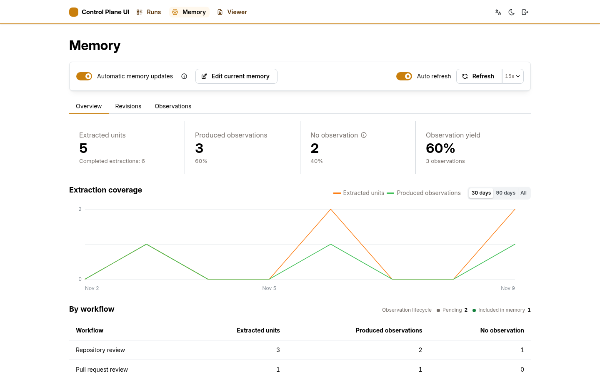
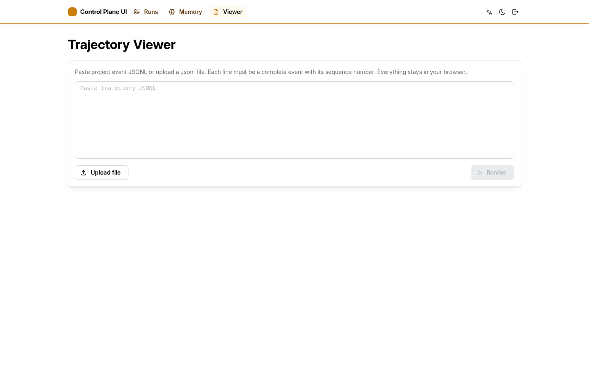

# Control Plane UI

语言：[English](README.md) | 中文

本文为 [README.md](README.md) 的中文译文；如有差异，以英文版为准。

这是内部运维控制台，用于查看和处置 run、下载执行归档、管理 Agent 记忆和阅读执行轨迹。浏览器通过本应用的同源服务端（BFF）访问后端数据；BFF 保存服务凭据，只代理允许的路由。独立的执行轨迹查看器在浏览器本地处理上传或粘贴的内容。

## 界面预览

> 以下测试数据截图同时也是提交到仓库的 Playwright 视觉基线。

### Runs



<!-- doc-default: control-plane-ui.runs-filters; source=apps/control-plane-ui/browser/features/runs/overview/RunFilters.tsx -->

可以按工作流、平台、生命周期阶段或时间范围筛选 run。在移动端，点击“筛选”展开控件；收起后仍显示已应用的条件。“清除筛选”会移除条件并返回第一页，同时保留每页数量偏好。

<!-- doc-default: control-plane-ui.runs-query-state; source=apps/control-plane-ui/browser/features/runs/overview/useRunsData.ts -->

切换查询时，结果区域显示加载状态，避免将上一查询的记录和分页误认为当前结果。查询失败后仍可调整筛选或点击“重试”。刷新同一查询时保留上次结果，并明确提示刷新失败。

### Memory



### Viewer



## 本地运行

在 `apps/control-plane-ui` 中安装依赖，并启动使用测试数据的预览：

```bash
pnpm install --frozen-lockfile
pnpm run dev:fixtures
```

打开 Vite 输出的地址，通常是 `http://localhost:5173`。这种模式提供有代表性的 run 和记忆状态，不需要启动 Review Runs、Memory Catalog、PostgreSQL 或 RustFS。Memory 暂停、恢复、编辑和回滚使用有状态测试数据；记忆文件树与执行轨迹操作会返回小型测试数据附件，因此无需真实存储对象也能验证浏览器下载行为。

测试数据服务端还提供稳定的全页错误状态，便于进行视觉检查：

- `/memory/revisions/404/tree` 显示记忆文件树预览失败，同时保留产物下载入口。
- `/memory/revisions/404/trajectory` 显示执行轨迹加载失败。
- `/runs/fixture-artifact-load-error/files` 显示 run 文件加载失败。

<!-- doc-default: control-plane-ui.viewer-input; source=apps/control-plane-ui/shared/trajectory-events.ts -->

查看器完全在浏览器内运行，接受从文件上传或粘贴的项目事件 JSONL。每个非空行必须包含带递增序号的完整事件，消息事件必须有消息 ID；不支持消息数组或包装对象。输入不会上传到 BFF。

<!-- doc-default: control-plane-ui.viewer-navigation; source=apps/control-plane-ui/browser/app/App.tsx -->

在同一标签页内切换页面时，Viewer 的内容和阅读状态保留在内存中，返回后可继续查看。“清空查看器”会丢弃当前内容；刷新或关闭标签页后也会清空，轨迹内容不会写入浏览器存储。

## 源码布局

该包先按运行时划分，再按浏览器功能组织：

```text
browser/
  app/                应用 shell、session UI、preferences 和 theme
  features/
    runs/             run 列表、详情、状态和 Review Runs projections
    memory/           memory 查看和 Memory Catalog projections
    workspace/        runs 与 memory 共用的文件浏览和编辑能力
    trajectory/       执行轨迹的解析与展示
    viewer/           本地执行轨迹查看器页面
  shared/             仅供 browser 使用的基础设施和小型工具
  styles/             按顺序加载的样式分区
  main.tsx            browser 入口
server/               Node BFF
shared/               browser 与 server 都会 import 的值
scripts/              开发期 package 工具
test/                 browser 与 server 测试
```

功能域之间不得相互 import。可复用的浏览器能力放在 `browser/features/` 或 `browser/shared/`；包级 `shared/` 仅用于真正跨越 browser/server 运行时边界的代码。

测试数据按 Review Runs 的默认页大小提供数十条 run，并实现了它的游标契约，因此翻页、状态筛选、详情时间线和已结算的模型用量快照都能在没有后端的情况下走通。每条生成的 run 都会对照存储实现实际可能产生的状态做校验，所以不可能出现的组合会直接让模块导入失败，不会混成看似合理的演示数据。

如需连接正在运行的 Review Runs，先在一个终端中构建并启动 BFF：

```bash
pnpm run build
REVIEW_RUNS_READ_TOKEN=local-read-token \
CONTROL_PLANE_UI_ACCESS_TOKEN=local-ui-token \
pnpm run server
```

再在另一个终端中启动 Vite：

```bash
pnpm run dev
```

Vite 会将 `/api` 请求代理到 `http://127.0.0.1:8091` 上的 BFF。BFF 默认连接 `http://127.0.0.1:8090` 上的 Review Runs；若 Review Runs 位于其他地址，请设置 `REVIEW_RUNS_URL`。下载产物还需要配置[本地集成部署](../../docs/operations/LOCAL_INTEGRATED_DEPLOYMENT.zh.md)中列出的 S3 参数。AWS 可以使用默认接口地址和 `SEC_REVIEW_ARTIFACT_S3_ADDRESSING_STYLE=auto`；本地 RustFS 部署会提供接口地址并使用 `path`。

使用完整 Compose 部署时，默认访问地址为 `http://127.0.0.1:8091`。

控制台支持持续更新的现代浏览器。请保持浏览器更新；旧版浏览器不在支持范围内。

## 本地检查

```bash
pnpm run lint
pnpm run format:check
pnpm run typecheck
pnpm run colors:check
pnpm run icons:check
pnpm run styles:report
pnpm test
pnpm run test:e2e
pnpm run build
```

额外的 UI 一致性检查包括：

- `pnpm run colors:check`：检查自定义颜色是否同时存在于浅色和深色主题中，指定的文字与背景组合是否仍然清晰，以及品牌色是否保持从浅到深排列。相邻颜色过于接近时只报告提示，不会导致 CI 失败。
- `pnpm run icons:check`：要求浏览器图标来自 Tabler，并使用共享的 `ICON_SIZE` 尺寸等级。
- `pnpm run styles:report`：列出维护中的 CSS 里直接写入的间距、圆角和字号值。该报告仅供检查，不会导致 CI 失败。

### 测试范围

- `pnpm test`：运行 Node 测试和 React 组件测试，检查组件渲染与交互。
- `pnpm run test:e2e`：运行桌面和移动端 Chrome 浏览器测试，检查布局、滚动、下载等浏览器行为，以及无障碍和视觉效果。

本地浏览器测试为每个 Playwright 测试启动独立的测试数据服务，端口随机分配。调试时可通过 `CONTROL_PLANE_UI_E2E_PORT` 指定固定端口。

### 测试外部部署

设置 `CONTROL_PLANE_UI_BASE_URL` 指向已启动的部署；需要登录时，同时设置 `CONTROL_PLANE_UI_ACCESS_TOKEN`。

外部部署测试只读，并使用单个 Playwright worker，减少对共享服务的负载。

### 无障碍与视觉检查

本地浏览器测试通过 axe 检查 WCAG A/AA 问题，并检查文字对比度、键盘焦点及控件的禁用和加载状态。

视觉测试覆盖桌面与移动端、浅色与深色主题，以及错误页面。截图与仓库中的基准图片比较，允许最多 0.1% 的像素不同。

界面有意变化时：

1. 检查新截图，确认变化符合预期。
2. 运行 `pnpm run test:e2e:update-visuals`。
3. 将更新后的基准图片一同提交。

## 服务配置与访问控制

生产服务需要 `REVIEW_RUNS_READ_TOKEN` 和 `CONTROL_PLANE_UI_ACCESS_TOKEN`，两者用途不同。访问 token 决定谁能打开控制台：浏览器用它换取 HTTP-only 会话 cookie，token 本身不会进入浏览器代码或 Vite 变量。后端代表已登录用户调用 Review Runs 查询路由时使用读取令牌，它同样只存在于服务端。由于两者分开，控制台访问凭据与后端读取密钥可以独立签发、轮换和吊销。例如，只读的监控面板只持有读取令牌，不具备任何控制台访问能力。

<!-- doc-default: CONTROL_PLANE_UI_HOST; source=apps/control-plane-ui/server/main.ts -->

生产服务默认绑定 `127.0.0.1`。只有容器网络或反向代理需要访问时才设置 `CONTROL_PLANE_UI_HOST`。浏览器会话使用独立的随机标识符，并在服务端保留 12 小时，而不是从访问 token 派生 cookie。

由 HTTPS 反向代理终止 TLS 时，设置 `CONTROL_PLANE_UI_SECURE_COOKIES=true`，使会话和退出登录 cookie 带有 `Secure` 属性。明文 HTTP 监听地址必须对不受信网络不可达；访问 token 只提交到 `/api/session`，但该请求的传输保护仍依赖 TLS。

BFF 还负责代理下载私有 RustFS 中的执行归档。它使用单独的 `s3:GetObject` 凭据，该凭据仅可读取 `sec-review/runs/*/artifacts/*`；浏览器只提交 run ID，不会收到存储凭据或对象 URI。BFF 会先将对象写入临时文件，并根据 Review Runs 元数据校验大小和 SHA-256 摘要，再向浏览器返回下载。下载使用同一个 HTTP-only 会话鉴权，固定作为附件返回，并受存储空闲超时限制。

## 记忆管理

服务端记忆文件树读取和构建代码实现版本化的 [memory-tree profile](../../contracts/tar-zstd-artifact/profiles/memory-tree/README.zh.md)。它们不会进入浏览器 bundle；BFF 负责校验、摘要计算和规范对象键。

设置 `MEMORY_CATALOG_URL` 和 `MEMORY_CATALOG_OPERATOR_TOKEN` 后，即可在控制台管理记忆：暂停或恢复记忆自动更新、编辑当前生效的记忆文件树，以及恢复已有修订。

BFF 负责访问 Catalog 和对象存储，并在返回产物前校验大小和 SHA-256 摘要。浏览器不会获得存储 URI 或凭据。

编辑失败后，保持编辑器打开且内容不变，可以重试同一次操作，复用原来的 operation ID；关闭或重新加载编辑器会开始新操作。编辑和恢复版本不会改变记忆树自动更新状态。

<!-- doc-default: control-plane-ui.memory-recovery; source=apps/control-plane-ui/browser/features/memory/Memory.tsx -->

记忆编辑和恢复失败时，错误显示在对应操作弹窗内；编辑草稿会保留以便重试。新建文件会拒绝已有路径，重命名为原路径时不改变文件。在窄屏上，修订和观察列表将记录身份与操作放在一起，选择图节点后会将详情带入视野。产物预览失败后可在当前页面重试。
