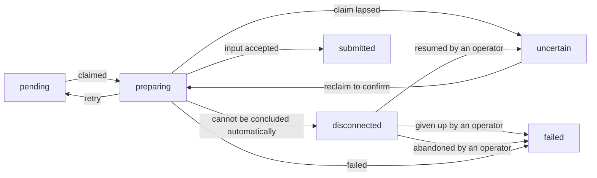
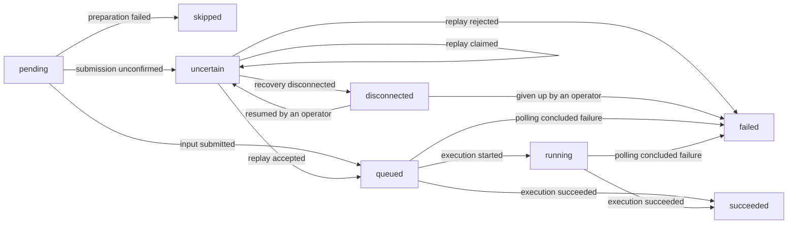
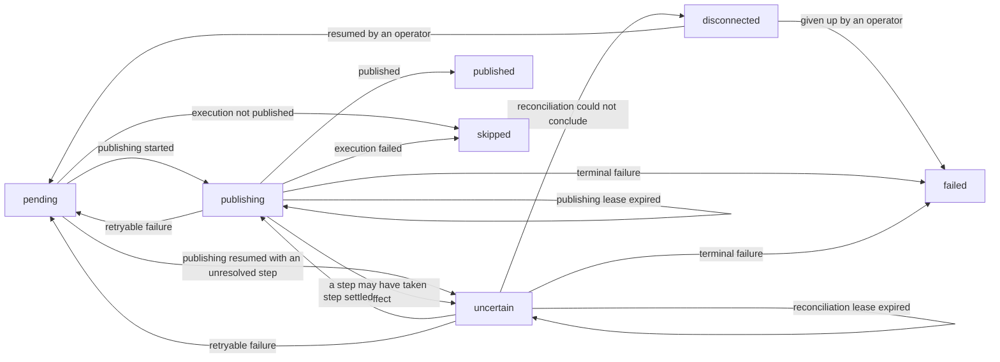
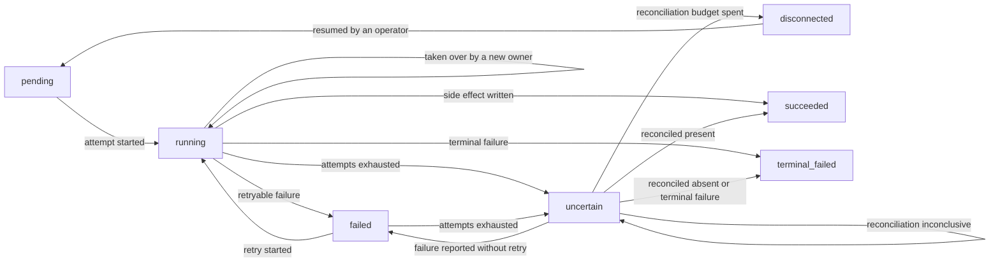

<!-- Generated from contracts/review-runs-api/v1/openapi.yaml (x-state-machines). Do not edit. Regenerate with `pnpm --dir contracts/review-runs-api/tools run generate`. -->

# Review Runs State Machines

Language: English | [中文](STATE_MACHINES.zh.md)

Every Review Runs lifecycle state and allowed transition, rendered from the `x-state-machines` block of [openapi.yaml](openapi.yaml). Each run has three axes (`preparation`, `execution`, `publication`), and a publication is made of steps with their own machine. The same status name can mean different things on different machines, so read a status together with its machine. For example, a publication step's `failed` is one failed attempt that can still be retried or reconciled, while an axis's `failed` is a final conclusion.

A transition that keeps the same state, such as a takeover or an inconclusive reconciliation, records an audit event without changing the status. "Recorded reason" is the `reason_code` written to the run's event log, when the transition has one.

## Preparation

Field: `preparation.status`

| State          | Label        | Role     | Meaning                                                                                                                                                                                                                                                                                                                                                                                                               |
| -------------- | ------------ | -------- | --------------------------------------------------------------------------------------------------------------------------------------------------------------------------------------------------------------------------------------------------------------------------------------------------------------------------------------------------------------------------------------------------------------------- |
| `pending`      | Pending      | initial  | Admitted, but no preparer has claimed the work yet.                                                                                                                                                                                                                                                                                                                                                                   |
| `preparing`    | Preparing    |          | A coordinator currently owns the claim and is building the Execution input.                                                                                                                                                                                                                                                                                                                                           |
| `uncertain`    | Uncertain    |          | The claim lapsed before the preparer reported, so it is unknown whether the prepared input reached Review Runs. This is not a failure: a claim may rebuild the input and resubmit it under the same identity, which is idempotent.                                                                                                                                                                                    |
| `disconnected` | Disconnected |          | Automatic work stopped without a conclusion, because the run's persisted state no longer admits the only transition expiry could make. Nothing retries this row on its own; an operator resumes it into `uncertain`, gives it up, or abandons it.                                                                                                                                                                     |
| `submitted`    | Submitted    | terminal | The input was accepted and handed to the Execution API provider; preparation is done.                                                                                                                                                                                                                                                                                                                                 |
| `failed`       | Failed       | terminal | Preparation ended without a usable result, in one of two ways: (1) it failed for good (retry budget exhausted, or the input could not be built), so the Execution API provider was never handed input and execution is skipped; (2) an operator gave up on or abandoned a disconnected preparation. After an operator decision the input may already have been submitted, and the task may still be running remotely. |

| From           | To             | Transition                        | Recorded reason                     |
| -------------- | -------------- | --------------------------------- | ----------------------------------- |
| `pending`      | `preparing`    | claimed                           |                                     |
| `preparing`    | `submitted`    | input accepted                    |                                     |
| `preparing`    | `pending`      | retry                             |                                     |
| `preparing`    | `uncertain`    | claim lapsed                      |                                     |
| `uncertain`    | `preparing`    | reclaim to confirm                |                                     |
| `preparing`    | `disconnected` | cannot be concluded automatically | `EXECUTION_ALREADY_ADVANCED`        |
| `disconnected` | `uncertain`    | resumed by an operator            | `PREPARATION_RESUMED_BY_OPERATOR`   |
| `disconnected` | `failed`       | given up by an operator           | `PREPARATION_GIVEN_UP_BY_OPERATOR`  |
| `disconnected` | `failed`       | abandoned by an operator          | `PREPARATION_ABANDONED_BY_OPERATOR` |
| `preparing`    | `failed`       | failed                            |                                     |

## Execution

Field: `execution.status`

| State          | Label        | Role     | Meaning                                                                                                                                                                                                                                                                                                                                                                                                                                                                                                                                                                                                                                         |
| -------------- | ------------ | -------- | ----------------------------------------------------------------------------------------------------------------------------------------------------------------------------------------------------------------------------------------------------------------------------------------------------------------------------------------------------------------------------------------------------------------------------------------------------------------------------------------------------------------------------------------------------------------------------------------------------------------------------------------------- |
| `pending`      | Pending      | initial  | Admitted, but its prepared input has not been submitted to the Execution API provider yet.                                                                                                                                                                                                                                                                                                                                                                                                                                                                                                                                                      |
| `queued`       | Queued       |          | The Execution API provider accepted the submission; polling has not yet seen it start.                                                                                                                                                                                                                                                                                                                                                                                                                                                                                                                                                          |
| `running`      | Running      |          | Polling observed that the Execution API provider is executing this run. A transient network blip while polling does not change this state: the run keeps the last observed value and is polled again, so this state may be slightly out of date.                                                                                                                                                                                                                                                                                                                                                                                                |
| `succeeded`    | Succeeded    | terminal | The Execution API provider returned a result; it now becomes eligible for publication.                                                                                                                                                                                                                                                                                                                                                                                                                                                                                                                                                          |
| `skipped`      | Skipped      | terminal | Execution never ran because preparation failed. This is not an execution failure; the reason is on the preparation axis.                                                                                                                                                                                                                                                                                                                                                                                                                                                                                                                        |
| `uncertain`    | Uncertain    |          | The task was submitted, but no response arrived, so it is unknown whether the Execution API provider accepted it. This is not a failure: the submission is replayed under the same run_id.                                                                                                                                                                                                                                                                                                                                                                                                                                                      |
| `disconnected` | Disconnected |          | Automatic recovery used its budget without a conclusive Execution API provider answer. The run is visible for operator action and is not reported as failed.                                                                                                                                                                                                                                                                                                                                                                                                                                                                                    |
| `failed`       | Failed       | terminal | This run no longer tracks the task, in one of two ways: (1) a definite failure, where polling produced a conclusive answer that the task cannot succeed (the Execution API provider reported it failed, or the run could not be found, returned no result, or the response broke the protocol) or a retried submission failed conclusively; (2) an operator gave up on a disconnected execution or abandoned the run's preparation. After an operator decision no cancellation is sent, so the task may still be running or may succeed remotely. A transient network error (a timeout, a 5xx, a dropped connection) is not a definite failure. |

| From           | To             | Transition                | Recorded reason                            |
| -------------- | -------------- | ------------------------- | ------------------------------------------ |
| `pending`      | `queued`       | input submitted           |                                            |
| `pending`      | `skipped`      | preparation failed        |                                            |
| `pending`      | `uncertain`    | submission unconfirmed    | `SUBMISSION_STATE_UNCERTAIN`               |
| `uncertain`    | `uncertain`    | replay claimed            | `SUBMISSION_RECOVERY_CLAIMED`              |
| `uncertain`    | `queued`       | replay accepted           |                                            |
| `uncertain`    | `failed`       | replay rejected           |                                            |
| `uncertain`    | `disconnected` | recovery disconnected     | `SUBMISSION_RECOVERY_EXHAUSTED`            |
| `disconnected` | `uncertain`    | resumed by an operator    | `SUBMISSION_RECOVERY_RESUMED_BY_OPERATOR`  |
| `disconnected` | `failed`       | given up by an operator   | `SUBMISSION_RECOVERY_GIVEN_UP_BY_OPERATOR` |
| `queued`       | `running`      | execution started         |                                            |
| `queued`       | `succeeded`    | execution succeeded       |                                            |
| `running`      | `succeeded`    | execution succeeded       |                                            |
| `queued`       | `failed`       | polling concluded failure |                                            |
| `running`      | `failed`       | polling concluded failure |                                            |

## Publication

Field: `publication.status`

| State          | Label        | Role     | Meaning                                                                                                                                                                                                                                  |
| -------------- | ------------ | -------- | ---------------------------------------------------------------------------------------------------------------------------------------------------------------------------------------------------------------------------------------- |
| `pending`      | Pending      | initial  | Waiting for a successful execution result before publishing.                                                                                                                                                                             |
| `publishing`   | Publishing   |          | A coordinator owns the publication claim and is performing the side effects.                                                                                                                                                             |
| `uncertain`    | Uncertain    |          | A step may have completed its side effect remotely and is being reconciled. The axis reflects its strongest step; this is not a failure, and other steps keep publishing.                                                                |
| `disconnected` | Disconnected |          | Automatic reconciliation of a step stopped without an answer, so an operator has to establish what is on the remote system. The axis reflects its strongest step.                                                                        |
| `published`    | Published    | terminal | All publication steps succeeded; the result is visible.                                                                                                                                                                                  |
| `failed`       | Failed       | terminal | Publishing ended in failure, either because its owner concluded it as failed (for example after a terminal failure or with steps that did not succeed) or because an operator gave up. A retryable failure returns to `pending` instead. |
| `skipped`      | Skipped      | terminal | There was nothing to publish because execution did not succeed.                                                                                                                                                                          |

| From           | To             | Transition                                 | Recorded reason                    |
| -------------- | -------------- | ------------------------------------------ | ---------------------------------- |
| `pending`      | `publishing`   | publishing started                         |                                    |
| `pending`      | `uncertain`    | publishing resumed with an unresolved step |                                    |
| `uncertain`    | `uncertain`    | reconciliation lease expired               | `PUBLICATION_LEASE_EXPIRED`        |
| `publishing`   | `uncertain`    | a step may have taken effect               |                                    |
| `uncertain`    | `publishing`   | step settled                               |                                    |
| `uncertain`    | `disconnected` | reconciliation could not conclude          |                                    |
| `disconnected` | `pending`      | resumed by an operator                     | `PUBLICATION_RESUMED_BY_OPERATOR`  |
| `disconnected` | `failed`       | given up by an operator                    | `PUBLICATION_GIVEN_UP_BY_OPERATOR` |
| `publishing`   | `published`    | published                                  |                                    |
| `publishing`   | `publishing`   | publishing lease expired                   | `PUBLICATION_LEASE_EXPIRED`        |
| `publishing`   | `pending`      | retryable failure                          |                                    |
| `publishing`   | `failed`       | terminal failure                           |                                    |
| `uncertain`    | `pending`      | retryable failure                          |                                    |
| `uncertain`    | `failed`       | terminal failure                           |                                    |
| `pending`      | `skipped`      | execution not published                    |                                    |
| `publishing`   | `skipped`      | execution failed                           | `PUBLICATION_ABANDONED`            |

## Publication step

Field: `ObservedPublicationStep.status`

| State             | Label            | Role     | Meaning                                                                                                                                                                      |
| ----------------- | ---------------- | -------- | ---------------------------------------------------------------------------------------------------------------------------------------------------------------------------- |
| `pending`         | Pending          | initial  | Not attempted yet, or returned to the queue with fresh budgets by an operator.                                                                                               |
| `running`         | Running          |          | An attempt started. Its owner may still be performing the side effect, or may have died after performing it, so a later claim cannot assume nothing happened.                |
| `failed`          | Attempt failed   |          | The last attempt failed. The system retries while attempts remain; once they are exhausted, it checks the remote result before concluding.                                   |
| `uncertain`       | Uncertain        |          | The attempt budget is spent, but any started attempt may have taken effect remotely, so the connector must reconcile against the remote system before the step can conclude. |
| `disconnected`    | Disconnected     |          | Reconciliation used its budget without an answer. An operator has to establish what is on the remote system.                                                                 |
| `succeeded`       | Succeeded        | terminal | The side effect exists, either written by an attempt or found by reconciliation.                                                                                             |
| `terminal_failed` | Terminal failure | terminal | The step will not be attempted again: an attempt failed terminally, or reconciliation confirmed that the side effect is absent.                                              |

| From           | To                | Transition                            | Recorded reason                   |
| -------------- | ----------------- | ------------------------------------- | --------------------------------- |
| `pending`      | `running`         | attempt started                       |                                   |
| `running`      | `running`         | taken over by a new owner             |                                   |
| `failed`       | `running`         | retry started                         |                                   |
| `running`      | `succeeded`       | side effect written                   |                                   |
| `running`      | `failed`          | retryable failure                     |                                   |
| `running`      | `terminal_failed` | terminal failure                      |                                   |
| `running`      | `uncertain`       | attempts exhausted                    |                                   |
| `failed`       | `uncertain`       | attempts exhausted                    |                                   |
| `uncertain`    | `succeeded`       | reconciled present                    |                                   |
| `uncertain`    | `terminal_failed` | reconciled absent or terminal failure |                                   |
| `uncertain`    | `uncertain`       | reconciliation inconclusive           |                                   |
| `uncertain`    | `disconnected`    | reconciliation budget spent           |                                   |
| `uncertain`    | `failed`          | failure reported without retry        |                                   |
| `disconnected` | `pending`         | resumed by an operator                | `PUBLICATION_RESUMED_BY_OPERATOR` |
