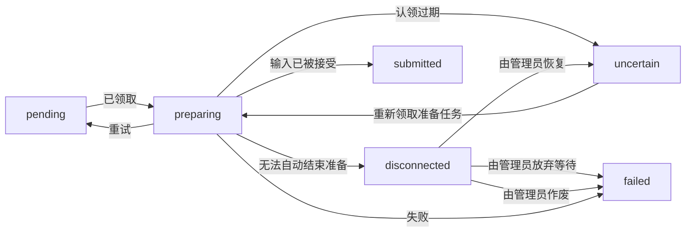
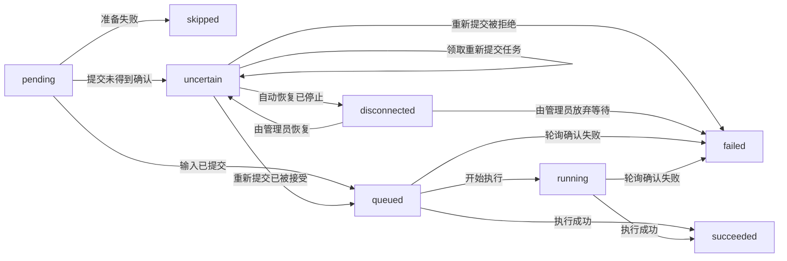
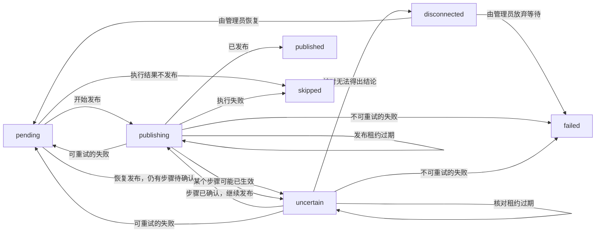
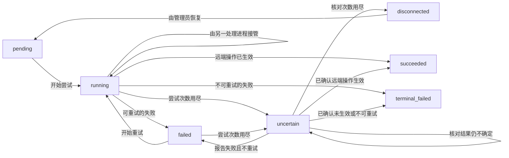

<!-- Generated from contracts/review-runs-api/v1/openapi.yaml and contracts/review-runs-api/v1/overlays/zh.yaml (x-state-machines). Do not edit. Regenerate with `pnpm --dir contracts/review-runs-api/tools run generate`. -->

# Review Runs 状态机

语言：[English](STATE_MACHINES.md) | 中文

Review Runs 的全部生命周期状态和允许的转换，定义于 [openapi.yaml](openapi.yaml) 的 `x-state-machines`，中文译文来自 [overlays/zh.yaml](overlays/zh.yaml)。每个运行有三条状态轴（`preparation`、`execution`、`publication`）。发布包含多个步骤，每个步骤也有独立的状态机。同名状态在不同状态机中可能含义不同。例如，发布步骤的 `failed` 表示一次尝试失败，仍可重试或核对；状态轴的 `failed` 则表示该轴已最终失败。

有些转换会记录审计事件，但不改变状态，例如任务被接管，或核对后结果仍不确定。“记录的原因”列显示该转换写入运行事件日志的 `reason_code`；没有原因码时留空。

## 准备

字段：`preparation.status`

| 状态           | 标签   | 角色 | 含义                                                                                                                                                                                                                                        |
| -------------- | ------ | ---- | ------------------------------------------------------------------------------------------------------------------------------------------------------------------------------------------------------------------------------------------- |
| `pending`      | 等待中 | 初始 | 运行已接收，尚无准备进程领取任务。                                                                                                                                                                                                          |
| `preparing`    | 准备中 |      | 协调进程已领取准备任务，正在构建执行所需的输入。                                                                                                                                                                                            |
| `uncertain`    | 待确认 |      | 准备进程尚未报告结果，认领就已过期，因此无法确认准备好的输入是否已送达 Review Runs。这不表示准备失败。任务可被重新领取，并使用同一运行标识重建、提交输入；重复提交是幂等的。                                                                |
| `disconnected` | 失联   |      | 已保存的运行状态不允许执行认领过期时应有的状态转换，因此自动处理已停止，尚无最终结论。系统不会自行重试；管理员可将其恢复为 `uncertain`、放弃等待或作废运行。                                                                                |
| `submitted`    | 已提交 | 终止 | 输入已被接受并提交给 Execution API 提供方，准备阶段已完成。                                                                                                                                                                                 |
| `failed`       | 失败   | 终止 | 准备阶段已结束，未得到可用结果。可能是准备永久失败（重试次数用尽或无法构建输入），此时输入从未提交给 Execution API 提供方，执行会被跳过；也可能是管理员对失联的准备任务选择放弃等待或作废运行，此时输入可能已经提交，任务可能仍在远端执行。 |

| 从             | 到             | 转换             | 记录的原因                          |
| -------------- | -------------- | ---------------- | ----------------------------------- |
| `pending`      | `preparing`    | 已领取           |                                     |
| `preparing`    | `submitted`    | 输入已被接受     |                                     |
| `preparing`    | `pending`      | 重试             |                                     |
| `preparing`    | `uncertain`    | 认领过期         |                                     |
| `uncertain`    | `preparing`    | 重新领取准备任务 |                                     |
| `preparing`    | `disconnected` | 无法自动结束准备 | `EXECUTION_ALREADY_ADVANCED`        |
| `disconnected` | `uncertain`    | 由管理员恢复     | `PREPARATION_RESUMED_BY_OPERATOR`   |
| `disconnected` | `failed`       | 由管理员放弃等待 | `PREPARATION_GIVEN_UP_BY_OPERATOR`  |
| `disconnected` | `failed`       | 由管理员作废     | `PREPARATION_ABANDONED_BY_OPERATOR` |
| `preparing`    | `failed`       | 失败             |                                     |

## 执行

字段：`execution.status`

| 状态           | 标签     | 角色 | 含义                                                                                                                                                                                                                                                                                                                                  |
| -------------- | -------- | ---- | ------------------------------------------------------------------------------------------------------------------------------------------------------------------------------------------------------------------------------------------------------------------------------------------------------------------------------------- |
| `pending`      | 等待中   | 初始 | 运行已接收，准备好的输入尚未提交给 Execution API 提供方。                                                                                                                                                                                                                                                                             |
| `queued`       | 排队中   |      | Execution API 提供方已接受任务，轮询尚未发现任务开始执行。                                                                                                                                                                                                                                                                            |
| `running`      | 执行中   |      | 轮询结果表明，Execution API 提供方正在执行该任务。轮询期间出现临时网络错误时，系统会保留上次获取的状态并继续查询，因此显示的状态可能滞后。                                                                                                                                                                                            |
| `succeeded`    | 执行成功 | 终止 | Execution API 提供方已返回结果，可以开始发布。                                                                                                                                                                                                                                                                                        |
| `skipped`      | 已跳过   | 终止 | 准备失败，执行未开始。失败原因记录在准备轴上，不属于执行失败。                                                                                                                                                                                                                                                                        |
| `uncertain`    | 待确认   |      | 任务已提交，但未收到响应，无法确认 Execution API 提供方是否已接受任务。这不表示执行失败；系统会使用同一个 run_id 重新提交。                                                                                                                                                                                                           |
| `disconnected` | 失联     |      | 自动恢复次数已用尽，Execution API 提供方仍未给出确定答复。该运行将等待管理员处理，不会被记为失败。                                                                                                                                                                                                                                    |
| `failed`       | 失败     | 终止 | 该运行已停止跟踪执行状态。可能是轮询确认了失败（Execution API 提供方报告失败、找不到运行、未返回结果或响应违反协议），或重新提交时收到确定的失败答复；也可能是管理员对失联的执行选择放弃等待，或作废了准备阶段。管理员的这些操作不会发送取消请求，远端任务仍可能继续执行并成功。临时网络错误（超时、5xx、连接中断）不属于确定的失败。 |

| 从             | 到             | 转换             | 记录的原因                                 |
| -------------- | -------------- | ---------------- | ------------------------------------------ |
| `pending`      | `queued`       | 输入已提交       |                                            |
| `pending`      | `skipped`      | 准备失败         |                                            |
| `pending`      | `uncertain`    | 提交未得到确认   | `SUBMISSION_STATE_UNCERTAIN`               |
| `uncertain`    | `uncertain`    | 领取重新提交任务 | `SUBMISSION_RECOVERY_CLAIMED`              |
| `uncertain`    | `queued`       | 重新提交已被接受 |                                            |
| `uncertain`    | `failed`       | 重新提交被拒绝   |                                            |
| `uncertain`    | `disconnected` | 自动恢复已停止   | `SUBMISSION_RECOVERY_EXHAUSTED`            |
| `disconnected` | `uncertain`    | 由管理员恢复     | `SUBMISSION_RECOVERY_RESUMED_BY_OPERATOR`  |
| `disconnected` | `failed`       | 由管理员放弃等待 | `SUBMISSION_RECOVERY_GIVEN_UP_BY_OPERATOR` |
| `queued`       | `running`      | 开始执行         |                                            |
| `queued`       | `succeeded`    | 执行成功         |                                            |
| `running`      | `succeeded`    | 执行成功         |                                            |
| `queued`       | `failed`       | 轮询确认失败     |                                            |
| `running`      | `failed`       | 轮询确认失败     |                                            |

## 发布

字段：`publication.status`

| 状态           | 标签   | 角色 | 含义                                                                                                                                                       |
| -------------- | ------ | ---- | ---------------------------------------------------------------------------------------------------------------------------------------------------------- |
| `pending`      | 等待中 | 初始 | 等待执行成功并返回结果，再开始发布。                                                                                                                       |
| `publishing`   | 发布中 |      | 协调进程已领取发布任务，正在执行远端发布操作。                                                                                                             |
| `uncertain`    | 待确认 |      | 某个发布步骤可能已在远端生效，系统正在核对结果。发布轴的状态由优先级最高的步骤状态决定。此状态不表示失败，其他步骤仍可继续发布。                           |
| `disconnected` | 失联   |      | 某个发布步骤的自动核对已停止，结果仍不确定，需要管理员核查远端情况。发布轴的状态由优先级最高的步骤状态决定。                                               |
| `published`    | 已发布 | 终止 | 所有发布步骤均已成功，结果已可见。                                                                                                                         |
| `failed`       | 失败   | 终止 | 发布已结束并记为失败：可能是负责发布的进程确认发布失败（例如发生不可重试的失败，或仍有步骤未成功），也可能是管理员放弃等待。可重试的失败会回到 `pending`。 |
| `skipped`      | 已跳过 | 终止 | 执行没有成功，因此没有可发布的内容。                                                                                                                       |

| 从             | 到             | 转换                     | 记录的原因                         |
| -------------- | -------------- | ------------------------ | ---------------------------------- |
| `pending`      | `publishing`   | 开始发布                 |                                    |
| `pending`      | `uncertain`    | 恢复发布，仍有步骤待确认 |                                    |
| `uncertain`    | `uncertain`    | 核对租约过期             | `PUBLICATION_LEASE_EXPIRED`        |
| `publishing`   | `uncertain`    | 某个步骤可能已生效       |                                    |
| `uncertain`    | `publishing`   | 步骤已确认，继续发布     |                                    |
| `uncertain`    | `disconnected` | 核对无法得出结论         |                                    |
| `disconnected` | `pending`      | 由管理员恢复             | `PUBLICATION_RESUMED_BY_OPERATOR`  |
| `disconnected` | `failed`       | 由管理员放弃等待         | `PUBLICATION_GIVEN_UP_BY_OPERATOR` |
| `publishing`   | `published`    | 已发布                   |                                    |
| `publishing`   | `publishing`   | 发布租约过期             | `PUBLICATION_LEASE_EXPIRED`        |
| `publishing`   | `pending`      | 可重试的失败             |                                    |
| `publishing`   | `failed`       | 不可重试的失败           |                                    |
| `uncertain`    | `pending`      | 可重试的失败             |                                    |
| `uncertain`    | `failed`       | 不可重试的失败           |                                    |
| `pending`      | `skipped`      | 执行结果不发布           |                                    |
| `publishing`   | `skipped`      | 执行失败                 | `PUBLICATION_ABANDONED`            |

## 发布步骤

字段：`ObservedPublicationStep.status`

| 状态              | 标签     | 角色 | 含义                                                                                                                         |
| ----------------- | -------- | ---- | ---------------------------------------------------------------------------------------------------------------------------- |
| `pending`         | 等待中   | 初始 | 该步骤尚未尝试，或已由管理员重新排队并重置允许尝试和核对的次数。                                                             |
| `running`         | 进行中   |      | 一次发布尝试已开始。负责该步骤的进程可能仍在执行，也可能在远端操作生效后中断。后续进程领取任务时，必须考虑操作已生效的可能。 |
| `failed`          | 尝试失败 |      | 上一次尝试失败。有剩余尝试次数时会重试；次数用尽后，须先核对远端结果，再确定最终状态。                                       |
| `uncertain`       | 待确认   |      | 尝试次数已用尽，之前的尝试可能已在远端生效。连接器必须先核对远端结果，才能结束该步骤。                                       |
| `disconnected`    | 失联     |      | 核对次数已用尽，仍无法确认结果，需要管理员核查远端情况。                                                                     |
| `succeeded`       | 发布成功 | 终止 | 远端操作已生效：发布尝试已报告成功，或后续核对已确认结果存在。                                                               |
| `terminal_failed` | 最终失败 | 终止 | 该步骤不会再次尝试：某次尝试发生不可重试的失败，或核对已确认远端操作未生效。                                                 |

| 从             | 到                | 转换                   | 记录的原因                        |
| -------------- | ----------------- | ---------------------- | --------------------------------- |
| `pending`      | `running`         | 开始尝试               |                                   |
| `running`      | `running`         | 由另一处理进程接管     |                                   |
| `failed`       | `running`         | 开始重试               |                                   |
| `running`      | `succeeded`       | 远端操作已生效         |                                   |
| `running`      | `failed`          | 可重试的失败           |                                   |
| `running`      | `terminal_failed` | 不可重试的失败         |                                   |
| `running`      | `uncertain`       | 尝试次数用尽           |                                   |
| `failed`       | `uncertain`       | 尝试次数用尽           |                                   |
| `uncertain`    | `succeeded`       | 已确认远端操作生效     |                                   |
| `uncertain`    | `terminal_failed` | 已确认未生效或不可重试 |                                   |
| `uncertain`    | `uncertain`       | 核对结果仍不确定       |                                   |
| `uncertain`    | `disconnected`    | 核对次数用尽           |                                   |
| `uncertain`    | `failed`          | 报告失败且不重试       |                                   |
| `disconnected` | `pending`         | 由管理员恢复           | `PUBLICATION_RESUMED_BY_OPERATOR` |
