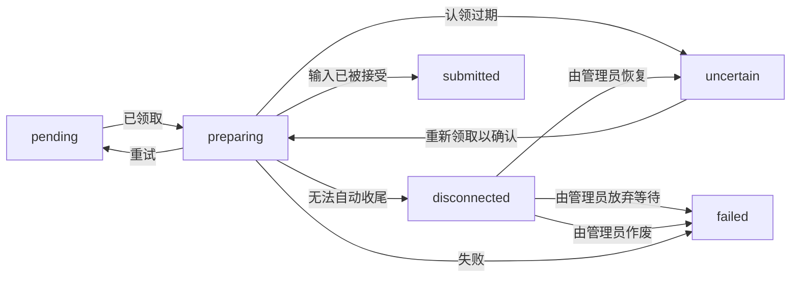
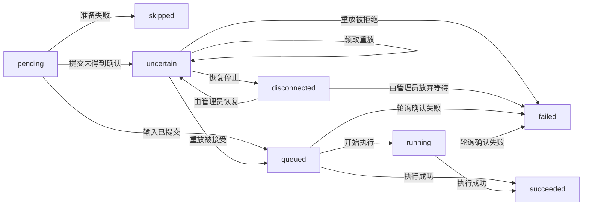
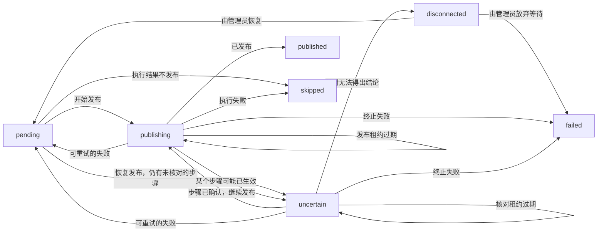
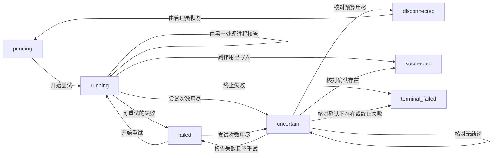

<!-- Generated from contracts/review-runs-api/v1/openapi.yaml and contracts/review-runs-api/v1/overlays/zh.yaml (x-state-machines). Do not edit. Regenerate with `pnpm --dir contracts/review-runs-api/tools run generate`. -->

# Review Runs 状态机

语言：[English](STATE_MACHINES.md) | 中文

Review Runs 全部生命周期状态和允许的转换，由 [openapi.yaml](openapi.yaml) 的 `x-state-machines` 和中文覆盖层 [overlays/zh.yaml](overlays/zh.yaml) 生成。每个 run 有三条轴（`preparation`、`execution`、`publication`），一次发布由若干步骤组成，步骤有自己的状态机。同一个状态名在不同状态机上含义可能不同，读状态时要连同它所在的状态机一起看。例如，发布步骤的 `failed` 只是一次尝试失败，仍可重试或核对；轴的 `failed` 则是最终结论。

保持同一状态的转换（例如接管或核对无结论）只记录审计事件，不改变状态。“记录的原因”是转换写入 run 事件日志的 `reason_code`（如有）。

## 准备

字段：`preparation.status`

| 状态           | 标签   | 角色 | 含义                                                                                                                                                                                                                                         |
| -------------- | ------ | ---- | -------------------------------------------------------------------------------------------------------------------------------------------------------------------------------------------------------------------------------------------- |
| `pending`      | 等待中 | 初始 | 已接纳，但还没有准备者领取这项工作。                                                                                                                                                                                                         |
| `preparing`    | 准备中 |      | 协调方当前持有认领，正在构造执行输入。                                                                                                                                                                                                       |
| `uncertain`    | 待确认 |      | 认领在准备者回报之前过期，因此不确定准备好的输入是否已到达 Review Runs。这不是失败：可以重新认领，用同一身份重建并重新提交输入，这一操作是幂等的。                                                                                           |
| `disconnected` | 失联   |      | 自动处理停止且没有结论：运行已持久化的状态不再允许过期唯一能做的那次转换。不会自动重试；由 管理员 将其恢复到 `uncertain`、放弃等待，或者作废（abandon）。                                                                                    |
| `submitted`    | 已提交 | 终止 | 输入已被接受并交给 Execution API 提供方，准备阶段完成。                                                                                                                                                                                      |
| `failed`       | 失败   | 终止 | 准备没有得到可用结果，分两种情况：(1) 准备永久失败（重试预算用尽，或无法构造输入），Execution API 提供方从未收到输入，因此执行被跳过；(2) 管理员 对失联的准备决定不再等待或作废。管理员 决定之后，输入可能已经提交，任务也可能仍在远端执行。 |

| 从             | 到             | 转换             | 记录的原因                          |
| -------------- | -------------- | ---------------- | ----------------------------------- |
| `pending`      | `preparing`    | 已领取           |                                     |
| `preparing`    | `submitted`    | 输入已被接受     |                                     |
| `preparing`    | `pending`      | 重试             |                                     |
| `preparing`    | `uncertain`    | 认领过期         |                                     |
| `uncertain`    | `preparing`    | 重新领取以确认   |                                     |
| `preparing`    | `disconnected` | 无法自动收尾     | `EXECUTION_ALREADY_ADVANCED`        |
| `disconnected` | `uncertain`    | 由管理员恢复     | `PREPARATION_RESUMED_BY_OPERATOR`   |
| `disconnected` | `failed`       | 由管理员放弃等待 | `PREPARATION_GIVEN_UP_BY_OPERATOR`  |
| `disconnected` | `failed`       | 由管理员作废     | `PREPARATION_ABANDONED_BY_OPERATOR` |
| `preparing`    | `failed`       | 失败             |                                     |

## 执行

字段：`execution.status`

| 状态           | 标签     | 角色 | 含义                                                                                                                                                                                                                                                                                                                                                                                      |
| -------------- | -------- | ---- | ----------------------------------------------------------------------------------------------------------------------------------------------------------------------------------------------------------------------------------------------------------------------------------------------------------------------------------------------------------------------------------------- |
| `pending`      | 等待中   | 初始 | 已接纳，但准备好的输入尚未提交给 Execution API 提供方。                                                                                                                                                                                                                                                                                                                                   |
| `queued`       | 排队中   |      | Execution API 提供方已接受提交，轮询尚未观察到它开始执行。                                                                                                                                                                                                                                                                                                                                |
| `running`      | 执行中   |      | 轮询观察到 Execution API 提供方正在执行该运行。轮询时偶发的网络抖动不会改变这个状态：运行保留上次观察到的值并继续轮询，因此这个状态可能略有滞后。                                                                                                                                                                                                                                         |
| `succeeded`    | 执行成功 | 终止 | Execution API 提供方返回了结果，现在可以发布。                                                                                                                                                                                                                                                                                                                                            |
| `skipped`      | 已跳过   | 终止 | 准备失败，因此执行从未运行。这不是执行失败，原因记录在准备轴上。                                                                                                                                                                                                                                                                                                                          |
| `uncertain`    | 待确认   |      | 任务已提交但没有收到响应，因此不确定 Execution API 提供方是否已接受。这不是失败：会用同一个 run_id 重放这次提交。                                                                                                                                                                                                                                                                         |
| `disconnected` | 失联     |      | 自动恢复已用完预算，仍未得到 Execution API 提供方的确定答复。该运行会显示出来等待 管理员 处理，不会被报告为失败。                                                                                                                                                                                                                                                                         |
| `failed`       | 失败     | 终止 | 这个运行不再跟踪该任务，分两种情况：(1) 确定的失败：轮询得到任务不可能成功的确定答复（Execution API 提供方报告失败，或者找不到该运行、没有返回结果、响应违反协议），或重试的提交得到确定的失败；(2) 管理员 对失联的执行决定不再等待，或作废了这个运行的准备。管理员 决定之后不会发送取消请求，因此任务可能仍在远端执行，甚至可能成功。临时网络错误（超时、5xx、连接中断）不算确定的失败。 |

| 从             | 到             | 转换             | 记录的原因                                 |
| -------------- | -------------- | ---------------- | ------------------------------------------ |
| `pending`      | `queued`       | 输入已提交       |                                            |
| `pending`      | `skipped`      | 准备失败         |                                            |
| `pending`      | `uncertain`    | 提交未得到确认   | `SUBMISSION_STATE_UNCERTAIN`               |
| `uncertain`    | `uncertain`    | 领取重放         | `SUBMISSION_RECOVERY_CLAIMED`              |
| `uncertain`    | `queued`       | 重放被接受       |                                            |
| `uncertain`    | `failed`       | 重放被拒绝       |                                            |
| `uncertain`    | `disconnected` | 恢复停止         | `SUBMISSION_RECOVERY_EXHAUSTED`            |
| `disconnected` | `uncertain`    | 由管理员恢复     | `SUBMISSION_RECOVERY_RESUMED_BY_OPERATOR`  |
| `disconnected` | `failed`       | 由管理员放弃等待 | `SUBMISSION_RECOVERY_GIVEN_UP_BY_OPERATOR` |
| `queued`       | `running`      | 开始执行         |                                            |
| `queued`       | `succeeded`    | 执行成功         |                                            |
| `running`      | `succeeded`    | 执行成功         |                                            |
| `queued`       | `failed`       | 轮询确认失败     |                                            |
| `running`      | `failed`       | 轮询确认失败     |                                            |

## 发布

字段：`publication.status`

| 状态           | 标签   | 角色 | 含义                                                                                                                         |
| -------------- | ------ | ---- | ---------------------------------------------------------------------------------------------------------------------------- |
| `pending`      | 等待中 | 初始 | 等待执行成功的结果，然后开始发布。                                                                                           |
| `publishing`   | 发布中 |      | 协调方持有发布认领，正在执行各项副作用。                                                                                     |
| `uncertain`    | 待确认 |      | 某个步骤可能已在远端完成副作用，正在核对。该轴反映最强的步骤状态；这不是失败，其他步骤会继续发布。                           |
| `disconnected` | 失联   |      | 某个步骤的自动核对已停止且没有答案，需要 管理员 确认远端的实际情况。该轴反映最强的步骤状态。                                 |
| `published`    | 已发布 | 终止 | 所有发布步骤均已成功，结果已可见。                                                                                           |
| `failed`       | 失败   | 终止 | 发布以失败结束：owner 将其收尾为失败（例如出现终止失败，或仍有步骤未成功），或者 管理员 放弃。可重试的失败会回到 `pending`。 |
| `skipped`      | 已跳过 | 终止 | 执行没有成功，因此没有可发布的内容。                                                                                         |

| 从             | 到             | 转换                       | 记录的原因                         |
| -------------- | -------------- | -------------------------- | ---------------------------------- |
| `pending`      | `publishing`   | 开始发布                   |                                    |
| `pending`      | `uncertain`    | 恢复发布，仍有未核对的步骤 |                                    |
| `uncertain`    | `uncertain`    | 核对租约过期               | `PUBLICATION_LEASE_EXPIRED`        |
| `publishing`   | `uncertain`    | 某个步骤可能已生效         |                                    |
| `uncertain`    | `publishing`   | 步骤已确认，继续发布       |                                    |
| `uncertain`    | `disconnected` | 核对无法得出结论           |                                    |
| `disconnected` | `pending`      | 由管理员恢复               | `PUBLICATION_RESUMED_BY_OPERATOR`  |
| `disconnected` | `failed`       | 由管理员放弃等待           | `PUBLICATION_GIVEN_UP_BY_OPERATOR` |
| `publishing`   | `published`    | 已发布                     |                                    |
| `publishing`   | `publishing`   | 发布租约过期               | `PUBLICATION_LEASE_EXPIRED`        |
| `publishing`   | `pending`      | 可重试的失败               |                                    |
| `publishing`   | `failed`       | 终止失败                   |                                    |
| `uncertain`    | `pending`      | 可重试的失败               |                                    |
| `uncertain`    | `failed`       | 终止失败                   |                                    |
| `pending`      | `skipped`      | 执行结果不发布             |                                    |
| `publishing`   | `skipped`      | 执行失败                   | `PUBLICATION_ABANDONED`            |

## 发布步骤

字段：`ObservedPublicationStep.status`

| 状态              | 标签     | 角色 | 含义                                                                                                    |
| ----------------- | -------- | ---- | ------------------------------------------------------------------------------------------------------- |
| `pending`         | 等待中   | 初始 | 尚未尝试，或者已由 管理员 放回队列并重置预算。                                                          |
| `running`         | 进行中   |      | 一次尝试已经开始。它的 owner 可能仍在执行副作用，也可能在执行后中止，因此后续认领不能假定什么都没发生。 |
| `failed`          | 尝试失败 |      | 上一次尝试失败。还有剩余次数时会重试；次数用尽后，先核对远端结果再下结论。                              |
| `uncertain`       | 待确认   |      | 尝试预算已用完，但任何已开始的尝试都可能已在远端生效，因此 connector 必须先核对远端，步骤才能结束。     |
| `disconnected`    | 失联     |      | 核对用完了预算仍没有答案，需要 管理员 确认远端的实际情况。                                              |
| `succeeded`       | 发布成功 | 终止 | 副作用已存在：由某次尝试写入，或由核对发现。                                                            |
| `terminal_failed` | 最终失败 | 终止 | 这个步骤不会再尝试：某次尝试终止失败，或者核对确认副作用不存在。                                        |

| 从             | 到                | 转换                     | 记录的原因                        |
| -------------- | ----------------- | ------------------------ | --------------------------------- |
| `pending`      | `running`         | 开始尝试                 |                                   |
| `running`      | `running`         | 由另一处理进程接管       |                                   |
| `failed`       | `running`         | 开始重试                 |                                   |
| `running`      | `succeeded`       | 副作用已写入             |                                   |
| `running`      | `failed`          | 可重试的失败             |                                   |
| `running`      | `terminal_failed` | 终止失败                 |                                   |
| `running`      | `uncertain`       | 尝试次数用尽             |                                   |
| `failed`       | `uncertain`       | 尝试次数用尽             |                                   |
| `uncertain`    | `succeeded`       | 核对确认存在             |                                   |
| `uncertain`    | `terminal_failed` | 核对确认不存在或终止失败 |                                   |
| `uncertain`    | `uncertain`       | 核对无结论               |                                   |
| `uncertain`    | `disconnected`    | 核对预算用尽             |                                   |
| `uncertain`    | `failed`          | 报告失败且不重试         |                                   |
| `disconnected` | `pending`         | 由管理员恢复             | `PUBLICATION_RESUMED_BY_OPERATOR` |
