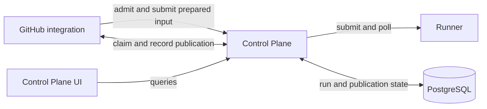
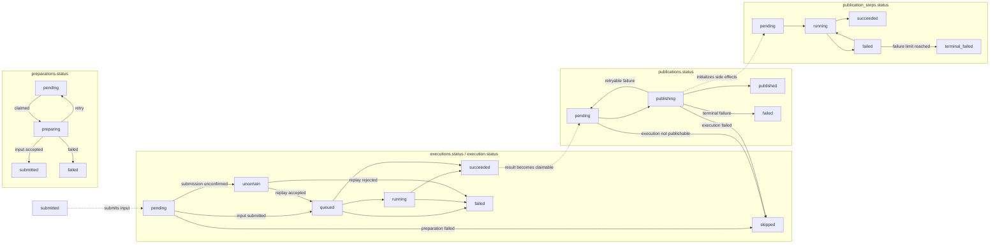

# Control Plane

[中文版](README.zh.md)

Control Plane gives every admitted review a stable identity and durable coordination state. It sits between GitHub integration and Runner so that preparation, submission, execution observation, recovery, and GitHub publication can continue across process restarts and uncertain network outcomes.

## Where it fits



GitHub integration owns GitHub request parsing, input preparation, and GitHub side effects. Runner, Temporal, and the worker own workflow execution. Control Plane coordinates those boundaries without parsing raw GitHub payloads, interpreting workflow-specific results, or executing agents. See the [system architecture](../docs/architecture/SYSTEM_ARCHITECTURE.md) for the complete data flow.

The service runs as an independent Node.js process on port `8090` by default. PostgreSQL credentials are provided only to Control Plane.

## What it does

- Admits a validated request and assigns its `run_id` before input preparation begins.
- Deduplicates replayed GitHub webhook and Actions ingress identities.
- Persists prepared Runner input before submitting it, so an uncertain submission can be recovered.
- Polls Runner and records execution progress, terminal workflow results, and terminal artifact references.
- Makes successful terminal results claimable by the owning integration for GitHub publication.
- Persists publication steps so completed remote side effects are not repeated after restart.
- Exposes redacted run queries for the Control Plane UI.

## Run lifecycle

A run begins in `pending` immediately after admission: on the Runner axis its input has not been submitted yet. Preparation progress is tracked separately in `preparations`, whose own `preparing` state means a preparer currently owns the claim that fences input construction. GitHub integration prepares and uploads the input bundle, then submits the replayable Runner input under that claim. Control Plane records the input and moves the run to `queued` only after Runner accepts it.

Control Plane polls `queued` and `running` runs. A successful Runner result is stored as `succeeded` and becomes eligible for publication. The integration claims that work, performs the GitHub side effects, and records either `published`, a retryable publication failure, or a terminal publication failure.

If Runner submission may have succeeded but its response was lost, the run enters recovery instead of creating a second identity. A terminal preparation or Runner failure makes publication `skipped`. A terminal preparation failure also creates connector-owned notice work, so a connector can tell its user even when the preparation owner had already crashed.

## Persistence model

The run trunk and the three lifecycle axes are separate tables. `review_runs` holds only the admitted identity; each axis keeps its own state and its own input:

| Table                         | Responsibility                                         | Status                                                                        |
| ----------------------------- | ------------------------------------------------------ | ----------------------------------------------------------------------------- |
| `review_runs`                 | Admission identity shared by all axes (no update path) | —                                                                             |
| `preparations`                | Claimable input preparation                            | `pending`, `preparing`, `submitted`, `failed`                                 |
| `preparation_failure_notices` | Connector-owned terminal-failure acknowledgements      | `pending`, `delivering`, `delivered`, `skipped`                               |
| `executions`                  | Runner submission, observation, and terminal result    | `pending`, `queued`, `running`, `uncertain`, `succeeded`, `skipped`, `failed` |
| `publications`                | Whole-publication ownership and outcome                | `pending`, `publishing`, `published`, `failed`, `skipped`                     |
| `publication_steps`           | Recoverable individual connector side effects          | `pending`, `running`, `succeeded`, `failed`, `terminal_failed`                |
| `review_run_events`           | Append-only audit log of transitions on every axis     | —                                                                             |



`publication_steps.failure_count` records failed executions only. A successful execution does not increment it; a failed step becomes `terminal_failed` after reaching the configured failure limit.

## Claims and recovery

Preparation, submission recovery, publication, publication-step commits, and terminal preparation notices use claim tokens to fence stale owners. While input preparation is active, GitHub integration renews its preparation claim. An expired preparation normally returns to `pending`; after the finite retry budget is exhausted, it fails the run, skips publication, and creates durable connector notice work. A timed-out owner may finish an external request, but it cannot commit state after another owner acquires a new token.

For automatic preparation recovery, a connector includes its versioned, opaque preparation input at admission. Control Plane persists and returns that input to the connector which owns the work, but never interprets provider-specific fields. A connector that does not provide replayable input can still prepare synchronously, but its expired work cannot be claimed by the recovery worker.

`run_id` is globally unique in PostgreSQL. `ingress_kind` and `ingress_key` provide connector-scoped ingress idempotency. `connector_id` fences reads, claims, publications, and publication steps. Durable-operation logs include both `connector_id` and `run_id`.

Temporal history, PostgreSQL coordination state, and object-storage artifacts are independent recovery inputs. A missing Runner run does not imply publication success, and a remote side effect is complete only after its publication step records success.

## HTTP API

| Endpoint                                 | Authentication             | Purpose                                  |
| ---------------------------------------- | -------------------------- | ---------------------------------------- |
| `GET /healthz`                           | None                       | Process health                           |
| `GET /readyz`                            | None                       | PostgreSQL-backed coordination readiness |
| `GET /v1/runs?...`                       | `CONTROL_PLANE_READ_TOKEN` | Filtered, cursor-paginated run list      |
| `GET /v1/runs/:run_id`                   | `CONTROL_PLANE_READ_TOKEN` | Redacted run detail                      |
| `GET /v1/runs/:run_id/publication-steps` | `CONTROL_PLANE_READ_TOKEN` | Publication-step summary                 |

The write surface — admission, submission, preparation and publication claims and their terminal outcomes — is a set of REST routes whose request/response shapes, security, and error codes are the hand-written [openapi.yaml](../contracts/control-plane-api/openapi.yaml) contract; that document is the single source of truth for the whole surface, not this table.

The contract is **enforced on requests**: routing, path/query/body validation, and authentication are all derived from it, so a request outside the document is rejected before a handler runs. Responses are _described_ by the contract but not validated against it at runtime — `fastify-openapi-glue` is request-only — so the declared response schemas are a promise the handlers keep, pinned by tests rather than by the framework. `control-plane/test/observed-run-contract.test.ts` validates the committed fixtures and the shapes `observeRun()` actually produces against the shared schemas, and `control-plane/test/server-http.test.ts` exercises the HTTP surface, which is what keeps a response from drifting outside its schema unnoticed.

Read responses omit `runner_input` and `publish_context`. The UI BFF holds the read token; browser code receives neither Control Plane token.

Read responses report three independent lifecycle axes as nested objects of the same shape: `preparation`, `execution`, and `publication`. Each carries its own `status`, `started_at`, `finished_at`, and `updated_at` — the last write to that axis, which is the activity freshness the console shows and is deliberately not a phase bound. The preparation summary adds `attempt_count` and the terminal `failure_code` / `failure_notice_status`, but never its opaque input, claim token, or connector identity. The list endpoint filters on the three axes by query parameter (`preparation_status`, `execution_status`, and `publication_status`; the parameter names keep their established spelling); [observed-run.schema.json](../contracts/control-plane-api/v1/observed-run.schema.json) is the read contract.

`/healthz` only proves the HTTP process is alive. `/readyz` verifies that the current PostgreSQL pool can execute a schema-ledger query and that its complete version set exactly matches this application; it returns `503 {"status":"unavailable"}` without database details otherwise. Compose uses `/readyz` for its Control Plane healthcheck. Runner and GitHub are deliberately excluded: their transient reachability does not make durable admission, reads, or PostgreSQL-backed recovery unsafe, and their failures have separate state-machine recovery paths.

## Configuration

| Variable                                   | Required                             | Purpose                                              |
| ------------------------------------------ | ------------------------------------ | ---------------------------------------------------- |
| `DATABASE_URL`                             | Yes                                  | PostgreSQL connection string                         |
| `CONTROL_PLANE_SERVICE_TOKEN`              | Yes                                  | Internal mutation and coordination authentication    |
| `CONTROL_PLANE_READ_TOKEN`                 | Yes                                  | Query API authentication                             |
| `AGENT_RUNNER_SERVICE_URL`                 | Yes                                  | Runner service base URL                              |
| `AGENT_RUNNER_SERVICE_TOKEN`               | For non-loopback or protected Runner | Runner authentication                                |
| `CONTROL_PLANE_PORT`                       | No                                   | Listen port; default `8090`                          |
| `CONNECTOR_ID`                             | No                                   | Coordination namespace; default `github-app:default` |
| `AGENT_RUNNER_BACKGROUND_POLL_INTERVAL_MS` | No                                   | Coordinator interval; default `15000`                |
| `AGENT_RUNNER_SERVICE_REQUEST_TIMEOUT_MS`  | No                                   | Runner request timeout; default `30000`              |
| `AGENT_RUNNER_SERVICE_REQUEST_RETRIES`     | No                                   | Runner transport retries; default `2`                |
| `AGENT_RUNNER_SERVICE_RETRY_BASE_DELAY_MS` | No                                   | Initial retry delay; default `500`                   |

## Database schema

Schema files live in `src/database/schema-versions`. Applied versions and SHA-256 checksums are recorded in `schema_versions`. Startup uses a PostgreSQL advisory lock to serialize schema work and rejects a database whose recorded checksum differs from the checked-in file. The experimental deployment policy permits destructive schema resets.

## Development

Use Node.js 24 and pnpm 12. Install dependencies and start the service from this directory:

```bash
pnpm install --frozen-lockfile
pnpm run server
```

Checks:

```bash
pnpm run format:check
pnpm run lint
pnpm run typecheck
pnpm test
pnpm run test:integration
```

The contract itself is linted (Spectral) and its projections are freshness-checked by the family tools under [`contracts/control-plane-api/tools`](../contracts/control-plane-api/tools/README.md).

`pnpm run test:integration` uses `TEST_DATABASE_URL` or `DATABASE_URL` when one is supplied; it must point to a disposable PostgreSQL database. Without either variable, the command starts a short-lived local Docker container from the PostgreSQL image declared in the repository-root `compose.yaml`, then removes it after the tests. Docker pulls that image when it is not local, so this fallback requires both Docker and registry access; set `TEST_POSTGRES_IMAGE` to use another image explicitly.
