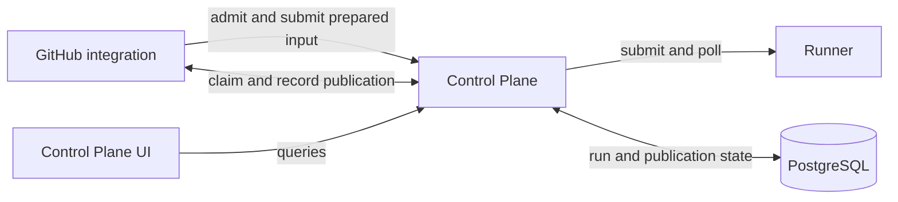
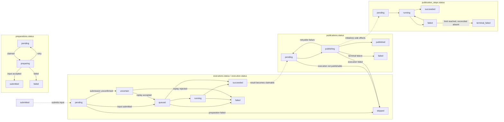

# Control Plane

[中文版](README.zh.md)

Control Plane gives every admitted review a stable identity and durable coordination state. It sits between GitHub integration and Runner so that preparation, submission, execution observation, recovery, and GitHub publication can continue across process restarts and uncertain network outcomes.

## Where it fits



GitHub integration owns GitHub request parsing, input preparation, and GitHub side effects. Runner, Temporal, and the worker own workflow execution. Control Plane coordinates those boundaries without parsing raw GitHub payloads, interpreting workflow-specific results, or executing agents. See the [system architecture](../docs/architecture/SYSTEM_ARCHITECTURE.md) for the complete data flow.

The service runs as an independent Node.js process on port `8090` by default. PostgreSQL credentials are provided only to Control Plane.

## What it does

- Admits a validated request and assigns its `run_id` before input preparation begins.
- Deduplicates replayed GitHub webhook and Actions ingress identities.
- Persists prepared Runner input before submitting it, so an uncertain submission can be recovered.
- Polls Runner and records execution progress, terminal workflow results, and terminal artifact references.
- Makes successful terminal results claimable by the owning integration for GitHub publication.
- Persists publication steps so completed remote side effects are not repeated after restart.
- Exposes redacted run queries for the Control Plane UI.

## Run lifecycle

A run begins in `pending` immediately after admission: on the Runner axis its input has not been submitted yet. Preparation progress is tracked separately in `preparations`, whose own `preparing` state means a preparer currently owns the claim that fences input construction. GitHub integration prepares and uploads the input bundle, then submits the replayable Runner input under that claim. Control Plane records the input and moves the run to `queued` only after Runner accepts it.

Control Plane polls `queued` and `running` runs. A successful Runner result is stored as `succeeded` and becomes eligible for publication. The integration claims that work, performs the GitHub side effects, and records either `published`, a retryable publication failure, or a terminal publication failure.

Re-admitting an already-observed ingress identity is a read-only replay: it returns the existing run and does not claim its preparation. Admission creates that row as `preparing`, which only the original admitter owns, so a process that died mid-preparation is recovered through lease expiry rather than by the replayed request. With the default claim timeout this means a replay can take up to ten minutes to make progress — long enough that a client must not treat "the request returned" as "the work resumed".

If Runner submission may have succeeded but its response was lost, the run enters recovery instead of creating a second identity. Entering that state is not a failure and queues no notice: an unconfirmed submission may still be accepted on replay, so announcing it would state a conclusion the run may contradict — and a posted comment cannot be taken back. A replay that is accepted returns the run to normal progress; one the Runner rejects, or one that produces no answer across the replay budget (`executions.attempt_count`, currently eight), fails the run, makes publication `skipped`, and only then queues the notice. Without that budget an unresolved submission would stay `uncertain` forever and would never be reported at all. A terminal preparation or Runner failure makes publication `skipped`. A terminal failure on any axis creates connector-owned notice work, so a connector can tell its user even when the process that observed the failure had already crashed; the notice records which axis failed so the reply describes how far the run actually got.

## Persistence model

The run trunk and the three lifecycle axes are separate tables. `review_runs` holds only the admitted identity; each axis keeps its own state and its own input:

| Table               | Responsibility                                          | Status                                                                                        |
| ------------------- | ------------------------------------------------------- | --------------------------------------------------------------------------------------------- |
| `review_runs`       | Admission identity shared by all axes (no update path)  | —                                                                                             |
| `preparations`      | Claimable input preparation                             | `pending`, `preparing`, `uncertain`, `disconnected`, `submitted`, `failed`                    |
| `run_notices`       | Connector-owned user-visible failure and attention work | `pending`, `delivering`, `delivered`, `failed`                                                |
| `executions`        | Runner submission, observation, and terminal result     | `pending`, `queued`, `running`, `uncertain`, `disconnected`, `succeeded`, `skipped`, `failed` |
| `publications`      | Whole-publication ownership and outcome                 | `pending`, `publishing`, `uncertain`, `disconnected`, `published`, `failed`, `skipped`        |
| `publication_steps` | Recoverable individual connector side effects           | `pending`, `running`, `uncertain`, `disconnected`, `succeeded`, `failed`, `terminal_failed`   |
| `review_run_events` | Append-only audit log of transitions on every axis      | —                                                                                             |



`publication_steps.attempt_count` is the step's retry budget, and attempts are the only unit that budget counts: an attempt is spent when it starts, so a publisher that dies mid-effect consumes one exactly like a failed attempt does. That count — not failures, not crashes, not elapsed time — is the single source of truth for whether another attempt is allowed. Nothing stores a separate failure total; the `failed` transitions on the step are what `failure_code`, `failure_message`, and the run's event log already record. `recovery_attempt_count` is deliberately a different budget: a reconciliation reads the remote system, which does not spend permission to repeat the write, so it never advances `attempt_count`.

Reaching the attempt limit does not fail a step. Any attempt that started may have completed its side effect on the remote system before its owner died or its response was lost, and Control Plane cannot see that system, so an exhausted step becomes a question for the connector instead of a verdict. The connector looks for the effect its own step would have produced — a run-specific branch, a review or comment marker — and reports what it found through `settleExhaustedPublicationStep`: the step becomes `succeeded` when the effect is there, and only a confirmation that it is absent makes the step `terminal_failed`. A reconciliation that could not be performed is not evidence of absence, so it propagates rather than concluding.

## Claims and recovery

Preparation, submission recovery, publication, publication-step commits, and run notices use claim tokens to fence stale owners. While input preparation is active, GitHub integration renews its preparation claim. An expired preparation returns to `uncertain` rather than `pending`, because a lapsed lease is not evidence that nothing happened: the next claim establishes what the previous owner left behind before rebuilding anything. After the finite retry budget is exhausted, expiry fails the run, skips publication, and creates durable connector notice work. A submission recovery that exhausts its budget instead moves execution from `uncertain` to `disconnected` and queues an attention notice: the outcome is still unknown, so it is not reported as a failure.

Expiry is isolated per run. A run whose persisted story contradicts an expiry conclusion — an expired `preparing` lease while its execution has already left `pending` — cannot be concluded without overwriting a real Runner result. Such a row becomes `disconnected` with a `disconnect_reason` (currently `EXECUTION_ALREADY_ADVANCED`), queues an attention notice, and is reported as `control_plane_preparation_expiry_blocked`; every later pass skips it instead of retrying a transition that must keep failing. Coordination keeps running for all other runs. An operator has two ways out, and both are explicit: `POST /v1/admin/runs/{run_id}/abandon` concludes the run rather than repairing it (preparation becomes `failed` with the reason it was parked under, `EXECUTION_ALREADY_ADVANCED`, an execution still in flight is failed, publication is skipped, and a notice is queued), `POST /v1/admin/runs/{run_id}/give-up` stops waiting for a disconnected execution or publication without asserting that nothing happened, while `POST /v1/admin/runs/{run_id}/resume` hands the row back as `uncertain` with a fresh attempt budget so recovery can re-establish what the previous owner left behind. Resuming serves both parked axes, and grants a fresh *reconciliation* budget rather than a fresh side effect: a `disconnected` publication returns to `uncertain` with its parked steps back in `uncertain` and their reconciliation budget reset, so the connector looks at the remote system once more instead of re-running a write whose outcome nobody established. The attempt budget stays spent, so a resumed run never re-runs a step: the step is offered for reconciliation (`PUBLICATION_STEP_RETRY_EXHAUSTED`), and only the connector's answer — the effect exists, or it looked and it does not — ends it. All three endpoints answer 409 for a run with no disconnected axis, and none is idempotent: a second call finds no such row and is refused the same way.

`abandon` records the reason the row was parked under — today always `EXECUTION_ALREADY_ADVANCED` — rather than a separate abandonment code. That is a deliberate, incompatible change from the earlier `PREPARATION_ABANDONED`: an operator script or alert keyed on that code will no longer match, and should key on the event or on `publication`/`execution` convergence instead. The reason is that every reason the audit log writes must be one the contract declares for the edge that wrote it, and inventing a second code for the same edge is how the two drifted apart.

For automatic preparation recovery, a connector includes its versioned, opaque preparation input at admission. Control Plane persists and returns that input to the connector which owns the work, but never interprets provider-specific fields. A connector that does not provide replayable input can still prepare synchronously, but its expired work cannot be claimed by the recovery worker.

`run_id` is globally unique in PostgreSQL. `ingress_kind` and `ingress_key` provide connector-scoped ingress idempotency. `connector_id` fences reads, claims, publications, and publication steps. Durable-operation logs include both `connector_id` and `run_id`.

Temporal history, PostgreSQL coordination state, and object-storage artifacts are independent recovery inputs. A missing Runner run does not imply publication success, and a remote side effect is complete only after its publication step records success.

## HTTP API

| Endpoint                                 | Authentication              | Purpose                                  |
| ---------------------------------------- | --------------------------- | ---------------------------------------- |
| `GET /healthz`                           | None                        | Process health                           |
| `GET /readyz`                            | None                        | PostgreSQL-backed coordination readiness |
| `GET /v1/runs?...`                       | `CONTROL_PLANE_READ_TOKEN`  | Filtered, cursor-paginated run list      |
| `GET /v1/runs/:run_id`                   | `CONTROL_PLANE_READ_TOKEN`  | Redacted run detail                      |
| `GET /v1/runs/:run_id/publication-steps` | `CONTROL_PLANE_READ_TOKEN`  | Publication-step summary                 |
| `GET /v1/runs/parked`                    | `CONTROL_PLANE_READ_TOKEN`  | Runs coordination stopped retrying       |
| `POST /v1/admin/runs/:run_id/abandon`    | `CONTROL_PLANE_ADMIN_TOKEN` | Abandon one blocked preparation          |
| `POST /v1/admin/runs/:run_id/give-up`    | `CONTROL_PLANE_ADMIN_TOKEN` | Stop waiting for one disconnected run    |
| `POST /v1/admin/runs/:run_id/resume`     | `CONTROL_PLANE_ADMIN_TOKEN` | Hand a disconnected axis to recovery     |

The write surface — admission, submission, preparation and publication claims and their terminal outcomes — is a set of REST routes whose request/response shapes, security, and error codes are the hand-written [openapi.yaml](../contracts/control-plane-api/openapi.yaml) contract; that document is the single source of truth for the whole surface, not this table.

The contract is **enforced on requests**: routing, path/query/body validation, and authentication are all derived from it, so a request outside the document is rejected before a handler runs. Responses are _described_ by the contract but not validated against it at runtime — `fastify-openapi-glue` is request-only — so the declared response schemas are a promise the handlers keep, pinned by tests rather than by the framework. `control-plane/test/observed-run-contract.test.ts` validates the committed fixtures and the shapes `observeRun()` actually produces against the shared schemas, and `control-plane/test/server-http.test.ts` exercises the HTTP surface, which is what keeps a response from drifting outside its schema unnoticed.

Read responses omit `runner_input` and `publish_context`. The UI BFF holds the read token; browser code receives neither Control Plane token.

The service token authenticates components coordinating a run; the read token authenticates redacted reads; a third, optional admin token authenticates the operator surface under `/v1/admin`. The three are deliberately not nested: holding the service token does not reach an admin route, and the admin token cannot admit runs or move a run through its normal lifecycle. `/v1/admin` exists only when `CONTROL_PLANE_ADMIN_TOKEN` is configured — otherwise the paths answer 404 rather than 401, so an unconfigured deployment does not advertise an operator surface at all. Reading the blocked-preparation queue needs only the read token, because knowing a run is stuck is not privileged; only the decision to abandon it is.

Read responses report three independent lifecycle axes as nested objects of the same shape: `preparation`, `execution`, and `publication`. Each carries its own `status`, `started_at`, `finished_at`, and `updated_at`. The preparation summary adds `attempt_count` and its terminal `failure_code`, but never its opaque input, claim token, or connector identity. `notices` is an ordered list: every entry is tied to the source transition event and can therefore report multiple distinct outcomes for one run without deduplicating them away.

`/healthz` only proves the HTTP process is alive. `/readyz` verifies that the current PostgreSQL pool can execute a schema-ledger query and that its complete version set exactly matches this application; it returns `503 {"status":"unavailable"}` without database details otherwise. Compose uses `/readyz` for its Control Plane healthcheck. Runner and GitHub are deliberately excluded: their transient reachability does not make durable admission, reads, or PostgreSQL-backed recovery unsafe, and their failures have separate state-machine recovery paths.

## Configuration

| Variable                                   | Required                             | Purpose                                                                                   |
| ------------------------------------------ | ------------------------------------ | ----------------------------------------------------------------------------------------- |
| `DATABASE_URL`                             | Yes                                  | PostgreSQL connection string                                                              |
| `CONTROL_PLANE_READ_TOKEN`                 | Yes                                  | Redacted read API; the console backend and any read-only consumer use this one            |
| `CONTROL_PLANE_SERVICE_TOKEN`              | Yes                                  | Component coordination (admission, claims, terminal outcomes); cannot reach `/v1/admin`   |
| `CONTROL_PLANE_ADMIN_TOKEN`                | No                                   | Operator authentication for `/v1/admin/*`; when unset the whole admin surface answers 404 |
| `AGENT_RUNNER_SERVICE_URL`                 | Yes                                  | Runner service base URL                                                                   |
| `AGENT_RUNNER_SERVICE_TOKEN`               | For non-loopback or protected Runner | Runner authentication                                                                     |
| `CONTROL_PLANE_PORT`                       | No                                   | Listen port; default `8090`                                                               |
| `CONNECTOR_ID`                             | No                                   | Coordination namespace; default `github-app:default`                                      |
| `AGENT_RUNNER_BACKGROUND_POLL_INTERVAL_MS` | No                                   | Coordinator interval; default `15000`                                                     |
| `AGENT_RUNNER_SERVICE_REQUEST_TIMEOUT_MS`  | No                                   | Runner request timeout; default `30000`                                                   |
| `AGENT_RUNNER_SERVICE_REQUEST_RETRIES`     | No                                   | Runner transport retries; default `2`                                                     |
| `AGENT_RUNNER_SERVICE_RETRY_BASE_DELAY_MS` | No                                   | Initial retry delay; default `500`                                                        |

## Database schema

Schema files live in `src/database/schema-versions`. Applied versions and SHA-256 checksums are recorded in `schema_versions`. Startup uses a PostgreSQL advisory lock to serialize schema work and rejects a database whose recorded checksum differs from the checked-in file. The experimental deployment policy permits destructive schema resets.

## Development

Use Node.js 24 and pnpm 12. Install dependencies and start the service from this directory:

```bash
pnpm install --frozen-lockfile
pnpm run server
```

Checks:

```bash
pnpm run format:check
pnpm run lint
pnpm run typecheck
pnpm test
pnpm run test:integration
```

The contract itself is linted (Spectral) and its projections are freshness-checked by the family tools under [`contracts/control-plane-api/tools`](../contracts/control-plane-api/tools/README.md).

`pnpm run test:integration` uses `TEST_DATABASE_URL` or `DATABASE_URL` when one is supplied; it must point to a disposable PostgreSQL database. Without either variable, the command starts a short-lived local Docker container from the PostgreSQL image declared in the repository-root `compose.yaml`, then removes it after the tests. Docker pulls that image when it is not local, so this fallback requires both Docker and registry access; set `TEST_POSTGRES_IMAGE` to use another image explicitly.
