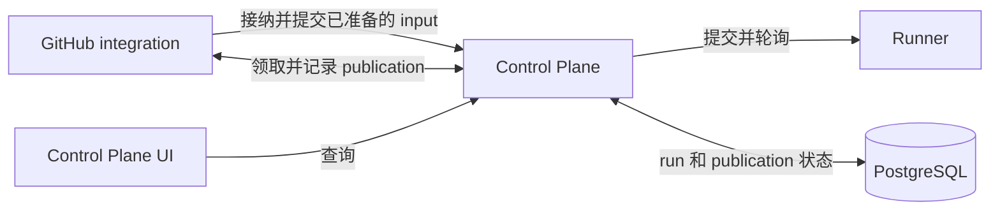
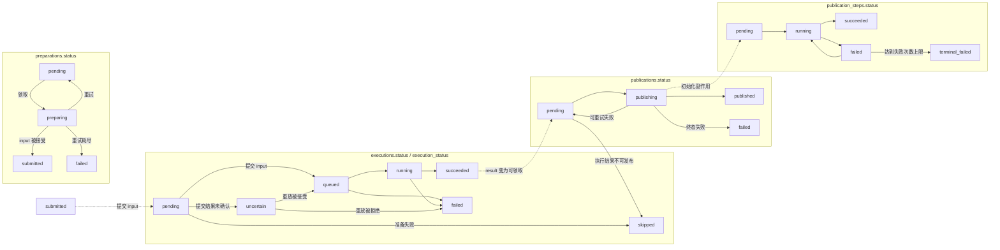

# Control Plane

[English](README.md) | 中文

本文是 [README.md](README.md) 的中文译文。英文版是权威版本；如果两者不一致，以英文版为准。

Control Plane 为每个已接纳的 review 提供稳定身份和持久化协调状态。它位于 GitHub integration 与 Runner 之间，使 input 准备、Runner 提交、执行观察、故障恢复和 GitHub 发布能够跨进程重启和不确定的网络结果继续进行。

## 在系统中的位置



GitHub integration 负责解析 GitHub 请求、准备 input 和执行 GitHub 副作用。Runner、Temporal 和 worker 负责 workflow 执行。Control Plane 协调这些边界，但不解析原始 GitHub payload、不解释 workflow 专用 result，也不执行 agent。完整数据流见[系统架构](../docs/architecture/SYSTEM_ARCHITECTURE.zh.md)。

服务作为独立 Node.js 进程运行，默认监听 `8090`。PostgreSQL 凭据只提供给 Control Plane。

## 功能

- 在 input 准备开始前接纳已校验请求并分配 `run_id`。
- 对重复送达的 GitHub webhook 和 Actions 入口身份进行去重。
- 在提交 Runner 前持久化已准备的 Runner input，使状态不确定的提交可以恢复。
- 轮询 Runner，并记录执行进度、终态 workflow result 和终态 artifact 引用。
- 让所属 integration 可以领取成功终态并执行 GitHub 发布。
- 持久化 publication step，避免进程重启后重复已完成的远程副作用。
- 为 Control Plane UI 提供脱敏的 run 查询。

## Run 生命周期

Run 在接纳后立即进入 `pending`：在 Runner 轴上表示其 input 尚未提交。准备进度单独记录在 `preparations` 中，其自身的 `preparing` 状态表示当前有 preparer 持有用于隔离 input 构造的 claim。GitHub integration 准备并上传 input bundle，再使用该 claim 提交可重放的 Runner input。Control Plane 记录 input，并且只在 Runner 接受请求后将 run 转为 `queued`。

Control Plane 轮询 `queued` 和 `running` run。Runner 成功后，Control Plane 将结果保存为 `succeeded`，使其可以被领取并发布。Integration 领取该工作，执行 GitHub 副作用，再记录 `published`、可重试的 publication 失败或终态 publication 失败。

如果 Runner submission 可能成功但响应丢失，run 会进入 recovery，而不是创建第二个身份。Preparation 或 Runner 的终态失败会将 publication 标为 `skipped`。终态 preparation 失败还会创建 connector 所有的 notice work，因此即使原 preparation owner 已崩溃，connector 仍可告知用户。

## 持久化模型

run 主干和三条生命周期轴分别存放在不同的表中。`review_runs` 只保存被接纳的身份；每条轴各自保存自己的状态和输入：

| 表                            | 职责                                 | 状态                                                                          |
| ----------------------------- | ------------------------------------ | ----------------------------------------------------------------------------- |
| `review_runs`                 | 所有轴共享的接纳身份（没有更新路径） | —                                                                             |
| `preparations`                | 可领取的 input preparation           | `pending`、`preparing`、`submitted`、`failed`                                 |
| `preparation_failure_notices` | connector 所有的终态失败确认         | `pending`、`delivering`、`delivered`、`skipped`                               |
| `executions`                  | Runner 提交、观察和终态结果          | `pending`、`queued`、`running`、`uncertain`、`succeeded`、`skipped`、`failed` |
| `publications`                | 整体发布的所有权和结果               | `pending`、`publishing`、`published`、`failed`、`skipped`                     |
| `publication_steps`           | 可恢复的单个 connector 副作用        | `pending`、`running`、`succeeded`、`failed`、`terminal_failed`                |
| `review_run_events`           | 每条轴状态转换的只追加审计日志       | —                                                                             |



`publication_steps.failure_count` 只记录失败的执行。成功执行不会增加该值；失败步骤达到配置的失败次数上限后进入 `terminal_failed`。

## Claim 和恢复

Preparation、submission recovery、publication、publication step 提交和终态 preparation notice 都使用 claim token 隔离过期 owner。Input preparation 活跃期间，GitHub integration 会续租 preparation claim。过期的 preparation 通常会回到 `pending`；在有限重试预算耗尽后，它会使 run 失败、跳过 publication，并创建持久化的 connector notice work。超时 owner 可以完成已发出的外部请求，但在新 owner 获得 token 后不能再提交状态。

若要自动恢复 preparation，connector 会在 admission 时提交版本化、opaque 的 preparation input。Control Plane 只持久化并返还该 input 给拥有工作的一方，绝不解释其中任何 provider 专属字段。没有提供可重放 input 的 connector 仍可同步 prepare，但其过期工作不能由恢复 worker 领取。

`run_id` 在 PostgreSQL 中全局唯一。`ingress_kind` 和 `ingress_key` 提供 connector 范围的入口幂等。`connector_id` 隔离读取、claim、publication 和 publication step。持久化操作日志同时包含 `connector_id` 和 `run_id`。

Temporal history、PostgreSQL 协调状态和对象存储 artifact 是彼此独立的恢复输入。Runner run 缺失不表示 publication 成功；远程副作用只有在 publication step 记录成功后才算完成。

## HTTP API

| Endpoint                                 | 认证                       | 用途                              |
| ---------------------------------------- | -------------------------- | --------------------------------- |
| `GET /healthz`                           | 无                         | 进程健康检查                      |
| `GET /readyz`                            | 无                         | PostgreSQL 支持的协调就绪检查     |
| `GET /v1/runs?...`                       | `CONTROL_PLANE_READ_TOKEN` | 支持过滤和 cursor 分页的 run 列表 |
| `GET /v1/runs/:run_id`                   | `CONTROL_PLANE_READ_TOKEN` | 脱敏的 run 详情                   |
| `GET /v1/runs/:run_id/publication-steps` | `CONTROL_PLANE_READ_TOKEN` | Publication step 摘要             |

写面——接纳、提交、准备与发布租约及其终态——是一组 REST 路由，其请求/响应形状、安全方案与错误码都来自手写的 [openapi.yaml](../contracts/control-plane-api/openapi.yaml) 契约；那份文档才是整个面的单一事实来源，而不是这张表。

契约在**请求侧是强制执行的**：路由、path/query/body 校验与鉴权都由它派生，因此任何不符合该文档的请求都会在进入 handler 之前被拒绝。响应侧由契约**描述**，但运行时并不对其校验——`fastify-openapi-glue` 只处理请求——因此声明的响应 schema 是 handler 需要遵守的约定，由测试而非框架来固定。`control-plane/test/observed-run-contract.test.ts` 会用共享 schema 校验已提交的 fixtures 以及 `observeRun()` 实际产出的形状，`control-plane/test/server-http.test.ts` 则覆盖 HTTP 面，这正是防止响应在无人察觉的情况下偏离其 schema 的机制。

查询响应不包含 `runner_input` 和 `publish_context`。UI BFF 持有 read token；浏览器代码不接收任何 Control Plane token。

查询响应以形状一致的三组嵌套对象报告彼此独立的生命周期轴：`preparation`、`execution` 与 `publication`。每组各自带有 `status`、`started_at` 与 `finished_at`；`execution` 与 `publication` 另有 `updated_at`，表示该轴最后一次被写入的时间。preparation 摘要额外给出 `attempt_count` 以及终态的 `failure_code` / `failure_notice_status`，但绝不包含其 opaque input、claim token 或 connector identity。列表端点通过查询参数沿三条轴筛选（`preparation_status`、`execution_status` 与 `publication_status`；参数名沿用既有拼写）；[observed-run.schema.json](../contracts/control-plane-api/v1/observed-run.schema.json) 是读取契约。

`/healthz` 只证明 HTTP 进程仍存活。`/readyz` 会验证当前 PostgreSQL 连接池可以执行 schema ledger 查询，且 ledger 的完整版本集合与本应用完全一致；否则返回不含数据库细节的 `503 {"status":"unavailable"}`。Compose 将 `/readyz` 用作 Control Plane healthcheck。Runner 与 GitHub 被有意排除：它们的瞬时不可达不会使 durable admission、读取或 PostgreSQL 支持的恢复变得不安全，其故障由各自的状态机恢复路径处理。

## 配置

| 变量                                       | 是否必需                           | 用途                                      |
| ------------------------------------------ | ---------------------------------- | ----------------------------------------- |
| `DATABASE_URL`                             | 是                                 | PostgreSQL connection string              |
| `CONTROL_PLANE_SERVICE_TOKEN`              | 是                                 | 内部 mutation 和协调认证                  |
| `CONTROL_PLANE_READ_TOKEN`                 | 是                                 | 查询 API 认证                             |
| `AGENT_RUNNER_SERVICE_URL`                 | 是                                 | Runner service base URL                   |
| `AGENT_RUNNER_SERVICE_TOKEN`               | 非 loopback 或受保护的 Runner 必需 | Runner 认证                               |
| `CONTROL_PLANE_PORT`                       | 否                                 | 监听端口；默认 `8090`                     |
| `CONNECTOR_ID`                             | 否                                 | 协调 namespace；默认 `github-app:default` |
| `AGENT_RUNNER_BACKGROUND_POLL_INTERVAL_MS` | 否                                 | Coordinator 间隔；默认 `15000`            |
| `AGENT_RUNNER_SERVICE_REQUEST_TIMEOUT_MS`  | 否                                 | Runner 请求超时；默认 `30000`             |
| `AGENT_RUNNER_SERVICE_REQUEST_RETRIES`     | 否                                 | Runner transport 重试次数；默认 `2`       |
| `AGENT_RUNNER_SERVICE_RETRY_BASE_DELAY_MS` | 否                                 | 初始重试延迟；默认 `500`                  |

## 数据库 schema

Schema 文件位于 `src/database/schema-versions`。已执行版本及 SHA-256 checksum 记录在 `schema_versions`。启动时使用 PostgreSQL advisory lock 串行执行 schema，并在数据库记录的 checksum 与当前文件不一致时拒绝启动。实验部署策略允许破坏性 schema reset。

## 开发

使用 Node.js 24 和 pnpm 12。在本目录安装依赖并启动服务：

```bash
pnpm install --frozen-lockfile
pnpm run server
```

检查命令：

```bash
pnpm run format:check
pnpm run lint
pnpm run typecheck
pnpm test
pnpm run test:integration
```

契约本身由族工具（位于 [`contracts/control-plane-api/tools`](../contracts/control-plane-api/tools/README.md)）用 Spectral 检查，其投影也由该工具做新鲜度校验。

`pnpm run test:integration` 在提供 `TEST_DATABASE_URL` 或 `DATABASE_URL` 时使用该地址；它必须指向可清空的 PostgreSQL 数据库。两个变量都未提供时，该命令会用仓库根目录 `compose.yaml` 声明的 PostgreSQL 镜像启动一个短生命周期本地 Docker 容器，并在测试完成后删除。Docker 在本地缺少该镜像时会拉取，因此此回退方式要求 Docker 可用且能访问镜像仓库；可通过 `TEST_POSTGRES_IMAGE` 显式使用其他镜像。
