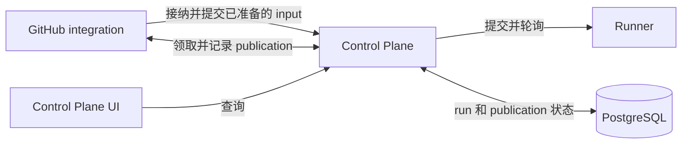
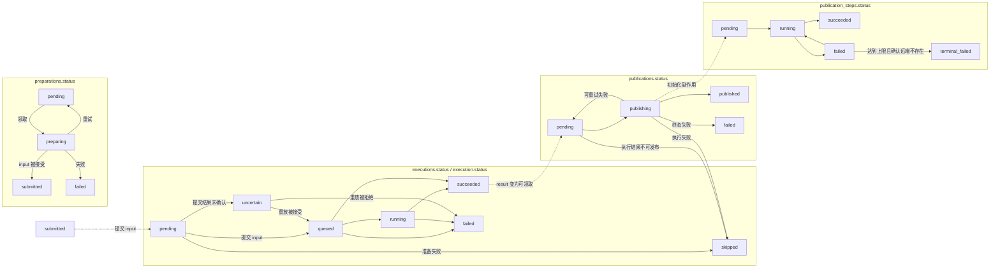

# Control Plane

[English](README.md) | 中文

本文是 [README.md](README.md) 的中文译文。英文版是权威版本；如果两者不一致，以英文版为准。

Control Plane 为每个已接纳的 review 提供稳定身份和持久化协调状态。它位于 GitHub integration 与 Runner 之间，使 input 准备、Runner 提交、执行观察、故障恢复和 GitHub 发布能够跨进程重启和不确定的网络结果继续进行。

## 在系统中的位置



GitHub integration 负责解析 GitHub 请求、准备 input 和执行 GitHub 副作用。Runner、Temporal 和 worker 负责 workflow 执行。Control Plane 协调这些边界，但不解析原始 GitHub payload、不解释 workflow 专用 result，也不执行 agent。完整数据流见[系统架构](../docs/architecture/SYSTEM_ARCHITECTURE.zh.md)。

服务作为独立 Node.js 进程运行，默认监听 `8090`。PostgreSQL 凭据只提供给 Control Plane。

## 功能

- 在 input 准备开始前接纳已校验请求并分配 `run_id`。
- 对重复送达的 GitHub webhook 和 Actions 入口身份进行去重。
- 在提交 Runner 前持久化已准备的 Runner input，使状态不确定的提交可以恢复。
- 轮询 Runner，并记录执行进度、终态 workflow result 和终态 artifact 引用。
- 让所属 integration 可以领取成功终态并执行 GitHub 发布。
- 持久化 publication step，避免进程重启后重复已完成的远程副作用。
- 为 Control Plane UI 提供脱敏的 run 查询。

## Run 生命周期

Run 在接纳后立即进入 `pending`：在 Runner 轴上表示其 input 尚未提交。准备进度单独记录在 `preparations` 中，其自身的 `preparing` 状态表示当前有 preparer 持有用于隔离 input 构造的 claim。GitHub integration 准备并上传 input bundle，再使用该 claim 提交可重放的 Runner input。Control Plane 记录 input，并且只在 Runner 接受请求后将 run 转为 `queued`。

Control Plane 轮询 `queued` 和 `running` run。Runner 成功后，Control Plane 将结果保存为 `succeeded`，使其可以被领取并发布。Integration 领取该工作，执行 GitHub 副作用，再记录 `published`、可重试的 publication 失败或终态 publication 失败。

重复接纳一个已经见过的 ingress 身份是一次只读重放：它返回既有的 run，不会去 claim 它的 preparation。接纳时创建的 preparation 行是 `preparing`，只由最初的接纳方持有，因此在中途崩溃的进程是靠租约过期恢复的，而不是靠重放请求。在默认 claim 超时下，这意味着一次重放最多要等十分钟才能推进——所以客户端不能把"请求返回了"当成"工作已继续"。

如果 Runner submission 可能成功但响应丢失，run 会进入 recovery，而不是创建第二个身份。进入该状态不是失败，也不会创建 notice：未确认的提交仍可能在重放时被接受，此时宣告失败就是在陈述一个 run 可能推翻的结论——而已发布的评论无法撤回。被接受的重放会让 run 恢复正常推进；而被 Runner 拒绝的重放，或在重放预算（`executions.attempt_count`，当前为八次）内始终得不到答复的重放，会让 run 失败、把 publication 标为 `skipped`，并只在那时才创建 notice。若没有这个预算，未解决的提交会永远停留在 `uncertain`，完全不会被报告。Preparation 或 Runner 的终态失败会将 publication 标为 `skipped`。任一轴的终态失败都会创建 connector 所有的 notice work，因此即使观察到失败的进程已崩溃，connector 仍可告知用户；notice 会记录失败发生在哪一轴，回复便可说明 run 实际走到了哪一步。

## 持久化模型

run 主干和三条生命周期轴分别存放在不同的表中。`review_runs` 只保存被接纳的身份；每条轴各自保存自己的状态和输入：

| 表                  | 职责                                   | 状态                                                                                          |
| ------------------- | -------------------------------------- | --------------------------------------------------------------------------------------------- |
| `review_runs`       | 所有轴共享的接纳身份（没有更新路径）   | —                                                                                             |
| `preparations`      | 可领取的 input preparation             | `pending`、`preparing`、`uncertain`、`disconnected`、`submitted`、`failed`                    |
| `run_notices`       | connector 所有的用户可见失败与待确认通知 | `pending`、`delivering`、`delivered`、`failed`                                              |
| `executions`        | Runner 提交、观察和终态结果            | `pending`、`queued`、`running`、`uncertain`、`disconnected`、`succeeded`、`skipped`、`failed` |
| `publications`      | 整体发布的所有权和结果                 | `pending`、`publishing`、`uncertain`、`disconnected`、`published`、`failed`、`skipped`        |
| `publication_steps` | 可恢复的单个 connector 副作用          | `pending`、`running`、`uncertain`、`disconnected`、`succeeded`、`failed`、`terminal_failed`   |
| `review_run_events` | 每条轴状态转换的只追加审计日志         | —                                                                                             |



`publication_steps.attempt_count` 就是该步骤的重试预算，而预算唯一计量的单位是「尝试」：一次尝试在被启动时就已消耗，因此中途死亡的 publisher 与一次失败的尝试消耗同样的额度。判断「还能不能再试一次」只以这个计数为准——不是失败次数，不是崩溃次数，也不是时间。系统不单独保存失败次数：步骤上的 `failed` 迁移本身，已经由 `failure_code`、`failure_message` 以及 run 的事件日志记录下来。`recovery_attempt_count` 刻意是另一本账：对账读的是远端状态，并没有花掉重复写入的许可，因此它从不推进 `attempt_count`。

达到尝试上限并不会让步骤直接失败。任何启动过的尝试，都可能在其所有者死亡或响应丢失之前已在远端系统完成了副作用，而 Control Plane 看不到那个系统，所以一个耗尽预算的步骤交给 connector 去查证，而不是直接下结论。connector 按自己这一步本应产生的效果去查找（run 专属分支、review 或 comment 的 marker），并通过 `settleExhaustedPublicationStep` 回报结果：找到效果则步骤变为 `succeeded`，只有确认效果不存在时步骤才进入 `terminal_failed`。无法执行的对账并不构成“不存在”的证据，因此它会向上抛出，而不是当作结论。

## Claim 和恢复

Preparation、submission recovery、publication、publication step 提交和 run notice 都使用 claim token 隔离过期 owner。Input preparation 活跃期间，GitHub integration 会续租 preparation claim。过期的 preparation 会回到 `uncertain` 而不是 `pending`，因为租约过期并不能证明什么都没发生：下一次认领会先查明上一位持有者留下了什么，再决定是否重建。在有限重试预算耗尽后，过期失败会使 run 失败、跳过 publication，并创建持久化的 connector notice work。提交恢复预算耗尽则把 execution 从 `uncertain` 转为 `disconnected`，并创建 attention notice：结果仍未知，因此不能报告为失败。

过期处理按 run 隔离。如果某个 run 的持久化状态与过期结论自相矛盾——`preparing` 租约已过期，但 execution 早已离开 `pending`——那么结论一旦写入就会覆盖 Runner 的真实结果。这类行会被回滚、标为 `disconnected` 并带上 `disconnect_reason`（当前为 `EXECUTION_ALREADY_ADVANCED`）、排一条 attention 通知，同时记录 `control_plane_preparation_expiry_blocked` 事件；后续每一轮协调都会跳过它，而不是反复重试一个必然失败的转换。其余 run 的协调不受影响。operator 有三种明确决策：`POST /v1/admin/runs/{run_id}/abandon` 给它收尾——准备阶段记为 `failed`（原因沿用它被停下的那个，即 `EXECUTION_ALREADY_ADVANCED`），仍在执行的 execution 一并置为 failed，publication 置为 skipped 并排队通知；`POST /v1/admin/runs/{run_id}/give-up` 则用于 disconnected 的 execution 或 publication：它表示不再等待结果，但绝不声称什么都没发生；而 `POST /v1/admin/runs/{run_id}/resume` 会把该行交回 `uncertain` 并给予新的尝试预算，让恢复逻辑重新确认上一位所有者究竟做到了哪一步。resume 对两条会停下的轴都适用，并且给予的是新的**对账**预算，而不是新的副作用：`disconnected` 的 publication 会回到 `uncertain`，停下的步骤也一并回到 `uncertain` 并重置对账预算，让 connector 再去看一眼远端，而不是重复一次结果无人确认的写入。尝试预算仍然保持已耗尽，因此 resume 之后不会重跑任何步骤：该步骤会被交给对账（`PUBLICATION_STEP_RETRY_EXHAUSTED`），只有 connector 的答案——副作用存在，或已确认不存在——才能给它收尾。三个端点对没有 `disconnected` 轴的 run 都返回 409，且都不幂等：第二次调用已找不到可处理的行，会以同样方式被拒绝。

`abandon` 记录的是该行被停下时的原因（目前恒为 `EXECUTION_ALREADY_ADVANCED`），而不是单独的放弃码。这是相对旧版 `PREPARATION_ABANDONED` 的**有意不兼容**变更：按该旧码检索的脚本或告警将不再命中，应改为按事件类型或 `publication`/`execution` 的收尾结果判断。原因是审计日志写出的每一个 reason 都必须是契约为该条边声明过的值，为同一条边再造第二个码，正是两者漂移的开始。

若要自动恢复 preparation，connector 会在 admission 时提交版本化、opaque 的 preparation input。Control Plane 只持久化并返还该 input 给拥有工作的一方，绝不解释其中任何 provider 专属字段。没有提供可重放 input 的 connector 仍可同步 prepare，但其过期工作不能由恢复 worker 领取。

`run_id` 在 PostgreSQL 中全局唯一。`ingress_kind` 和 `ingress_key` 提供 connector 范围的入口幂等。`connector_id` 隔离读取、claim、publication 和 publication step。持久化操作日志同时包含 `connector_id` 和 `run_id`。

Temporal history、PostgreSQL 协调状态和对象存储 artifact 是彼此独立的恢复输入。Runner run 缺失不表示 publication 成功；远程副作用只有在 publication step 记录成功后才算完成。

## HTTP API

| Endpoint                                 | 认证                        | 用途                              |
| ---------------------------------------- | --------------------------- | --------------------------------- |
| `GET /healthz`                           | 无                          | 进程健康检查                      |
| `GET /readyz`                            | 无                          | PostgreSQL 支持的协调就绪检查     |
| `GET /v1/runs?...`                       | `CONTROL_PLANE_READ_TOKEN`  | 支持过滤和 cursor 分页的 run 列表 |
| `GET /v1/runs/:run_id`                   | `CONTROL_PLANE_READ_TOKEN`  | 脱敏的 run 详情                   |
| `GET /v1/runs/:run_id/publication-steps` | `CONTROL_PLANE_READ_TOKEN`  | Publication step 摘要             |
| `GET /v1/runs/parked`                    | `CONTROL_PLANE_READ_TOKEN`  | 协调已停止重试的 run 列表         |
| `POST /v1/admin/runs/:run_id/abandon`    | `CONTROL_PLANE_ADMIN_TOKEN` | 放弃一个 blocked preparation      |
| `POST /v1/admin/runs/:run_id/give-up`    | `CONTROL_PLANE_ADMIN_TOKEN` | 不再等待一个 disconnected run     |
| `POST /v1/admin/runs/:run_id/resume`     | `CONTROL_PLANE_ADMIN_TOKEN` | 把 disconnected 轴交回自动恢复    |

写面——接纳、提交、准备与发布租约及其终态——是一组 REST 路由，其请求/响应形状、安全方案与错误码都来自手写的 [openapi.yaml](../contracts/control-plane-api/openapi.yaml) 契约；那份文档才是整个面的单一事实来源，而不是这张表。

契约在**请求侧是强制执行的**：路由、path/query/body 校验与鉴权都由它派生，因此任何不符合该文档的请求都会在进入 handler 之前被拒绝。响应侧由契约**描述**，但运行时并不对其校验——`fastify-openapi-glue` 只处理请求——因此声明的响应 schema 是 handler 需要遵守的约定，由测试而非框架来固定。`control-plane/test/observed-run-contract.test.ts` 会用共享 schema 校验已提交的 fixtures 以及 `observeRun()` 实际产出的形状，`control-plane/test/server-http.test.ts` 则覆盖 HTTP 面，这正是防止响应在无人察觉的情况下偏离其 schema 的机制。

查询响应不包含 `runner_input` 和 `publish_context`。UI BFF 持有 read token；浏览器代码不接收任何 Control Plane token。

service token 用于协调 run 的各个组件，read token 用于脱敏读取，第三个可选的 admin token 用于 `/v1/admin` 下的运维面。三者刻意不构成包含关系：持有 service token 无法访问 admin 路由，admin token 也不能接纳 run 或让 run 走正常生命周期。只有在配置了 `CONTROL_PLANE_ADMIN_TOKEN` 时 `/v1/admin` 才存在——否则这些路径返回 404 而不是 401，因此未配置的部署不会暴露任何运维面。查看 parked 队列（三轴合一的"停止重试"列表）只需要 read token，因为"知道某个 run 卡住了"并不属于特权；只有"决定放弃它、不再等待它、或把它交回自动恢复"才需要 admin token。

查询响应以形状一致的三组嵌套对象报告彼此独立的生命周期轴：`preparation`、`execution` 与 `publication`。每组各自带有 `status`、`started_at`、`finished_at` 与 `updated_at`。preparation 摘要额外给出 `attempt_count` 以及终态的 `failure_code`，但绝不包含其 opaque input、claim token 或 connector identity。`notices` 是按创建时间排序的列表；每项都绑定其源状态转换事件，因此同一 run 的多个独立结果不会被错误去重。

`/healthz` 只证明 HTTP 进程仍存活。`/readyz` 会验证当前 PostgreSQL 连接池可以执行 schema ledger 查询，且 ledger 的完整版本集合与本应用完全一致；否则返回不含数据库细节的 `503 {"status":"unavailable"}`。Compose 将 `/readyz` 用作 Control Plane healthcheck。Runner 与 GitHub 被有意排除：它们的瞬时不可达不会使 durable admission、读取或 PostgreSQL 支持的恢复变得不安全，其故障由各自的状态机恢复路径处理。

## 配置

| 变量                                       | 是否必需                           | 用途                                                    |
| ------------------------------------------ | ---------------------------------- | ------------------------------------------------------- |
| `DATABASE_URL`                             | 是                                 | PostgreSQL connection string                            |
| `CONTROL_PLANE_READ_TOKEN`                 | 是                                 | 脱敏读 API；控制台后端与任何只读消费方都用它            |
| `CONTROL_PLANE_SERVICE_TOKEN`              | 是                                 | 组件协调（接纳、领取、终态）；无法访问 `/v1/admin`      |
| `CONTROL_PLANE_ADMIN_TOKEN`                | 否                                 | `/v1/admin/*` 的运维认证；未配置时整个 admin 面返回 404 |
| `AGENT_RUNNER_SERVICE_URL`                 | 是                                 | Runner service base URL                                 |
| `AGENT_RUNNER_SERVICE_TOKEN`               | 非 loopback 或受保护的 Runner 必需 | Runner 认证                                             |
| `CONTROL_PLANE_PORT`                       | 否                                 | 监听端口；默认 `8090`                                   |
| `CONNECTOR_ID`                             | 否                                 | 协调 namespace；默认 `github-app:default`               |
| `AGENT_RUNNER_BACKGROUND_POLL_INTERVAL_MS` | 否                                 | Coordinator 间隔；默认 `15000`                          |
| `AGENT_RUNNER_SERVICE_REQUEST_TIMEOUT_MS`  | 否                                 | Runner 请求超时；默认 `30000`                           |
| `AGENT_RUNNER_SERVICE_REQUEST_RETRIES`     | 否                                 | Runner transport 重试次数；默认 `2`                     |
| `AGENT_RUNNER_SERVICE_RETRY_BASE_DELAY_MS` | 否                                 | 初始重试延迟；默认 `500`                                |

## 数据库 schema

Schema 文件位于 `src/database/schema-versions`。已执行版本及 SHA-256 checksum 记录在 `schema_versions`。启动时使用 PostgreSQL advisory lock 串行执行 schema，并在数据库记录的 checksum 与当前文件不一致时拒绝启动。实验部署策略允许破坏性 schema reset。

## 开发

使用 Node.js 24 和 pnpm 12。在本目录安装依赖并启动服务：

```bash
pnpm install --frozen-lockfile
pnpm run server
```

检查命令：

```bash
pnpm run format:check
pnpm run lint
pnpm run typecheck
pnpm test
pnpm run test:integration
```

契约本身由族工具（位于 [`contracts/control-plane-api/tools`](../contracts/control-plane-api/tools/README.md)）用 Spectral 检查，其投影也由该工具做新鲜度校验。

`pnpm run test:integration` 在提供 `TEST_DATABASE_URL` 或 `DATABASE_URL` 时使用该地址；它必须指向可清空的 PostgreSQL 数据库。两个变量都未提供时，该命令会用仓库根目录 `compose.yaml` 声明的 PostgreSQL 镜像启动一个短生命周期本地 Docker 容器，并在测试完成后删除。Docker 在本地缺少该镜像时会拉取，因此此回退方式要求 Docker 可用且能访问镜像仓库；可通过 `TEST_POSTGRES_IMAGE` 显式使用其他镜像。
