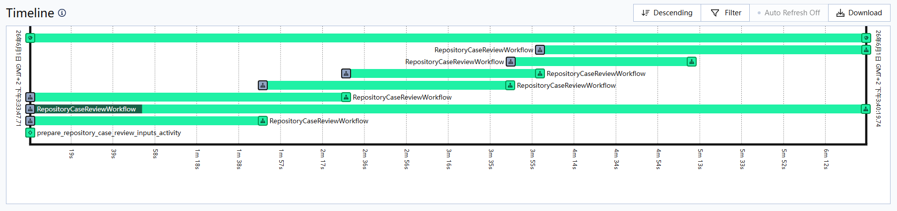

# Agent Framework Selection

Language: English | [中文](FRAMEWORK_SELECTION.zh.md)

This note records why the agent framework currently builds stage agents with LangChain `create_agent` plus project middleware, instead of directly using the high-level `deepagents.create_deep_agent` entry point or dropping all the way down to LangGraph.

## Current Position

The project uses `deepagents` as a toolkit, not as the top-level application framework.

It reuses useful lower-level pieces:

- filesystem middleware and backend protocol shapes
- sandbox protocol ideas
- skills middleware and the `<source>/<skill>/SKILL.md` discovery convention
- result types used by file, search, edit, upload, and execute operations

But this project still owns how the security-review workflow runs.

## Why Not `create_deep_agent`

`deepagents.create_deep_agent` quickly supplies a coding agent with file and tool capabilities. Security review also needs stage-specific responsibilities, context, tools, and structured results, so tool availability alone does not determine the design.

`create_deep_agent` combines middleware and runtime conventions around a model/tool loop. This project selects and combines those pieces per stage instead of adopting the complete general-purpose configuration.

Each stage builds its agent explicitly with LangChain `create_agent`, reusing `deepagents` middleware and backend protocols. The project workflow still determines stage responsibilities.

Memory illustrates the purpose of that composition: review is followed by asynchronous experience extraction and memory-tree maintenance; review agents receive an index and read topic files on demand. This needs a dedicated workflow, not just default memory middleware.

## Why Not Raw LangGraph

LangGraph executes the underlying graph and can save graph state through a checkpointer. This project uses graph execution without retaining resumable conversation-thread state. Temporal handles persistent scheduling and retries between stages. Those are separate choices.

### The agent loop stays with `create_agent`

It would make sense to own every node, edge, retry, state field, and reducer directly if the workflow shape were stable enough. For the current project, that would be premature. The main engineering work is still in the security-review semantics and runtime boundaries around each stage. LangChain `create_agent` keeps the agent loop and middleware integration compact while still allowing project-specific control where it matters.

### Checkpointed graph state is not durable execution here

Graphs built in `runtime/agent_runtime_graph.py` have no checkpointer and are invoked once per stage. Saving graph state alone would not support recovery within a stage: later nodes also depend on sandbox files, processes, and tool sessions.

- **A checkpoint restores graph state, not the environment the agent worked in.** A stage's workspace is a temporary directory restored from the input snapshot, and its command sandbox is a Docker container created for that invocation and removed when the stage ends. A graph checkpoint does not ensure that the files, running processes, and tool sessions needed by a resumed `next` node will be available after a process restart. Recovery must account for those dependencies as well as graph state.
- **Replaying nodes can repeat external operations.** Nodes write files and run commands against a filesystem that is not checkpointed. Artifacts and trajectories are managed by stage attempt. Recovery must determine how far earlier operations got and whether they can be repeated, not just replay nodes.

Putting the agent loop inside the workflow definition, as [Temporal's AI cookbook](https://docs.temporal.io/ai-cookbook) describes, runs into the same split: the LLM and tool calls become durable activities, but the container they mutate is still outside any durable state.

Temporal schedules and retries stages; the activity that creates the environment manages its use and cleanup. LangGraph executes the model/tool loop within the stage without an additional checkpoint store.

### What the field reports

Other research discusses this gap between saved execution state and the environment needed to continue:

- [Safe to Resume? Breaking Execution Continuity of Agent Execution via Rollback](https://arxiv.org/abs/2608.29381) (arXiv 2608.29381) studies checkpoint and rollback as a security surface rather than only a performance one. Its central claim is that correct rollback does not imply secure recovery: a faithfully restored checkpoint can resume an execution whose internal state, assumptions, and external effects never coexisted in any valid history. It lists stale external dependencies and unrecorded external effects among the failure modes, demonstrates them against several frameworks including LangGraph, and attributes them to a common gap between the state a checkpoint restores and the dependencies a safe continuation needs. That is the same gap this document describes at the stage boundary.
- [DART: Semantic Recoverability for Structured Tool Agents](https://arxiv.org/abs/2605.23311) (arXiv 2605.23311) states the recovery dilemma directly: replaying the whole task is safe but wasteful, while restoring from a local checkpoint is efficient but can leave committed downstream work tied to an upstream history that no longer exists. It formalizes *semantic recoverability*, certifies which boundaries of a failed instance are recoverable, and admits a restore point only when it preserves committed downstream work. Its evaluation includes external validation on a LangGraph substrate, and it reports that controller legality does not imply semantic validity.
- [DeltaBox: Scaling Stateful AI Agents with Millisecond-Level Sandbox Checkpoint/Rollback](https://arxiv.org/abs/2605.22781) (arXiv 2605.22781) attacks the problem from the sandbox side instead of the controller side. It assumes agents need checkpoint and rollback of the complete sandbox state, including files and process state, and that duplicating that state wholesale is too slow for search and fan-out. It introduces OS-level change-based checkpoint/rollback (layered filesystem state plus incremental process dumps) and reports millisecond-level latency. This is the class of mechanism that would make in-stage recovery meaningful here, because it restores the environment a resumed node needs rather than only the graph that resumes into it.

## Why Temporal For Workflow Execution

The execution system uses Temporal.

> *Timeline screenshot is for scheduling-shape reference only; workflow and activity labels may come from an older run and are not the current API names.*

This timeline shows a repository review where the review workflow prepares repository case workflows and Temporal tracks sliding-window workflow / activity execution over time.

Reasons for using Temporal:

- Review runs are long-running flows, so queued, running, completed, and failed states should be owned by the execution system.
- The Temporal task queue is the only queue for review execution.
- Temporal workflow history stores execution history used to recover workflow progress.
- Internal workflow / activity orchestration needs durable scheduling, retry, timeout, and failure propagation across prepare / analysis / mitigation / verification / delivery stages.

## Future Direction

If a stage becomes stable enough that its agent loop is mostly fixed, it can be moved closer to raw LangGraph later. That would make sense for code whose main problem is precise graph state, retry, and node ownership.

That is not the current bottleneck. Similar project-specific responsibilities are still easier to evolve in our own runtime than inside a larger harness.

Supporting recovery in the middle of a stage would require restoring not only Agent state but also the files, processes, and tool sessions it depends on. For example, if a checkpoint records that a test has started but the original container has been deleted, restoring Agent state alone cannot resume reading the test results.