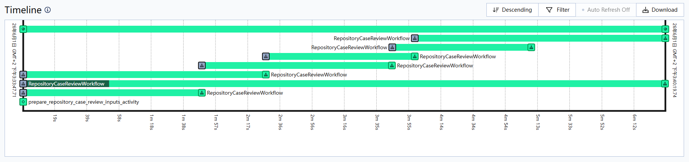

# Agent Framework Selection

语言：[English](FRAMEWORK_SELECTION.md) | 中文

本文是 [FRAMEWORK_SELECTION.md](FRAMEWORK_SELECTION.md) 的中文译文。英文版是权威版本；如果两者不一致，以英文版为准。

本文记录 runner 为什么现在使用 LangChain `create_agent` 加项目自己的 middleware 来构造各阶段 agent，而不是直接使用高层的 `deepagents.create_deep_agent`，也不是直接下沉到原始 LangGraph。

## 当前定位

本项目把 `deepagents` 当作工具箱使用，而不是当作顶层应用框架使用。

项目复用了它比较有用的底层部分：

- filesystem middleware 和 backend protocol 形状
- sandbox protocol 思路
- skills middleware 以及 `<source>/<skill>/SKILL.md` 的发现约定
- 文件读取、搜索、编辑、上传和执行操作的结果类型

但安全审查 workflow 的运行方式，仍然由本项目自己负责。

## 为什么不直接用 `create_deep_agent`

早期搓 demo 时考虑过直接使用 `deepagents.create_deep_agent`。它的价值很直接：能很快给出一个完整的 coding-agent 形态。但项目继续往安全审查系统推进后，关键问题就不只是“agent 能不能读文件、调工具”，而是“哪个阶段承担什么职责、拿到什么上下文、暴露哪些工具、最后产出什么结构化结果”。

从这个角度看，`create_deep_agent` 是一个带有有用默认选项的高层 harness。它在底层 agent loop 之上组装了一组 middleware 和运行时约定。本项目需要的是把这些部件按阶段重新组合，而不是直接接受一个通用 agent 形状。

所以当前设计复用了 `deepagents` 里有用的 middleware 和 backend protocol，同时用 LangChain `create_agent` 显式构造每个 stage agent。这个选择不是否定 `deepagents`，而是避免让一个通用 harness 替安全审查 workflow 决定阶段职责。

事后来看，这个选择是对的。memory 机制就是一个例子：它不是直接用默认 memory middleware 那么简单，而是包括运行后产出经验、离线整理经验碎片，以及更接近 Claude Code memory 的渐进式披露组织方式，让 agent 先看到有界的启动索引，再按需读取相关 topic。

## 为什么不直接用原始 LangGraph

LangGraph 是这一类 agent 系统下面更底层的图运行时，同时它也通过 checkpointer 提供 durable execution 和 thread state。本项目用了前者，没有用后者：图形态仍然由 `create_agent` 承担，持久化仍然停在 Temporal 的阶段边界上。这是两个分开的决定。

### agent loop 交给 `create_agent`

如果 workflow 形状已经足够稳定，项目想完全自己控制每个 node、edge、retry、state field 和 reducer，那么下沉到 LangGraph 是合理的。但对现在这个项目来说还偏早。当前主要工程问题仍然在每个阶段的安全审查语义和运行时边界上。LangChain `create_agent` 能让 agent loop 和 middleware 集成保持紧凑，同时把真正需要定制的地方留给项目自己控制。

### 图状态 checkpoint 在沙箱 agent 里并不等于 durable execution

`runtime/agent_runtime_graph.py` 构造的图没有挂 checkpointer，每个阶段只调用一次，所以一次运行根本没有可供恢复的 thread state。即使挂上，也不会得到更细的恢复粒度，原因在于带沙箱的 agent 的通用性质，而不在本项目的个别实现：

- **checkpoint 恢复的是图状态，不是 agent 工作过的环境。** 一个阶段的 workspace 是从输入快照恢复出来的临时目录，命令沙箱是为这次调用创建、阶段结束就删除的 Docker 容器。进程重启后两者都不在了，于是 checkpoint 会恢复到一个 `next` 节点，而它需要的文件、进程和工具会话已经不存在。只恢复图、不恢复环境，只是把失败往后推，而不是吸收掉。
- **恢复粒度必须考虑副作用。** 被重放的节点会往没有 checkpoint 的文件系统里写产物、跑命令。产物是按 attempt 清理的本地阶段文件，transcript 按 stage attempt 命名，所以重放的节点要么重复劳动，要么留下半成品。
- **阶段本身已经是持久化单元。** 在一个 Temporal activity 内部，容器、MCP 会话、bootstrap 结果和产物目录构成一个无法零成本拆开的生命周期。要在这个粒度内恢复，需要环境本身可重建，这是沙箱设计问题，不是图状态问题。

把 agent loop 放进 workflow definition（[Temporal 的 AI cookbook](https://docs.temporal.io/ai-cookbook) 描述的做法）会撞上同一个断层：LLM 和工具调用变成了持久化的 activity，但它们修改的容器仍在任何持久化状态之外。

这些是有意划定的边界。Temporal 持有阶段边界的持久化，并把阶段环境视为创建它的 activity 的财产；LangGraph 只负责这个边界之内的 agent loop，并且不挂 checkpointer。

### 领域里已有的结论

上面这个断层不是本项目独有，下列工作直接给它命了名。

- [Safe to Resume? Breaking Execution Continuity of Agent Execution via Rollback](https://arxiv.org/abs/2608.29381)（arXiv 2608.29381）把 checkpoint / rollback 当作安全问题而不只是性能问题来研究。其核心论断是：正确的 rollback 不等于安全的恢复，一个被忠实还原的 checkpoint 可能恢复出一段内部状态、前提假设和外部副作用从未在任何合法历史中同时存在过的执行。它把 stale external dependencies 和 unrecorded external effects 列为失败模式，在包括 LangGraph 在内的若干框架上做了演示，并把成因归结为 checkpoint 恢复的状态与安全续跑所需的依赖之间的落差。这正是本文描述的阶段边界上的那个落差。
- [DART: Semantic Recoverability for Structured Tool Agents](https://arxiv.org/abs/2605.23311)（arXiv 2605.23311）直接点明恢复的两难：整任务重放安全但浪费，从局部 checkpoint 恢复高效，却可能让已经提交的下游工作挂靠在一段不复存在的上游历史上。它形式化了 *semantic recoverability*，认证失败实例的哪些边界是可恢复的，并且只有在能保留已提交下游工作时才接受该恢复点。其评估包含在 LangGraph 基座上的外部验证，并报告 controller legality 不等于 semantic validity。
- [DeltaBox: Scaling Stateful AI Agents with Millisecond-Level Sandbox Checkpoint/Rollback](https://arxiv.org/abs/2605.22781)（arXiv 2605.22781）从沙箱侧而非控制侧切入。它假定 agent 需要完整的沙箱状态 checkpoint 与 rollback（包括文件与进程状态），而整体复制该状态对搜索和扇出来说太慢；于是引入 OS 层的增量式 checkpoint/rollback（分层文件系统状态加增量进程转储），并报告毫秒级延迟。这类机制才是让阶段内恢复在这里变得有意义的前提，因为它恢复的是恢复后节点真正需要的那个环境，而不只是恢复进去的那张图。

## 为什么 workflow 执行使用 Temporal

执行系统使用 Temporal。

> *Timeline 截图仅用于说明调度形态；图中的 workflow / activity 名称可能来自旧运行或早期命名，不代表当前 API 名称。*

这张 timeline 展示了一次 repository review 中，runner workflow 如何准备多个 repository case workflow，以及 Temporal 如何跟踪滑动窗口下 workflow / activity 随时间推进的过程。

选择 Temporal 的原因：

- runner run 是长流程，排队、运行中、完成和失败状态应该由执行系统持有。
- Temporal task queue 是 runner 执行的唯一队列。
- Temporal workflow history 是后续拆分持久化步骤的事实来源，不再需要手写 checkpoint 文件。
- 内部 workflow / activity 编排需要跨 prepare / analysis / mitigation / verification / delivery 阶段的持久化调度、重试、超时和失败传播。

Temporal 也记录了一种合理的 Temporal + agent 设计：把 agent loop 放进 workflow definition，由 workflow 持久化 message history，再通过 activity 调用 LLM 和工具。这样做能让 agent loop 本身也具备 durable execution，但不会让阶段环境变得持久，因此不会改变上面的结论。

但本项目没有选择这条路。Temporal 是 durable workflow orchestration，不是 agent reasoning layer。本项目用 Temporal 负责阶段、activity、重试、产物和失败传播，而不是把一个自由循环的 agent 直接塞进 workflow definition。系统的核心单元是有明确阶段、输入契约和结构化输出的安全审查 workflow；Temporal 管可靠性和调度，agent 管判断和生成。

## 后续方向

如果某个 stage 稳定到 agent loop 基本固定，后面可以继续下沉到原始 LangGraph。那会更适合主要问题已经变成精确 graph state、retry 和 node ownership 的代码。

但这不是当前瓶颈。类似的项目边界仍然放在自己的 runtime 里更容易演进，而不是藏进更大的 harness。

阶段内的细粒度恢复必须从沙箱出发，而不是从 checkpointer 出发。值得评估的形态是：阶段环境由一个稳定的 per-stage 身份标识，从快照和产物目录恢复，让被恢复的节点拿到它期望的那个沙箱。在这件事存在之前，checkpointer 只会再加上第二套互相不兼容的“运行进行到哪了”。[DART](https://arxiv.org/abs/2605.23311) 提出的 admissibility 检查，正是这种恢复需要满足的判据：被恢复的阶段不能继续一段上游输入已不复存在的工作。
