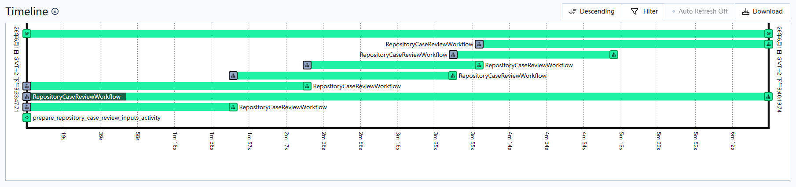

# Agent 框架选择

语言：[English](FRAMEWORK_SELECTION.md) | 中文

本文为 [FRAMEWORK_SELECTION.md](FRAMEWORK_SELECTION.md) 的中文译文；如有差异，以英文版为准。

本项目使用 LangChain `create_agent` 和自定义 middleware 构建各阶段 Agent。本文解释为什么这样组合工具，而不直接使用 `deepagents.create_deep_agent`，或自行编写底层 LangGraph 图。

## 当前定位

本项目把 `deepagents` 当作工具箱使用，而不是当作顶层应用框架使用。

项目复用了它比较有用的底层部分：

- filesystem middleware 和 backend protocol
- sandbox protocol
- skills middleware 以及 `<source>/<skill>/SKILL.md` 的发现约定
- 文件读取、搜索、编辑、上传和执行操作的结果类型

但安全审查工作流的运行方式，仍然由本项目自己负责。

## 为什么不直接用 `create_deep_agent`

`deepagents.create_deep_agent` 可以快速提供具备文件和工具能力的代码 Agent。但安全审查还需要为各阶段分别规定职责、上下文、可用工具和结构化输出，不能只看工具是否齐全。

`create_deep_agent` 在模型与工具循环之上组合了 middleware 和运行约定。本项目需要按阶段选择和组合这些部件，因此保留其底层能力，不直接采用整套通用配置。

各阶段使用 LangChain `create_agent` 明确构建 Agent，并复用 `deepagents` 的 middleware 和 backend protocol。阶段如何分工仍由项目工作流决定。

记忆机制可以说明这种组合方式的用途：本项目在审查后异步提取经验、维护记忆文件树；审查时先提供索引，再按需读取主题文件。它需要专门的流程，不能只挂载默认 memory middleware。

## 为什么不直接用原始 LangGraph

LangGraph 提供底层图执行，也可以通过 checkpointer 保存图状态。本项目使用它执行 Agent 图，但不保存可恢复的对话线程状态；工作流在阶段之间的持久化调度和重试交给 Temporal。这是两个独立选择。

### Agent 循环交给 `create_agent`

如果某阶段已稳定到需要直接控制每个节点、连接、重试、状态字段和状态合并函数，可以考虑直接使用 LangGraph。现阶段的主要定制需求仍是安全审查各阶段的输入、工具和结果要求，`create_agent` 已能提供所需的循环和 middleware 支持。

### 保存图状态不等于能恢复沙箱中的任务

`runtime/agent_runtime_graph.py` 构建的图没有配置 checkpointer，每个阶段只调用一次，不保留可供恢复的线程状态。仅增加图状态保存，还不足以支持阶段中途恢复，因为后续节点也依赖沙箱内的文件、进程和工具会话：

- **图状态不包含完整执行环境。** 工作区从输入快照还原到临时目录，Docker 容器为本次调用创建并在阶段结束时清理。即使保存了下一个节点的位置，也不能据此保证恢复时所需的文件、进程和工具会话仍在。恢复流程必须同时处理这些依赖。
- **重放节点可能重复执行外部操作。** 节点会写文件、运行命令，而文件系统没有随图状态一起保存。阶段产物和执行轨迹按尝试次数管理；恢复时必须判断旧操作已完成多少、是否可以重复执行，不能只重放节点。

把 Agent 循环放进工作流定义（[Temporal 的 AI cookbook](https://docs.temporal.io/ai-cookbook) 描述的做法）会撞上同一个断层：LLM 和工具调用变成了持久化的 activity，但它们修改的容器仍在任何持久化状态之外。

因此，本项目由 Temporal 调度和重试各阶段；创建环境的 activity 负责环境的使用和清理。LangGraph 在阶段内部执行模型与工具循环，不另外保存检查点。

### 领域里已有的结论

上面这种状态与环境之间的差距不是本项目独有，下列研究讨论了相关问题。

- [Safe to Resume? Breaking Execution Continuity of Agent Execution via Rollback](https://arxiv.org/abs/2608.29381)（arXiv 2608.29381）把 checkpoint / rollback 当作安全问题而不只是性能问题来研究。其核心论断是：正确的 rollback 不等于安全的恢复，一个被忠实还原的 checkpoint 可能恢复出一段内部状态、前提假设和外部副作用从未在任何合法历史中同时存在过的执行。它把 stale external dependencies 和 unrecorded external effects 列为失败模式，在包括 LangGraph 在内的若干框架上做了演示，并把成因归结为 checkpoint 恢复的状态与安全续跑所需的依赖之间的落差。这正是本文描述的阶段边界上的那个落差。
- [DART: Semantic Recoverability for Structured Tool Agents](https://arxiv.org/abs/2605.23311)（arXiv 2605.23311）直接点明恢复的两难：整任务重放安全但浪费，从局部 checkpoint 恢复高效，却可能让已经提交的下游工作挂靠在一段不复存在的上游历史上。它形式化了 *semantic recoverability*，认证失败实例的哪些边界是可恢复的，并且只有在能保留已提交下游工作时才接受该恢复点。其评估包含在 LangGraph 基座上的外部验证，并报告 controller legality 不等于 semantic validity。
- [DeltaBox: Scaling Stateful AI Agents with Millisecond-Level Sandbox Checkpoint/Rollback](https://arxiv.org/abs/2605.22781)（arXiv 2605.22781）从沙箱侧而非控制侧切入。它假定 Agent 需要完整的沙箱状态 checkpoint 与 rollback（包括文件与进程状态），而整体复制该状态对搜索和扇出来说太慢；于是引入 OS 层的增量式 checkpoint/rollback（分层文件系统状态加增量进程转储），并报告毫秒级延迟。这类机制才是让阶段内恢复在这里变得有意义的前提，因为它恢复的是恢复后节点真正需要的那个环境，而不只是恢复进去的那张图。

## 为什么 workflow 执行使用 Temporal

执行系统使用 Temporal。

> *Timeline 截图仅用于说明调度形态；图中的 workflow / activity 名称可能来自旧运行或早期命名，不代表当前 API 名称。*

这张 timeline 展示了一次 repository review 中，review workflow 如何准备多个 repository case workflow，以及 Temporal 如何跟踪滑动窗口下 workflow / activity 随时间推进的过程。

选择 Temporal 的原因：

- review run 是长流程，排队、运行中、完成和失败状态应该由执行系统持有。
- Temporal task queue 是 review 执行的唯一队列。
- Temporal workflow history 保存执行历史，用于恢复 workflow 的执行进度。
- 内部 workflow / activity 编排需要跨 prepare / analysis / mitigation / verification / delivery 阶段的持久化调度、重试、超时和失败传播。

## 后续方向

如果某个阶段稳定到 Agent 循环基本固定，后面可以继续下沉到原始 LangGraph。那会更适合主要问题已经变成精确控制图状态、重试和节点职责的代码。

但这不是当前瓶颈。类似的项目边界仍然放在自己的运行时里更容易演进，而不是藏进更大的通用执行框架。

如果以后需要支持阶段中途恢复，除了保存 Agent 状态，还需处理它依赖的文件、进程和工具会话。例如，checkpoint 记录测试已启动，但原容器已删除时，仅恢复 Agent 状态无法继续读取测试结果。