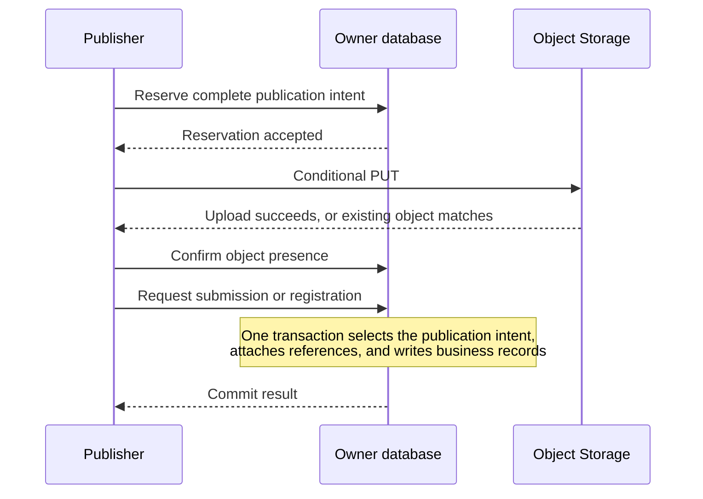

# Artifact Publication and Recovery

Language: English | [中文](ARTIFACT_PUBLICATION.zh.md)

This document explains how files in object storage and their records in PostgreSQL stay consistent when a publisher can stop between the two writes, and how each kind of artifact is recovered. It applies the shared coordination approach in [POSTGRES_COORDINATION](POSTGRES_COORDINATION.md) to writes that span two systems.

## The Dual-Write Problem

Review input publication, extraction registration, automatic maintenance revisions, and manual edit revisions all upload files to object storage and register results in PostgreSQL separately. These writes cannot be completed in one local transaction, creating a [dual-write consistency problem](https://docs.aws.amazon.com/prescriptive-guidance/latest/cloud-design-patterns/transactional-outbox.html): an upload may succeed before the process stops without registering it in the database, leaving an unreferenced object. Registering the database reference first creates the opposite risk: a failed upload can leave a reference to a missing file.

## The Publication Protocol

To support retries after an interruption, input and memory publishers first persist a publication intent containing the intended artifact references and complete registration payload, then upload the objects and register the result. Retries can inspect existing objects and continue from that record instead of blindly repeating uploads or model calls.

## Recovery by Artifact

After an interruption, retries check the recorded publication intent and object state first. A [Temporal Activity retry](https://docs.temporal.io/activity-definition#idempotency) can repeat an upload after a lost completion response; it does not make storage and SQL one transaction.

| Artifact                            | Durable recovery basis                                                                                                                    | Recovery boundary                                                                                                                                                                                            |
| ----------------------------------- | ----------------------------------------------------------------------------------------------------------------------------------------- | ------------------------------------------------------------------------------------------------------------------------------------------------------------------------------------------------------------ |
| Review input bundle                 | Review Runs publication intent: reference, prepared input, and publish context                                                            | A replacement preparation claim can reuse the original publication intent when the object is present. Only definite absence permits abandoning an unused candidate and rebuilding.                           |
| Extraction trajectory               | Memory Catalog publication intent containing the trajectory reference, observations, and summary                                          | Retries check recorded candidates before rerunning the model; selection and extraction registration commit together.                                                                                         |
| Learning or reorganization revision | Memory Catalog publication intent grouping the tree, trajectory, operation ID, expected active revision, and observation IDs for learning | Different model outputs can be separate candidates; selection, revision creation, observation consumption for learning, and active pointer update commit together.                                           |
| Manual revision                     | Memory Catalog publication intent containing the tree reference, operation ID, and expected active revision; the UI BFF uploads the tree  | Retries of unchanged content within the open editor retain the operation ID and original expected revision. The BFF repeats reservation, conditional upload, confirmation, and idempotent revision creation. |
| Execution archive in S3             | Temporal publication request and the fixed run key                                                                                        | Recovery verifies the existing archive against the request before using local files. If neither a complete uploaded archive nor local artifacts remain, the request cannot reconstruct the archive bytes.    |

UI restore moves the active pointer to an existing revision in a Catalog transaction; it creates neither a revision nor an object and does not repair missing bytes.

The input and memory protocols are described in the [Review Runs](../../services/review-runs/README.md) and [Memory Catalog](../../services/memory-catalog/README.md) guides. Storage errors remain uncertain and fail the attempt; they are not evidence that an object is missing. Recorded publication intents support retries, but do not provide automatic background completion after retries are exhausted.

## Storage Guarantees and Cleanup

<!-- doc-time-sensitive: artifact-conditional-write-semantics; checked=2026-10-31; source=https://docs.aws.amazon.com/AmazonS3/latest/userguide/conditional-writes.html -->

[Conditional PUT](https://docs.aws.amazon.com/AmazonS3/latest/userguide/conditional-writes.html) prevents cooperating publishers from overwriting an occupied key. It does not enforce retention against other identities with overwrite or delete permission. Consumers verify size and SHA-256 before use: this rejects replacement content but cannot recover lost bytes. S3-compatible deployments must verify the APIs and policy conditions they rely on against their deployed storage version.

Abandoning a candidate does not delete its object, and no automatic object garbage collection is implemented. A stale uploader may still finish, and candidates may share content keys. An object without a current database attachment is not necessarily disposable: future cleanup must account for historical revisions, extraction references, and prepared references retained in Temporal history.
