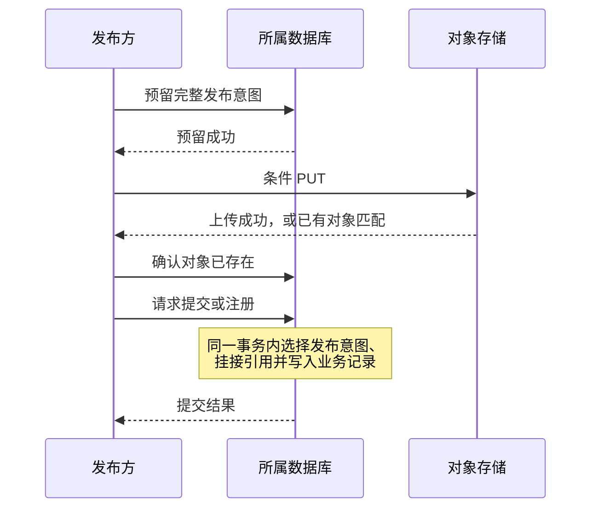

# Artifact 发布与恢复

语言：[English](ARTIFACT_PUBLICATION.md) | 中文

本文为 [ARTIFACT_PUBLICATION.md](ARTIFACT_PUBLICATION.md) 的中文译文；如有差异，以英文版为准。

本文说明发布者可能在两次写入之间停止时，对象存储中的文件与 PostgreSQL 中的记录如何保持一致，以及每类 artifact 如何恢复。它把 [POSTGRES_COORDINATION](POSTGRES_COORDINATION.zh.md) 中的共同协调做法应用到跨越两个系统的写入上。

## 双写问题

本系统中的审查输入发布、经验提取登记、自动维护版本和人工编辑版本，都需要分别向对象存储上传文件、向 PostgreSQL 登记结果。两者无法在一个本地事务中同时完成，因此会遇到[双写一致性问题（dual-write problem）](https://docs.aws.amazon.com/prescriptive-guidance/latest/cloud-design-patterns/transactional-outbox.html)：文件上传成功后，进程可能在登记数据库前中断，留下没有数据库引用的对象；如果先登记数据库，上传失败又可能留下指向不存在文件的引用。

## 发布协议

为支持中断后重试，输入材料和记忆产物的发布方先持久保存发布意图（publication intent），记录预期的产物引用和登记所需的完整业务数据，再上传对象，最后登记结果。重试可以据此检查已有对象并继续处理，无需盲目重复上传或重新调用模型。

## 发布候选状态

<!-- doc-default: input-bundle-candidate-transitions; source=services/review-runs/src/persistence/input-bundle-candidate-store.ts -->

Input bundle 按 `reserved → present → selected` 推进：预留保存完整意图，确认记录上传者对对象存在的声明，提交准备结果时选定候选。持有准备认领者可以放弃 `reserved` 或 `present` 候选。与 Memory Catalog 候选不同，已放弃的输入候选可以在当前准备认领下，以相同内容重新预留。`selected` 候选不能被放弃。

<!-- doc-default: memory-publication-transitions; source=services/memory-catalog/src/catalog-store.ts -->

| Catalog 候选   | 正常转换                        | 放弃与重放                                                                                                                                                          |
| -------------- | ------------------------------- | ------------------------------------------------------------------------------------------------------------------------------------------------------------------- |
| Extraction     | `reserved → present → selected` | 没有 `abandoned` 状态。登记必须选定已确认的候选；重复确认保留 `selected`。                                                                                          |
| Memory version | `reserved → present → selected` | 未选定的自动 `learning` 或 `reorganization` 候选可以从 `reserved` 或 `present` 进入 `abandoned`。该状态不可逆，重试预留或确认不会重新激活它。人工候选没有放弃操作。 |

选定记录哪个意图已附加到业务结果。确认不代表 Catalog 检查过对象存储：上传者负责验证对象。这些状态都不会删除已存储的文件。暂停记忆自动更新可以放弃自动版本候选，但不会放弃 extraction 候选，也不会取消 worker 执行。

## 按 artifact 恢复

中途失败后，重试先检查已记录的发布意图和对象状态。[Temporal Activity 重试](https://docs.temporal.io/activity-definition#idempotency)可能在完成响应丢失后重复上传，但不会把对象存储与 SQL 合成一个事务。

| 产物                            | 持久化恢复依据                                                                                         | 恢复边界                                                                                                             |
| ------------------------------- | ------------------------------------------------------------------------------------------------------ | -------------------------------------------------------------------------------------------------------------------- |
| 审查输入材料包                  | Review Runs 发布意图：产物引用、已准备的输入和发布上下文                                               | 接管输入准备的调用方可在对象存在时复用原发布意图；只有确认对象不存在时，才能放弃未选中的候选记录并重新准备。         |
| 经验提取轨迹                    | Memory Catalog 发布意图：轨迹引用、observation 和摘要                                                  | 重试先检查已有候选记录，再决定是否重新调用模型；选定记录和登记 extraction 在同一事务中完成。                         |
| learning 或 reorganization 版本 | Memory Catalog 发布意图：记忆树、轨迹、operation ID、预期生效版本，以及 learning 使用的 observation ID | 不同模型输出可以对应不同候选记录；选定记录、创建版本、learning 对 observation 的消费和更新生效版本在同一事务中完成。 |
| manual 版本                     | Memory Catalog 发布意图：记忆树引用、operation ID 和预期生效版本；UI BFF 上传记忆树                    | 编辑器保持打开且内容未变时，重试复用 operation ID 和最初预期的版本。BFF 重新执行预留、条件上传、确认和幂等版本创建。 |
| S3 中的执行归档                 | Temporal 发布请求和固定的 run 对象键                                                                   | 恢复时先按请求校验已上传的归档，再考虑本地文件。如果完整归档和本地产物都已丢失，仅凭请求无法重建归档内容。           |

UI 恢复版本在 Catalog 事务中将生效版本指针移到已有版本，不创建版本或对象，也不会修复丢失的字节。

输入材料和记忆产物的具体协议见 [Review Runs](../../services/review-runs/README.zh.md) 和 [Memory Catalog](../../services/memory-catalog/README.md)。存储错误仍是不确定状态，会使本次尝试失败，不能当作对象不存在。已记录的发布意图支持重试，但不提供重试耗尽后的自动后台完成机制。

## 存储保证与清理

<!-- doc-time-sensitive: artifact-conditional-write-semantics; checked=2026-10-31; source=https://docs.aws.amazon.com/AmazonS3/latest/userguide/conditional-writes.html -->

[条件 PUT](https://docs.aws.amazon.com/AmazonS3/latest/userguide/conditional-writes.html) 阻止遵守协议的发布方覆盖已有对象键，但不保证对象能抵抗其他具有覆盖或删除权限的身份。读取方在使用前校验大小与 SHA-256：这能拒绝替换内容，却不能找回丢失的字节。S3 兼容部署必须针对实际部署的存储版本验证所依赖的 API 与策略条件。

放弃候选发布记录不会删除对象，目前也没有自动对象垃圾回收。旧上传进程仍可能完成上传，不同候选发布记录也可能共享内容对象键。当前未被数据库引用的对象不一定可以删除：未来清理必须考虑历史版本、经验提取引用，以及 Temporal 历史记录中保留的尚未挂接引用。
