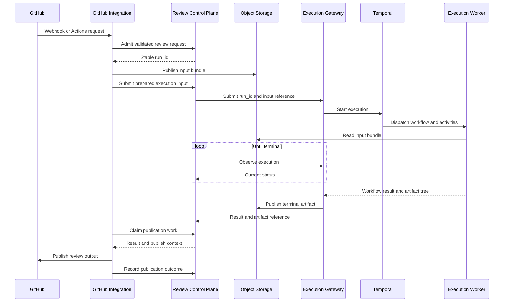
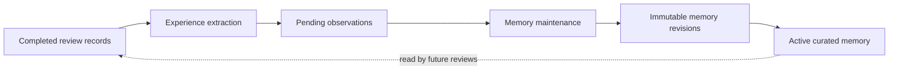

# System Architecture

Sec Review Bot contains six runtime entities with separate responsibilities and deployment boundaries: GitHub Integration, Review Control Plane, Control Plane UI, Execution Gateway, Execution Worker, and Memory Catalog Server.

## Runtime topology

Temporal Server is infrastructure, but it participates directly in the runtime relationship between Execution Gateway and Execution Worker, so the topology presents it with the runtime services. PostgreSQL and Object Storage remain separate persistence facilities. The main review path and the asynchronous memory path are separate flows.

## Main review path

## Asynchronous memory path

## Normal flow

1. GitHub sends a webhook or Actions request to the integration.
2. The integration validates the platform request and asks Control Plane to admit it; the admission request does not carry the raw GitHub webhook payload.
3. Control Plane creates the run and persists its identity in PostgreSQL.
4. Control Plane returns the stable `run_id` to the integration. State, artifacts, Execution API requests, and logs use this same identity.
5. The integration prepares the input bundle and writes it to Object Storage under that run identity.
6. The integration submits `publish_context` and replayable Execution input containing the input `ArtifactRef`; archive bytes remain in Object Storage.
7. Control Plane persists the Execution input before crossing the Execution API boundary, allowing an uncertain submission to be replayed without reconstructing process-local state.
8. Control Plane submits the `run_id` and input reference through the Execution API. The current provider, Execution Gateway, starts the Temporal workflow.
9. Execution Worker reads the input bundle from Object Storage by reference.
10. Control Plane polls the Execution API for execution status.
11. Execution Worker finishes the terminal artifact tree on the shared artifact volume.
12. Execution Gateway archives that tree and publishes the terminal artifact to Object Storage.
13. The Execution API provider projects the Temporal result and returns the workflow result plus terminal artifact reference to Control Plane; the artifact bytes remain in Object Storage. Control Plane persists both without interpreting workflow-specific result content.
14. The integration claims the corresponding publication work. Control Plane returns the workflow result and the opaque `publish_context` originally supplied by that connector; `publish_context` contains no credentials or process-local objects.
15. The integration publishes the GitHub review, comment, issue, or pull request.
16. The integration records the publication outcome through Control Plane.

The sequence and list show the first occurrence of each step. Polling, heartbeats, retries, and state writes can repeat. Because steps 3 and 4 precede input preparation, a failure in step 5 or 6 still has a durable `run_id`; only a request rejected before admission has no `run_id`.

Integration pulls publication work from Control Plane rather than receiving a callback. Control Plane keeps successful terminal work in `pending`, atomically assigns a publication claim to the connector, and accepts the connector's success or failure outcome. This keeps GitHub-specific side effects out of Control Plane while allowing an integration restart to resume unfinished work.

`apps/github-integration/` owns GitHub request parsing, input preparation, and GitHub publication. `control-plane/` owns admission, Execution coordination, recovery, and durable run state. `execution-gateway/` owns the authenticated HTTP-to-Temporal boundary. `agents/` owns the Execution Worker, workflows, and agent runtime. `memory-catalog/` owns managed-memory PostgreSQL state and revision commits. `apps/control-plane-ui/` reads the redacted Control Plane query API and never accesses PostgreSQL directly.

Detailed Control Plane state, claim, schema, and API behavior belongs in the [Control Plane README](../../control-plane/README.md).
