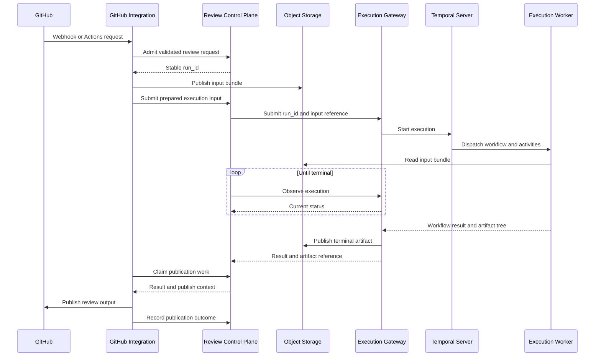
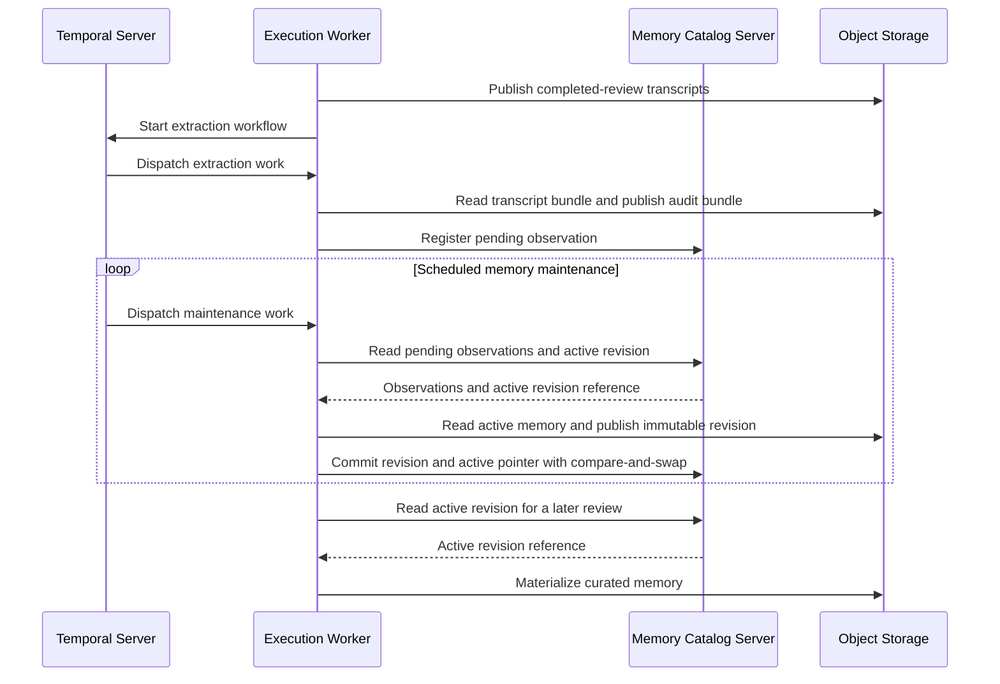

# System Architecture

Sec Review Bot contains six runtime entities with separate responsibilities and deployment boundaries: GitHub Integration, Review Control Plane, Control Plane UI, Execution Gateway, Execution Worker, and Memory Catalog Server.

## Runtime topology

Temporal Server is infrastructure, but it participates directly in the runtime relationship between Execution Gateway and Execution Worker, so the topology presents it with the runtime services. PostgreSQL and Object Storage remain separate persistence facilities. The main review path and the asynchronous memory path are separate flows.

## Main review path

## Asynchronous memory path

## Durability and ownership

The diagrams show the first occurrence of each interaction. Polling, heartbeats, retries, and state writes can repeat. Control Plane persists the stable `run_id` before the integration prepares input, so preparation or submission failure still leaves a durable run identity; only a request rejected before admission has no `run_id`. Control Plane also persists replayable Execution input before crossing the Execution API boundary, allowing an uncertain submission to be retried without reconstructing process-local state.

Integration pulls publication work from Control Plane rather than receiving a callback. Control Plane keeps successful terminal work in `pending`, atomically assigns a publication claim to the connector, and accepts the connector's success or failure outcome. This keeps GitHub-specific side effects out of Control Plane while allowing an integration restart to resume unfinished work.

`apps/github-integration/` owns GitHub request parsing, input preparation, and GitHub publication. `control-plane/` owns admission, Execution coordination, recovery, and durable run state. `execution-gateway/` owns the authenticated HTTP-to-Temporal boundary. `agents/` owns the Execution Worker, workflows, and agent runtime. `memory-catalog/` owns managed-memory PostgreSQL state and revision commits. `apps/control-plane-ui/` reads the redacted Control Plane query API and never accesses PostgreSQL directly.

Detailed Control Plane state, claim, schema, and API behavior belongs in the [Control Plane README](../../control-plane/README.md).
