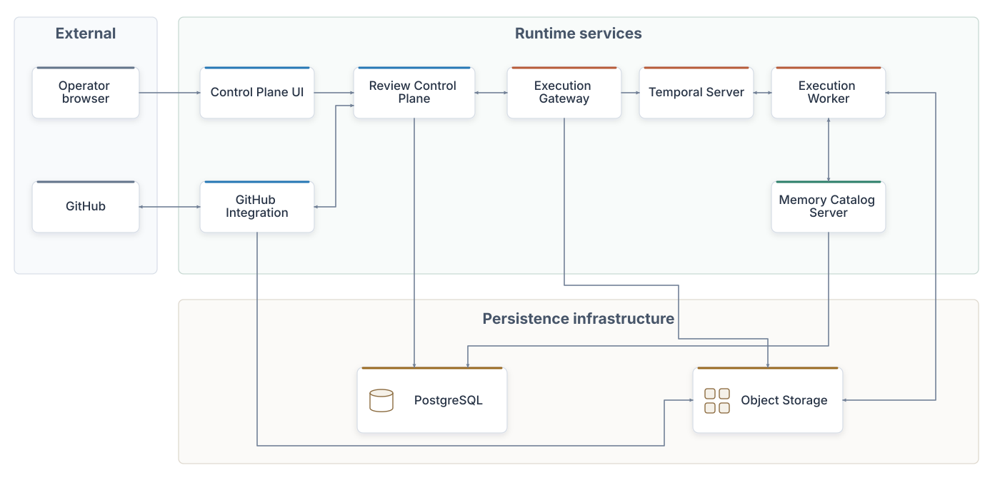
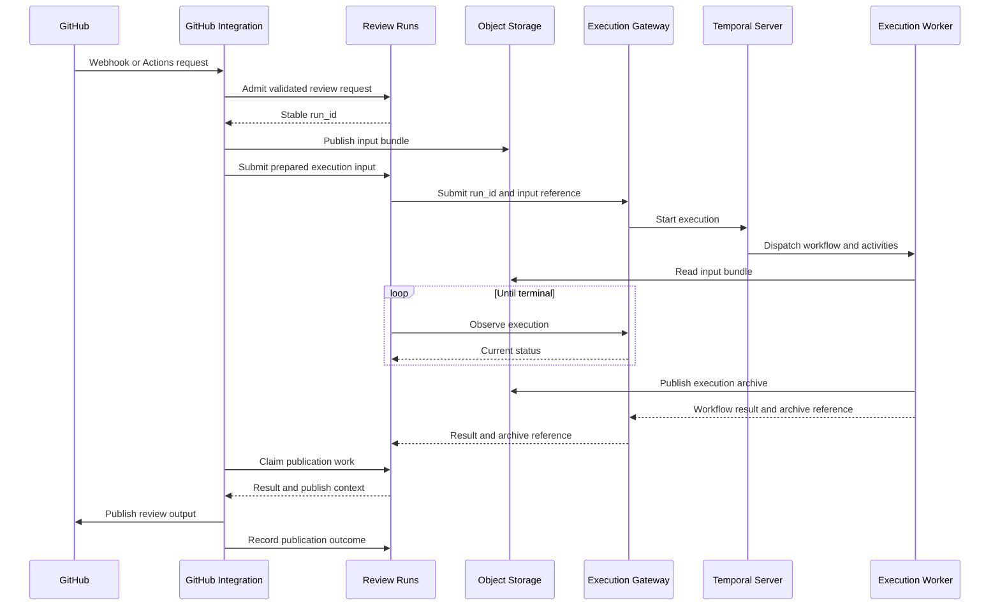
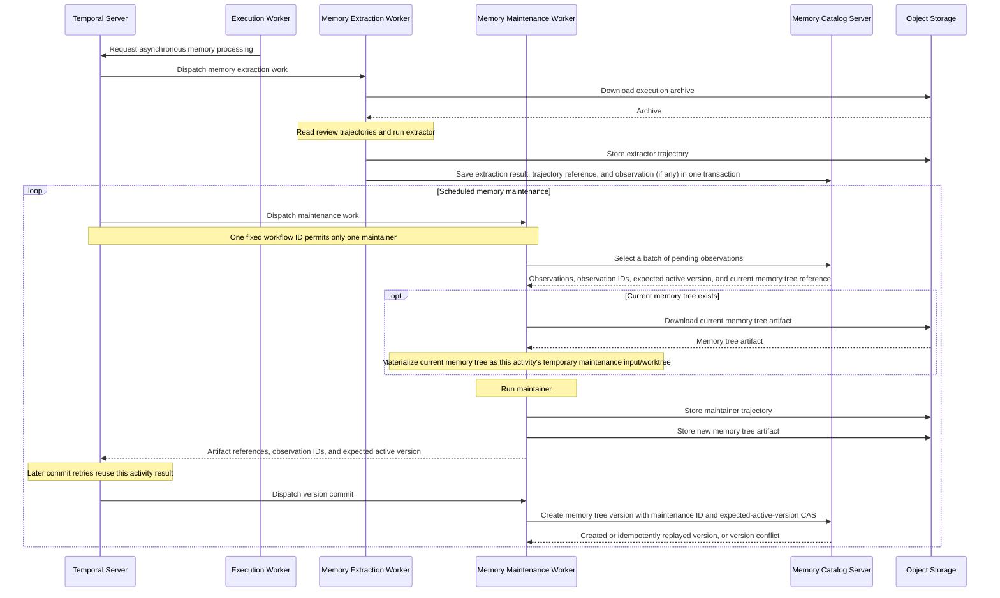
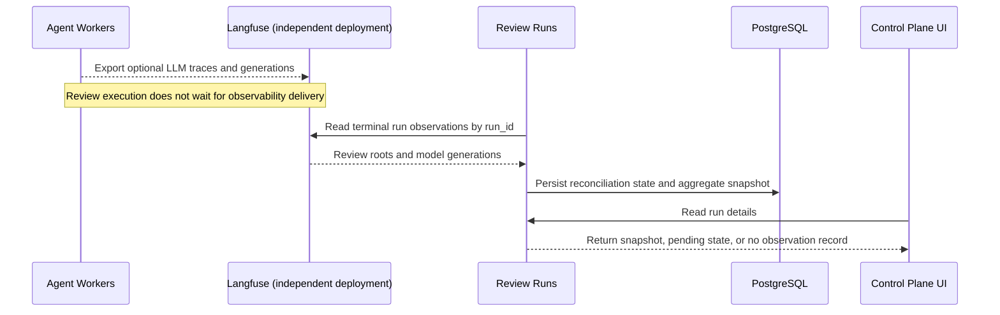

# System Architecture

Language: English | [中文](SYSTEM_ARCHITECTURE.zh.md)

Sec Review Bot's repository-owned runtime roles are GitHub Integration, Review Runs, Control Plane UI, Execution Gateway, Execution Worker, Memory Extraction Worker, Memory Maintenance Worker, and Memory Catalog Server. Langfuse is a trusted observability dependency with an independent deployment and lifecycle, not a repository-owned runtime role.

Distinguish the review task, its execution, and its delivery:

| Term      | Meaning                                                                                          |
| --------- | ------------------------------------------------------------------------------------------------ |
| run       | An admitted review task in Review Runs, including preparation, execution, and publication state. |
| execution | Work submitted through Execution Gateway to Temporal.                                            |
| case      | A repository-scan problem unit requiring independent analysis and verification.                  |
| delivery  | A publishable repair result for one or more cases.                                               |

## Runtime topology

Temporal Server is infrastructure, but it directly dispatches work to the worker processes, so the topology presents it with the runtime services. PostgreSQL and Object Storage remain separate persistence facilities. Langfuse appears outside the repository deployment boundary: workers optionally export LLM observations to it, and Review Runs reads those observations asynchronously to persist model-usage snapshots. Review execution, memory extraction, and memory maintenance use independent worker processes and task queues.

Memory Catalog owns coordination state in PostgreSQL, Object Storage owns immutable memory-tree and trajectory artifacts, and Temporal owns workflow execution. When memory consumption is enabled and an active version exists, a review invocation materializes that memory tree into a temporary directory for the agent and removes it afterward.

Control Plane UI accesses Memory Catalog through its same-origin backend (BFF). The browser receives no Catalog tokens, storage credentials, or `s3://` references. The BFF checks artifact references, size, and digest before returning downloaded content. Authenticated operators can pause or resume automatic memory-tree version commits, commit manual edits, and restore an existing version. New versions record the version active at creation as their predecessor, while version numbers remain globally increasing. The BFF can create immutable memory-tree objects but has read-only access to review artifacts and memory trajectories.

## Runtime ownership map

| Runtime role              | Code                          | Owns                                                                                                         | Local guide                                          |
| ------------------------- | ----------------------------- | ------------------------------------------------------------------------------------------------------------ | ---------------------------------------------------- |
| GitHub Integration        | `apps/github-integration/`    | GitHub ingress, input preparation, Review Runs client, and GitHub publication                                | [README](../../apps/github-integration/README.md)    |
| Review Runs               | `services/review-runs/`       | Admission, durable run state, recovery, execution observation, and publication coordination                  | [README](../../services/review-runs/README.md)       |
| Control Plane UI          | `apps/control-plane-ui/`      | Authenticated operator console for Review Runs inspection and memory management                              | [README](../../apps/control-plane-ui/README.md)      |
| Execution Gateway         | `services/execution-gateway/` | Authenticated Execution API and HTTP-to-Temporal translation                                                 | [README](../../services/execution-gateway/README.md) |
| Execution Worker          | `agents/`                     | Review workflows, activities, agent runtime, stage artifacts, and execution archive publication              | [README](../../agents/README.md)                     |
| Memory Extraction Worker  | `agents/`                     | Per-execution archive consumption, extractor invocation, trajectory publication, and extraction registration | [README](../../agents/README.md)                     |
| Memory Maintenance Worker | `agents/`                     | Batched maintenance input consumption, maintainer invocation, memory tree publication, and version commit    | [README](../../agents/README.md)                     |
| Memory Catalog Server     | `services/memory-catalog/`    | Observation catalog, immutable memory version history, and active version coordination                       | [README](../../services/memory-catalog/README.md)    |

The runtime roles communicate through project-owned boundaries under [`contracts/`](../../contracts/README.md). `services/` groups the internal HTTP service packages; each retains its own configuration, build, and deployment. Package location does not determine process topology: `agents/` implements independently deployed Temporal workers. Applications under `apps/` remain independently deployed services.

## Main review path

## Asynchronous memory path

## Observability and statistics path

Langfuse stores model-call records. Review Runs reads and aggregates them into its own database for display in the Control Plane UI.
