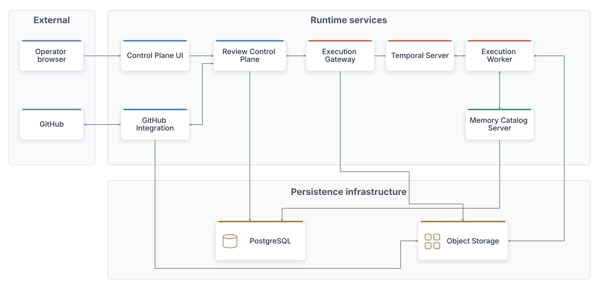
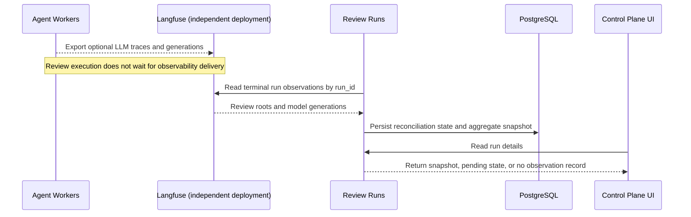
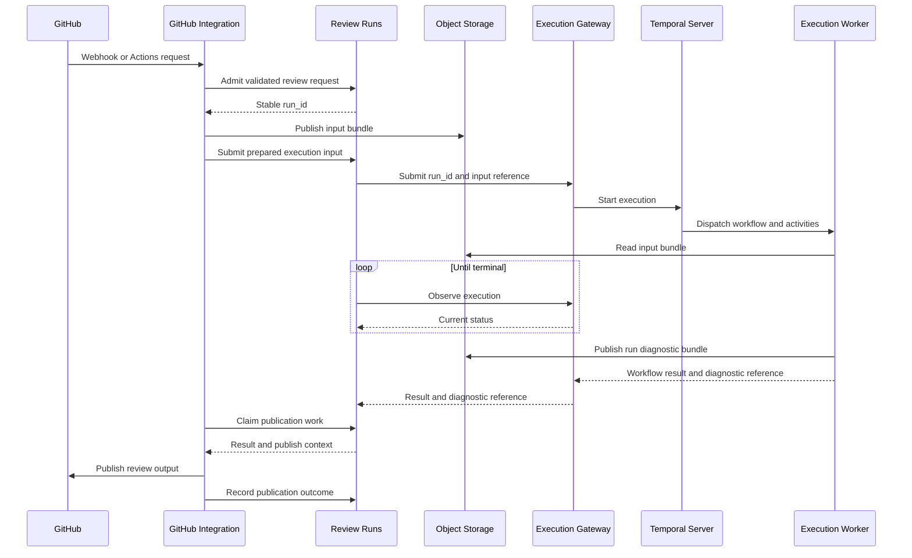
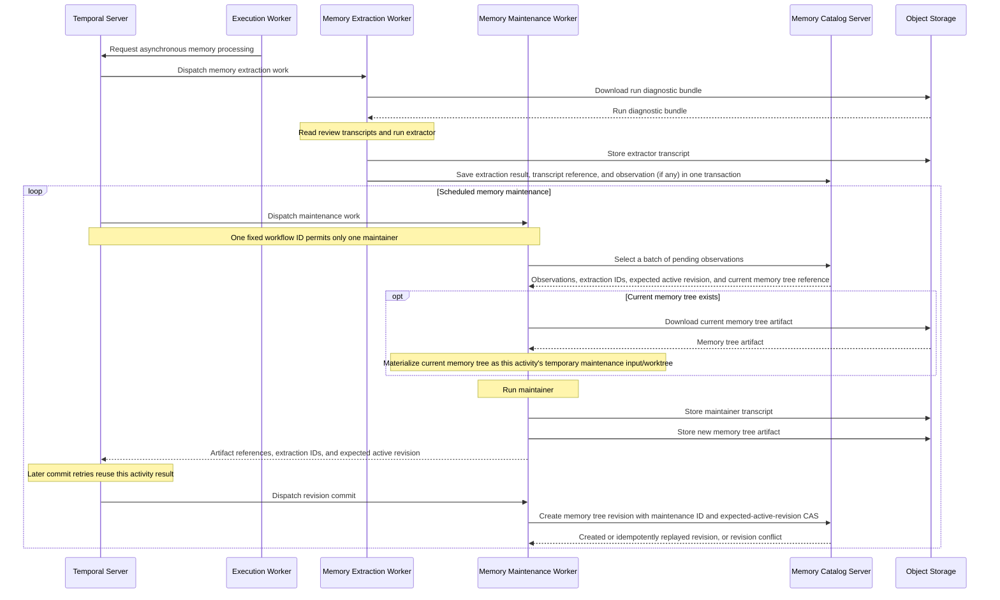

# System Architecture

Language: English | [中文](SYSTEM_ARCHITECTURE.zh.md)

Sec Review Bot's repository-owned runtime roles are GitHub Integration, Review Runs, Control Plane UI, Execution Gateway, Execution Worker, Memory Extraction Worker, Memory Maintenance Worker, and Memory Catalog Server. Langfuse is a trusted observability dependency with an independent deployment and lifecycle, not a repository-owned runtime role.

## Runtime topology

Temporal Server is infrastructure, but it directly dispatches work to the worker processes, so the topology presents it with the runtime services. PostgreSQL and Object Storage remain separate persistence facilities. Langfuse appears outside the repository deployment boundary: workers optionally export LLM observations to it, and Review Runs reads those observations asynchronously to persist model-usage snapshots. Review execution, memory extraction, and memory maintenance use independent worker processes and task queues.

The memory path has one deployment-independent state model. Memory Catalog owns coordination state in PostgreSQL, Object Storage owns immutable memory-tree and transcript artifacts, and Temporal owns workflow execution. Each review invocation materializes the current memory tree into a temporary directory for its agent backend and removes that directory afterward.

Control Plane UI manages Memory Catalog through its BFF and never exposes Catalog tokens, storage credentials, or `s3://` references to the browser. The BFF fetches and identity-checks artifact downloads. Authenticated operators can pause or resume automatic maintenance, create operator edit revisions, and restore the active pointer to an existing revision. New revisions retain that active revision as their predecessor while revision identities remain globally increasing. The BFF can create immutable memory-tree objects, while run artifacts and memory transcripts remain read-only.

## Runtime ownership map

| Runtime role | Code | Owns | Local guide |
| --- | --- | --- | --- |
| GitHub Integration | `apps/github-integration/` | GitHub ingress, input preparation, Review Runs client, and GitHub publication | [README](../../apps/github-integration/README.md) |
| Review Runs | `review-runs/` | Admission, durable run state, recovery, execution observation, and publication coordination | [README](../../review-runs/README.md) |
| Control Plane UI | `apps/control-plane-ui/` | Authenticated operator console for Review Runs inspection and memory management | [README](../../apps/control-plane-ui/README.md) |
| Execution Gateway | `execution-gateway/` | Authenticated Execution API and HTTP-to-Temporal translation | [README](../../execution-gateway/README.md) |
| Execution Worker | `agents/` | Review workflows, activities, agent runtime, stage artifacts, and run diagnostic publication | [README](../../agents/README.md) |
| Memory Extraction Worker | `agents/` | Per-run diagnostic consumption, extractor invocation, transcript publication, and extraction registration | [README](../../agents/README.md) |
| Memory Maintenance Worker | `agents/` | Bounded maintenance input consumption, maintainer invocation, memory tree publication, and revision commit | [README](../../agents/README.md) |
| Memory Catalog Server | `memory-catalog/` | Observation catalog, immutable memory revision history, and active revision coordination | [README](../../memory-catalog/README.md) |

The runtime roles communicate through project-owned boundaries under [`contracts/`](../../contracts/README.md). Package location does not determine process topology: `agents/` implements independently deployed Temporal workers. Applications under `apps/` remain independently deployed services.

## Observability and statistics path

Langfuse stores the individual model-call observations. Review Runs reads and aggregates them into its own database for display in the Control Plane UI.

## Main review path

## Asynchronous memory path

