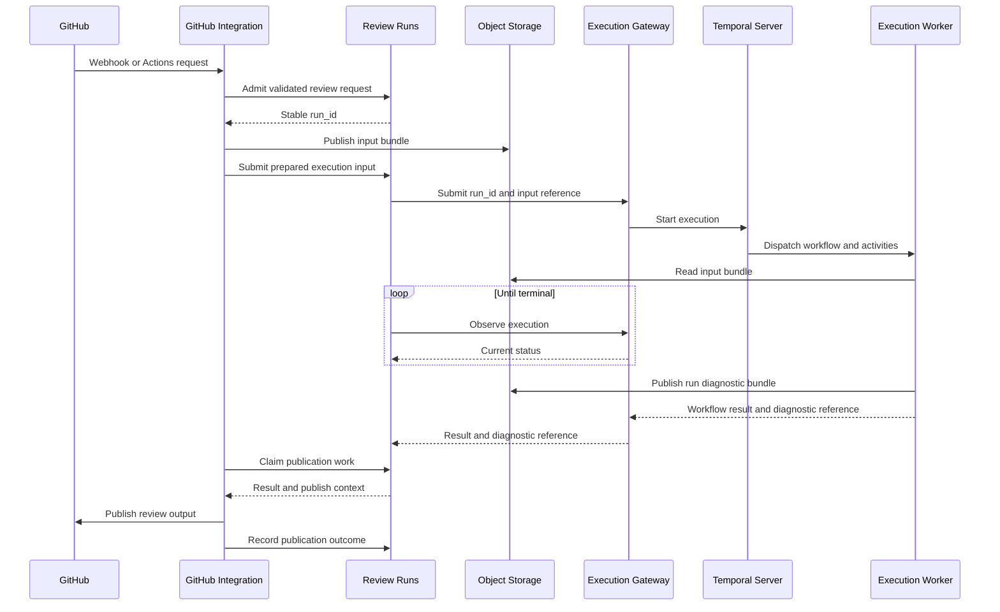
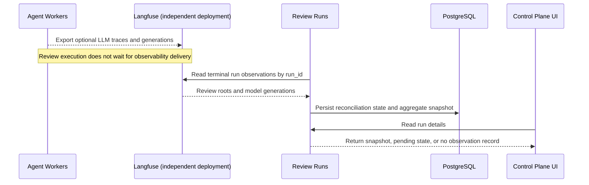
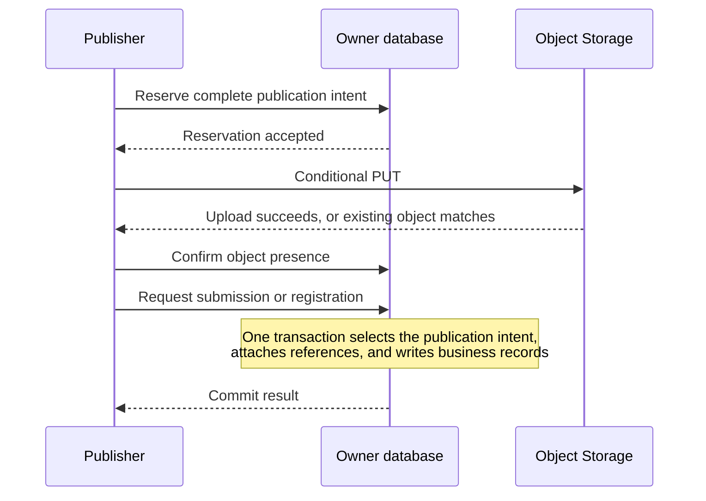

# System Architecture

Language: English | [中文](SYSTEM_ARCHITECTURE.zh.md)

Sec Review Bot's repository-owned runtime roles are GitHub Integration, Review Runs, Control Plane UI, Execution Gateway, Execution Worker, Memory Extraction Worker, Memory Maintenance Worker, and Memory Catalog Server. Langfuse is a trusted observability dependency with an independent deployment and lifecycle, not a repository-owned runtime role.

## Runtime topology

Temporal Server is infrastructure, but it directly dispatches work to the worker processes, so the topology presents it with the runtime services. PostgreSQL and Object Storage remain separate persistence facilities. Langfuse appears outside the repository deployment boundary: workers optionally export LLM observations to it, and Review Runs reads those observations asynchronously to persist model-usage snapshots. Review execution, memory extraction, and memory maintenance use independent worker processes and task queues.

The memory path has one deployment-independent state model. Memory Catalog owns coordination state in PostgreSQL, Object Storage owns immutable memory-tree and trajectory artifacts, and Temporal owns workflow execution. Each review invocation materializes the current memory tree into a temporary directory for its agent backend and removes that directory afterward.

Control Plane UI manages Memory Catalog through its BFF and never exposes Catalog tokens, storage credentials, or `s3://` references to the browser. The BFF fetches and identity-checks artifact downloads. Authenticated operators can pause or resume automatic maintenance, create operator edit revisions, and restore the active pointer to an existing revision. New revisions retain that active revision as their predecessor while revision identities remain globally increasing. The BFF can create immutable memory-tree objects, while run artifacts and memory trajectories remain read-only.

## Runtime ownership map

| Runtime role | Code | Owns | Local guide |
| --- | --- | --- | --- |
| GitHub Integration | `apps/github-integration/` | GitHub ingress, input preparation, Review Runs client, and GitHub publication | [README](../../apps/github-integration/README.md) |
| Review Runs | `services/review-runs/` | Admission, durable run state, recovery, execution observation, and publication coordination | [README](../../services/review-runs/README.md) |
| Control Plane UI | `apps/control-plane-ui/` | Authenticated operator console for Review Runs inspection and memory management | [README](../../apps/control-plane-ui/README.md) |
| Execution Gateway | `services/execution-gateway/` | Authenticated Execution API and HTTP-to-Temporal translation | [README](../../services/execution-gateway/README.md) |
| Execution Worker | `agents/` | Review workflows, activities, agent runtime, stage artifacts, and run diagnostic publication | [README](../../agents/README.md) |
| Memory Extraction Worker | `agents/` | Per-run diagnostic consumption, extractor invocation, trajectory publication, and extraction registration | [README](../../agents/README.md) |
| Memory Maintenance Worker | `agents/` | Batched maintenance input consumption, maintainer invocation, memory tree publication, and revision commit | [README](../../agents/README.md) |
| Memory Catalog Server | `services/memory-catalog/` | Observation catalog, immutable memory revision history, and active revision coordination | [README](../../services/memory-catalog/README.md) |

The runtime roles communicate through project-owned boundaries under [`contracts/`](../../contracts/README.md). `services/` groups the internal HTTP service packages; each retains its own configuration, build, and deployment. Package location does not determine process topology: `agents/` implements independently deployed Temporal workers. Applications under `apps/` remain independently deployed services.

## Main review path

## Asynchronous memory path

## Observability and statistics path

Langfuse stores the individual model-call observations. Review Runs reads and aggregates them into its own database for display in the Control Plane UI.

## Artifact publication and recovery

PostgreSQL and object storage commit separately. Input and memory publishers first persist a publication intent: the intended artifact references and the business payload needed to finish attachment after a crash.

After an interruption, retries check the recorded publication intent and object state first. A [Temporal Activity retry](https://docs.temporal.io/activity-definition#idempotency) can repeat an upload after a lost completion response; it does not make storage and SQL one transaction.

| Artifact | Durable recovery basis | Recovery boundary |
| --- | --- | --- |
| Review input bundle | Review Runs publication intent: reference, prepared input, and publish context | A replacement preparation claim can reuse the original publication intent when the object is present. Only definite absence permits abandoning an unused candidate and rebuilding. |
| Extraction trajectory | Memory Catalog publication intent containing the trajectory reference, observation, and summary | Retries check recorded candidates before rerunning the model; selection and extraction registration commit together. |
| Maintenance revision | Memory Catalog publication intent grouping the tree, trajectory, observation IDs, and expected active revision | Different model outputs can be separate candidates; selection, revision creation, observation consumption, and active pointer update commit together. |
| Operator edit revision | Memory Catalog publication intent containing the tree reference, operation ID, and expected active revision; the UI BFF uploads the tree | Retries of unchanged content within the open editor retain the operation ID and original expected revision. The BFF repeats reservation, conditional upload, confirmation, and idempotent revision creation. |
| Run diagnostic bundle in S3 | Temporal publication request and the fixed run key | Recovery verifies the existing bundle against the request before using local files. If neither a complete uploaded bundle nor local artifacts remain, the request cannot reconstruct the diagnostic bytes. |

UI restore moves the active pointer to an existing revision in a Catalog transaction; it creates neither a revision nor an object and does not repair missing bytes.

The input and memory protocols are described in the [Review Runs](../../services/review-runs/README.md) and [Memory Catalog](../../services/memory-catalog/README.md) guides. Storage errors remain uncertain and fail the attempt; they are not evidence that an object is missing. Recorded publication intents support retries, but do not provide automatic background completion after retries are exhausted.

<!-- doc-time-sensitive: artifact-conditional-write-semantics; checked=2026-10-31; source=https://docs.aws.amazon.com/AmazonS3/latest/userguide/conditional-writes.html -->

[Conditional PUT](https://docs.aws.amazon.com/AmazonS3/latest/userguide/conditional-writes.html) prevents cooperating publishers from overwriting an occupied key. It does not enforce retention against other identities with overwrite or delete permission. Consumers verify size and SHA-256 before use: this rejects replacement content but cannot recover lost bytes. S3-compatible deployments must verify the APIs and policy conditions they rely on against their deployed storage version.

Abandoning a candidate does not delete its object, and no automatic object garbage collection is implemented. A stale uploader may still finish, and candidates may share content keys. Future cleanup must account for historical revisions, extraction references, and prepared references retained in Temporal history, rather than treating every object without a current database attachment as disposable.
