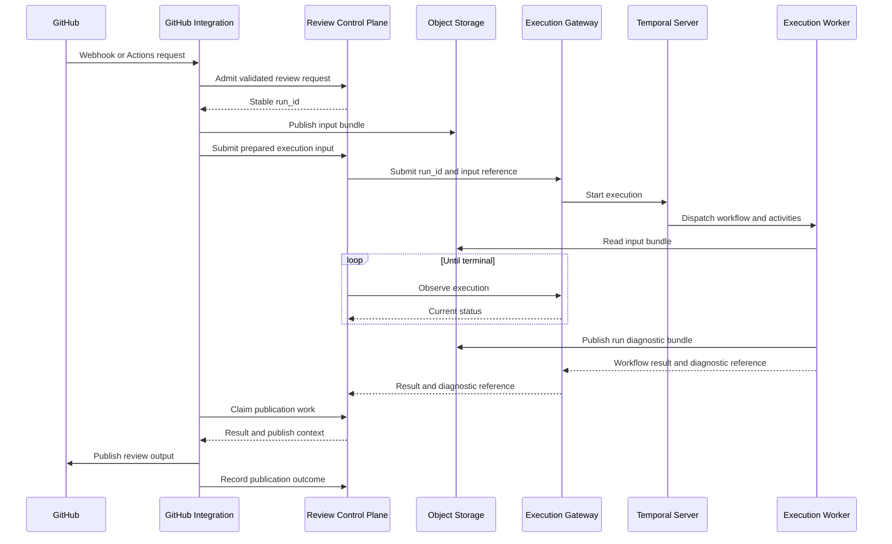
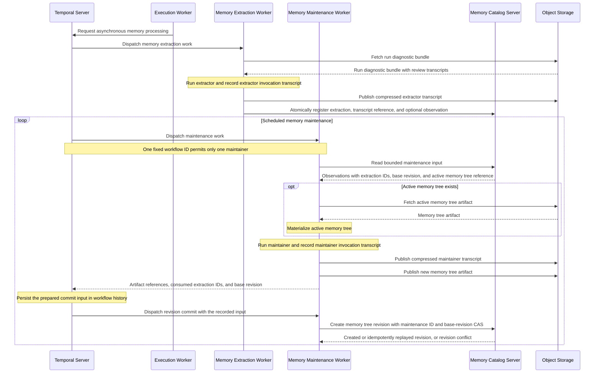

# System Architecture

Sec Review Bot has eight runtime roles: GitHub Integration, Review Control Plane, Control Plane UI, Execution Gateway, Execution Worker, Memory Extraction Worker, Memory Maintenance Worker, and Memory Catalog Server.

## Runtime topology

Temporal Server is infrastructure, but it directly dispatches work to the worker processes, so the topology presents it with the runtime services. PostgreSQL and Object Storage remain separate persistence facilities. Review execution, memory extraction, and memory maintenance use independent worker processes and task queues.

## Runtime ownership map

| Runtime role | Code | Owns | Local guide |
| --- | --- | --- | --- |
| GitHub Integration | `apps/github-integration/` | GitHub ingress, input preparation, Control Plane client, and GitHub publication | [README](../../apps/github-integration/README.md) |
| Review Control Plane | `control-plane/` | Admission, durable run state, recovery, execution observation, and publication coordination | [README](../../control-plane/README.md) |
| Control Plane UI | `apps/control-plane-ui/` | Authenticated operator console and read-only Control Plane projection | [README](../../apps/control-plane-ui/README.md) |
| Execution Gateway | `execution-gateway/` | Authenticated Execution API and HTTP-to-Temporal translation | [README](../../execution-gateway/README.md) |
| Execution Worker | `agents/` | Review workflows, activities, agent runtime, stage artifacts, and run diagnostic publication | [README](../../agents/README.md) |
| Memory Extraction Worker | `agents/` | Per-run diagnostic consumption, extractor invocation, transcript publication, and extraction registration | [README](../../agents/README.md) |
| Memory Maintenance Worker | `agents/` | Bounded maintenance input consumption, maintainer invocation, memory tree publication, and revision commit | [README](../../agents/README.md) |
| Memory Catalog Server | `memory-catalog/` | Observation catalog, immutable memory revision history, and active revision coordination | [README](../../memory-catalog/README.md) |

The runtime roles communicate through project-owned boundaries under [`contracts/`](../../contracts/README.md). Package location does not determine process topology: `agents/` implements three independent Temporal workers. The two applications under `apps/` remain independently deployed services.

## Main review path

## Asynchronous memory path

