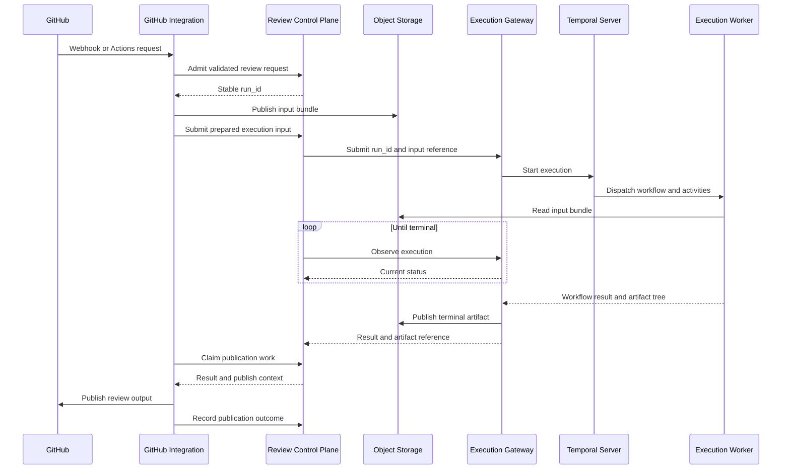
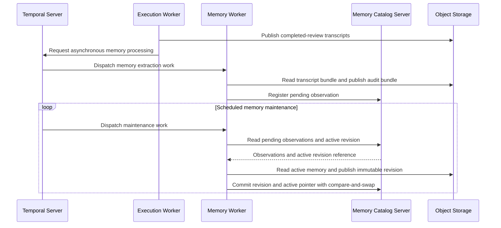

# System Architecture

Sec Review Bot contains seven runtime entities with separate responsibilities and deployment boundaries: GitHub Integration, Review Control Plane, Control Plane UI, Execution Gateway, Execution Worker, Memory Worker, and Memory Catalog Server.

## Runtime topology

Temporal Server is infrastructure, but it directly dispatches work to both worker pools, so the topology presents it with the runtime services. PostgreSQL and Object Storage remain separate persistence facilities. The main review path and the asynchronous memory path use separate task queues and worker processes.

## Runtime ownership map

| Runtime entity | Code | Owns | Local guide |
| --- | --- | --- | --- |
| GitHub Integration | `apps/github-integration/` | GitHub ingress, input preparation, Control Plane client, and GitHub publication | [README](../../apps/github-integration/README.md) |
| Review Control Plane | `control-plane/` | Admission, durable run state, recovery, execution observation, and publication coordination | [README](../../control-plane/README.md) |
| Control Plane UI | `apps/control-plane-ui/` | Authenticated operator console and read-only Control Plane projection | [README](../../apps/control-plane-ui/README.md) |
| Execution Gateway | `execution-gateway/` | Authenticated Execution API and HTTP-to-Temporal translation | [README](../../execution-gateway/README.md) |
| Execution Worker | `agents/` | Review workflows, activities, agent runtime, stage artifacts, and transcript publication | [README](../../agents/README.md) |
| Memory Worker | `agents/` | Asynchronous memory extraction and maintenance workflows | [README](../../agents/README.md) |
| Memory Catalog Server | `memory-catalog/` | Observation catalog, immutable memory revision history, and active revision coordination | [README](../../memory-catalog/README.md) |

The runtime entities communicate through project-owned boundaries under [`contracts/`](../../contracts/README.md). Package location does not imply shared runtime ownership: the two workers are separate processes even though they are implemented in the same Python package, while the two applications under `apps/` are independently deployed services.

## Main review path

## Asynchronous memory path

## State and recovery boundaries

| Durable state | Owner | Purpose |
| --- | --- | --- |
| Run admission, replayable execution input, execution observation, and publication progress | Review Control Plane in PostgreSQL | Coordination and recovery across service restarts |
| Workflow and activity history | Temporal Server | Durable scheduling, retries, timeouts, and workflow recovery |
| Input bundles, terminal artifacts, transcripts, audit bundles, and memory revisions | Object Storage | Immutable exchange and archival of large artifacts |
| Memory observations and the active revision pointer | Memory Catalog Server in PostgreSQL | Catalog coordination and compare-and-swap revision activation |

These stores are independent recovery inputs. Missing Temporal history does not establish a publication outcome, and a PostgreSQL run record does not imply that its referenced object still exists. Recovery must reconcile the owner of each state rather than infer one subsystem's outcome from another subsystem.

An external side effect is complete only when the component that owns its coordination state records the outcome. Component-specific state machines and retry rules belong in the owning package README; cross-component data shapes belong in the relevant contract family.
