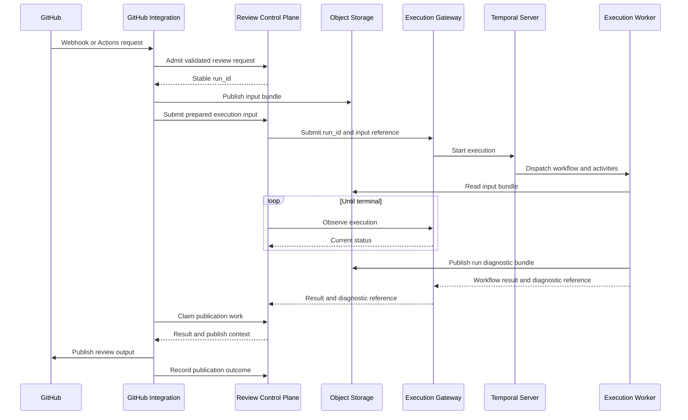
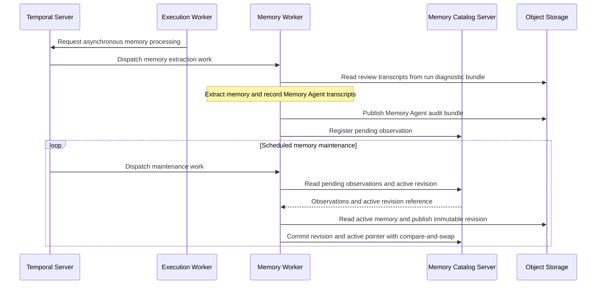

# System Architecture

Sec Review Bot contains seven runtime entities with separate responsibilities and deployment boundaries: GitHub Integration, Review Control Plane, Control Plane UI, Execution Gateway, Execution Worker, Memory Worker, and Memory Catalog Server.

## Runtime topology

Temporal Server is infrastructure, but it directly dispatches work to both worker pools, so the topology presents it with the runtime services. PostgreSQL and Object Storage remain separate persistence facilities. The main review path and the asynchronous memory path use separate task queues and worker processes.

## Runtime ownership map

| Runtime entity | Code | Owns | Local guide |
| --- | --- | --- | --- |
| GitHub Integration | `apps/github-integration/` | GitHub ingress, input preparation, Control Plane client, and GitHub publication | [README](../../apps/github-integration/README.md) |
| Review Control Plane | `control-plane/` | Admission, durable run state, recovery, execution observation, and publication coordination | [README](../../control-plane/README.md) |
| Control Plane UI | `apps/control-plane-ui/` | Authenticated operator console and read-only Control Plane projection | [README](../../apps/control-plane-ui/README.md) |
| Execution Gateway | `execution-gateway/` | Authenticated Execution API and HTTP-to-Temporal translation | [README](../../execution-gateway/README.md) |
| Execution Worker | `agents/` | Review workflows, activities, agent runtime, stage artifacts, and run diagnostic publication | [README](../../agents/README.md) |
| Memory Worker | `agents/` | Asynchronous memory extraction and maintenance workflows | [README](../../agents/README.md) |
| Memory Catalog Server | `memory-catalog/` | Observation catalog, immutable memory revision history, and active revision coordination | [README](../../memory-catalog/README.md) |

The runtime entities communicate through project-owned boundaries under [`contracts/`](../../contracts/README.md). Package location does not imply shared runtime ownership: the two workers are separate processes even though they are implemented in the same Python package, while the two applications under `apps/` are independently deployed services.

## Main review path

## Asynchronous memory path

