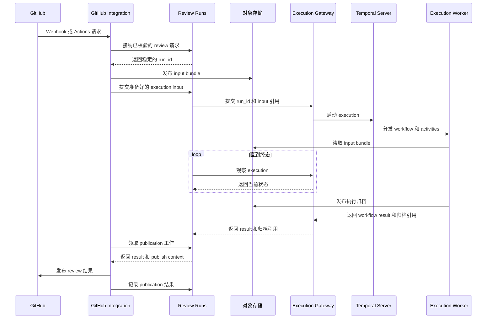
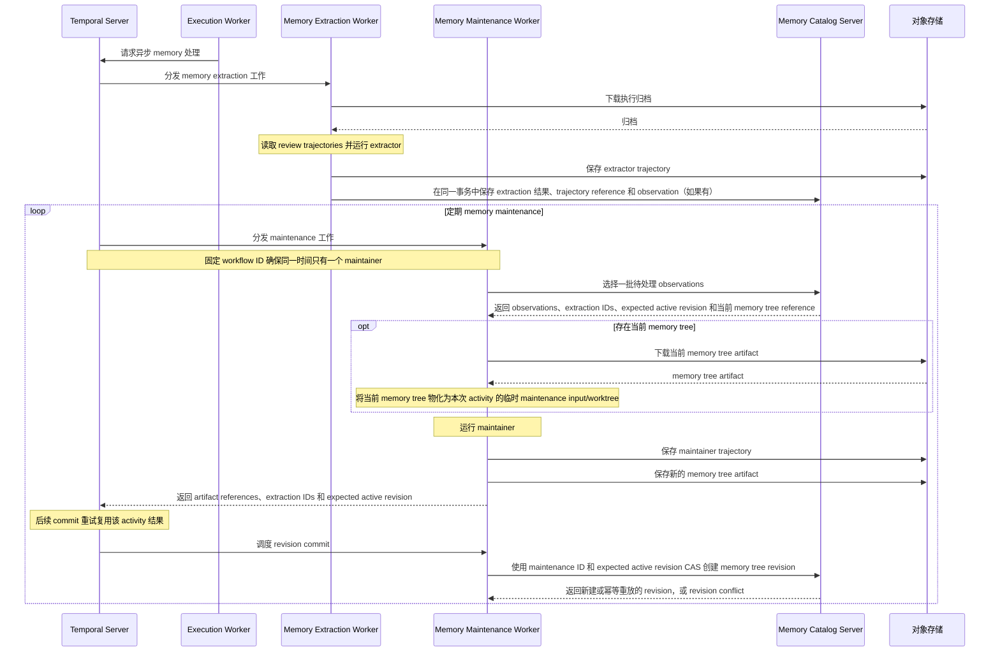
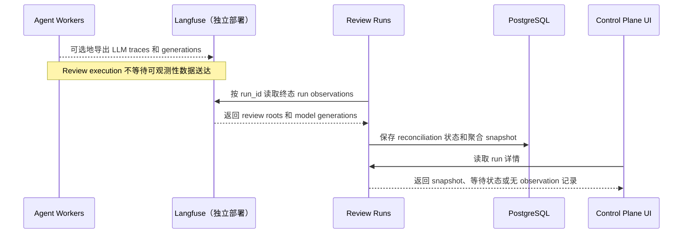
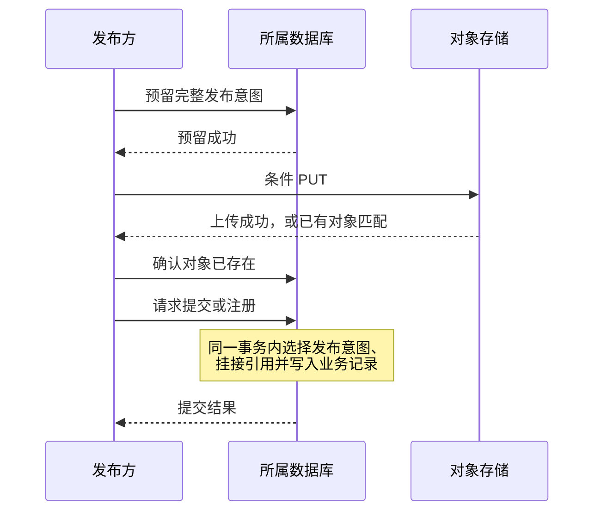

# 系统架构

语言：[English](SYSTEM_ARCHITECTURE.md) | 中文

本文为 [SYSTEM_ARCHITECTURE.md](SYSTEM_ARCHITECTURE.md) 的中文译文；如有差异，以英文版为准。

本仓库实现的运行组件包括 GitHub Integration、Review Runs、Control Plane UI、Execution Gateway、Execution Worker、Memory Extraction Worker、Memory Maintenance Worker 和 Memory Catalog Server。Langfuse 是受信任、独立部署并拥有独立生命周期的可观测性依赖，不属于本仓库负责的运行角色。

阅读后文时，注意区分 run、execution、case 和 delivery：

| 名称      | 含义                                                                |
| --------- | ------------------------------------------------------------------- |
| run       | 一次已被 Review Runs 接收的审查任务，包含输入准备、执行和发布状态。 |
| execution | 通过 Execution Gateway 提交给 Temporal 的执行过程。                 |
| case      | 仓库扫描中需要独立分析和验证的问题单元。                            |
| delivery  | 可发布的一组修复结果，可以对应一个或多个问题单元。                  |

## 运行拓扑

Temporal Server 属于基础设施，但它会直接向 Worker 进程分发工作，因此拓扑图将它与运行服务放在一起。PostgreSQL 和对象存储则单独作为持久化设施呈现。Langfuse 位于本仓库的部署边界之外：Worker 可以向其发送模型调用记录，Review Runs 再异步汇总并保存用量快照。审查执行、记忆提取和记忆维护使用各自的 Worker 进程和 Temporal 任务队列。

Memory Catalog 在 PostgreSQL 中保存协调状态，对象存储保存不可变的记忆文件树和执行轨迹，Temporal 调度工作流。启用记忆读取且已有生效版本时，审查调用会将记忆文件树还原到临时目录，供 Agent 读取，并在调用结束后清理。

Control Plane UI 通过同源服务端（BFF）访问 Memory Catalog，浏览器不会获得 Catalog 令牌、对象存储凭据或 `s3://` 引用。BFF 下载产物后先核对引用信息、大小和摘要，再返回内容。经过认证的运维人员可以暂停或恢复记忆树自动修订提交、提交人工编辑版本，以及恢复已有版本。新修订以创建时的生效版本为前驱，修订编号仍全局递增。BFF 可以创建不可变的记忆文件树对象，但对审查产物和记忆执行轨迹仅有读取权限。

## 运行角色职责地图

| 运行角色                  | 代码                          | 负责内容                                                      | 本地指南                                                |
| ------------------------- | ----------------------------- | ------------------------------------------------------------- | ------------------------------------------------------- |
| GitHub Integration        | `apps/github-integration/`    | 接收 GitHub 请求、准备输入、调用 Review Runs 和发布结果       | [README](../../apps/github-integration/README.zh.md)    |
| Review Runs               | `services/review-runs/`       | 接收任务、保存运行状态、恢复处理、跟踪执行和协调发布          | [README](../../services/review-runs/README.zh.md)       |
| Control Plane UI          | `apps/control-plane-ui/`      | 经身份验证的运维控制台，用于查看 run 和管理记忆               | [README](../../apps/control-plane-ui/README.zh.md)      |
| Execution Gateway         | `services/execution-gateway/` | 经过鉴权的 Execution API 与 HTTP-to-Temporal 转换             | [README](../../services/execution-gateway/README.zh.md) |
| Execution Worker          | `agents/`                     | 执行审查工作流、activity 和 Agent，保存阶段产物并发布执行归档 | [README](../../agents/README.zh.md)                     |
| Memory Extraction Worker  | `agents/`                     | 读取执行归档、提取经验、发布轨迹并登记 extraction             | [README](../../agents/README.zh.md)                     |
| Memory Maintenance Worker | `agents/`                     | 分批整理待处理经验、发布记忆文件树并提交修订                  | [README](../../agents/README.zh.md)                     |
| Memory Catalog Server     | `services/memory-catalog/`    | 保存 extraction、不可变修订历史和当前生效版本                 | [README](../../services/memory-catalog/README.zh.md)    |

这些运行角色通过 [`contracts/`](../../contracts/README.zh.md) 下由项目维护的边界通信。`services/` 归集内部 HTTP 服务包；各包保留独立的配置、构建和部署。源码包的位置不决定运行进程的组织方式：`agents/` 实现彼此独立部署的 Temporal Worker。`apps/` 下的应用也分别独立部署。

## 主 Review 链路

## 异步 Memory 链路

## 可观测性与统计链路

Langfuse 保存模型调用记录。Review Runs 读取并汇总这些数据，写入自己的数据库，供 Control Plane UI 展示。

## Artifact 发布与恢复

本系统中的审查输入发布、经验提取登记、自动维护修订和人工编辑修订，都需要分别向对象存储上传文件、向 PostgreSQL 登记结果。两者无法在一个本地事务中同时完成，因此会遇到[双写一致性问题（dual-write problem）](https://docs.aws.amazon.com/prescriptive-guidance/latest/cloud-design-patterns/transactional-outbox.html)：文件上传成功后，进程可能在登记数据库前中断，留下没有数据库引用的对象；如果先登记数据库，上传失败又可能留下指向不存在文件的引用。

为支持中断后重试，输入材料和记忆产物的发布方先持久保存发布意图（publication intent），记录预期的产物引用和登记所需的完整业务数据，再上传对象，最后登记结果。重试可以据此检查已有对象并继续处理，无需盲目重复上传或重新调用模型。

中途失败后，重试先检查已记录的发布意图和对象状态。[Temporal Activity 重试](https://docs.temporal.io/activity-definition#idempotency)可能在完成响应丢失后重复上传，但不会把对象存储与 SQL 合成一个事务。

| 产物                            | 持久化恢复依据                                                                                         | 恢复边界                                                                                                             |
| ------------------------------- | ------------------------------------------------------------------------------------------------------ | -------------------------------------------------------------------------------------------------------------------- |
| 审查输入材料包                  | Review Runs 发布意图：产物引用、已准备的输入和发布上下文                                               | 接管输入准备的调用方可在对象存在时复用原发布意图；只有确认对象不存在时，才能放弃未选中的候选记录并重新准备。         |
| 经验提取轨迹                    | Memory Catalog 发布意图：轨迹引用、observation 和摘要                                                  | 重试先检查已有候选记录，再决定是否重新调用模型；选定记录和登记 extraction 在同一事务中完成。                         |
| learning 或 reorganization 修订 | Memory Catalog 发布意图：记忆树、轨迹、operation ID、预期生效修订，以及 learning 使用的 observation ID | 不同模型输出可以对应不同候选记录；选定记录、创建修订、learning 对 observation 的消费和更新生效版本在同一事务中完成。 |
| manual 修订                     | Memory Catalog 发布意图：记忆树引用、operation ID 和预期生效修订；UI BFF 上传记忆树                    | 编辑器保持打开且内容未变时，重试复用 operation ID 和最初预期的修订。BFF 重新执行预留、条件上传、确认和幂等修订创建。 |
| S3 中的执行归档                 | Temporal 发布请求和固定的 run 对象键                                                                   | 恢复时先按请求校验已上传的归档，再考虑本地文件。如果完整归档和本地产物都已丢失，仅凭请求无法重建归档内容。           |

UI 恢复版本在 Catalog 事务中将生效版本指针移到已有修订，不创建修订或对象，也不会修复丢失的字节。

输入材料和记忆产物的具体协议见 [Review Runs](../../services/review-runs/README.zh.md) 和 [Memory Catalog](../../services/memory-catalog/README.md)。存储错误仍是不确定状态，会使本次尝试失败，不能当作对象不存在。已记录的发布意图支持重试，但不提供重试耗尽后的自动后台完成机制。

<!-- doc-time-sensitive: artifact-conditional-write-semantics; checked=2026-10-31; source=https://docs.aws.amazon.com/AmazonS3/latest/userguide/conditional-writes.html -->

[条件 PUT](https://docs.aws.amazon.com/AmazonS3/latest/userguide/conditional-writes.html) 阻止遵守协议的发布方覆盖已有对象键，但不保证对象能抵抗其他具有覆盖或删除权限的身份。读取方在使用前校验大小与 SHA-256：这能拒绝替换内容，却不能找回丢失的字节。S3 兼容部署必须针对实际部署的存储版本验证所依赖的 API 与策略条件。

放弃候选发布记录不会删除对象，目前也没有自动对象垃圾回收。旧上传进程仍可能完成上传，不同候选发布记录也可能共享内容对象键。当前未被数据库引用的对象不一定可以删除：未来清理必须考虑历史修订、经验提取引用，以及 Temporal 历史记录中保留的尚未挂接引用。
