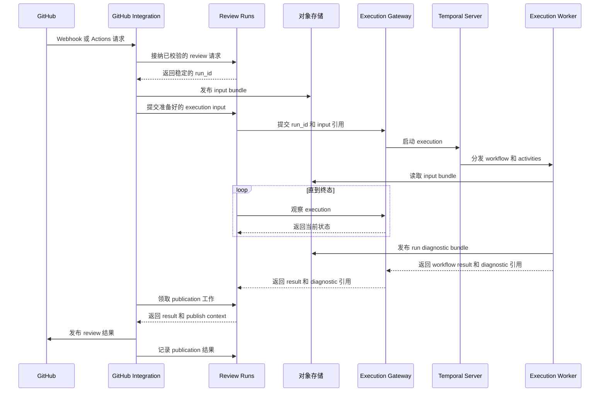
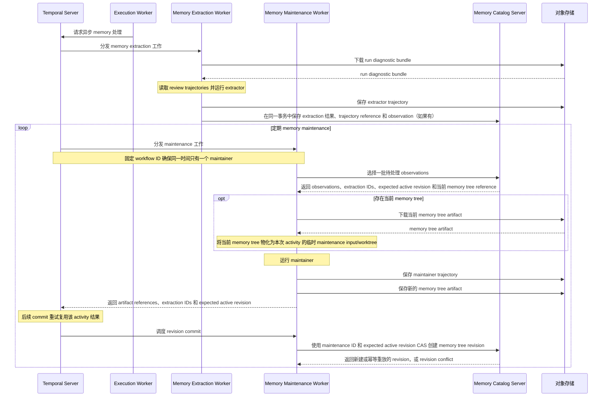
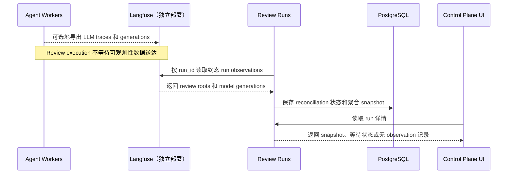
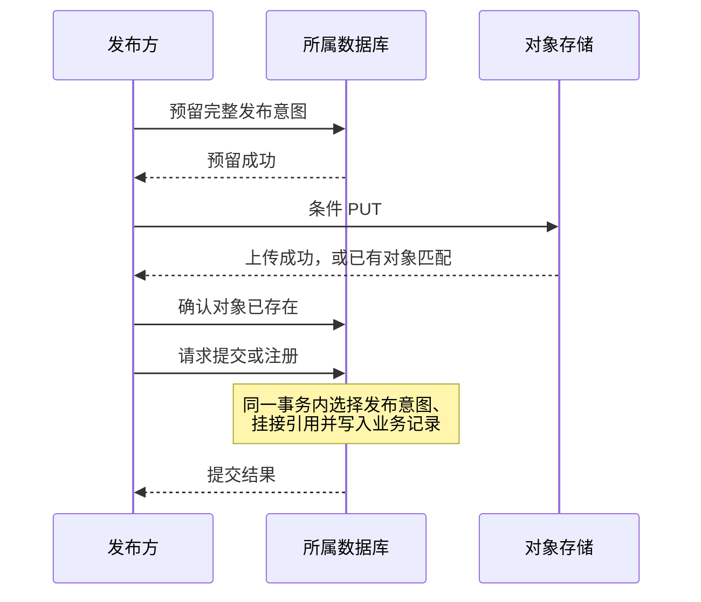

# 系统架构

语言：[English](SYSTEM_ARCHITECTURE.md) | 中文

本文是 [SYSTEM_ARCHITECTURE.md](SYSTEM_ARCHITECTURE.md) 的中文译文。英文版是权威版本；如果两者不一致，以英文版为准。

Sec Review Bot 由本仓库负责的运行角色包括 GitHub Integration、Review Runs、Control Plane UI、Execution Gateway、Execution Worker、Memory Extraction Worker、Memory Maintenance Worker 和 Memory Catalog Server。Langfuse 是受信任、独立部署并拥有独立生命周期的可观测性依赖，不属于本仓库负责的运行角色。

## 运行拓扑

Temporal Server 属于基础设施，但它会直接向 worker 进程分发工作，因此拓扑图将它与运行服务放在一起。PostgreSQL 和对象存储则单独作为持久化设施呈现。Langfuse 位于本仓库的部署边界之外：worker 可以向其导出 LLM observations，Review Runs 则异步读取这些 observations 并持久化模型用量 snapshot。Review execution、memory extraction 与 memory maintenance 分别使用独立的 worker 进程和 task queue。

Memory 链路只有一套与部署位置无关的状态模型：Memory Catalog 负责 PostgreSQL 中的协调状态，对象存储负责不可变 memory-tree 和 trajectory artifacts，Temporal 负责 workflow 执行。每次 review invocation 都会把当前 memory tree 物化到临时目录供 agent backend 使用，并在结束后删除该目录。

Control Plane UI 通过自身 BFF 管理 Memory Catalog，browser 不会获得 Catalog token、对象存储凭据或 `s3://` reference。Artifact download 由 BFF 读取并校验 identity。经过认证的 operator 可以暂停或恢复自动 maintenance、创建 operator edit revision，以及把 active pointer 恢复到已有 revision。后续新 revision 会把该 active revision 记录为前驱，同时 revision identity 保持全局递增。BFF 可以创建不可变 memory-tree object，但 run artifact 和 memory trajectory 仍然只读。

## 运行角色职责地图

| 运行角色 | 代码 | 负责内容 | 本地指南 |
| --- | --- | --- | --- |
| GitHub Integration | `apps/github-integration/` | GitHub 入口、input 准备、Review Runs client 与 GitHub publication | [README](../../apps/github-integration/README.zh.md) |
| Review Runs | `review-runs/` | 接纳、持久化 run 状态、恢复、execution 观察与 publication 协调 | [README](../../review-runs/README.zh.md) |
| Control Plane UI | `apps/control-plane-ui/` | 用于 Review Runs 查看和 memory 管理的鉴权运维控制台 | [README](../../apps/control-plane-ui/README.md) |
| Execution Gateway | `execution-gateway/` | 经过鉴权的 Execution API 与 HTTP-to-Temporal 转换 | [README](../../execution-gateway/README.zh.md) |
| Execution Worker | `agents/` | Review workflow、activity、agent runtime、stage artifact 与 run diagnostic publication | [README](../../agents/README.zh.md) |
| Memory Extraction Worker | `agents/` | 按 run 消费 diagnostic、调用 extractor、发布 trajectory 并登记 extraction | [README](../../agents/README.zh.md) |
| Memory Maintenance Worker | `agents/` | 按批消费 maintenance input、调用 maintainer、发布 memory tree 并提交 revision | [README](../../agents/README.zh.md) |
| Memory Catalog Server | `memory-catalog/` | Observation catalog、不可变 memory revision history 与 active revision 协调 | [README](../../memory-catalog/README.zh.md) |

这些运行角色通过 [`contracts/`](../../contracts/README.zh.md) 下由项目维护的边界通信。Package 位置并不决定进程拓扑：`agents/` 实现彼此独立部署的 Temporal worker。`apps/` 下的应用也分别独立部署。

## 主 Review 链路

## 异步 Memory 链路

## 可观测性与统计链路

Langfuse 保存每次模型调用的 observation。Review Runs 读取并汇总这些数据，写入自己的数据库，供 Control Plane UI 展示。

## Artifact 发布与恢复

PostgreSQL 与对象存储分别提交。Input 与 memory 的发布方先持久化发布意图记录（publication intent），记录预期的产物引用，以及崩溃后完成挂接所需的业务数据。

中途失败后，重试先检查已记录的发布意图和对象状态。[Temporal Activity 重试](https://docs.temporal.io/activity-definition#idempotency)可能在完成响应丢失后重复上传，但不会把对象存储与 SQL 合成一个事务。

| 产物 | 持久化恢复依据 | 恢复边界 |
| --- | --- | --- |
| Review input bundle | Review Runs 发布意图：reference、prepared input 与 publish context | 新 preparation claim 可在对象存在时复用原 发布意图；只有明确不存在时，才允许放弃未选中的 candidate 并重建。 |
| Extraction trajectory | Memory Catalog 发布意图：trajectory reference、observation 与 summary | 重试先检查已记录的 candidate，再决定是否重新运行模型；选择与 extraction 注册在同一事务中提交。 |
| Maintenance revision | Memory Catalog 发布意图：tree、trajectory、observation IDs 与 expected active revision 作为一组 | 不同模型输出可以形成不同 candidate；选择、revision 创建、observation 消费与 active pointer 更新在同一事务中提交。 |
| Operator edit revision | Memory Catalog 发布意图：tree reference、operation ID 与 expected active revision；UI BFF 上传 tree | 编辑器保持打开且内容未变时，重试保留 operation ID 与原 expected revision。BFF 重复执行预留、条件上传、确认与幂等 revision 创建。 |
| S3 中的 run diagnostic bundle | Temporal publication request 与固定 run key | 恢复先按 request 校验已有 bundle，再考虑本地文件。如果完整上传的 bundle 与本地产物均已丢失，request 无法重建诊断字节。 |

UI restore 在 Catalog 事务中将 active pointer 移到已有 revision，不创建 revision 或对象，也不会修复丢失的字节。

Input 与 memory 的具体协议见 [Review Runs](../../review-runs/README.zh.md) 和 [Memory Catalog](../../memory-catalog/README.md)。存储错误仍是不确定状态，会使本次尝试失败，不能当作对象不存在。已记录的 发布意图 支持重试，但不提供重试耗尽后的自动后台完成机制。

<!-- doc-time-sensitive: artifact-conditional-write-semantics; checked=2026-10-31; source=https://docs.aws.amazon.com/AmazonS3/latest/userguide/conditional-writes.html -->

[条件 PUT](https://docs.aws.amazon.com/AmazonS3/latest/userguide/conditional-writes.html) 阻止遵守协议的发布方覆盖已有 key，但不保证对象能抵抗其他具有覆盖或删除权限的身份。Consumer 在使用前校验大小与 SHA-256：这能拒绝替换内容，却不能找回丢失的字节。S3 兼容部署必须针对实际部署的存储版本验证所依赖的 API 与策略条件。

放弃 candidate 不会删除对象，目前也没有自动对象垃圾回收。旧上传进程仍可能完成上传，不同 candidate 也可能共享内容 key。未来清理必须考虑历史 revision、extraction reference，以及 Temporal history 中保留的尚未挂接引用，不能把当前没有数据库挂接的对象直接视为可删除。
