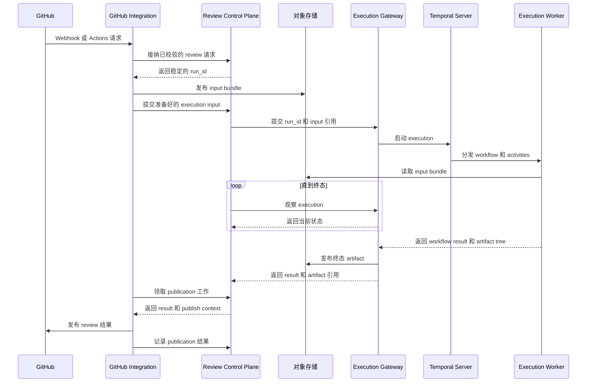
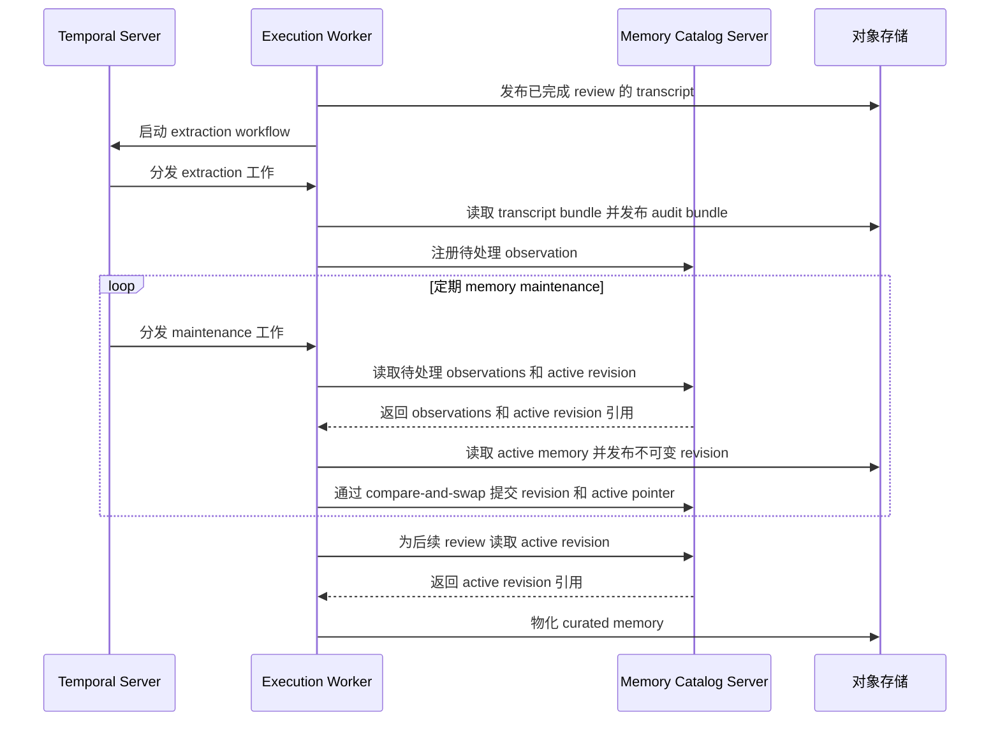

# 系统架构

语言：[English](SYSTEM_ARCHITECTURE.md) | 中文

本文是 [SYSTEM_ARCHITECTURE.md](SYSTEM_ARCHITECTURE.md) 的中文译文。英文版是权威版本；如果两者不一致，以英文版为准。

Sec Review Bot 包含六个运行实体，各自拥有独立的职责和部署边界：GitHub Integration、Review Control Plane、Control Plane UI、Execution Gateway、Execution Worker 和 Memory Catalog Server。

## 运行拓扑

Temporal Server 属于基础设施，但它直接参与 Execution Gateway 与 Execution Worker 之间的运行关系，因此拓扑图将它与运行服务放在一起。PostgreSQL 和对象存储则单独作为持久化设施呈现。主 review 链路与异步 memory 链路是两条独立流程。

## 主 Review 链路

## 异步 Memory 链路

## 持久化与职责边界

图中展示的是每次交互首次发生的顺序；轮询、heartbeat、重试和状态写入可能重复多次。Control Plane 在 integration 准备 input 前持久化稳定的 `run_id`，因此 input 准备或提交失败时仍然存在持久化的 run 身份；只有在接纳前被拒绝的请求没有 `run_id`。Control Plane 还会在跨越 Execution API 边界前持久化可重放的 Execution input，使状态不确定的 submission 可以重试，而不需要重建进程内状态。

Integration 主动从 Control Plane 领取 publication 工作，而不是等待 Control Plane 回调。Control Plane 将成功终态的工作保持为 `pending`，原子地向 connector 分配 publication claim，并接收 connector 回写的成功或失败结果。因此 GitHub 专用副作用不会进入 Control Plane，integration 重启后也能继续处理未完成工作。

`apps/github-integration/` 负责解析 GitHub 请求、准备 input 和执行 GitHub 发布。`control-plane/` 负责接纳、Execution 协调、恢复和持久化 run 状态。`execution-gateway/` 负责经过鉴权的 HTTP-to-Temporal 边界。`agents/` 负责 Execution Worker、workflow 和 agent runtime。`memory-catalog/` 负责 managed-memory PostgreSQL 状态和 revision 提交。`apps/control-plane-ui/` 读取脱敏的 Control Plane 查询 API，不直接访问 PostgreSQL。

Control Plane 的状态、claim、schema 和 API 细节见 [Control Plane README](../../control-plane/README.zh.md)。
