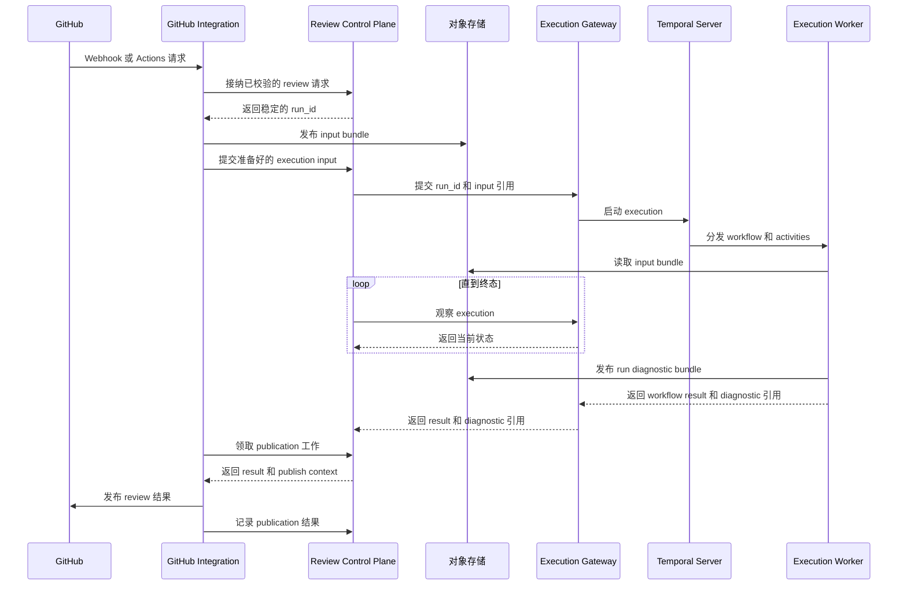
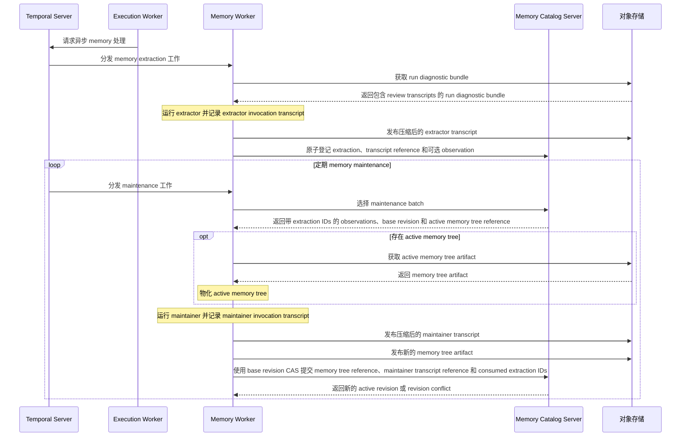

# 系统架构

语言：[English](SYSTEM_ARCHITECTURE.md) | 中文

本文是 [SYSTEM_ARCHITECTURE.md](SYSTEM_ARCHITECTURE.md) 的中文译文。英文版是权威版本；如果两者不一致，以英文版为准。

Sec Review Bot 包含七个运行实体，各自拥有独立的职责和部署边界：GitHub Integration、Review Control Plane、Control Plane UI、Execution Gateway、Execution Worker、Memory Worker 和 Memory Catalog Server。

## 运行拓扑

Temporal Server 属于基础设施，但它会直接向两个 worker pool 分发工作，因此拓扑图将它与运行服务放在一起。PostgreSQL 和对象存储则单独作为持久化设施呈现。主 review 链路与异步 memory 链路使用不同的 task queue 和 worker 进程。

## 运行实体职责地图

| 运行实体 | 代码 | 负责内容 | 本地指南 |
| --- | --- | --- | --- |
| GitHub Integration | `apps/github-integration/` | GitHub 入口、input 准备、Control Plane client 与 GitHub publication | [README](../../apps/github-integration/README.zh.md) |
| Review Control Plane | `control-plane/` | 接纳、持久化 run 状态、恢复、execution 观察与 publication 协调 | [README](../../control-plane/README.zh.md) |
| Control Plane UI | `apps/control-plane-ui/` | 经过鉴权的运维控制台与只读 Control Plane 投影 | [README](../../apps/control-plane-ui/README.md) |
| Execution Gateway | `execution-gateway/` | 经过鉴权的 Execution API 与 HTTP-to-Temporal 转换 | [README](../../execution-gateway/README.zh.md) |
| Execution Worker | `agents/` | Review workflow、activity、agent runtime、stage artifact 与 run diagnostic publication | [README](../../agents/README.zh.md) |
| Memory Worker | `agents/` | 异步 memory extraction 与 maintenance workflow | [README](../../agents/README.zh.md) |
| Memory Catalog Server | `memory-catalog/` | Observation catalog、不可变 memory revision history 与 active revision 协调 | [README](../../memory-catalog/README.zh.md) |

这些运行实体通过 [`contracts/`](../../contracts/README.zh.md) 下由项目维护的边界通信。目录位置不代表共享运行时所有权：两个 worker 虽然实现在同一个 Python package 中，却是独立进程；`apps/` 下的两个应用也分别独立部署。

## 主 Review 链路

## 异步 Memory 链路

