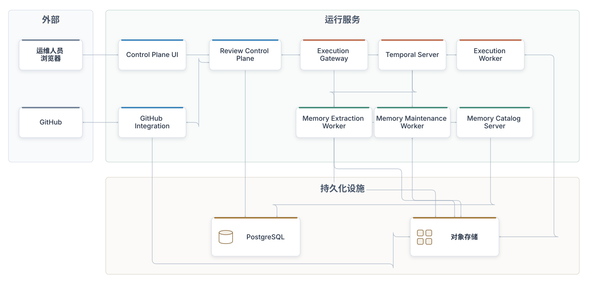
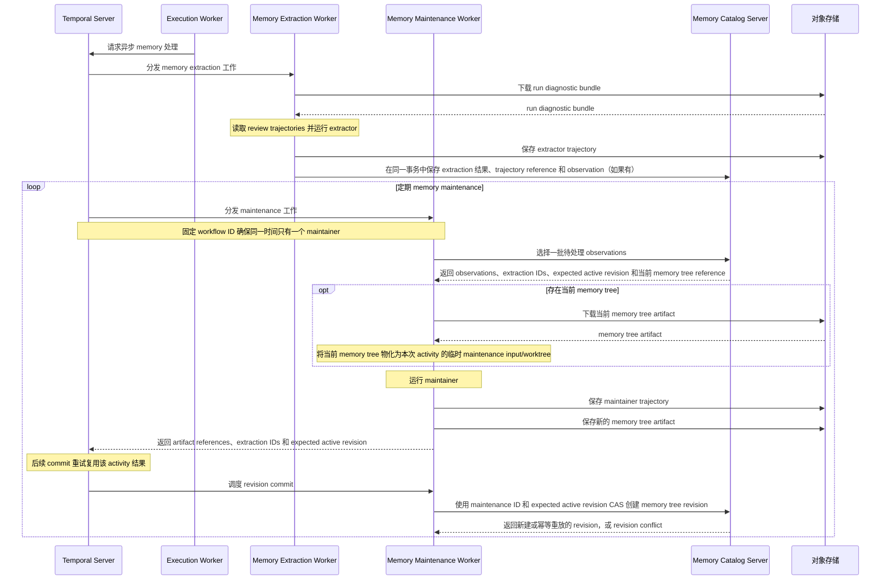
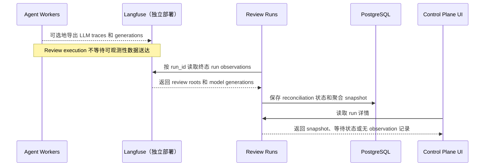
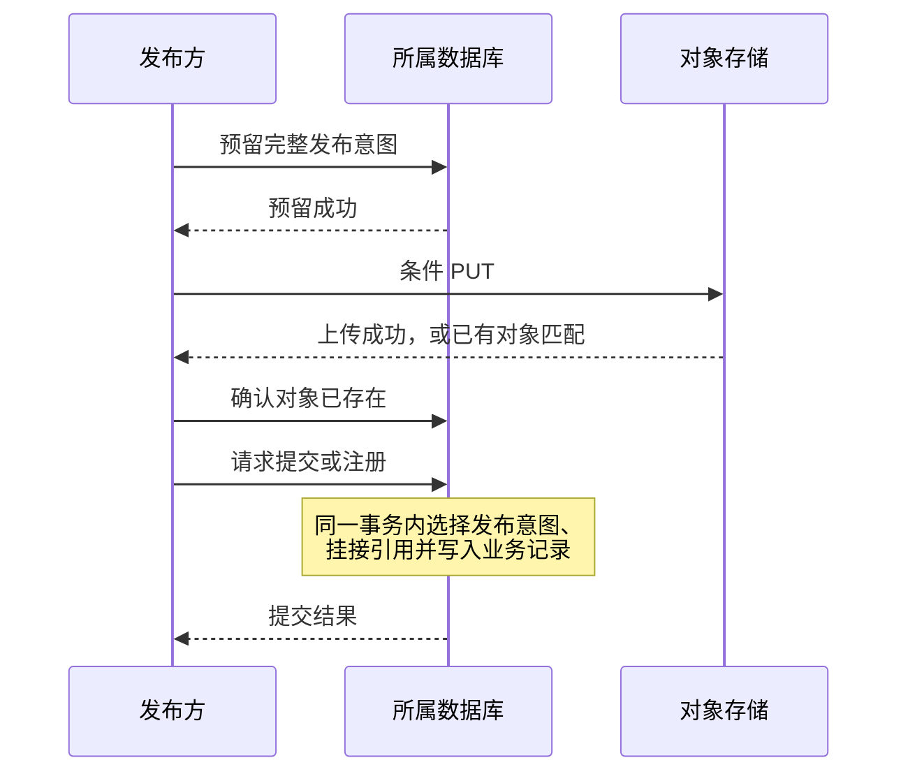

# 系统架构

语言：[English](SYSTEM_ARCHITECTURE.md) | 中文

本文为 [SYSTEM_ARCHITECTURE.md](SYSTEM_ARCHITECTURE.md) 的中文译文；如有差异，以英文版为准。

本仓库实现的运行组件包括 GitHub Integration、Review Runs、Control Plane UI、Execution Gateway、Execution Worker、Memory Extraction Worker、Memory Maintenance Worker 和 Memory Catalog Server。Langfuse 是受信任、独立部署并拥有独立生命周期的可观测性依赖，不属于本仓库负责的运行角色。

阅读后文时，注意区分 run、execution、case 和 delivery：

| 名称 | 含义 |
| --- | --- |
| run | 一次已被 Review Runs 接收的审查任务，包含输入准备、执行和发布状态。 |
| execution | 通过 Execution Gateway 提交给 Temporal 的执行过程。 |
| case | 仓库扫描中需要独立分析和验证的问题单元。 |
| delivery | 可发布的一组修复结果，可以对应一个或多个问题单元。 |

## 运行拓扑

Temporal Server 属于基础设施，但它会直接向 Worker 进程分发工作，因此拓扑图将它与运行服务放在一起。PostgreSQL 和对象存储则单独作为持久化设施呈现。Langfuse 位于本仓库的部署边界之外：Worker 可以向其发送模型调用记录，Review Runs 再异步汇总并保存用量快照。审查执行、记忆提取和记忆维护使用各自的 Worker 进程和 Temporal 任务队列。

Memory Catalog 在 PostgreSQL 中保存协调状态，对象存储保存不可变的记忆文件树和执行轨迹，Temporal 调度工作流。启用记忆读取且已有生效版本时，审查调用会将记忆文件树还原到临时目录，供 Agent 读取，并在调用结束后清理。

Control Plane UI 通过同源服务端（BFF）访问 Memory Catalog，浏览器不会获得 Catalog 令牌、对象存储凭据或 `s3://` 引用。BFF 下载产物后先核对引用信息、大小和摘要，再返回内容。经过认证的运维人员可以暂停或恢复自动维护、提交人工编辑版本，以及恢复已有版本。新修订以创建时的生效版本为前驱，修订编号仍全局递增。BFF 可以创建不可变的记忆文件树对象，但对审查产物和记忆执行轨迹仅有读取权限。

## 运行角色职责地图

| 运行角色 | 代码 | 负责内容 | 本地指南 |
| --- | --- | --- | --- |
| GitHub Integration | `apps/github-integration/` | 接收 GitHub 请求、准备输入、调用 Review Runs 和发布结果 | [README](../../apps/github-integration/README.zh.md) |
| Review Runs | `services/review-runs/` | 接收任务、保存运行状态、恢复处理、跟踪执行和协调发布 | [README](../../services/review-runs/README.zh.md) |
| Control Plane UI | `apps/control-plane-ui/` | 经身份验证的运维控制台，用于查看 run 和管理记忆 | [README](../../apps/control-plane-ui/README.zh.md) |
| Execution Gateway | `services/execution-gateway/` | 经过鉴权的 Execution API 与 HTTP-to-Temporal 转换 | [README](../../services/execution-gateway/README.zh.md) |
| Execution Worker | `agents/` | 执行审查工作流、activity 和 Agent，保存阶段产物并发布诊断包 | [README](../../agents/README.zh.md) |
| Memory Extraction Worker | `agents/` | 读取审查诊断包、提取经验、发布轨迹并登记提取结果 | [README](../../agents/README.zh.md) |
| Memory Maintenance Worker | `agents/` | 分批整理待处理经验、发布记忆文件树并提交修订 | [README](../../agents/README.zh.md) |
| Memory Catalog Server | `services/memory-catalog/` | 保存经验提取记录、不可变修订历史和当前生效版本 | [README](../../services/memory-catalog/README.zh.md) |

这些运行角色通过 [`contracts/`](../../contracts/README.zh.md) 下由项目维护的边界通信。`services/` 归集内部 HTTP 服务包；各包保留独立的配置、构建和部署。源码包的位置不决定运行进程的组织方式：`agents/` 实现彼此独立部署的 Temporal Worker。`apps/` 下的应用也分别独立部署。

## 主 Review 链路

## 异步 Memory 链路

## 可观测性与统计链路

Langfuse 保存每次模型调用的 observation。Review Runs 读取并汇总这些数据，写入自己的数据库，供 Control Plane UI 展示。

## Artifact 发布与恢复

PostgreSQL 与对象存储分别提交。Input 与 memory 的发布方先持久化发布意图记录（publication intent），记录预期的产物引用，以及崩溃后完成挂接所需的业务数据。

中途失败后，重试先检查已记录的发布意图和对象状态。[Temporal Activity 重试](https://docs.temporal.io/activity-definition#idempotency)可能在完成响应丢失后重复上传，但不会把对象存储与 SQL 合成一个事务。

| 产物 | 持久化恢复依据 | 恢复边界 |
| --- | --- | --- |
| Review input bundle | Review Runs 发布意图：reference、prepared input 与 publish context | 新 preparation claim 可在对象存在时复用原 发布意图；只有明确不存在时，才允许放弃未选中的 candidate 并重建。 |
| Extraction trajectory | Memory Catalog 发布意图：trajectory reference、observation 与 summary | 重试先检查已记录的 candidate，再决定是否重新运行模型；选择与 extraction 注册在同一事务中提交。 |
| Maintenance revision | Memory Catalog 发布意图：tree、trajectory、observation IDs 与 expected active revision 作为一组 | 不同模型输出可以形成不同 candidate；选择、revision 创建、observation 消费与 active pointer 更新在同一事务中提交。 |
| Operator edit revision | Memory Catalog 发布意图：tree reference、operation ID 与 expected active revision；UI BFF 上传 tree | 编辑器保持打开且内容未变时，重试保留 operation ID 与原 expected revision。BFF 重复执行预留、条件上传、确认与幂等 revision 创建。 |
| S3 中的 run diagnostic bundle | Temporal publication request 与固定 run key | 恢复先按 request 校验已有 bundle，再考虑本地文件。如果完整上传的 bundle 与本地产物均已丢失，request 无法重建诊断字节。 |

UI restore 在 Catalog 事务中将 active pointer 移到已有 revision，不创建 revision 或对象，也不会修复丢失的字节。

Input 与 memory 的具体协议见 [Review Runs](../../services/review-runs/README.zh.md) 和 [Memory Catalog](../../services/memory-catalog/README.md)。存储错误仍是不确定状态，会使本次尝试失败，不能当作对象不存在。已记录的 发布意图 支持重试，但不提供重试耗尽后的自动后台完成机制。

<!-- doc-time-sensitive: artifact-conditional-write-semantics; checked=2026-10-31; source=https://docs.aws.amazon.com/AmazonS3/latest/userguide/conditional-writes.html -->

[条件 PUT](https://docs.aws.amazon.com/AmazonS3/latest/userguide/conditional-writes.html) 阻止遵守协议的发布方覆盖已有 key，但不保证对象能抵抗其他具有覆盖或删除权限的身份。Consumer 在使用前校验大小与 SHA-256：这能拒绝替换内容，却不能找回丢失的字节。S3 兼容部署必须针对实际部署的存储版本验证所依赖的 API 与策略条件。

放弃 candidate 不会删除对象，目前也没有自动对象垃圾回收。旧上传进程仍可能完成上传，不同 candidate 也可能共享内容 key。未来清理必须考虑历史 revision、extraction reference，以及 Temporal history 中保留的尚未挂接引用，不能把当前没有数据库挂接的对象直接视为可删除。
