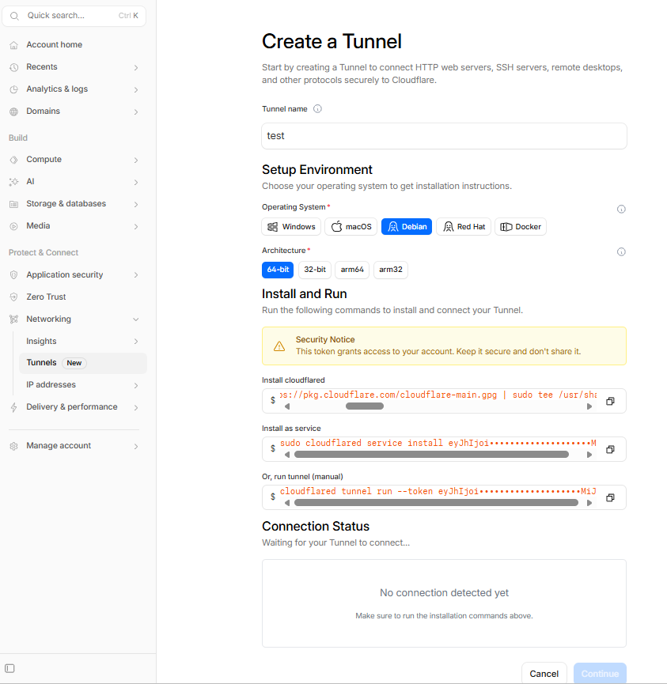
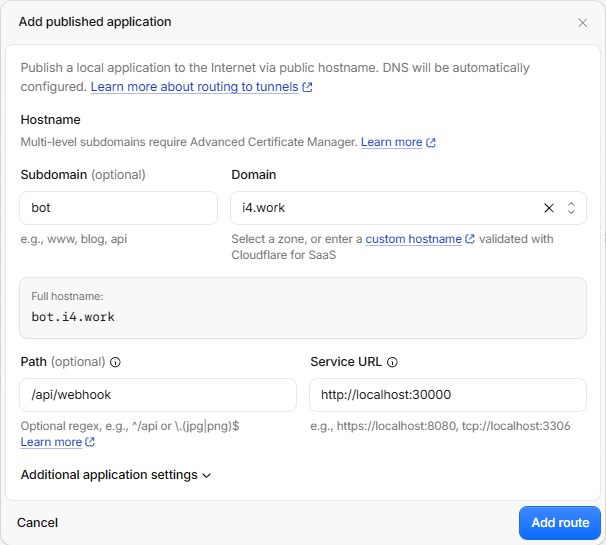
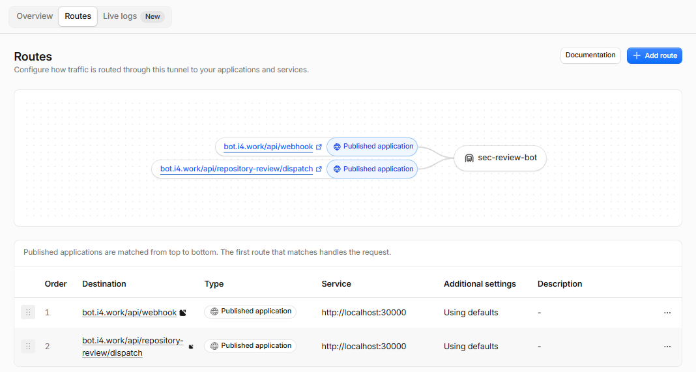

# 本地 GitHub 入站设置

语言：[English](LOCAL_GITHUB_INBOUND_SETUP.md) | 中文

本文为 [LOCAL_GITHUB_INBOUND_SETUP.md](LOCAL_GITHUB_INBOUND_SETUP.md) 的中文译文；如有差异，以英文版为准。

本文介绍如何将 GitHub App webhook 和 GitHub Actions 发起的仓库审查请求路由到本地 GitHub Integration 服务。

## 什么是 Webhook

Webhook 是事件发生后，对方向你提供的地址发送的 HTTP 请求。

在这个项目里：

- GitHub 是事件源
- 你的 `sec-review-bot` 服务是接收方
- 你需要给 GitHub 一个可访问的 Webhook URL
- 当 issue 或 PR 事件发生后，GitHub 会把 payload 发到这个 URL

你的服务不轮询 GitHub，由 GitHub 主动推送事件。

## Webhook 和 API 权限

本地 Webhook 设置只负责接收事件。GitHub App 还需要 API 权限，才能在收到事件后执行后续操作。

- Webhook 决定 App 能收到哪些 GitHub 事件。
- GitHub API 权限决定 App 后续能做什么，例如发评论、创建 review、开 draft PR。

这个项目里的服务端会：

1. 验证 Webhook secret
2. 解析 GitHub 发来的事件 payload
3. 通过 App 身份去请求 GitHub API

所需权限和 Webhook 订阅见 [GitHub App 权限设置](LOCAL_INTEGRATED_DEPLOYMENT.zh.md#github-app-权限设置)。

## 为什么本地开发不能直接填 `localhost`

GitHub 的服务器无法直接访问你本机的 `localhost:30000`。

本地开发时，你需要一个 GitHub 能访问到的公网 HTTPS 地址，并把它转发到本地 Webhook 服务：

```text
GitHub -> 公网 HTTPS URL -> 本地 http://localhost:30000/api/webhook
```

常见选择有两种：

- `smee`
  - 快速、轻量，适合本地调试
- Cloudflare Tunnel
  - 更正式，适合已有域名或需要稳定 Webhook 地址的情况

## 本地服务地址

GitHub Integration 默认提供以下入站 endpoint：

```text
http://localhost:30000/api/webhook
http://localhost:30000/api/repository-review/dispatch
```

- `/api/webhook` 接收 GitHub App 的 issue 和 PR 事件。
- `/api/repository-review/dispatch` 接收 GitHub Actions 发起的仓库级 review 请求。

端口来自 `PORT`。只调试 GitHub App Webhook 时配置第一个地址即可；使用仓库级 review 工作流时，第二个地址也必须能从公网访问。

## 方案一：使用 `smee`

很多 GitHub App 和 Webhook 教程使用 [`smee.io`](https://smee.io/)，因为它能让本地开发环境很快收到事件。

### `smee` 的工作方式

1. 在 `smee.io` 获取一个临时公网 URL
2. GitHub 把 Webhook 发到这个公网 URL
3. 本地运行 `smee` 客户端，把事件转发到你的本地服务

### 命令

```bash
npx smee -u https://smee.io/xxxxxxxxxxxx -t http://localhost:30000/api/webhook
```

其中：

- `-u`: 你的公网 `smee` channel 地址
- `-t`: 本地 Webhook 服务地址

### 适合使用 `smee` 的场景

- 本地快速调试 Webhook
- 临时验证 GitHub App 配置
- 不想自己处理证书、反向代理、入站端口和域名

### 代价

- URL 通常是临时调试地址
- 适合开发，不适合作为生产 Webhook 地址

## 方案二：使用 Cloudflare Tunnel

如果你已经有域名但没有公网入站服务，或者不想自己处理端口转发、TLS 证书和暴露本机端口，可以使用 Cloudflare Tunnel。

### Cloudflare Tunnel 的工作方式

1. 在一台可运行 `cloudflared` 的机器上创建 tunnel
2. 把某个域名或子域名路由到本地 GitHub Integration 服务
3. GitHub App 和 GitHub Actions 通过这个稳定的 HTTPS 地址访问各自的 endpoint

在 Cloudflare Tunnel 中为每个 endpoint 添加一条 Published application route。这些 route 使用相同的 Hostname 和 Service，只填写不同的 Path：

```text
Hostname: your-subdomain.example.com
Service: http://localhost:30000
Webhook Path: /api/webhook
Repository Review Path: /api/repository-review/dispatch
```

Service 中不要附加 endpoint 路径。配置完成后的公网地址是：

```text
https://your-subdomain.example.com/api/webhook
https://your-subdomain.example.com/api/repository-review/dispatch
```

第一个 URL 填入 GitHub App 的 Webhook URL。第二个 URL 写入目标仓库的 Actions secret `SEC_BOT_DISPATCH_URL`。

### 图示

创建 tunnel 时按 Cloudflare 的指引操作：



先添加一条 route，然后用相同方式添加另一条 route：



完成后，同一个 tunnel 下应当包含已配置的 route：



卸载方法见 <https://developers.cloudflare.com/tunnel/troubleshooting/>，命令是：

```bash
sudo cloudflared service uninstall
```

### 适合使用 Cloudflare Tunnel 的场景

- 需要稳定、可复用的 Webhook URL
- 已经有 Cloudflare 和域名
- 不想自己维护 nginx、证书和公网端口暴露

## 入站转发的常见坑

- Webhook secret 和本地配置不一致
- Webhook URL 填对了，但本地转发工具没在跑
- Cloudflare Tunnel 只配置了 `/api/webhook`，导致 GitHub Actions 发起的仓库审查请求返回 `404`
- 公网地址已配置，但本地服务没有监听对应端口

`403 Resource not accessible by integration` 等权限问题见 [GitHub App 权限设置](LOCAL_INTEGRATED_DEPLOYMENT.zh.md#github-app-权限设置)。

## 参考

- GitHub App quickstart:
  - <https://docs.github.com/en/apps/creating-github-apps/writing-code-for-a-github-app/quickstart>
- GitHub Webhook guide:
  - <https://docs.github.com/en/apps/creating-github-apps/writing-code-for-a-github-app/building-a-github-app-that-responds-to-webhook-events>
