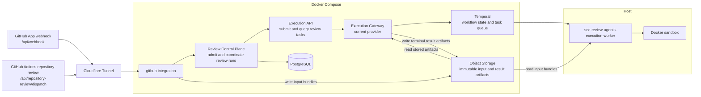

# Local Integrated Deployment

Language: English | [中文](LOCAL_INTEGRATED_DEPLOYMENT.zh.md)

This guide covers local deployment of the GitHub integration, Review Control Plane, Execution Gateway, Temporal, object storage, and a host execution worker.

Use it to run the complete integrated path locally. For running agents directly without the HTTP Execution Gateway, or for debugging with `run-local-* --temporal`, see the [agents local running guide](../../agents/README.md).

## Deployment Shape



Cloudflare Tunnel sends GitHub traffic to the integration service. Control Plane coordinates each review run, Execution Gateway and Temporal dispatch its work, and the host worker executes the agents in Docker sandboxes. PostgreSQL stores control state, while RustFS stores run inputs and artifacts.

Control Plane UI is a separately deployed console. Its same-origin server reads run state from Control Plane and proxies artifact downloads, so service and storage credentials remain outside browser code. See [Local GitHub Inbound Setup](LOCAL_GITHUB_INBOUND_SETUP.md) for public endpoint configuration.

Without a worker, submitted tasks remain in Temporal waiting for execution.

Default local endpoints:

| Service | URL |
| --- | --- |
| GitHub integration | `http://127.0.0.1:30000` |
| Review Control Plane | `http://127.0.0.1:8090` |
| Control Plane UI | `http://127.0.0.1:8091` |
| Execution Gateway | `http://127.0.0.1:8000` |
| Temporal gRPC | `127.0.0.1:7233` |
| Temporal Web UI | `http://127.0.0.1:8233` |
| RustFS API | `http://127.0.0.1:9100` |
| RustFS Console | `http://127.0.0.1:9101` |

## Prerequisites

### GitHub App Permission Settings

Required repository permissions:

- `Pull requests: Read and write`
- `Contents: Read and write`
- `Issues: Read and write`

Required webhook subscriptions:

- `Pull request`
- `Issues`
- `Issue comment`

Notes:

- `Metadata: Read-only` is a default GitHub App permission and does not need to be enabled manually.
- If you change App permissions, existing installations often need to approve the new permissions again.
- A common error when permissions are insufficient is `403 Resource not accessible by integration`.

### GitHub App Credentials

Download the private key from the GitHub App settings page. You can place it at the default path, `apps/github-integration/private-key.pem`.

Generate a secret in the GitHub App webhook settings and set `WEBHOOK_SECRET` in `apps/github-integration/.env` to the same value. The private key authenticates the GitHub App, while the webhook secret verifies incoming webhooks.

### GitHub App Webhook Configuration

To forward a public URL to the local GitHub integration service, see [Local GitHub Inbound Setup](LOCAL_GITHUB_INBOUND_SETUP.md).

### Actions Secrets Configuration

Repository review is triggered through GitHub Actions: [`.github/workflows/sec-review-bot.yml`](../../.github/workflows/sec-review-bot.yml)

Configure this Actions secret in the target repository:

```bash
SEC_BOT_DISPATCH_URL=https://your-bot-dev.example.com/api/repository-review/dispatch
```

The repository review workflow authenticates to the App with GitHub Actions OIDC. The workflow must have `id-token: write`, and the OIDC audience is fixed to `sec-review-bot`.

## Deployment Configuration

The integrated deployment uses four source configuration files. Compose `.env` also carries the object-storage endpoint and service credentials; these credentials are passed to the appropriate service only:

- repository-root `.env`: Compose control plane;
- `apps/github-integration/.env`: GitHub integration;
- `agents/config/model-providers.toml`: model deployments;
- `ops/systemd/deployment.env`: systemd deployment configuration before installation.

The installer combines these settings with checkout-derived paths and writes the systemd services' effective configuration to `/etc/sec-review-bot/deployment.env`.

Create the configuration files from the repository root:

```bash
cp compose.env.sample .env
cp agents/config/model-providers.sample.toml agents/config/model-providers.toml
cp apps/github-integration/.env.sample apps/github-integration/.env
cp ops/systemd/deployment.env.sample ops/systemd/deployment.env
chmod 600 .env \
  agents/config/model-providers.toml \
  apps/github-integration/.env \
  ops/systemd/deployment.env
```

The samples contain both usable defaults and empty or placeholder values that must be replaced. At minimum, configure the Execution API token, GitHub App credentials, and model deployment credentials. The systemd installer combines the deployment settings with repository paths and writes the result to `/etc` as described below.

`agents/.env` is used by `run-local-*` and other local CLIs. Compose and the systemd worker do not load it automatically. See the [agents local running guide](../../agents/README.md) for local CLI configuration.

### 1. Compose `.env`

Compose-level defaults are documented in [compose.env.sample](../../compose.env.sample). This file controls how Compose starts containers, mounts local directories, and exposes ports.

Set `EXECUTION_API_TOKEN`, `AGENT_MEMORY_CATALOG_TOKEN`, and the PostgreSQL/RustFS passwords to independently generated secrets, for example with `openssl rand -hex 32`. Copy the same Memory Catalog token into `ops/systemd/deployment.env`; Compose gives it to the independent Memory Catalog Server container, while the host worker uses it as a narrow client credential. Compose-owned state uses the fixed repository directories `.agent-temporal-state`, `.agent-rustfs-state`, and `.agent-postgres-state`; they are intentionally not separate configuration values.

RustFS uses a separate workload identity for each responsibility: the integration writes input objects; the host worker reads inputs and reads/writes immutable transcript bundles, memory versions, and memory-agent audit bundles; the artifact storage writer writes terminal artifacts; and the UI BFF reads stored artifacts for authenticated downloads. The corresponding secret keys in `compose.env.sample` belong to those identities and should be generated independently.

### 2. GitHub Integration `.env`

GitHub integration runtime settings are documented in [apps/github-integration/.env.sample](../../apps/github-integration/.env.sample). Minimum local configuration:

```bash
APP_ID=123456
WEBHOOK_SECRET=your_webhook_secret
PORT=30000
```

Compose injects the Execution API address and token only into Control Plane for initial submission, submission recovery, and terminal observation. The address currently resolves to the Execution Gateway service, but Control Plane is configured only in API terms. Compose injects the container private-key path, Control Plane address and token, and RustFS input storage configuration into the integration. PostgreSQL and execution credentials are not available to the integration. These values do not need to be repeated in `apps/github-integration/.env`.

### 3. Model Configuration

Model deployment configuration is documented in [agents/config/model-providers.sample.toml](../../agents/config/model-providers.sample.toml). The systemd worker reads the copied `agents/config/model-providers.toml` through `MODEL_PROVIDERS_CONFIG_TOML`.

Every agent that can run must be explicitly bound to a model deployment:

```toml
[[deployments]]
name = "anthropic_strong"
model = "anthropic/claude-3-7-sonnet-20250219"
max_input_tokens = 200000
api_key = "your_anthropic_key"
api_base = "https://your-anthropic-endpoint/v1"

[agent_deployment_bindings]
issue-analyzer = "anthropic_strong"
```

After changing model configuration or credentials, probe deployment availability:

```bash
cd agents
uv run sec-review-agents-check-llm-deployments
uv run sec-review-agents-check-llm-deployments --fail-fast
```

### 4. systemd Integrated Service Configuration

`ops/systemd/deployment.env` is the editable source configuration. Every time the installer runs, it combines that file with paths derived from the current checkout and replaces `/etc/sec-review-bot/deployment.env`. Both the control-plane service and host worker read the installed file.

The installer owns `SEC_REVIEW_BOT_DIR` and `SEC_REVIEW_AGENTS_DIR`. Do not add them to the editable source file. The installer removes stale values and regenerates them from its own repository location. Input archives are exchanged through RustFS, so the integration container and host worker no longer share `.agent-input-bundles`.

The installer also generates the internal `SEC_REVIEW_SERVICE_UID` and `SEC_REVIEW_SERVICE_GID` values. Before Compose starts, it creates the repository-local state directories for that service user. This prevents Docker from creating unwritable root-owned bind-mount sources and lets the Temporal container write its SQLite database as the same user.

Materialized run inputs and generated artifacts default to `.agent-run-inputs` and `.agent-artifacts`. Model configuration defaults to `agents/config/model-providers.toml` in the current checkout. Most installations should keep these defaults. To move them, set an absolute `SEC_REVIEW_AGENT_RUN_INPUT_ROOT`, `SEC_REVIEW_AGENT_ARTIFACT_ROOT`, or `MODEL_PROVIDERS_CONFIG_TOML` in `ops/systemd/deployment.env`; the installer preserves non-empty overrides for these independent worker paths.

If [`ops/systemd/deployment.env.sample`](../../ops/systemd/deployment.env.sample) gains new options, add the relevant options to `ops/systemd/deployment.env` manually.

Core fields:

| Field | Configuration |
| --- | --- |
| `TEMPORAL_ADDRESS` | Must use the host port exposed by `TEMPORAL_PORT` in the repository `.env`; the default is `127.0.0.1:7233`. |
| `TEMPORAL_NAMESPACE`, `TEMPORAL_TASK_QUEUE` | Must match the same-named values in the repository `.env`. |
| `AGENT_DOCKER_IMAGE` | Image used for Docker sandboxes; the default is a general-purpose image. |
| `AGENT_JOERN_ENABLED`, `AGENT_PLAYWRIGHT_ENABLED` | Advertise the corresponding installed CLI to eligible agents; both default to `false`. |
| `AGENT_MCP_ENABLED` | Enable configured MCP integrations; defaults to `false`. |
| `SEC_REVIEW_ARTIFACT_S3_ENDPOINT` | Host-worker endpoint for RustFS; the Compose default is exposed at `http://127.0.0.1:9100`. |
| `AWS_ACCESS_KEY_ID`, `AWS_SECRET_ACCESS_KEY` | Narrow RustFS credential matching the Execution Worker values in the repository `.env`; it can read run inputs and read/write run transcript bundles, memory versions, and memory-agent audit bundles. |
| `AGENT_MEMORY_CATALOG_URL` | Independent managed-memory API; the Compose default is `http://127.0.0.1:8092`. |
| `AGENT_MEMORY_CATALOG_TOKEN` | Must match the repository `.env`; it authorizes memory coordination but grants no direct PostgreSQL access. |

Execution Gateway receives a separate artifact-storage-writer credential through Compose. It can write only `runs/*/artifacts/*`. The host worker's credential is limited to `runs/*/input/*` reads plus reads/writes under `runs/*/transcripts/*`, `memory/versions/*`, and `memory/audit/*`; agent sandboxes do not receive it. Gateway reads the worker's artifact root through a read-only bind mount only after a run becomes terminal.

The Memory Catalog Server is a separate TypeScript service, not part of Control Plane. It alone receives `MEMORY_CATALOG_DATABASE_URL` inside Compose and stores observations plus the active memory pointer in PostgreSQL. Temporal owns extraction execution and the singleton maintenance workflow; PostgreSQL is only the durable catalog and compare-and-swap commit boundary. Host workers call the service with `AGENT_MEMORY_CATALOG_TOKEN`; they materialize transcripts and active memory locally for each activity, and agent sandboxes only see the resulting filesystem mounts. Do not also set `AGENT_MEMORY_DIR` for a managed worker.

Most local deployments can keep these defaults. Rerun the installer after moving the checkout.

Add or change the following variables as needed.

#### Langfuse Tracing

[Langfuse](https://langfuse.com/docs) is an optional external observability service. It is not part of this repository's Compose control plane. Use [Langfuse Cloud](https://cloud.langfuse.com) or run a separate [self-hosted Langfuse deployment](https://langfuse.com/self-hosting), create a project and API keys there, then set all three variables together in `ops/systemd/deployment.env` and rerun the installer:

```bash
LANGFUSE_PUBLIC_KEY=your_public_key
LANGFUSE_SECRET_KEY=your_secret_key
LANGFUSE_BASE_URL=https://cloud.langfuse.com
```

#### Runtime Diagnostics

```bash
AGENT_LOG_LEVEL=INFO
AGENT_MODEL_TURN_DIAGNOSTICS=1
AGENT_GRAPH_MAX_STEPS=24
AGENT_GRAPH_RECURSION_BUFFER=8
```

#### Repository Workflow Concurrency

```bash
AGENT_DISCOVERY_MAX_CONCURRENCY=1
AGENT_CASE_PROCESSING_MAX_CONCURRENCY=1
```

Concurrency values limit only the number of in-flight requests. They are not TPM/RPM rate limits; quota pressure depends more on token volume, request rate, and retry behavior.

#### Docker Sandbox

`deployment.env.sample` uses the general-purpose sandbox image and disables optional external-tool prompts and MCP by default:

```bash
AGENT_SANDBOX_BACKEND=docker
AGENT_DOCKER_IMAGE=mcr.microsoft.com/devcontainers/universal:6-noble
AGENT_DOCKER_NETWORK_MODE=none
AGENT_JOERN_ENABLED=false
AGENT_PLAYWRIGHT_ENABLED=false
AGENT_MCP_ENABLED=false
```

With `AGENT_SANDBOX_BACKEND=docker`, the worker fails during startup when Docker is unavailable.

To expose the Joern and Playwright CLIs through the provided Docker image, build the workspace tools image and update `ops/systemd/deployment.env`:

```bash
docker build -f agents/docker/workspace-tools.Dockerfile -t sec-review-bot-workspace:tools agents
AGENT_DOCKER_IMAGE=sec-review-bot-workspace:tools
AGENT_JOERN_ENABLED=true
AGENT_PLAYWRIGHT_ENABLED=true
```

The same image also supports the optional CodeGraph and Playwright MCP integrations. Enable them separately when required:

```bash
AGENT_MCP_ENABLED=true
```

CodeGraph runs inside the sandbox, so it needs a backend that can execute commands: install `codegraph` in the workspace tools image and set `AGENT_MCP_ENABLED=true`. CodeGraph tools are attached only to stages that explicitly opt in and expose a writable `/workspace`.

### Integrated Deployment Paths

With the sample configuration, the integrated deployment stores runtime data in these repository-level paths:

| Path | Owner | Purpose |
| --- | --- | --- |
| `.agent-rustfs-state` | RustFS | Persistent object storage for input archives exchanged between integration and the Execution Worker |
| `.agent-run-inputs` | Host worker | Materialized input for active runs; never included in published diagnostic bundles |
| `.agent-artifacts` | Host worker | Agent artifacts and workflow output for each task |
| `.agent-postgres-state` | PostgreSQL | Admission, execution observation, and publication step coordination |
| `.agent-temporal-state` | Temporal | Workflow history and pending task state |
| `.agent-memory` | Host worker | Persistent agent memory store, when memory is enabled |

## Run The Deployment

### Integrated Service

Install the agents project, build all required images, and confirm that the current user can access Docker:

```bash
cd agents
uv sync --frozen --no-dev
cd ..
docker info
docker compose --profile app build
```

Review `ops/systemd/deployment.env`, then install the systemd units. The argument identifies the regular host user that runs Compose and the worker:

```bash
sudo ops/systemd/install.sh "$USER"
```

Start the complete integrated service and enable it at boot:

```bash
sudo systemctl enable --now sec-review-bot.target
```

`sec-review-bot.target` is the single systemd entry point for the complete deployment. It groups the Compose control plane with `sec-review-agents-execution-worker@1.service` so they can be managed together.

The control plane contains GitHub integration, Execution Gateway, and Temporal. The host worker executes review activities and creates Docker sandboxes.

Startup and runtime failures are supervised differently, and it matters when diagnosing a run:

- **Startup.** The unit starts Compose with a health gate, so a service that never becomes healthy, or a one-shot init service like `rustfs-init` that fails, fails the start. systemd stops dependent units and retries a bounded number of times; after that the unit stays failed until an operator intervenes. The unit is considered started as soon as its process exists, not when the health gate passes, so dependent units can start while Compose is still waiting; the host worker rides that out by retrying its own connection.
- **Runtime.** A crashing service restarts on its own, up to a bounded number of attempts, without affecting the rest of the stack — PostgreSQL in particular. Once a service exhausts its attempts it stays stopped, and **the unit still reports `active (running)`**, because the process keeping the journal fed follows logs rather than supervising health.

For routine lifecycle operations, use only the target:

```bash
sudo systemctl start sec-review-bot.target
sudo systemctl stop sec-review-bot.target
sudo systemctl restart sec-review-bot.target
```

Temporal development-server state is stored under `.agent-temporal-state`, so these routine lifecycle operations preserve workflow history and pending tasks. Stopping removes the Compose containers and network (`docker compose down`); every start creates them again, so a container can never outlive the network it was created on. All state lives in the repository-local bind mounts.

Inspect the deployment status and logs:

```bash
sudo systemctl status sec-review-bot.target
sudo systemctl status sec-review-bot-control-plane.service
sudo systemctl status sec-review-agents-execution-worker@1.service
sudo journalctl \
  -u sec-review-bot-control-plane.service \
  -u sec-review-agents-execution-worker@1.service \
  -f
```

`systemctl status` reports on the Compose process and the worker, not on the containers. A unit can be `active (running)` while a service has stopped, so also run `docker compose --profile app ps --all`.

Read the result as:

- `exited` on a long-running service means it stopped. It either exited cleanly, which the configured restart policy does not retry, or it used up its restart attempts. The journal and the exit status say which.
- `unhealthy` means the container is running but its health command fails; Compose reported this at startup, and at runtime it does not restart the container.
- A service absent even with `--all` means Compose never created it, usually because a dependency it waits on (`condition: service_healthy` or `service_completed_successfully`) never satisfied.

If the unit stopped after repeated startup failures, fixing the cause is not enough on its own: systemd remembers the failure and refuses to start it again. Clear that record first:

```bash
sudo systemctl reset-failed sec-review-bot-control-plane.service
sudo systemctl start sec-review-bot.target
```

Disable automatic startup and stop the complete service immediately:

```bash
sudo systemctl disable --now sec-review-bot.target
```

After changing code, rebuild the images and restart the complete service:

```bash
docker compose --profile app build
sudo systemctl restart sec-review-bot.target
```

After changing installation files under `ops/systemd`, run the installer again before restarting the service.

Check Execution Gateway:

```bash
EXECUTION_API_TOKEN=<paste-your-token>
curl -sS http://127.0.0.1:8000/healthz \
  -H "Authorization: Bearer ${EXECUTION_API_TOKEN}"
```

Check whether Control Plane can safely accept coordination requests:

```bash
curl -sS http://127.0.0.1:8090/readyz
```

`/healthz` is process liveness only. `/readyz` returns `503` when PostgreSQL, its connection pool, or a schema ledger whose complete version set does not match this application is unavailable; it intentionally does not include the Execution API or GitHub reachability.

### Component-Level Operations

For troubleshooting or updating one component, restart the control plane or worker separately:

```bash
sudo systemctl restart sec-review-bot-control-plane.service
sudo systemctl restart sec-review-agents-execution-worker@1.service
```

For development, you can bypass systemd and run the Compose control plane in the foreground:

```bash
docker compose --profile app up --build
```

This command does not start the host worker.

### Worker Concurrency

`TEMPORAL_MAX_CONCURRENT_ACTIVITIES` limits how many activities one worker process can execute at once. It defaults to `2`; each activity may create a sandbox and make multiple model calls, so a single-node deployment should start with this conservative value.

The systemd template can run multiple worker processes on one execution node:

```bash
sudo systemctl enable --now sec-review-agents-execution-worker@2.service
sudo systemctl enable --now sec-review-agents-execution-worker@3.service
```

Temporal distributes tasks among instances that share a task queue. Tune one process first; add processes or execution nodes only when measurements show that one process is a bottleneck or when process-level fault isolation is required.

## Cleanup

The installer creates the repository-local bind-mount roots and assigns them to the configured service user. Run the installer after changing the service user or deployment checkout:

```bash
sudo ops/systemd/install.sh "$USER"
```

Files inside the PostgreSQL, Temporal, and RustFS state directories retain the service-specific ownership required by their containers.

The PostgreSQL coordination store and Temporal state describe the same active runs. Do not delete `.agent-temporal-state` while retaining PostgreSQL records that still need polling or publication. To reset run execution and publication state, stop the complete service and remove both state directories together:

```bash
sudo systemctl stop sec-review-bot.target
sudo rm -rf .agent-temporal-state .agent-postgres-state
sudo systemctl start sec-review-bot.target
```

This permanently deletes workflow history, pending tasks, polling state, and publication state. The materials prepared before a run starts (the archive uploaded to RustFS) and the diagnostic materials produced after a run ends currently have no automatic retention period; their corresponding local files are also retained indefinitely by default for recovery, replay, and diagnostics. The deployment does not configure lifecycle expiration, so the operator must monitor disk usage. They can be removed manually after confirming that no retained run needs them:

```bash
sudo rm -rf .agent-rustfs-state .agent-run-inputs .agent-artifacts
```

The `.agent-memory` directory is persistent across runs and is not part of routine cleanup. To deliberately reset agent memory, stop the worker first and remove `.agent-memory` separately. This permanently deletes extracted observations and maintained memory.

```bash
sudo rm -rf .agent-memory
```

### Backup and recovery

RustFS state and PostgreSQL state are independent data sets. Back up `.agent-rustfs-state` and `.agent-postgres-state` together with the deployment configuration, but store passwords and access keys in the secret manager rather than in the backup archive. A recovery must restore RustFS first, run the RustFS initializer to reconcile the bucket and policies, and then restore PostgreSQL so run records can resolve their stored artifact references. The initializer is safe to run repeatedly; it does not replace existing objects.

## Proxies

The GitHub integration image build and Git workspace fetches use separate network settings. For Compose, set these variables in the repository `.env`; for non-Compose startup, set runtime variables in the GitHub integration `.env`.

### pnpm Registry

Corepack and pnpm use `https://registry.npmjs.org` by default while building the GitHub integration image. If that endpoint is unavailable or unreliable, select a reachable registry:

```bash
NPM_CONFIG_REGISTRY=https://registry.npmmirror.com
```

This variable is passed only to Corepack and pnpm during the image build. Rebuild the GitHub integration image after changing it:

```bash
docker compose --profile app build github-integration
```

### Git Fetch

GitHub integration uses `git fetch` to retrieve the target commit while preparing a review input bundle. If the container cannot connect directly to GitHub, configure the host HTTP proxy only for these fetches:

```bash
GITHUB_INTEGRATION_GIT_HTTP_PROXY=http://host.docker.internal:7897
```

Compose maps `host.docker.internal` to the host. The proxy must listen on an address reachable from Docker containers instead of loopback only. This variable does not change the network path used by the GitHub API, Execution Gateway, worker, or sandboxes.

When running GitHub integration without Compose, use an address reachable by the host process instead, for example:

```bash
GITHUB_INTEGRATION_GIT_HTTP_PROXY=http://127.0.0.1:7897
```

Each git and snapshot command is bounded by `GITHUB_INTEGRATION_GIT_TIMEOUT_MS` (default `600000`, i.e. 10 minutes) so a hung remote cannot stall input preparation indefinitely. Raise it for repositories whose cold clone legitimately takes longer.

## Why The Deployment Looks Like This

Two runtimes carry this deployment: Compose runs the services that coordinate a review, and a systemd unit runs the worker that executes one. Which runtime hosts which component follows from what that component does, and it also decides where supervision ends.

### The worker runs on the host

The worker is the only component that runs code from a reviewed repository. It starts a Docker container per agent invocation, so it needs access to the host Docker daemon. Putting it inside Compose would mean either mounting the Docker socket into a container that already runs untrusted code, or running a privileged nested daemon. Both let a compromised review reach past the sandbox. On the host it uses the daemon directly and is supervised by systemd, which gives it a real unit state, a bounded restart policy, and a dependency on the control plane.

Temporal's task-queue model makes this placement natural rather than a workaround: a worker polls the queue, and its location does not matter to the workflows it advances. Losing the worker delays work; it does not lose workflow state.

### The coordinating services run in Compose

PostgreSQL, Temporal, object storage, and the three HTTP services are ordinary long-running containers. Compose gives them image pinning, dependency ordering through health gates, network isolation, and a single configuration file, none of which the worker needs.

### The same shape appears elsewhere

Runner systems that execute untrusted jobs separate the two roles the same way:

- [GitHub's self-hosted runner](https://docs.github.com/en/actions/hosting-your-own-runners/managing-self-hosted-runners/configuring-the-self-hosted-runner-application-as-a-service) is installed as a service on the host and launches each job in a container.
- [Gitea's act runner](https://docs.gitea.com/usage/actions/act-runner) runs as a host daemon and offers `docker://`, `kubernetes://`, and `host` job environments, warning explicitly that host jobs get no isolation.
- [GitLab Runner](https://docs.gitlab.com/runner/executors/) keeps its manager on the host and dispatches jobs to Docker.

In all three the control plane sits outside the machine, so worker failure never has to propagate into it.

### What this costs

Here the control plane shares the machine, so the two runtimes must agree on failure handling. They do not, in one specific way: systemd reports a failed worker as a failed unit, while a Compose service that exhausts its restarts leaves the unit `active (running)`. The unit's foreground process follows logs; Compose offers no way to turn a single service's permanent failure into a process exit without also treating every crash as a whole-stack failure, which is what pulled PostgreSQL down before.

So a runtime failure below the startup gate is found by checking containers, not by unit state — the status section above covers how. Closing that gap inside Compose would need a supervisor that reads expected service states, and the expected states would have to live somewhere other than the services themselves. That trade has not been worth making for a local deployment where the operator is already at the machine. It would be the first thing to revisit if this deployment ever has to run unattended.
