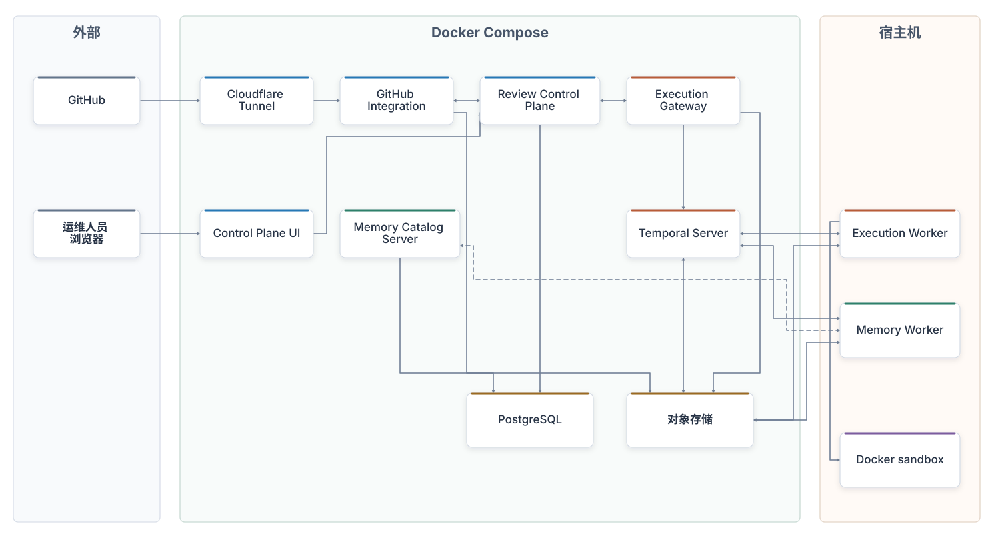

# 本地集成部署

语言：[English](LOCAL_INTEGRATED_DEPLOYMENT.md) | 中文

本文是 [LOCAL_INTEGRATED_DEPLOYMENT.md](LOCAL_INTEGRATED_DEPLOYMENT.md) 的中文译文。英文版是权威版本；如果两者不一致，以英文版为准。

这是 GitHub integration、Review Runs、运行服务、Temporal、对象存储以及宿主机 Execution Worker、Memory Extraction Worker 和 Memory Maintenance Worker 的本地部署说明。

如果你要在本地跑完整集成链路，读本文。不经过 HTTP 运行服务、直接在本地运行 agent，或使用 `run-local-* --temporal` 调试时，见 [agents 本地运行说明](../../agents/README.zh.md)。

## 部署结构



Cloudflare Tunnel 将 GitHub 流量转发到 integration 服务。Review Runs 协调每个 review run；Temporal 把 review、memory extraction 和 memory maintenance 工作分发给三个独立的 worker pool。PostgreSQL 保存控制和 catalog 状态，RustFS 保存运行输入、trajectory、memory revision 和 artifact。

图中的 Langfuse 同时位于 Docker Compose 和宿主机 worker 边界之外，因为它是独立部署的。Worker 可以向其导出 LLM observations，Review Runs 可以读取这些 observations 并生成模型用量 snapshot；两条链路都不会阻塞 review execution 或 publication。

Control Plane UI 是独立部署的控制台。它的同源服务端从 Review Runs 读取运行状态并代理 artifact 下载，因此服务凭据和存储凭据都不会进入浏览器代码。公网 endpoint 的配置见[本地 GitHub 入站设置](LOCAL_GITHUB_INBOUND_SETUP.zh.md)。

负责某条 task queue 的 worker 不存在时，该队列中的任务会停留在 Temporal 中等待执行。

默认本地端口：

| Service | URL |
| --- | --- |
| GitHub integration | `http://127.0.0.1:30000` |
| Review Runs | `http://127.0.0.1:8090` |
| Control Plane UI | `http://127.0.0.1:8091` |
| Execution Gateway | `http://127.0.0.1:8000` |
| Memory Catalog Server | `http://127.0.0.1:8092` |
| PostgreSQL | `postgresql://127.0.0.1:5432` |
| Temporal gRPC | `127.0.0.1:7233` |
| Temporal Web UI | `http://127.0.0.1:8233` |
| RustFS API | `http://127.0.0.1:9100` |
| RustFS Console | `http://127.0.0.1:9101` |

Temporal 接入只与 Execution Gateway 共享的专用 Compose internal network。gRPC 与 Web UI 端口发布在宿主 loopback，供宿主 worker 和本地 operator 使用。

## 前提

### GitHub App 权限设置

需要的 repository permissions：

- `Pull requests: Read and write`
- `Contents: Read and write`
- `Issues: Read and write`

需要订阅的 webhook：

- `Pull request`
- `Issues`
- `Issue comment`

补充：

- `Metadata: Read-only` 是 GitHub App 默认权限，不需要手动额外开启。
- 如果修改了 App 权限，已有 installation 往往需要重新批准权限。
- 权限不够时，常见报错是 `403 Resource not accessible by integration`。

### GitHub App 凭据

从 GitHub App 设置页面下载私钥，可以放在默认位置 `apps/github-integration/private-key.pem`。

在 GitHub App 的 webhook 设置中生成一个 secret，并把相同的值写入 `apps/github-integration/.env` 的 `WEBHOOK_SECRET`。私钥用于 GitHub App 身份认证，webhook secret 用于校验收到的 webhook。

### GitHub App webhook 配置

如果要把公网 URL 转发到本地 GitHub integration service，见 [本地 GitHub 入站设置](LOCAL_GITHUB_INBOUND_SETUP.zh.md)。

### Actions secrets 配置

仓库级 review 通过 GitHub Actions 触发：[`.github/workflows/sec-review-bot.yml`](../../.github/workflows/sec-review-bot.yml)

目标仓库需要配置 Actions secrets：

```bash
SEC_BOT_DISPATCH_URL=https://your-bot-dev.example.com/api/repository-review/dispatch
```

Repository review workflow 使用 GitHub Actions OIDC 向 App 鉴权。workflow 必须配置 `id-token: write`，OIDC audience 固定为 `sec-review-bot`。

## 部署配置

集成部署使用四份源配置。Compose `.env` 还承载对象存储 endpoint 和服务凭据；这些凭据只传递给各自需要的服务：

- 根目录 `.env`：Compose 控制平面；
- `apps/github-integration/.env`：GitHub integration；
- `agents/config/model-providers.toml`：模型 deployment；
- `ops/systemd/deployment.env`：安装前的 systemd 部署配置。

安装脚本会将这些设置与当前 checkout 推导出的路径合并，并把 systemd service 实际使用的配置写入 `/etc/sec-review-bot/deployment.env`。

先在仓库根目录创建这四份配置：

```bash
ops/init-local-deployment-config.sh
```

初始化命令会复制维护中的 sample，为内部服务生成彼此独立的凭据，同步 Compose 与宿主 worker 共同使用的值，并将四个文件的权限设为 `0600`。它不会覆盖已有配置。执行完成后，只需填写 GitHub App 身份、webhook secret、私钥和模型 deployment；Langfuse 等可选外部服务仍需填写各自的凭据。systemd 安装脚本会将部署设置与仓库路径合并后写入 `/etc`，见下文。

`agents/.env` 供 `run-local-*` 和其他本地 CLI 使用，不会被 Compose 或 systemd worker 自动读取。本地 CLI 的配置方式见 [agents 本地运行说明](../../agents/README.zh.md)。

### 1. Compose `.env`

Compose 层默认值在 [compose.env.sample](../../compose.env.sample)。这个文件只管 Compose 怎么启动容器、挂载哪些本地目录、暴露哪些端口。

初始化命令会用彼此独立的随机值填充服务 token 与 PostgreSQL/RustFS 凭据，并把宿主 worker 所需的 Memory Catalog token 和各角色存储凭据同步写入 `ops/systemd/deployment.env`，无需手工复制。Compose 自己管理的状态固定使用仓库下的 `.agent-temporal-state`、`.agent-rustfs-state` 和 `.agent-postgres-state`，不再分别提供配置项。

RustFS 按存储职责分配身份：integration 写入 input object；Execution Worker 读取 input、写入 run diagnostic bundle 并读取 active memory revision；Memory Extraction Worker 和 Memory Maintenance Worker 共用一套 memory storage identity，用于访问 run diagnostic、memory revision 和压缩后的 memory-agent trajectory；UI BFF 为经过认证的下载读取已存储 diagnostic。Extraction 与 maintenance 仍然是独立的 Temporal worker identity、进程和 task queue。这里保留共享 S3 credential，是因为当前对象存储 policy 覆盖同一个 memory artifact namespace；在本次部署拆分中进一步拆 IAM contract 不会单独改善进程隔离。

### 2. GitHub integration `.env`

GitHub integration 运行配置见 [apps/github-integration/.env.sample](../../apps/github-integration/.env.sample)。本地最小配置：

```bash
APP_ID=123456
WEBHOOK_SECRET=your_webhook_secret
PORT=30000
```

Compose 只把 Execution API 地址和 token 注入 Review Runs，用于初次提交、提交恢复和终态观察。该地址当前解析到 Execution Gateway 服务，但 Review Runs 的配置只使用 API 术语。Integration 只接收容器内私钥路径、Review Runs 地址和 token，以及 RustFS input storage 配置，不持有 PostgreSQL 或 execution 凭据。这些值不需要在 `apps/github-integration/.env` 中重复配置。

将私钥放在 `apps/github-integration/private-key.pem`。Compose 会把这个宿主机文件挂载到容器中并覆盖 `PRIVATE_KEY_PATH`；初始化命令同时把 `PRIVATE_KEY_PATH` 设置为该文件在宿主机上的绝对路径，仅用于让 `apps/github-integration/.env` 也能支持非 Compose 直接启动。

### 3. 模型配置

模型 deployment 配置见 [agents/config/model-providers.sample.toml](../../agents/config/model-providers.sample.toml)。Systemd worker 通过 `MODEL_PROVIDERS_CONFIG_TOML` 读取复制后的 `agents/config/model-providers.toml`。

所有运行到的 agent 都必须显式绑定模型 deployment：

```toml
[[deployments]]
name = "anthropic_strong"
model = "anthropic/claude-3-7-sonnet-20250219"
max_input_tokens = 200000
api_key = "your_anthropic_key"
api_base = "https://your-anthropic-endpoint/v1"

[agent_deployment_bindings]
issue-analyzer = "anthropic_strong"
```

修改模型配置或凭据后，可以探测 deployment 可用性：

```bash
cd agents
uv run sec-review-agents-check-llm-deployments
uv run sec-review-agents-check-llm-deployments --fail-fast
```

### 4. systemd 集成服务配置

`ops/systemd/deployment.env` 是供用户编辑的源配置。每次运行安装脚本时，都会将该文件与当前 checkout 推导出的路径合并，并替换 `/etc/sec-review-bot/deployment.env`。Compose stack service 和宿主机 worker 都读取安装后的文件。

`SEC_REVIEW_BOT_DIR` 和 `SEC_REVIEW_AGENTS_DIR` 由安装脚本负责，不要把它们加入可编辑的源文件。安装脚本会删除旧值，并根据自身所在的仓库重新生成。Input archive 改由 RustFS 交换，因此 integration 容器和宿主 worker 不再共享 `.agent-input-bundles`。

安装脚本还会生成内部使用的 `SEC_REVIEW_SERVICE_UID` 和 `SEC_REVIEW_SERVICE_GID`。在 Compose 启动前，它会为该 service user 创建仓库内的状态目录。这样可以避免 Docker 自动创建无法由非 root 容器写入的 root-owned bind mount 源目录，并让 Temporal 容器以同一用户写入 SQLite 数据库。

运行时解包的输入和生成的 artifact 默认分别写入当前 checkout 的 `.agent-run-inputs` 与 `.agent-artifacts`，模型配置默认读取 `agents/config/model-providers.toml`。大多数部署应保留这些默认值。如果需要移动这些目录或从其他位置读取模型配置，可以在 `ops/systemd/deployment.env` 中填写绝对路径 `SEC_REVIEW_AGENT_RUN_INPUT_ROOT`、`SEC_REVIEW_AGENT_ARTIFACT_ROOT` 或 `MODEL_PROVIDERS_CONFIG_TOML`；安装脚本会保留这些独立 worker 路径的非空 override。

如果 [`ops/systemd/deployment.env.sample`](../../ops/systemd/deployment.env.sample) 新增了选项，需要手动把相关选项加入 `ops/systemd/deployment.env`。

核心字段：

| Field | 如何配置 |
| --- | --- |
| `TEMPORAL_ADDRESS` | 必须使用根目录 `.env` 中 `TEMPORAL_PORT` 暴露的宿主机端口；默认是 `127.0.0.1:7233`。 |
| `TEMPORAL_NAMESPACE`、`TEMPORAL_EXECUTION_TASK_QUEUE` | 必须与根目录 `.env` 中的同名值一致。 |
| `AGENT_DOCKER_IMAGE` | Docker sandbox 使用的镜像；默认使用通用镜像。 |
| `AGENT_SKILLS_ENABLED` | 为声明了 bundled skills 的 agent 物化对应 skills；默认是 `true`。 |
| `AGENT_JOERN_ENABLED`、`AGENT_PLAYWRIGHT_ENABLED` | 向适用的 agent 提示镜像中已安装的相应 CLI；两者默认均为 `false`。 |
| `AGENT_MCP_ENABLED` | 启用已配置的 MCP 集成；默认是 `false`。 |
| `AGENT_MEMORY_CONSUMPTION_ENABLED` | 允许 review agent 读取整理后的 memory；默认是 `true`。 |
| `AGENT_MEMORY_PROCESSING_ENABLED` | 允许 trajectory extraction 和 memory maintenance；默认是 `true`。 |
| `SEC_REVIEW_ARTIFACT_S3_ENDPOINT` | 可选的自定义 S3-compatible endpoint。本地 RustFS 部署使用 `http://127.0.0.1:9100`；使用由 `AWS_REGION` 选择的 AWS endpoint 时省略该项。 |
| `SEC_REVIEW_ARTIFACT_S3_ADDRESSING_STYLE` | S3 请求寻址方式：`auto`、`path` 或 `virtual`。本地 RustFS 部署使用 `path`；外部存储可以使用 `auto` 或 `virtual`，无需改变 artifact reference。 |
| `SEC_REVIEW_EXECUTION_S3_ACCESS_KEY`、`SEC_REVIEW_EXECUTION_S3_SECRET_KEY` | Execution Worker 凭据；可读取 run input、写入 run diagnostic bundle，并读取 active memory revision。 |
| `SEC_REVIEW_MEMORY_S3_ACCESS_KEY`、`SEC_REVIEW_MEMORY_S3_SECRET_KEY` | 两个 memory worker 共用的存储凭据；可读取 run diagnostic bundle，并读写 memory revision 和压缩后的 memory-agent trajectory。 |
| `AGENT_MEMORY_CATALOG_URL` | Memory Catalog 协调状态 API；Compose 默认是 `http://127.0.0.1:8092`。 |
| `AGENT_MEMORY_CATALOG_TOKEN` | 必须与仓库 `.env` 一致；它只授权 memory 协调，不提供 PostgreSQL 直连权限。 |

Execution Worker 会在 workflow 成功前把权威 run diagnostic 发布到 `runs/*/artifacts/*`。Execution Gateway 只校验并转发该不可变引用，不持有对象存储凭据，也不挂载 worker artifact tree。Agent sandbox 不会收到任何 workload storage 凭据。

Memory Catalog Server 是独立 TypeScript 服务，不属于 Review Runs。Compose 只运行一个 PostgreSQL 实例，其中包含相互独立的 `sec_review_review_runs` 和 `sec_review_memory_catalog` database。只有 Memory Catalog 收到 `MEMORY_CATALOG_DATABASE_URL`，并在自己的 database 中保存 extraction records 及其可选 observations、memory-tree revision history 和 active revision pointer。每个 revision 记录对应的 maintenance identity 和 maintainer trajectory reference。Temporal 负责 extraction 执行和单例 maintenance workflow；PostgreSQL 是持久 catalog 与 compare-and-swap 提交边界。宿主 worker 使用 `AGENT_MEMORY_CATALOG_TOKEN` 调用它；memory-tree revisions 和 memory-agent trajectories 以不可变对象保存在 RustFS 中。Worker 将这些对象物化到 invocation 级临时 worktree，agent sandbox 只看到最终 filesystem mount。

Compose 会向 Control Plane UI 提供 `MEMORY_CATALOG_URL` 和 `MEMORY_CATALOG_TOKEN`。经过认证的 browser session 可以通过 BFF 查看和管理 memory，而不会获得 Catalog 或对象存储凭据。UI storage identity 可以读取 run artifact、memory tree 和 memory trajectory，但只能在 `memory/trees/*` 下创建不可变对象。编辑或恢复失败后，maintenance 会保持暂停，直到 operator 显式恢复。系统不会自动清理未引用的 memory object。

PostgreSQL 初始化脚本只会在 `.agent-postgres-state` 为空时执行。采用或修改 database 名称后，应先停止部署并删除该目录，再重新启动 Compose。此操作会删除已有的 Review Runs 和 Memory Catalog 数据。

大多数本地部署可以保留这些默认值。移动 checkout 后，重新运行安装脚本。

以下变量按需添加或修改。

#### Langfuse tracing

[Langfuse](https://langfuse.com/docs) 独立部署，强烈建议配置。核心审查执行不依赖它，但 LLM 调用追踪和 Review Runs 模型用量统计依赖它。它不属于本仓库的 Compose 控制平面。可以使用 [Langfuse Cloud](https://cloud.langfuse.com)，也可以单独运行[自托管 Langfuse](https://langfuse.com/self-hosting)。在 Langfuse 中创建 project 和 API keys 后，把下面三项一起写入 `ops/systemd/deployment.env`，再重新运行安装脚本：

```bash
LANGFUSE_PUBLIC_KEY=your_public_key
LANGFUSE_SECRET_KEY=your_secret_key
LANGFUSE_BASE_URL=https://cloud.langfuse.com
```

#### Runtime diagnostics

```bash
AGENT_LOG_LEVEL=INFO
AGENT_MODEL_TURN_DIAGNOSTICS=1
AGENT_GRAPH_MAX_STEPS=24
AGENT_GRAPH_RECURSION_BUFFER=8
```

#### Repository workflow 并发

```bash
AGENT_DISCOVERY_MAX_CONCURRENCY=1
AGENT_CASE_PROCESSING_MAX_CONCURRENCY=1
```

并发值只限制同时在飞请求数，不等价于 TPM/RPM 限流控制；是否触发配额更取决于 token 体积、请求速率和重试行为。

#### Docker sandbox

`deployment.env.sample` 默认使用通用 sandbox 镜像，并关闭可选 external-tool prompt 与 MCP：

```bash
AGENT_SANDBOX_BACKEND=docker
AGENT_DOCKER_IMAGE=mcr.microsoft.com/devcontainers/universal:6-noble
AGENT_DOCKER_NETWORK_MODE=none
AGENT_JOERN_ENABLED=false
AGENT_PLAYWRIGHT_ENABLED=false
AGENT_MCP_ENABLED=false
```

执行节点使用 `AGENT_SANDBOX_BACKEND=docker` 后，Docker 不可用时 Execution Worker 会在启动阶段失败；两个 memory worker 都不会初始化或依赖 Docker sandbox 边界。

要通过仓库提供的 Docker 镜像使用 Joern 和 Playwright CLI，先构建 workspace tools 镜像，再修改 `ops/systemd/deployment.env`：

```bash
docker build -f agents/docker/workspace-tools.Dockerfile -t sec-review-bot-workspace:tools agents
AGENT_DOCKER_IMAGE=sec-review-bot-workspace:tools
AGENT_JOERN_ENABLED=true
AGENT_PLAYWRIGHT_ENABLED=true
```

同一镜像也支持可选的 CodeGraph 和 Playwright MCP 集成。需要时单独启用：

```bash
AGENT_MCP_ENABLED=true
```

CodeGraph 在 sandbox 内运行，因此需要一个能执行命令的 backend：把 `codegraph` 装进 workspace tools 镜像，并设置 `AGENT_MCP_ENABLED=true`。CodeGraph tools 只会挂到显式 opt in、并且暴露可写 `/workspace` 的阶段。

### 集成部署路径

使用 sample 配置时，集成部署默认把运行数据写入以下仓库级路径：

| Path | Owner | Purpose |
| --- | --- | --- |
| `.agent-rustfs-state` | RustFS | run inputs、diagnostics、memory-tree revisions、memory-agent trajectories 及其他 artifacts 的持久对象存储 |
| `.agent-run-inputs` | 宿主机 worker | 活跃运行所需的本地输入；不会进入对外发布的诊断材料 |
| `.agent-artifacts` | 宿主机 worker | 每次运行的 agent 产物和 workflow 输出 |
| `.agent-postgres-state` | PostgreSQL | Review Runs run 状态与 Memory Catalog 协调状态 |
| `.agent-temporal-state` | Temporal | workflow history 和待处理 task state |

## 运行部署

### 集成服务

先安装 agents 项目，构建所有需要的镜像，并确认当前用户可以访问 Docker：

```bash
cd agents
uv sync --frozen --no-dev
cd ..
docker info
docker compose --profile app build
```

检查 `ops/systemd/deployment.env` 后，安装 systemd units。参数指定实际运行 Compose 和 worker 的普通宿主机用户：

```bash
sudo ops/systemd/install.sh "$USER"
```

启动完整集成服务，并配置为随系统启动：

```bash
sudo systemctl enable --now sec-review-bot.target
```

> 此命令会等待 Compose 启动健康门控，通常需要几十秒。可在另一个终端运行 `sudo journalctl -u sec-review-bot-compose-stack.service -f` 查看进度。

`sec-review-bot.target` 是整套部署统一的 systemd 入口。它把 `sec-review-bot-compose-stack.service`、`sec-review-execution-worker@1.service`、`sec-review-memory-extraction-worker@1.service` 和单例 `sec-review-memory-maintenance-worker.service` 组合起来统一管理。

控制平面包括 GitHub integration、Execution Gateway 和 Temporal。Execution Worker 运行 review workflow、创建 Docker sandbox 并发布 run diagnostic；Memory Extraction Worker 消费诊断包并登记 observations；Memory Maintenance Worker 串行更新共享 memory tree，并负责修复 maintenance schedule。两个 memory worker 都不拥有 review sandbox 边界。

启动期失败和运行期失败的监督方式不同，排查时这个区别很关键：

- **启动期。** unit 会等待 Compose 健康门控通过，systemd 随后才启动依赖它的 worker。某个服务始终无法变为健康、或某个一次性 init 服务（如 `rustfs-init`）失败时，本次启动会失败，尚未就绪的 stack 不会暴露给 worker。失败的尝试会先被清理，再由 systemd 进行有上限的重试；达到上限后 unit 保持 failed，直到运维介入。
- **运行期。** 崩溃的服务会自行重启，重启次数有上限，且不影响栈内其余服务（尤其是 PostgreSQL）。某个服务用尽重启次数后就会停在停止状态，而 **unit 仍显示 `active (running)`**，因为维持日志转发的进程只负责跟随日志，并不监督健康状态。

日常启停和重启只操作 target：

```bash
sudo systemctl start sec-review-bot.target
sudo systemctl stop sec-review-bot.target
sudo systemctl restart sec-review-bot.target
```

Temporal development server 的状态保存在 `.agent-temporal-state` 下，因此上述日常启停和重启会保留 workflow history 与待处理任务。停止会移除 Compose 容器与网络（`docker compose down`），每次启动重新创建，因此容器不可能比它创建时所在的网络活得更久；所有状态都保存在仓库本地的 bind mount 中。

查看整体状态和日志：

```bash
sudo systemctl status sec-review-bot.target
sudo systemctl status sec-review-bot-compose-stack.service
sudo systemctl status sec-review-execution-worker@1.service
sudo systemctl status sec-review-memory-extraction-worker@1.service
sudo systemctl status sec-review-memory-maintenance-worker.service
sudo journalctl \
  -u sec-review-bot-compose-stack.service \
  -u sec-review-execution-worker@1.service \
  -u sec-review-memory-extraction-worker@1.service \
  -u sec-review-memory-maintenance-worker.service \
  -f
```

`systemctl status` 反映的是 Compose 进程和 worker 的状态，不是容器的状态。某个服务可能已经停止而 unit 仍显示 `active (running)`，所以还要单独运行 `docker compose --profile app ps --all`。

结果这样读：

- 长驻服务显示 `exited`，表示它已经停止。可能是正常退出（当前配置的重启策略不会重启它），也可能是用尽了重启次数；是哪种要看 journal 和退出状态。
- 显示 `unhealthy`，表示容器还在运行但健康检查命令失败；启动期 Compose 会因此报错，运行期则不会重启该容器。
- 即使加了 `--all` 某个服务仍不在列表里，表示 Compose 从未创建它，通常是因为它等待的依赖（`condition: service_healthy` 或 `service_completed_successfully`）始终没有满足。

如果 unit 因反复启动失败而停止，仅修好原因还不够：systemd 记着这次失败，会拒绝再次启动。先清除该记录：

```bash
sudo systemctl reset-failed sec-review-bot-compose-stack.service
sudo systemctl start sec-review-bot.target
```

取消随系统启动并立即停止完整服务：

```bash
sudo systemctl disable --now sec-review-bot.target
```

修改代码后，重新构建镜像，再重启完整服务：

```bash
docker compose --profile app build
sudo systemctl restart sec-review-bot.target
```

修改 `ops/systemd` 下的安装文件后，先重新运行安装脚本，再重启服务。

验证 Execution Gateway：

```bash
curl -sS http://127.0.0.1:8000/healthz
```

验证 Review Runs 是否可以安全接收协调请求：

```bash
curl -sS http://127.0.0.1:8090/readyz
```

`/healthz` 仅表示进程存活。PostgreSQL、连接池或完整版本集合与本应用不一致的 schema ledger 不可用时，`/readyz` 返回 `503`；它有意不包含 Execution API 或 GitHub 的可达性。

### 组件级操作

排障或只更新一个组件时，可以分别重启控制平面或任一个 worker：

```bash
sudo systemctl restart sec-review-bot-compose-stack.service
sudo systemctl restart sec-review-execution-worker@1.service
sudo systemctl restart sec-review-memory-extraction-worker@1.service
sudo systemctl restart sec-review-memory-maintenance-worker.service
```

开发调试时，也可以绕过 systemd，在前台启动 Compose stack：

```bash
docker compose --profile app up --build
```

这个命令不会启动任何宿主机 worker。

### Worker 并发

`TEMPORAL_EXECUTION_MAX_CONCURRENT_ACTIVITIES` 限制每个 Execution Worker 同时执行的 review activities 数量，默认值为 `2`。每个 review activity 都可能创建 sandbox 并发出多次模型请求，因此单机部署应从这个保守值开始。`TEMPORAL_MEMORY_EXTRACTION_MAX_CONCURRENT_ACTIVITIES` 独立限制每个 Memory Extraction Worker 的 activity 数量，默认值为 `4`。Memory Maintenance Worker 始终使用 `TEMPORAL_MEMORY_MAINTENANCE_MAX_CONCURRENT_ACTIVITIES=1`；其 unit 特意不是 template，不应扩容。

两套 systemd template 可以分别扩展 Execution 和 Memory Extraction worker pool：

```bash
sudo systemctl enable --now sec-review-execution-worker@2.service
sudo systemctl enable --now sec-review-execution-worker@3.service
sudo systemctl enable --now sec-review-memory-extraction-worker@2.service
sudo systemctl enable --now sec-review-memory-extraction-worker@3.service
```

Temporal 会在共用同一 task queue 的实例之间分配任务。每个 worker pool 至少保留一个进程；review 工作排队时增加 Execution Worker，extraction 工作排队时增加 Memory Extraction Worker。两个可扩容 pool 不必使用相同的实例数量或机器规格。Maintenance 始终只有一个进程和一个 activity slot；固定 workflow ID、schedule overlap policy 与 Catalog compare-and-swap 边界共同提供持久的单例保证。

## 清理

安装脚本会创建仓库内的 bind-mount 根目录，并将其 ownership 设置为配置的 service user。更换 service user 或部署 checkout 后，运行安装脚本：

```bash
sudo ops/systemd/install.sh "$USER"
```

PostgreSQL、Temporal 和 RustFS 状态目录内的文件保留各自容器所需的 ownership。

PostgreSQL 协调状态与 Temporal 状态描述的是同一批活跃 run。不要在保留仍需轮询或发布的 PostgreSQL 记录时单独删除 `.agent-temporal-state`。重置 run 执行与发布状态时，应先停止完整服务，再同时删除两个状态目录：

```bash
sudo systemctl stop sec-review-bot.target
sudo rm -rf .agent-temporal-state .agent-postgres-state
sudo systemctl start sec-review-bot.target
```

该操作会永久删除 workflow history、待处理任务、轮询状态和发布状态。运行开始前准备的输入材料（上传到 RustFS 的 archive）以及运行结束后生成的诊断材料（diagnostic artifact）当前没有自动保留期限；本地工作目录中的相应文件也一样默认无限期保留，用于恢复、重放和诊断。部署不会配置生命周期过期规则，因此磁盘用量由运维人员监控。确认没有仍需保留的 run 依赖它们后，才可以手动清理：

```bash
sudo rm -rf .agent-rustfs-state .agent-run-inputs .agent-artifacts
```

### 备份与恢复

RustFS 状态和 PostgreSQL 状态是两套独立数据。应将 `.agent-rustfs-state`、`.agent-postgres-state` 与部署配置一起备份，但不要把密码和 access key 写入备份包，应交由 secret manager 单独保存。恢复时先恢复 RustFS，再运行 RustFS 初始化器重新核对 bucket 和策略，最后恢复 PostgreSQL，这样 run 记录中的对象引用才有对应的存储内容。初始化器可以重复运行，不会覆盖已有对象。

## 代理

GitHub integration 的镜像构建和 Git workspace 拉取使用不同的网络配置。Compose 部署在根目录 `.env` 中设置这些变量；非 Compose 启动时，在 GitHub integration 的 `.env` 中设置运行时变量。

### pnpm 与 npm registry

Node 服务镜像从 `ghcr.io/pnpm/pnpm:12-alpine` 复制 pnpm 12，构建过程中不再下载 package manager。因此 Docker 必须能直接访问 GHCR，或通过 daemon 配置的 registry mirror 或代理访问。

pnpm 默认从 `https://registry.npmjs.org` 下载项目依赖。该地址不可用或速度不稳定时，可以改用可达的 npm registry：

```bash
NPM_CONFIG_REGISTRY=https://registry.npmmirror.com
```

这个变量只在镜像构建阶段传给 pnpm，不会改变 Docker 拉取 pnpm 基础镜像的位置。修改后使用 `docker compose --profile app build` 重新构建 Node 服务镜像。

### Git fetch

GitHub integration 在准备 review input bundle 时通过 `git fetch` 拉取目标 commit。如果容器无法直接连接 GitHub，可以只为这些 fetch 配置宿主机 HTTP 代理：

```bash
GITHUB_INTEGRATION_GIT_HTTP_PROXY=http://host.docker.internal:7897
```

Compose 会把 `host.docker.internal` 映射到宿主机。代理必须监听 Docker 容器可访问的地址，而不是只监听 `127.0.0.1`。这个变量不会改变 GitHub API、Execution Gateway、worker 或 sandbox 的网络路径。

非 Compose 启动 GitHub integration 时，可以改用宿主机进程能够访问的地址，例如：

```bash
GITHUB_INTEGRATION_GIT_HTTP_PROXY=http://127.0.0.1:7897
```

每条 git 命令和快照命令都受 `GITHUB_INTEGRATION_GIT_TIMEOUT_MS` 约束（默认 `600000`，即 10 分钟），避免远端挂起时无限拖住输入准备。若仓库的冷克隆确实更慢，可以提高该值。

## 为何这样部署

这套部署由两个运行时承担：Compose 跑协调服务，systemd 跑三个宿主机 worker pool。哪个组件由哪个运行时承载，取决于该组件要做什么，这也决定了监督能覆盖到哪里。

### workers 跑在宿主机上

Execution Worker 是整条链路里唯一会运行被审查仓库代码的组件。它为每次 agent 调用启动一个 Docker 容器，因此需要访问宿主机的 Docker daemon。把它放进 Compose 只有两种做法：把 Docker socket 挂进一个本来就在运行不可信代码的容器，或者在容器内再跑一个特权 daemon。无论哪种，只要某次 review 出了事，影响都会超出沙箱。放在宿主机上，它直接使用 daemon，并由 systemd 监督，因此具备真实的 unit 状态、有上限的重启策略，以及对控制平面的依赖关系。Memory Extraction Worker 和 Memory Maintenance Worker 通过各自的 systemd unit 在宿主机并列运行，但不会初始化 Docker sandbox。

在 Temporal 的任务队列模型里，worker 部署在宿主上属于常规做法，算不上变通：worker 主动轮询队列，部署在哪里并不影响 workflow 的推进。worker 消失只会让任务延后，不会丢失 workflow 状态。

### 协调服务跑在 Compose 里

PostgreSQL、Temporal、对象存储和三个 HTTP 服务都是普通的长驻容器。Compose 为它们提供镜像固定、基于健康门控的依赖顺序、网络隔离，以及单一配置文件——这些都是 worker 不需要的。

### 同样的形态在别处也存在

执行不可信任务的 runner 系统也这样划分两个角色：

- [GitHub 的 self-hosted runner](https://docs.github.com/en/actions/hosting-your-own-runners/managing-self-hosted-runners/configuring-the-self-hosted-runner-application-as-a-service) 安装为宿主机上的服务，每个 job 在容器里启动。
- [Gitea 的 act runner](https://docs.gitea.com/usage/actions/act-runner) 以宿主 daemon 运行，提供 `docker://`、`kubernetes://` 和 `host` 三种 job 环境，并明确警告 host 模式的 job 没有隔离。
- [GitLab Runner](https://docs.gitlab.com/runner/executors/) 的 manager 同样位于宿主机，把 job 分派给 Docker。

这三者的控制平面都在机器之外，因此 worker 失败从来不需要传播进去。

### 这样做的代价

本项目的控制平面与 worker 同机，于是两个运行时必须在失败处理上取得一致，而它们在一处并不一致：systemd 会把失败的 worker 报告为失败的 unit，而一个用尽重启次数的 Compose 服务会让 unit 仍显示 `active (running)`。unit 的前台进程只负责跟随日志；Compose 没有办法把单个服务的永久失败转成进程退出，除非同时把所有崩溃都当作整栈失败——而那正是之前把 PostgreSQL 一起拖垮的做法。

因此，健康门控之下的运行期失败要靠检查容器发现，而不是靠 unit 状态——上文的状态检查一节说明了做法。若要在 Compose 内部补上这个缺口，需要一个读取期望服务状态的监督器，而这些期望状态只能存放在服务定义之外。对本地部署而言，运维人员本来就在机器前，这笔取舍并不划算。如果这套部署将来需要无人值守地运行，它会是第一个需要重新评估的地方。
