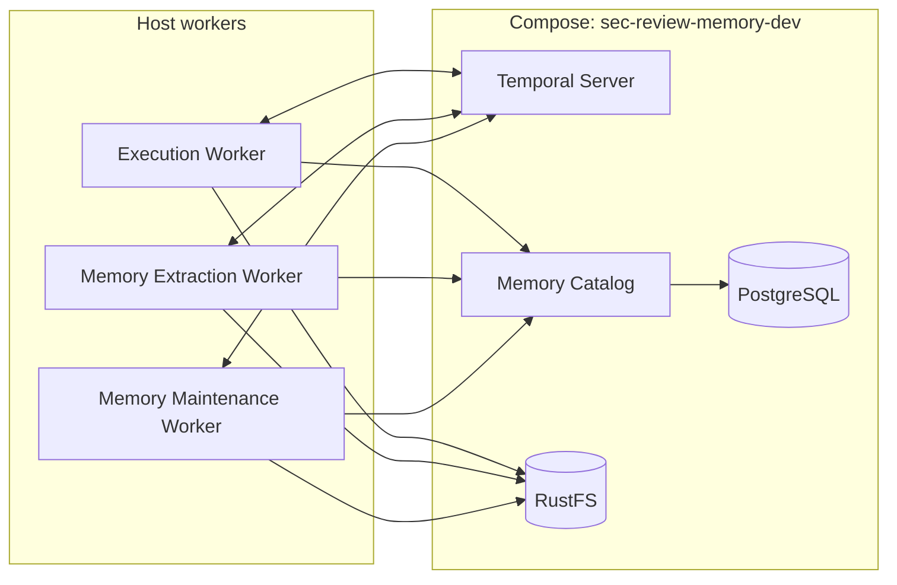

# Local Memory Development

Language: English | [中文](LOCAL_MEMORY_DEVELOPMENT.zh.md)

This guide covers the standalone local Memory development environment. See [Agent Memory System](../agent/MEMORY_SYSTEM.md) for the design and [local integrated deployment](LOCAL_INTEGRATED_DEPLOYMENT.md) for the full control plane and systemd operation.

For local Memory development, Compose runs the infrastructure and the workers run as host processes.



Temporal Server dispatches work to the workers; Memory Catalog owns coordination state in PostgreSQL, and RustFS stores artifacts. `rustfs-init` runs once to initialize storage. GitHub Integration, Review Runs, Execution Gateway, and Control Plane UI are not started in this setup.

<!-- doc-default: memory-dev-isolation; source=compose.memory.env.sample -->

The sample selects Compose project `sec-review-memory-dev`, data directories under `.agent-memory-dev/`, and separate host ports: PostgreSQL `55433`, RustFS API/console `19100`/`19101`, Temporal API/UI `17233`/`18233`, and Memory Catalog `18092`. Worker endpoints use those same ports. Run commands from the repository root without overriding these settings in the shell.

If `compose.memory.env` already exists, update its project name, state paths, ports, and worker endpoints from the sample before starting. Existing app data is not migrated or deleted.

> [!WARNING]
> The checked-in development credentials are fixed loopback-only values. They are not secrets and must not be used on a shared machine or any deployment reachable from another host.

From the **repository root**, create the ignored local env file and start the infrastructure:

```bash
# Create the local development configuration.
cp compose.memory.env.sample compose.memory.env

# Create writable RustFS and Temporal data directories for the current UID/GID.
install -d .agent-memory-dev/rustfs .agent-memory-dev/temporal

# Build and start the infrastructure; wait for health checks.
docker compose \
  --env-file compose.memory.env \
  --profile memory \
  up -d --build --wait \
  rustfs postgres temporal memory-catalog-server

# Initialize object-storage buckets and workload identities.
docker compose \
  --env-file compose.memory.env \
  --profile memory \
  run --rm rustfs-init

# Check Memory Catalog health.
curl --fail http://127.0.0.1:18092/healthz
```

Configure `agents/.env` and `agents/config/model-providers.toml` for model access, then start the Execution, Memory Extraction, and Memory Maintenance workers together:

```bash
# Enter the repository root (replace this path).
cd /path/to/sec-review-bot

# Start the execution, extraction, and maintenance workers.
uv --project agents run python -m scripts.dev.dev_workers \
  --env-file compose.memory.env
```

<!-- doc-default: local-memory-worker-launcher; source=scripts/dev/dev_workers.py -->

The launcher maps the separate object-storage identities to their workers, keeps Memory Maintenance Worker activity concurrency at `1`, and stops the worker group when one worker exits or the launcher receives `SIGINT`/`SIGTERM`. It does not start or stop Compose services.

When memory processing is enabled in local Temporal mode, Memory Extraction Worker reads the diagnostic bundle produced by Execution Worker from the local filesystem. Both workers must be able to access the same file path. Extraction results still use Memory Catalog to store observations and artifact references, and S3-compatible storage to store the extractor trajectory.

Run the operational script from the repository root (see [scripts guide](../../scripts/README.md#memory-operations)):

Ask Temporal Server to start one memory maintenance workflow:

```bash
uv --project agents run python -m scripts.ops.memory_ops --env-file compose.memory.env maintain
```

Create or update the periodic maintenance schedule in Temporal Server:

```bash
uv --project agents run python -m scripts.ops.memory_ops --env-file compose.memory.env schedules maintenance ensure
```
