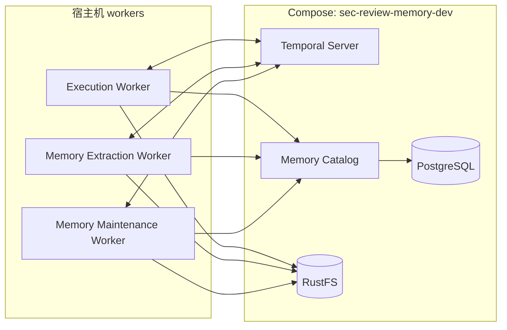

# 本地 Memory 开发

语言：[English](LOCAL_MEMORY_DEVELOPMENT.md) | 中文

本文介绍独立的本地 Memory 开发环境。整体设计见 [Agent Memory System](../agent/MEMORY_SYSTEM.zh.md)；完整控制平面的部署与 systemd 运维见[本地集成部署](LOCAL_INTEGRATED_DEPLOYMENT.zh.md)。

本地 Memory 开发由 Compose 运行基础设施，各个 worker 则作为宿主机进程运行。



Temporal Server 向 workers 分发任务；Memory Catalog 在 PostgreSQL 中保存协调状态，RustFS 保存 artifacts。`rustfs-init` 是一次性存储初始化任务。此环境不启动 GitHub Integration、Review Runs、Execution Gateway 或 Control Plane UI。

<!-- doc-default: memory-dev-isolation; source=compose.memory.env.sample -->

示例配置使用 Compose 项目名 `sec-review-memory-dev`，数据放在 `.agent-memory-dev/` 下，宿主端口分别为：PostgreSQL `55433`、RustFS API/console `19100`/`19101`、Temporal API/UI `17233`/`18233`、Memory Catalog `18092`。worker 地址使用对应的新端口。从仓库根目录运行命令，避免 shell 环境变量覆盖这些设置。

如果已有 `compose.memory.env`，启动前请按示例更新项目名、数据路径、端口和 worker 地址。现有完整部署数据不会被迁移或删除。

> [!WARNING]
> 仓库提供的是只供 loopback 开发使用的固定凭据。它们不是 secret，不得用于共享机器或可被其他主机访问的部署。

在 **仓库根目录** 中创建被忽略的本地 env 文件，并启动基础设施：

```bash
# 创建本地开发配置文件。
cp compose.memory.env.sample compose.memory.env

# 提前创建 RustFS 和 Temporal 数据目录，确保当前 UID/GID 可写。
install -d .agent-memory-dev/rustfs .agent-memory-dev/temporal

# 构建并启动基础设施，等待健康检查通过。
docker compose \
  --env-file compose.memory.env \
  --profile memory \
  up -d --build --wait \
  rustfs postgres temporal memory-catalog-server

# 初始化对象存储的 buckets 和工作身份。
docker compose \
  --env-file compose.memory.env \
  --profile memory \
  run --rm rustfs-init

# 检查 Memory Catalog 是否正常。
curl --fail http://127.0.0.1:18092/healthz
```

填好 `agents/.env` 和 `agents/config/model-providers.toml` 中的模型配置，然后一起启动 Execution、Memory Extraction 和 Memory Maintenance workers：

```bash
# 进入仓库根目录（替换为实际路径）。
cd /path/to/sec-review-bot

# 启动执行、提取和维护 workers。
uv --project agents run python -m scripts.dev.dev_workers \
  --env-file compose.memory.env
```

<!-- doc-default: local-memory-worker-launcher; source=scripts/dev/dev_workers.py -->

launcher 会将不同的对象存储身份传给对应 worker，将 Memory Maintenance Worker 的 activity concurrency 保持为 `1`，并在任一 worker 退出或收到 `SIGINT`/`SIGTERM` 时停止整个 worker 组。它不负责启动或停止 Compose services。

本地 Temporal 模式启用 memory processing 时，Memory Extraction Worker 会从本地文件系统读取 Execution Worker 生成的 diagnostic bundle，因此两个 worker 必须能访问同一个文件路径。提取结果仍通过 Memory Catalog 保存 observations 和产物引用，通过 S3 兼容存储保存 extractor 的执行轨迹。

从仓库根目录运行运维脚本（见 [scripts 说明](../../scripts/README.md#memory-operations)）：

请求 Temporal Server 启动一次 memory maintenance workflow：

```bash
uv --project agents run python -m scripts.ops.memory_ops --env-file compose.memory.env maintain
```

在 Temporal Server 中创建或更新周期性 maintenance schedule：

```bash
uv --project agents run python -m scripts.ops.memory_ops --env-file compose.memory.env schedules maintenance ensure
```
