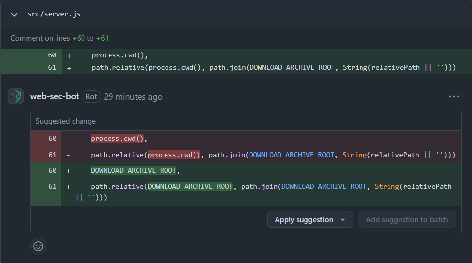

# Suggestion Comment Design

Language: English | [中文](SUGGESTION_COMMENT_DESIGN.zh.md)

## Goal

Map the patch diff into GitHub PR review suggestions so reviewers can apply a focused fix directly from the PR UI. For example:

These comments provide an apply-suggestion action anchored to changed lines. Summary comments explain issues and patches describe edits; neither provides the same inline action.

Sources:

- [GitHub REST API - Create a review for a pull request](https://docs.github.com/en/rest/pulls/reviews#create-a-review-for-a-pull-request)
- [GitHub REST API - Create a review comment for a pull request](https://docs.github.com/en/rest/pulls/comments)
- [GitHub Docs - Reviewing proposed changes in a pull request](https://docs.github.com/pull-requests/collaborating-with-pull-requests/reviewing-changes-in-pull-requests/reviewing-proposed-changes-in-a-pull-request)

## Inline Suggestion Scope

GitHub suggestions are PR-diff-anchored review comments, not a generic patch transport channel. GitHub requires each inline suggestion to:

- target a file already present in the PR changed-file set.
- anchor to a line interval visible in the PR diff.

Therefore this workflow emits suggestions only for the part of a mitigation patch that can be mapped to those PR-visible lines. Mitigation edits outside the PR diff may remain in the mitigation diff, but they fall back to the standard summary path instead of being forced into inline suggestions.

## Implementation

### Eligibility Rules

Emit suggestion candidates when a mitigation patch exists and at least one patch hunk can be anchored to a PR-visible diff hunk. Each candidate must meet these conditions:

1. Patch file exists in PR changed-file set and has PR patch content.
2. Patch hunk produces a suggestion block; deletion allows empty replacement content.
3. Patch hunk can be anchored to a right-side (current-version) PR diff interval.

This is a partial-admission pipeline:

- non-anchorable files/hunks are skipped, while anchorable ones are still emitted.
- Skipped entries are reported in the suggestion manifest under `unmapped_changes`.

### Mapping Pipeline

#### 1. Parse the mitigation diff

Parse unified diff content and collect, per file:

- `path`
- hunk header (`old_start`, `old_count`, `new_start`, `new_count`)
- hunk lines

#### 2. Restrict to PR-visible files

Keep only patch files that match entries from `pulls.listFiles`, the GitHub API source for PR changed-file metadata and visible patch hunks.

#### 3. Build suggestion replacements and bodies

Split each patch hunk into suggestion blocks of consecutive added and removed lines:

- Replacements use the added lines as replacement text.
- Deletions use empty replacement text.
- Pure insertions anchor to a neighboring context line and preserve that line in the replacement.
- Put the replacement text in a `suggestion` code block as the comment body.

#### 4. Build review anchors from overlapping PR patch hunks

For each suggestion block, find an overlapping PR patch hunk in the same file and intersect their line ranges in the PR's current version:

- `start_line = max(block.start_line, pr_hunk.new_start)`
- `line = min(block.line, pr_hunk.new_start + pr_hunk.new_count - 1)`
- `side = RIGHT`

Skip blocks with no valid overlap. If `start_line === line`, submit a single-line anchor. If `start_line < line`, submit a multi-line anchor with `start_line` and `start_side`.

#### 5. Publish one review with all inline suggestions

Create one PR review containing:

- inline suggestion comments (`path`, `body`, `line`, `side`, optional `start_line`, `start_side`)
- `commit_id = head_sha`

### Fallback Behavior

When no candidate is emitted:

1. Do not publish inline suggestions.
2. Publish the standard top-level PR summary comment.

This keeps behavior deterministic and avoids weakly anchored or misleading inline edits.

When some candidates are emitted but some hunks are not anchorable:

1. Publish inline suggestions for anchorable candidates.
2. Append an `Unmapped Mitigation Changes` section to the review body for non-anchorable hunks.
