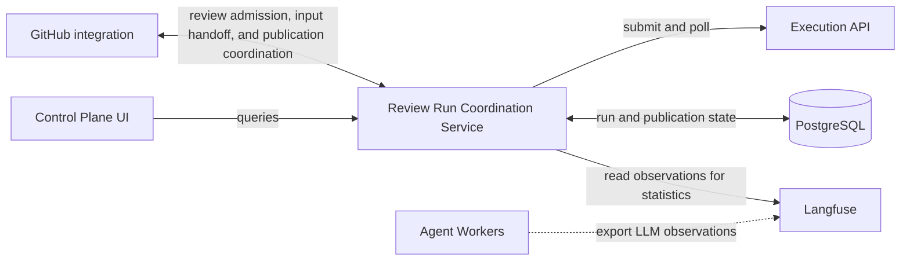
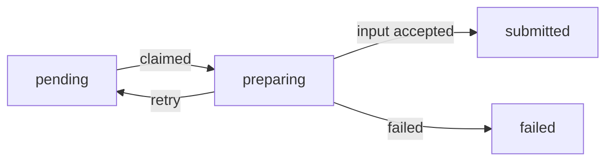
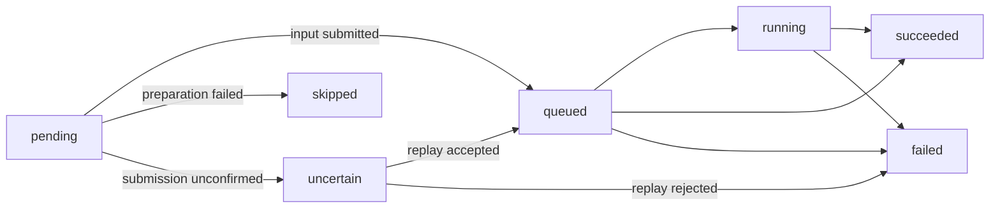
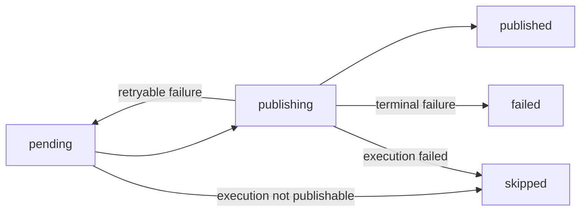
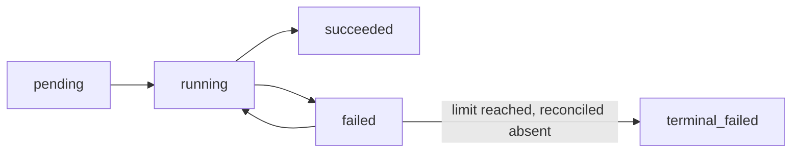

# Review Runs

[中文版](README.zh.md)

Review Runs is the review-run coordination service. It accepts review requests and durably coordinates their complete lifecycle across input preparation, execution, and result publication.

## Where it fits



- **GitHub integration** owns GitHub request parsing, input preparation, and GitHub side effects.
- **Review Run Coordination Service** owns admission, durable lifecycle state, recovery, execution observation, and publication coordination.
- **Execution API provider, Temporal, and workers** own workflow execution.
- **Langfuse** independently stores optional LLM observations; Review Runs reads them asynchronously to build statistics.

See the [system architecture](../docs/architecture/SYSTEM_ARCHITECTURE.md) for the complete data flow.

## What it does

- Admits a validated request and assigns its `run_id` before input preparation begins.
- Deduplicates replayed GitHub webhook and Actions ingress identities.
- Persists prepared Execution input before submitting it, so an uncertain submission can be recovered.
- Polls Execution API provider and records execution progress, terminal workflow results, and terminal artifact references.
- Makes successful terminal results claimable by the owning integration for GitHub publication.
- Persists publication steps so completed remote side effects are not repeated after restart.
- Reconciles terminal-run model-call totals from external Langfuse without changing execution or publication outcomes.
- Exposes redacted run queries, including the optional execution-statistics snapshot, for the Control Plane UI.

## Run lifecycle

A run begins in `pending` immediately after admission: on the Execution API provider axis its input has not been submitted yet. Preparation progress is tracked separately in `preparations`, whose own `preparing` state means a preparer currently owns the claim that fences input construction. GitHub integration prepares and uploads the input bundle, then submits the replayable Execution input under that claim. Review Runs records the input and moves the run to `queued` only after Execution API provider accepts it.

Review Runs polls `queued` and `running` runs. A successful Execution result is stored as `succeeded` and becomes eligible for publication. The integration claims that work, performs the GitHub side effects, and records either `published`, a retryable publication failure, or a terminal publication failure.

Re-admitting an already-observed ingress identity is a read-only replay: it returns the existing run and does not claim its preparation. Admission creates that row as `preparing`, which only the original admitter owns, so a process that died mid-preparation is recovered through lease expiry rather than by the replayed request. With the default claim timeout this means a replay can take up to ten minutes to make progress — long enough that a client must not treat "the request returned" as "the work resumed".

If Execution API provider submission may have succeeded but its response was lost, the run enters recovery instead of creating a second identity. Entering that state is not a failure and queues no notice: an unconfirmed submission may still be accepted on replay, so announcing it would state a conclusion the run may contradict — and a posted comment cannot be taken back. A replay that is accepted returns the run to normal progress; one the Execution API provider rejects, or one that produces no answer across the replay budget (`executions.attempt_count`, currently eight), fails the run, makes publication `skipped`, and only then queues the notice. Without that budget an unresolved submission would stay `uncertain` forever and would never be reported at all. A terminal preparation or Execution API provider failure makes publication `skipped`. A terminal failure on any axis creates connector-owned notice work, so a connector can tell its user even when the process that observed the failure had already crashed; the notice records which axis failed so the reply describes how far the run actually got.

## Persistence model

The run trunk and the three lifecycle axes are separate tables. `review_runs` holds only the admitted identity; each axis keeps its own state and its own input:

| Table                         | Responsibility                                                      | Status                                                                                        |
| ----------------------------- | ------------------------------------------------------------------- | --------------------------------------------------------------------------------------------- |
| `review_runs`                 | Admission identity shared by all axes (no update path)              | —                                                                                             |
| `preparations`                | Claimable input preparation                                         | `pending`, `preparing`, `uncertain`, `disconnected`, `submitted`, `failed`                    |
| `run_notices`                 | Connector-owned user-visible failure and attention work             | `pending`, `delivering`, `delivered`, `failed`                                                |
| `executions`                  | Execution API provider submission, observation, and terminal result | `pending`, `queued`, `running`, `uncertain`, `disconnected`, `succeeded`, `skipped`, `failed` |
| `publications`                | Whole-publication ownership and outcome                             | `pending`, `publishing`, `uncertain`, `disconnected`, `published`, `failed`, `skipped`        |
| `publication_steps`           | Recoverable individual connector side effects                       | `pending`, `running`, `uncertain`, `disconnected`, `succeeded`, `failed`, `terminal_failed`   |
| `execution_statistics`        | Statistics reconciliation state and run totals                      | `pending`, `reconciling`, `settled`, `unavailable`                                            |
| `execution_statistics_groups` | Workflow-coordinate/agent/provider/model call and token totals      | —                                                                                             |
| `review_run_events`           | Append-only audit log of transitions on every axis                  | —                                                                                             |

`preparations.status`:



`executions.status` / `execution.status`:



`publications.status`:



`publication_steps.status`:



The axes remain connected by three cross-axis triggers: a submitted preparation causes Execution input submission, a succeeded execution makes publication claimable, and claiming publication initializes its connector side effects. These are orchestration triggers, not status transitions within one table.

`publication_steps.attempt_count` is the step's retry budget, and attempts are the only unit that budget counts: an attempt is spent when it starts, so a publisher that dies mid-effect consumes one exactly like a failed attempt does. That count — not failures, not crashes, not elapsed time — is the single source of truth for whether another attempt is allowed. Nothing stores a separate failure total; the `failed` transitions on the step are what `failure_code`, `failure_message`, and the run's event log already record. `recovery_attempt_count` is deliberately a different budget: a reconciliation reads the remote system, which does not spend permission to repeat the write, so it never advances `attempt_count`.

Reaching the attempt limit does not fail a step. Any attempt that started may have completed its side effect on the remote system before its owner died or its response was lost, and Review Runs cannot see that system, so an exhausted step becomes a question for the connector instead of a verdict. The connector looks for the effect its own step would have produced — a run-specific branch, a review or comment marker — and reports what it found through `settleExhaustedPublicationStep`: the step becomes `succeeded` when the effect is there, and only a confirmation that it is absent makes the step `terminal_failed`. A reconciliation that could not be performed is not evidence of absence, so it propagates rather than concluding.

## Claims and recovery

### Claim leases

Preparation, submission recovery, publication, publication-step commits, and run notices use claim tokens to reject writes from stale owners. GitHub integration renews active preparation and publication claims. A lease expiry makes the work recoverable; it does not by itself establish whether the previous owner completed a remote operation.

### Automatic recovery

| Axis                 | Recovery behavior                                                                                                                   | Stops automatically when                                                                              |
| -------------------- | ----------------------------------------------------------------------------------------------------------------------------------- | ----------------------------------------------------------------------------------------------------- |
| Preparation          | An expired `preparing` row moves to `uncertain`. The next claim checks what the previous owner left behind before rebuilding input. | The retry budget is exhausted, or execution has already advanced beyond `pending`.                    |
| Execution submission | An unconfirmed submission moves to `uncertain` and is replayed under the same `run_id`.                                             | The replay budget is exhausted, producing `disconnected`.                                             |
| Publication          | A step whose remote outcome is unknown is reconciled against the connector.                                                         | Reconciliation cannot conclude within its budget, parking the step and publication as `disconnected`. |

Preparation retry exhaustion fails the run, skips publication, and queues a connector notice. A preparation whose execution already advanced becomes `disconnected` with `disconnect_reason=EXECUTION_ALREADY_ADVANCED`; later expiry passes leave it parked while continuing to process other runs. Execution and publication disconnections queue attention work because their remote outcomes remain unknown.

### Operator decisions

| Decision                               | Eligible run                                       | Result                                                                                                                                                                                                                                 |
| -------------------------------------- | -------------------------------------------------- | -------------------------------------------------------------------------------------------------------------------------------------------------------------------------------------------------------------------------------------- |
| `POST /v1/admin/runs/{run_id}/resume`  | A resumable disconnected axis                      | Preparation and execution return to `uncertain` with fresh recovery budgets. Publication returns to `pending`; disconnected steps return to `pending` with fresh attempt and reconciliation budgets. Succeeded steps remain unchanged. |
| `POST /v1/admin/runs/{run_id}/give-up` | Any disconnected axis                              | Stops waiting, concludes the disconnected axis as failed, and queues the applicable notice. It does not assert that the remote operation never happened.                                                                               |
| `POST /v1/admin/runs/{run_id}/abandon` | Preparation parked by `EXECUTION_ALREADY_ADVANCED` | Fails preparation with `EXECUTION_ALREADY_ADVANCED`, concludes any open downstream axes, skips publication, and preserves an already-recorded terminal execution result.                                                               |

These operations return 409 when the run is not eligible. They are not idempotent: after the first decision moves the axis, the same request no longer has a disconnected row to act on. Publication resume may issue an unfinished side effect again; every such decision is recorded in the event log.

### Replayable preparation

For automatic preparation recovery, a connector includes its versioned, opaque preparation input at admission. Review Runs persists that value and returns it only to the connector that owns the work. A connector without replayable input can prepare synchronously, but its expired work cannot be claimed by the recovery worker.

### Recovery identity and state

`run_id` is globally unique in PostgreSQL. `ingress_kind` and `ingress_key` provide connector-scoped ingress idempotency. `connector_id` fences reads, claims, publications, and publication steps. Durable-operation logs include both `connector_id` and `run_id`.

Temporal history, PostgreSQL coordination state, and object-storage artifacts are independent recovery inputs. A missing Execution API provider run does not imply publication success, and a remote side effect is complete only after its publication step records success.

## HTTP API

| Endpoint                                 | Authentication            | Purpose                                    |
| ---------------------------------------- | ------------------------- | ------------------------------------------ |
| `GET /healthz`                           | None                      | Process health                             |
| `GET /readyz`                            | None                      | PostgreSQL-backed coordination readiness   |
| `GET /v1/runs?...`                       | `REVIEW_RUNS_READ_TOKEN`  | Filtered, cursor-paginated run list        |
| `GET /v1/runs/:run_id`                   | `REVIEW_RUNS_READ_TOKEN`  | Redacted run detail                        |
| `GET /v1/runs/:run_id/publication-steps` | `REVIEW_RUNS_READ_TOKEN`  | Publication-step summary                   |
| `GET /v1/runs/parked`                    | `REVIEW_RUNS_READ_TOKEN`  | Runs coordination stopped retrying         |
| `POST /v1/admin/runs/:run_id/abandon`    | `REVIEW_RUNS_ADMIN_TOKEN` | Abandon a preparation parked by a conflict |
| `POST /v1/admin/runs/:run_id/give-up`    | `REVIEW_RUNS_ADMIN_TOKEN` | Stop waiting for one disconnected run      |
| `POST /v1/admin/runs/:run_id/resume`     | `REVIEW_RUNS_ADMIN_TOKEN` | Hand a disconnected axis to recovery       |

The write surface — admission, submission, preparation and publication claims and their terminal outcomes — is a set of REST routes whose request/response shapes, security, and error codes are the hand-written [openapi.yaml](../contracts/review-runs-api/v1/openapi.yaml) contract; that document is the single source of truth for the whole surface, not this table.

The contract is **enforced on requests**: routing, path/query/body validation, and authentication are all derived from it, so a request outside the document is rejected before a handler runs. Responses are _described_ by the contract but not validated against it at runtime — `fastify-openapi-glue` is request-only — so the declared response schemas are a promise the handlers keep, pinned by tests rather than by the framework. `review-runs/test/observed-run-contract.test.ts` validates the committed fixtures and the shapes `observeRun()` actually produces against the shared schemas, and `review-runs/test/server-http.test.ts` exercises the HTTP surface, which is what keeps a response from drifting outside its schema unnoticed.

Read responses omit `execution_input` and `publish_context`. They retain `source_platform` for stable platform aggregation and `connector_id` for the connector type and instance that owns the run. `execution_statistics` is `null` when no snapshot row exists; otherwise it projects the reconciliation state, observed totals, and grouped totals from the two relational statistics tables. A missing or incomplete snapshot is not zero usage. The UI BFF holds the read token; browser code receives neither Review Runs token nor Langfuse credentials.

The service token authenticates components coordinating a run; the read token authenticates redacted reads; a third, optional admin token authenticates the operator surface under `/v1/admin`. The three are deliberately not nested: holding the service token does not reach an admin route, and the admin token cannot admit runs or move a run through its normal lifecycle. `/v1/admin` exists only when `REVIEW_RUNS_ADMIN_TOKEN` is configured — otherwise the paths answer 404 rather than 401, so an unconfigured deployment does not advertise an operator surface at all. Reading the parked-run queue needs only the read token, because knowing a run is stuck is not privileged; only the decisions that conclude one are.

Read responses report three independent lifecycle axes as nested objects of the same shape: `preparation`, `execution`, and `publication`. Each carries its own `status`, `started_at`, `finished_at`, and `updated_at`. The preparation summary adds `attempt_count` and its terminal `failure_code`, but never its opaque input, claim token, or connector identity. `notices` contains messages that an integration should show when part of the run fails or needs attention. They are ordered from oldest to newest, and separate events remain separate entries.

`/healthz` only proves the HTTP process is alive. `/readyz` verifies that the current PostgreSQL pool can execute a schema-ledger query and that its complete version set exactly matches this application; it returns `503 {"status":"unavailable"}` without database details otherwise. Compose uses `/readyz` for its Review Runs healthcheck. Execution API provider and GitHub are deliberately excluded: their transient reachability does not make durable admission, reads, or PostgreSQL-backed recovery unsafe, and their failures have separate state-machine recovery paths.

## Configuration

| Variable                                      | Required                                             | Purpose                                                                                       |
| --------------------------------------------- | ---------------------------------------------------- | --------------------------------------------------------------------------------------------- |
| `DATABASE_URL`                                | Yes                                                  | PostgreSQL connection string                                                                  |
| `REVIEW_RUNS_READ_TOKEN`                      | Yes                                                  | Redacted read API; the console backend and any read-only consumer use this one                |
| `REVIEW_RUNS_SERVICE_TOKEN`                   | Yes                                                  | Component coordination (admission, claims, terminal outcomes); cannot reach `/v1/admin`       |
| `REVIEW_RUNS_ADMIN_TOKEN`                     | No                                                   | Operator authentication for `/v1/admin/*`; when unset the whole admin surface answers 404     |
| `EXECUTION_API_URL`                           | Yes                                                  | Execution API provider base URL                                                               |
| `EXECUTION_API_TOKEN`                         | For non-loopback or protected Execution API provider | Execution API provider authentication                                                         |
| `REVIEW_RUNS_PORT`                            | No                                                   | Listen port; default `8090`                                                                   |
| `CONNECTOR_ID`                                | No                                                   | Coordination namespace; default `github-integration:default`                                  |
| `AGENT_EXECUTION_BACKGROUND_POLL_INTERVAL_MS` | No                                                   | Coordinator interval; default `15000`                                                         |
| `EXECUTION_API_REQUEST_TIMEOUT_MS`            | No                                                   | Execution API provider request timeout; default `30000`                                       |
| `EXECUTION_API_REQUEST_RETRIES`               | No                                                   | Execution API provider transport retries; default `2`                                         |
| `EXECUTION_API_RETRY_BASE_DELAY_MS`           | No                                                   | Initial retry delay; default `500`                                                            |
| `LANGFUSE_BASE_URL`                           | No                                                   | External Langfuse URL; enables execution statistics when all three Langfuse variables are set |
| `LANGFUSE_PUBLIC_KEY`                         | With `LANGFUSE_BASE_URL`                             | Langfuse project public key                                                                   |
| `LANGFUSE_SECRET_KEY`                         | With `LANGFUSE_BASE_URL`                             | Langfuse project secret key                                                                   |
| `LANGFUSE_REQUEST_TIMEOUT_MS`                 | No                                                   | One Langfuse request timeout; default `30000`                                                 |
| `EXECUTION_STATISTICS_POLL_INTERVAL_MS`       | No                                                   | Statistics coordinator interval; default `15000`                                              |
| `EXECUTION_STATISTICS_MAX_ITEMS_PER_PASS`     | No                                                   | Maximum due runs reconciled per coordinator pass; default `20`                                |
| `EXECUTION_STATISTICS_INITIAL_DELAY_MS`       | No                                                   | Delay after execution completion before the first Langfuse read; default `30000`              |
| `EXECUTION_STATISTICS_CONFIRMATION_DELAY_MS`  | No                                                   | Delay before confirming that two snapshots match; default `30000`                             |
| `EXECUTION_STATISTICS_SETTLEMENT_WINDOW_MS`   | No                                                   | Maximum observation-settling window; default `600000`                                         |
| `EXECUTION_STATISTICS_MAX_FAILURES`           | No                                                   | Consecutive Langfuse read failures before marking statistics unavailable; default `8`         |
| `EXECUTION_STATISTICS_RETRY_DELAY_MS`         | No                                                   | Delay after a failed Langfuse read; default `30000`                                           |
| `EXECUTION_STATISTICS_CLAIM_TIMEOUT_MS`       | No                                                   | Lease timeout for a statistics reconciliation claim; default `600000`                         |

## Database schema

Schema files live in `src/database/schema-versions`. Applied versions and SHA-256 checksums are recorded in `schema_versions`. Startup uses a PostgreSQL advisory lock to serialize schema work and rejects a database whose recorded checksum differs from the checked-in file. The experimental deployment policy permits destructive schema resets.

Execution statistics use two relational tables: `execution_statistics` owns reconciliation state and run totals, while `execution_statistics_groups` stores totals by case, delivery, pass, draft batch, discovery chunk, agent, provider, and model. Call-level observations remain in external Langfuse. A snapshot is `settled` only after two matching reads that contain at least one review root; reaching the bounded window first produces `partial_window`, or `no_observations` when the whole window contains no review roots. Usage coverage applies only to calls returned by Langfuse and is not an upload-completeness claim.

Langfuse HTTP 429 responses defer the claimed run according to `Retry-After` (falling back to `EXECUTION_STATISTICS_RETRY_DELAY_MS`) without consuming the consecutive-failure budget. If that delay reaches the settlement deadline, reconciliation concludes as `unavailable` with failure code `LANGFUSE_RATE_LIMITED` instead of remaining pending indefinitely.

## Development

The service runs as an independent Node.js process on port `8090` by default. PostgreSQL credentials are provided only to Review Runs.

Use Node.js 24 and pnpm 12. Install dependencies and start the service from this directory:

```bash
pnpm install --frozen-lockfile
pnpm run server
```

Checks:

```bash
pnpm run format:check
pnpm run lint
pnpm run typecheck
pnpm test
pnpm run test:integration
```

The contract itself is linted (Spectral) and its projections are freshness-checked by the family tools under [`contracts/review-runs-api/tools`](../contracts/review-runs-api/tools/README.md).

`pnpm run test:integration` uses `TEST_DATABASE_URL` or `DATABASE_URL` when one is supplied; it must point to a disposable PostgreSQL database. Without either variable, the command starts a short-lived local Docker container from the PostgreSQL image declared in the repository-root `compose.yaml`, then removes it after the tests. Docker pulls that image when it is not local, so this fallback requires both Docker and registry access; set `TEST_POSTGRES_IMAGE` to use another image explicitly.
