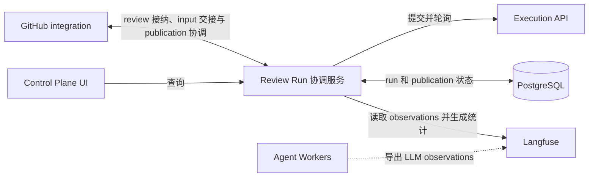
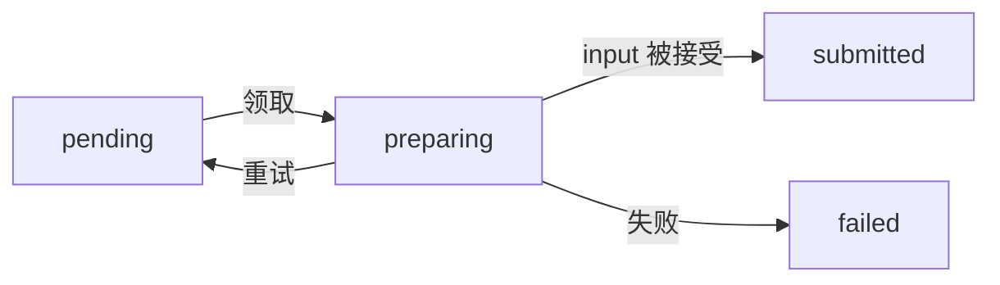
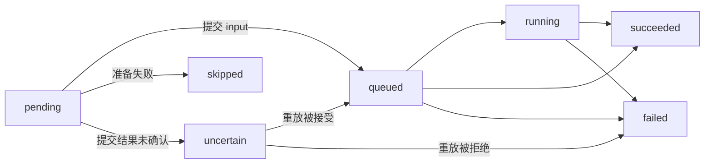
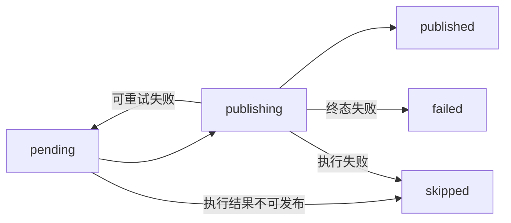
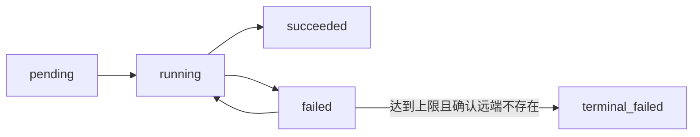

# Review Runs

[English](README.md) | 中文

本文是 [README.md](README.md) 的中文译文。英文版是权威版本；如果两者不一致，以英文版为准。

Review Runs 是 review run 协调服务。它接纳 review 请求，并持久协调输入准备、执行和结果发布的完整生命周期。

## 在系统中的位置



- **GitHub integration** 负责解析 GitHub 请求、准备 input 和执行 GitHub 副作用。
- **Review Run 协调服务** 负责接纳、持久生命周期状态、恢复、execution 观察和 publication 协调。
- **Execution API provider、Temporal 和 workers** 负责 workflow 执行。
- **Langfuse** 独立保存可选的 LLM observations；Review Runs 异步读取这些数据来生成统计。

完整数据流见[系统架构](../docs/architecture/SYSTEM_ARCHITECTURE.zh.md)。

## 功能

- 在 input 准备开始前接纳已校验请求并分配 `run_id`。
- 对重复送达的 GitHub webhook 和 Actions 入口身份进行去重。
- 在提交 Execution API provider 前持久化已准备的 Execution input，使状态不确定的提交可以恢复。
- 轮询 Execution API provider，并记录执行进度、终态 workflow result 和终态 artifact 引用。
- 让所属 integration 可以领取成功终态并执行 GitHub 发布。
- 持久化 publication step，避免进程重启后重复已完成的远程副作用。
- 从外部 Langfuse 协调终态 run 的模型调用总量，但不改变 execution 或 publication 结果。
- 为 Control Plane UI 提供脱敏的 run 查询，包括可选的 execution-statistics snapshot。

## Run 生命周期

Run 在接纳后立即进入 `pending`：在 Execution API provider 轴上表示其 input 尚未提交。准备进度单独记录在 `preparations` 中，其自身的 `preparing` 状态表示当前有 preparer 持有用于隔离 input 构造的 claim。GitHub integration 准备并上传 input bundle，再使用该 claim 提交可重放的 Execution input。Review Runs 记录 input，并且只在 Execution API provider 接受请求后将 run 转为 `queued`。

Review Runs 轮询 `queued` 和 `running` run。Execution API provider 成功后，Review Runs 将结果保存为 `succeeded`，使其可以被领取并发布。Integration 领取该工作，执行 GitHub 副作用，再记录 `published`、可重试的 publication 失败或终态 publication 失败。

重复接纳一个已经见过的 ingress 身份是一次只读重放：它返回既有的 run，不会去 claim 它的 preparation。接纳时创建的 preparation 行是 `preparing`，只由最初的接纳方持有，因此在中途崩溃的进程是靠租约过期恢复的，而不是靠重放请求。在默认 claim 超时下，这意味着一次重放最多要等十分钟才能推进——所以客户端不能把"请求返回了"当成"工作已继续"。

如果 Execution API provider submission 可能成功但响应丢失，run 会进入 recovery，而不是创建第二个身份。进入该状态不是失败，也不会创建 notice：未确认的提交仍可能在重放时被接受，此时宣告失败就是在陈述一个 run 可能推翻的结论——而已发布的评论无法撤回。被接受的重放会让 run 恢复正常推进；而被 Execution API provider 拒绝的重放，或在重放预算（`executions.attempt_count`，当前为八次）内始终得不到答复的重放，会让 run 失败、把 publication 标为 `skipped`，并只在那时才创建 notice。若没有这个预算，未解决的提交会永远停留在 `uncertain`，完全不会被报告。Preparation 或 Execution API provider 的终态失败会将 publication 标为 `skipped`。任一轴的终态失败都会创建 connector 所有的 notice work，因此即使观察到失败的进程已崩溃，connector 仍可告知用户；notice 会记录失败发生在哪一轴，回复便可说明 run 实际走到了哪一步。

## 持久化模型

run 主干和三条生命周期轴分别存放在不同的表中。`review_runs` 只保存被接纳的身份；每条轴各自保存自己的状态和输入：

| 表                  | 职责                                        | 状态                                                                                          |
| ------------------- | ------------------------------------------- | --------------------------------------------------------------------------------------------- |
| `review_runs`       | 所有轴共享的接纳身份（没有更新路径）        | —                                                                                             |
| `preparations`      | 可领取的 input preparation                  | `pending`、`preparing`、`uncertain`、`disconnected`、`submitted`、`failed`                    |
| `run_notices`       | connector 所有的用户可见失败与待确认通知    | `pending`、`delivering`、`delivered`、`failed`                                                |
| `executions`        | Execution API provider 提交、观察和终态结果 | `pending`、`queued`、`running`、`uncertain`、`disconnected`、`succeeded`、`skipped`、`failed` |
| `publications`      | 整体发布的所有权和结果                      | `pending`、`publishing`、`uncertain`、`disconnected`、`published`、`failed`、`skipped`        |
| `publication_steps` | 可恢复的单个 connector 副作用               | `pending`、`running`、`uncertain`、`disconnected`、`succeeded`、`failed`、`terminal_failed`   |
| `review_run_events` | 每条轴状态转换的只追加审计日志              | —                                                                                             |

`preparations.status`：



`executions.status` / `execution.status`：



`publications.status`：



`publication_steps.status`：



四条轴仍由三个跨轴触发关系连接：preparation 进入 `submitted` 后提交 Execution input，execution 进入 `succeeded` 后 publication 变为可领取，publication 被领取后初始化 connector 副作用。这些是 orchestration trigger，不是同一张表内的状态迁移。

`publication_steps.attempt_count` 就是该步骤的重试预算，而预算唯一计量的单位是「尝试」：一次尝试在被启动时就已消耗，因此中途死亡的 publisher 与一次失败的尝试消耗同样的额度。判断「还能不能再试一次」只以这个计数为准——不是失败次数，不是崩溃次数，也不是时间。系统不单独保存失败次数：步骤上的 `failed` 迁移本身，已经由 `failure_code`、`failure_message` 以及 run 的事件日志记录下来。`recovery_attempt_count` 则记录确认远端结果的失败次数：查询远端状态不会重复写入副作用，因此普通的远端结果确认不会推进 `attempt_count`。

达到尝试上限并不会让步骤直接失败。任何启动过的尝试，都可能在其所有者死亡或响应丢失之前已在远端系统完成了副作用，而 Review Runs 看不到那个系统，所以一个耗尽预算的步骤交给 connector 去查证，而不是直接下结论。connector 按自己这一步本应产生的效果去查找（run 专属分支、review 或 comment 的 marker），并通过 `settleExhaustedPublicationStep` 回报结果：找到效果则步骤变为 `succeeded`，只有确认效果不存在时步骤才进入 `terminal_failed`。无法查询或无法确认远端结果并不构成“不存在”的证据，因此错误会向上抛出，而不是被当作结论。

## Claim 和恢复

### Claim 租约

Preparation、submission recovery、publication、publication step 提交和 run notice 都使用 claim token 拒绝过期 owner 的写入。GitHub integration 会续租活跃的 preparation 和 publication claim。租约过期只会使工作进入可恢复状态，不能单独证明上一位 owner 是否完成了远端操作。

### 自动恢复

| 轴                   | 恢复行为                                                                                                    | 自动恢复停止条件                                                               |
| -------------------- | ----------------------------------------------------------------------------------------------------------- | ------------------------------------------------------------------------------ |
| Preparation          | 过期的 `preparing` 行进入 `uncertain`。下一次 claim 会先确认上一位 owner 留下的状态，再决定是否重建 input。 | 重试预算耗尽，或 execution 已离开 `pending`。                                  |
| Execution submission | 未确认的 submission 进入 `uncertain`，并在同一个 `run_id` 下重放。                                          | 重放预算耗尽，进入 `disconnected`。                                            |
| Publication          | 远端结果未知的 step 由 connector 查询并完成 reconciliation。                                                | Reconciliation 在预算内无法得出结论，step 和 publication 进入 `disconnected`。 |

Preparation 重试耗尽会使 run 失败、跳过 publication，并创建 connector notice。若 preparation 过期时 execution 已经推进，该 preparation 会以 `disconnect_reason=EXECUTION_ALREADY_ADVANCED` 进入 `disconnected`；后续过期处理会保留这条 parked row，并继续处理其他 run。Execution 和 publication 进入 disconnected 时会创建 attention work，因为它们的远端结果仍然未知。

### Operator 决策

| 决策                                   | 适用对象                                           | 结果                                                                                                                                                                                              |
| -------------------------------------- | -------------------------------------------------- | ------------------------------------------------------------------------------------------------------------------------------------------------------------------------------------------------- |
| `POST /v1/admin/runs/{run_id}/resume`  | 可以恢复的 disconnected 轴                         | Preparation 和 execution 回到 `uncertain` 并获得新的恢复预算。Publication 回到 `pending`；disconnected steps 回到 `pending`，并重置 attempt 和 reconciliation budget。已经成功的 steps 保持不变。 |
| `POST /v1/admin/runs/{run_id}/give-up` | 任意 disconnected 轴                               | 停止等待，将 disconnected 轴收敛为 failed，并创建相应 notice。该决定不表示远端操作从未发生。                                                                                                      |
| `POST /v1/admin/runs/{run_id}/abandon` | 因 `EXECUTION_ALREADY_ADVANCED` 停下的 preparation | 使用 `EXECUTION_ALREADY_ADVANCED` 使 preparation 失败，结束仍开放的下游轴，跳过 publication，并保留已经记录的终态 execution result。                                                              |

Run 不满足适用条件时，这些操作返回 409。它们不幂等：第一次决策移动该轴后，同一请求将找不到可处理的 disconnected row。Resume publication 可能再次执行尚未完成的远端副作用；每次决策都会写入 event log。

### 可重放 Preparation

若要自动恢复 preparation，connector 会在 admission 时提交版本化、opaque 的 preparation input。Review Runs 持久化该值，并只把它返回给拥有这项工作的 connector。没有提供可重放 input 的 connector 仍可同步 prepare，但其过期工作不能由 recovery worker 领取。

### 恢复身份与状态

`run_id` 在 PostgreSQL 中全局唯一。`ingress_kind` 和 `ingress_key` 提供 connector 范围的入口幂等。`connector_id` 隔离读取、claim、publication 和 publication step。持久化操作日志同时包含 `connector_id` 和 `run_id`。

Temporal history、PostgreSQL 协调状态和对象存储 artifact 是彼此独立的恢复输入。Execution API provider run 缺失不表示 publication 成功；远程副作用只有在 publication step 记录成功后才算完成。

## HTTP API

| Endpoint                                 | 认证                      | 用途                              |
| ---------------------------------------- | ------------------------- | --------------------------------- |
| `GET /healthz`                           | 无                        | 进程健康检查                      |
| `GET /readyz`                            | 无                        | PostgreSQL 支持的协调就绪检查     |
| `GET /v1/runs?...`                       | `REVIEW_RUNS_READ_TOKEN`  | 支持过滤和 cursor 分页的 run 列表 |
| `GET /v1/runs/:run_id`                   | `REVIEW_RUNS_READ_TOKEN`  | 脱敏的 run 详情                   |
| `GET /v1/runs/:run_id/publication-steps` | `REVIEW_RUNS_READ_TOKEN`  | Publication step 摘要             |
| `GET /v1/runs/parked`                    | `REVIEW_RUNS_READ_TOKEN`  | 协调已停止重试的 run 列表         |
| `POST /v1/admin/runs/:run_id/abandon`    | `REVIEW_RUNS_ADMIN_TOKEN` | 放弃因矛盾而停下的准备阶段        |
| `POST /v1/admin/runs/:run_id/give-up`    | `REVIEW_RUNS_ADMIN_TOKEN` | 不再等待一个 disconnected run     |
| `POST /v1/admin/runs/:run_id/resume`     | `REVIEW_RUNS_ADMIN_TOKEN` | 把 disconnected 轴交回自动恢复    |

写面——接纳、提交、准备与发布租约及其终态——是一组 REST 路由，其请求/响应形状、安全方案与错误码都来自手写的 [openapi.yaml](../contracts/review-runs-api/v1/openapi.yaml) 契约；那份文档才是整个面的单一事实来源，而不是这张表。

契约在**请求侧是强制执行的**：路由、path/query/body 校验与鉴权都由它派生，因此任何不符合该文档的请求都会在进入 handler 之前被拒绝。响应侧由契约**描述**，但运行时并不对其校验——`fastify-openapi-glue` 只处理请求——因此声明的响应 schema 是 handler 需要遵守的约定，由测试而非框架来固定。`review-runs/test/observed-run-contract.test.ts` 会用共享 schema 校验已提交的 fixtures 以及 `observeRun()` 实际产出的形状，`review-runs/test/server-http.test.ts` 则覆盖 HTTP 面，这正是防止响应在无人察觉的情况下偏离其 schema 的机制。

查询响应不包含 `execution_input` 和 `publish_context`。它们会保留 `source_platform`，用于稳定的平台聚合；也会保留 `connector_id`，用于标识拥有该 run 的 connector 类型与实例。UI BFF 持有 read token；浏览器代码不接收任何 Review Runs token。

service token 用于协调 run 的各个组件，read token 用于脱敏读取，第三个可选的 admin token 用于 `/v1/admin` 下的运维面。三者刻意不构成包含关系：持有 service token 无法访问 admin 路由，admin token 也不能接纳 run 或让 run 走正常生命周期。只有在配置了 `REVIEW_RUNS_ADMIN_TOKEN` 时 `/v1/admin` 才存在——否则这些路径返回 404 而不是 401，因此未配置的部署不会暴露任何运维面。查看 parked 队列（三轴合一的"停止重试"列表）只需要 read token，因为"知道某个 run 卡住了"并不属于特权；只有"决定放弃它、不再等待它、或把它交回自动恢复"才需要 admin token。

查询响应以形状一致的三组嵌套对象报告彼此独立的生命周期轴：`preparation`、`execution` 与 `publication`。每组各自带有 `status`、`started_at`、`finished_at` 与 `updated_at`。preparation 摘要额外给出 `attempt_count` 以及终态的 `failure_code`，但绝不包含其 opaque input 或 claim token。`notices` 包含 run 的某个环节失败或需要关注时应由集成展示给用户的消息。消息按产生时间从早到晚排列；同一 run 发生多次独立事件时会保留多条，不会合并。

`/healthz` 只证明 HTTP 进程仍存活。`/readyz` 会验证当前 PostgreSQL 连接池可以执行 schema ledger 查询，且 ledger 的完整版本集合与本应用完全一致；否则返回不含数据库细节的 `503 {"status":"unavailable"}`。Compose 将 `/readyz` 用作 Review Runs healthcheck。Execution API provider 与 GitHub 被有意排除：它们的瞬时不可达不会使 durable admission、读取或 PostgreSQL 支持的恢复变得不安全，其故障由各自的状态机恢复路径处理。

## 配置

| 变量                                          | 是否必需                                           | 用途                                                                     |
| --------------------------------------------- | -------------------------------------------------- | ------------------------------------------------------------------------ |
| `DATABASE_URL`                                | 是                                                 | PostgreSQL connection string                                             |
| `REVIEW_RUNS_READ_TOKEN`                      | 是                                                 | 脱敏读 API；控制台后端与任何只读消费方都用它                             |
| `REVIEW_RUNS_SERVICE_TOKEN`                   | 是                                                 | 组件协调（接纳、领取、终态）；无法访问 `/v1/admin`                       |
| `REVIEW_RUNS_ADMIN_TOKEN`                     | 否                                                 | `/v1/admin/*` 的运维认证；未配置时整个 admin 面返回 404                  |
| `EXECUTION_API_URL`                           | 是                                                 | Execution API provider base URL                                          |
| `EXECUTION_API_TOKEN`                         | 非 loopback 或受保护的 Execution API provider 必需 | Execution API provider 认证                                              |
| `REVIEW_RUNS_PORT`                            | 否                                                 | 监听端口；默认 `8090`                                                    |
| `CONNECTOR_ID`                                | 否                                                 | 协调 namespace；默认 `github-integration:default`                        |
| `AGENT_EXECUTION_BACKGROUND_POLL_INTERVAL_MS` | 否                                                 | Coordinator 间隔；默认 `15000`                                           |
| `EXECUTION_API_REQUEST_TIMEOUT_MS`            | 否                                                 | Execution API provider 请求超时；默认 `30000`                            |
| `EXECUTION_API_REQUEST_RETRIES`               | 否                                                 | Execution API provider transport 重试次数；默认 `2`                      |
| `EXECUTION_API_RETRY_BASE_DELAY_MS`           | 否                                                 | 初始重试延迟；默认 `500`                                                 |
| `LANGFUSE_BASE_URL`                           | 否                                                 | 外部 Langfuse URL；三个 Langfuse 变量全部配置时启用 execution statistics |
| `LANGFUSE_PUBLIC_KEY`                         | 与 `LANGFUSE_BASE_URL` 一起配置                    | Langfuse project public key                                              |
| `LANGFUSE_SECRET_KEY`                         | 与 `LANGFUSE_BASE_URL` 一起配置                    | Langfuse project secret key                                              |
| `LANGFUSE_REQUEST_TIMEOUT_MS`                 | 否                                                 | 单次 Langfuse 请求超时；默认 `30000`                                     |
| `EXECUTION_STATISTICS_POLL_INTERVAL_MS`       | 否                                                 | Statistics coordinator 间隔；默认 `15000`                                |
| `EXECUTION_STATISTICS_MAX_ITEMS_PER_PASS`     | 否                                                 | 每轮最多处理的到期 run 数；默认 `20`                                     |
| `EXECUTION_STATISTICS_INITIAL_DELAY_MS`       | 否                                                 | Execution 完成后首次读取 Langfuse 的延迟；默认 `30000`                   |
| `EXECUTION_STATISTICS_CONFIRMATION_DELAY_MS`  | 否                                                 | 两次 snapshot 稳定确认之间的延迟；默认 `30000`                           |
| `EXECUTION_STATISTICS_SETTLEMENT_WINDOW_MS`   | 否                                                 | Observation settling 总时间窗口；默认 `600000`                           |
| `EXECUTION_STATISTICS_MAX_FAILURES`           | 否                                                 | 连续 Langfuse 读取失败多少次后标记 unavailable；默认 `8`                 |
| `EXECUTION_STATISTICS_RETRY_DELAY_MS`         | 否                                                 | Langfuse 读取失败后的重试延迟；默认 `30000`                              |
| `EXECUTION_STATISTICS_CLAIM_TIMEOUT_MS`       | 否                                                 | Statistics reconciliation claim 超时；默认 `600000`                      |

## 数据库 schema

Schema 文件位于 `src/database/schema-versions`。已执行版本及 SHA-256 checksum 记录在 `schema_versions`。启动时使用 PostgreSQL advisory lock 串行执行 schema，并在数据库记录的 checksum 与当前文件不一致时拒绝启动。实验部署策略允许破坏性 schema reset。

Execution statistics 使用两张关系表：`execution_statistics` 保存 reconciliation 状态和 run totals，`execution_statistics_groups` 保存按 case、delivery、pass、draft batch、discovery chunk、agent、provider 和 model 聚合的 totals。逐 call observations 继续保留在外部 Langfuse。至少包含一个审查 root 的连续两次读取结果相同后，snapshot 才是 `settled`；先到达有界时间窗口则标记为 `partial_window`，如果整个窗口都没有审查 root，则标记为 `no_observations`。Usage coverage 只描述 Langfuse 返回的 calls，不证明所有真实模型调用都已上传。

Langfuse 返回 HTTP 429 时，已领取的 run 按 `Retry-After` 延期；缺少该响应头时使用 `EXECUTION_STATISTICS_RETRY_DELAY_MS`，且不会增加连续失败次数。如果这次延期已经到达 settlement deadline，reconciliation 会收敛为 `unavailable` 并记录 `LANGFUSE_RATE_LIMITED`，不会无限停留在 `pending`。

## 开发

服务作为独立 Node.js 进程运行，默认监听 `8090`。PostgreSQL 凭据只提供给 Review Runs。

使用 Node.js 24 和 pnpm 12。在本目录安装依赖并启动服务：

```bash
pnpm install --frozen-lockfile
pnpm run server
```

检查命令：

```bash
pnpm run format:check
pnpm run lint
pnpm run typecheck
pnpm test
pnpm run test:integration
```

契约本身由族工具（位于 [`contracts/review-runs-api/tools`](../contracts/review-runs-api/tools/README.md)）用 Spectral 检查，其投影也由该工具做新鲜度校验。

`pnpm run test:integration` 在提供 `TEST_DATABASE_URL` 或 `DATABASE_URL` 时使用该地址；它必须指向可清空的 PostgreSQL 数据库。两个变量都未提供时，该命令会用仓库根目录 `compose.yaml` 声明的 PostgreSQL 镜像启动一个短生命周期本地 Docker 容器，并在测试完成后删除。Docker 在本地缺少该镜像时会拉取，因此此回退方式要求 Docker 可用且能访问镜像仓库；可通过 `TEST_POSTGRES_IMAGE` 显式使用其他镜像。
